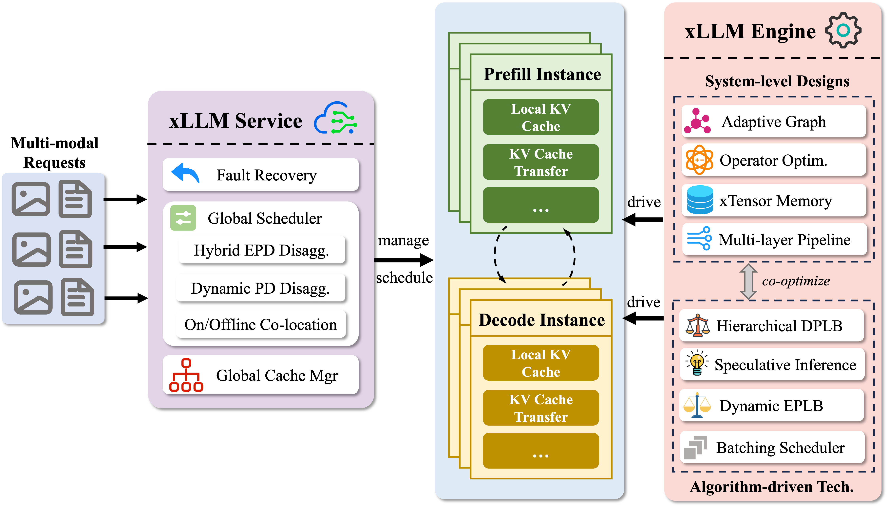

<!-- Copyright 2022 JD Co.

Licensed under the Apache License, Version 2.0 (the "License");
you may not use this project except in compliance with the License.
You may obtain a copy of the License at

    http://www.apache.org/licenses/LICENSE-2.0

Unless required by applicable law or agreed to in writing, software
distributed under the License is distributed on an "AS IS" BASIS,
WITHOUT WARRANTIES OR CONDITIONS OF ANY KIND, either express or implied.
See the License for the specific language governing permissions and
limitations under the License. -->

[English](./README.md) | [中文](./README_zh.md)

<div align="center">

    
[](https://docs.xllm-ai.com/) [](https://quay.io/repository/jd_xllm/xllm-ai?tab=tags) [](https://opensource.org/licenses/Apache-2.0) [](https://arxiv.org/abs/2510.14686) [](https://deepwiki.com/xLLM-AI/xllm)
    
</div>

---------------------


### 📢 新闻
<!-- only keep the latest 3 news, others should be folded -->
- 2026-08-27: 🎉  我们 day-0 支持了[GLM-5.3-Flash](https://modelscope.cn/models/ZhipuAI/GLM-5.3-Flash)模型的推理服务，部署请参考[部署文档](https://github.com/xLLM-AI/xllm/blob/preview/glm-5.3-flash/testspace/run_glm_53_flash.sh)。
- 2026-07-06: 🎉 xLLM 正式捐赠给开放原子开源基金会！
- 2026-06-13: 🎉 我们 day-0 支持了[MiniMax-M3](https://huggingface.co/MiniMaxAI/MiniMax-M3) 模型的推理服务，部署请参考[部署文档](https://github.com/xLLM-AI/xllm/blob/preview/minimax-m3/testspace/run_minimax_m3.sh)。


<details>
<summary>更多新闻</summary>

- 2026-04-24: 🎉  我们 day-0 支持了[DeepSeek-V4](https://huggingface.co/deepseek-ai/DeepSeek-V4-Flash) 模型的推理服务，部署请参考[部署文档](https://github.com/xLLM-AI/xllm/blob/preview/deepseek-v4-mlu/testspace/run_deepseek_v4.sh)。
- 2026-02-12: 🎉 我们 day-0 支持了最新的[GLM-5](https://github.com/zai-org/GLM-5) 模型的高效推理服务，部署请参考[部署文档](https://github.com/zai-org/GLM-5/blob/main/example/ascend.md)。
- 2025-12-21: 🎉 我们在第一时间内支持了[GLM-4.7](https://github.com/zai-org)模型的高效推理。
- 2025-12-08: 🎉 我们在第一时间内支持了[GLM-4.6V](https://github.com/zai-org/GLM-V)模型的高效推理。
- 2025-12-05: 🎉 我们支持了[GLM-4.5/GLM-4.6](https://github.com/zai-org/GLM-4.5/blob/main/README_zh.md)系列模型.
- 2025-12-05: 🎉 我们支持了[VLM-R1](https://github.com/om-ai-lab/VLM-R1) 模型.
- 2025-12-05: 🎉 我们基于[Mooncake](https://github.com/kvcache-ai/Mooncake)构建了混合 KV 缓存管理机制，支持具备智能卸载与预取能力的全局 KV 缓存管理。
- 2025-10-16: 🎉 我们最近在 arXiv 上发布了我们的 [xLLM 技术报告](https://arxiv.org/abs/2510.14686)，提供了全面的技术蓝图和实施见解。

</details>

## 简介

**xLLM** 是一个高效的开源大模型推理框架，专为**国产芯片**优化设计，提供企业级的服务部署，使得性能更高、成本更低。

<div align="center">

</div>

## 亮点

* **顶尖性能**：通过众多先进特性，提供高吞吐、低延迟的推理服务。
* **主流硬件支持**：专为国产AI加速卡打造并深度优化。
* **服务-引擎分离架构**：服务层负责调度与可用性，引擎层专注于计算。
* **企业级部署**：已在京东零售核心业务中大规模落地验证。

## 硬件支持

| 硬件类型           | 简称 | 型号   | 备注                |
| ------------------ | ---- | ------ | ------------------- |
| Ascend NPU         | NPU  | A2, A3 | HDK Driver 25.2.0 + |
| Cambricon MLU      | MLU  | MLU    |                     |
| Moore Threads GPU  | MUSA | S5000  |                     |
| Hygon DCU          | DCU  | BW1000 |                     |
| MetaX MACA         | MACA | MXC500 |                     |
| Iluvatar CoreX GPU | ILU  | BI150  |                     |

## 入门指南

* [快速开始](https://docs.xllm-ai.com/zh/getting_started/quick_start/)
* [启动xLLM](https://docs.xllm-ai.com/zh/getting_started/launch_xllm/)
* [在线服务](https://docs.xllm-ai.com/zh/getting_started/online_service/)
* [离线推理](https://docs.xllm-ai.com/zh/getting_started/offline_service/)
* [模型支持](https://docs.xllm-ai.com/zh/supported_models/)


## DP 请求路由策略

普通一体化推理的新请求使用缓存感知 DP 路由，仅保留原方案 B。
不再提供策略切换开关，也不再使用剩余 block 数或 KV 压力惩罚进行选路评分。
旧启动脚本需移除 `--dp_routing_policy`，JSON 配置也应移除同名字段。

每 DP 的 waiting/running 请求数由 scheduler 持有的 `DPRequestLoad` 在请求
绑定、入 batch、抢占、完成和取消时增量维护，不再为选路重复遍历请求队列。
可通过 `get_dp_request_load().waiting()` / `.running()` 获取计数；这些接口与
更新操作仅在调度线程使用，不提供跨线程快照。未绑定 DP 的全局等待请求仍不
计入 per-DP waiting，本次不改变请求绑定时机。

```text
load = waiting + running
```

请求数按请求去重，派发后立即记账，不迁移已绑定请求。

一体化推理的新请求选路不依赖 cache 类型，启用 Host Cache 或 KV Store 不会
禁用缓存感知选路，但只查询设备端命中。PD 以及新建的 beam/多 sequence 请求保留原放置方式。
现有准入、预算和分配检查保持不变。已经绑定 DP 或持有缓存资源的请求不重新
选路；Store 预取在进入调度队列前确定 DP，该归属保持不变，本次不调整预取时机。
因此开启 Store 不代表预取阶段也使用缓存感知选路。持有 Host block 不代表已入 batch。
首次登记显式记为 waiting，入 batch 和抢占分别通过状态事件切换 running/waiting，
不使用首次入 batch 时间或 block 持有情况推断当前执行状态。
使用 `waiting + running` 衡量负载。候选 DP 的最大/最小负载同时超过
绝对差阈值 `--dp_balance_abs_threshold=10` 和比例阈值
`--dp_balance_rel_threshold=1.5` 时，选择最低负载 DP；否则比较当前请求的
实际可复用前缀，最长命中占输入比例严格大于 `--dp_cache_threshold=0.5`
时选择缓存亲和 DP，命中不足或未启用 prefix cache 时选择最低负载 DP。
命中并列先按低负载，再轮转；最低负载并列轮转。

只读查询覆盖普通 KV、KV + LINEAR 和 SWA + 压缩/TOKEN cache，复用现有恢复
边界规则，不分配 blocks、不修改引用计数或 LRU，也不查询 Host/Store 命中收益。
原有固定归属、特殊请求与资源检查保持不变。

使用 `--v=1` 可查看 `[DPRouting]` 选择日志。历史 A/B 对照结果见
`docs/zh/cache_aware_dp_routing_results.md`。后续压力测试应同时比较 TTFT、
TPOT、吞吐、真实命中率和错误率，不能假设新策略必然降低 TTFT。

## 社区支持

<div align="center">
  
</div>


## 致谢
本项目的实现得益于以下开源项目: 

- [ScaleLLM](https://github.com/vectorch-ai/ScaleLLM) - 采用了ScaleLLM中构图方式和借鉴Runtime执行。
- [Mooncake](https://github.com/kvcache-ai/Mooncake) - 依赖构建了多级KV Cache管理机制。
- [brpc](https://github.com/apache/brpc) - 依赖brpc构建了高性能http service。
- [tokenizers-cpp](https://github.com/mlc-ai/tokenizers-cpp) - 依赖tokenizers-cpp构建了c++ tokenizer。
- [safetensors](https://github.com/huggingface/safetensors) - 依赖其c binding safetensors能力。
- [Partial JSON Parser](https://github.com/promplate/partial-json-parser) - xLLM的C++版本JSON解析器，参考Python与Go实现的设计思路。
- [concurrentqueue](https://github.com/cameron314/concurrentqueue) - 高性能无锁Queue.

感谢以下合作的高校实验室：

- [THU-MIG](https://ise.thss.tsinghua.edu.cn/mig/projects.html)（清华大学软件学院、北京信息科学与技术国家研究中心）
- USTC-Cloudlab（中国科学技术大学云计算实验室）
- [Beihang-HiPO](https://github.com/buaa-hipo)（北京航空航天大学HiPO研究组）
- PKU-DS-LAB（北京大学数据结构实验室）
- PKU-NetSys-LAB（北京大学网络系统实验室）
- [TJU-TANKLab](https://flashserve.org/) (天津大学TANK实验室)

感谢以下为xLLM作出贡献的[开发者](https://github.com/xLLM-AI/xllm/graphs/contributors)

<a href="https://github.com/xLLM-AI/xllm/graphs/contributors">
  
</a>


## 引用

如果你觉得这个仓库对你有帮助，欢迎引用我们：
```
@article{liu2025xllm,
  title={xLLM Technical Report},
  author={xLLM team},
  journal={arXiv preprint arXiv:2510.14686},
  year={2025}
}
```
