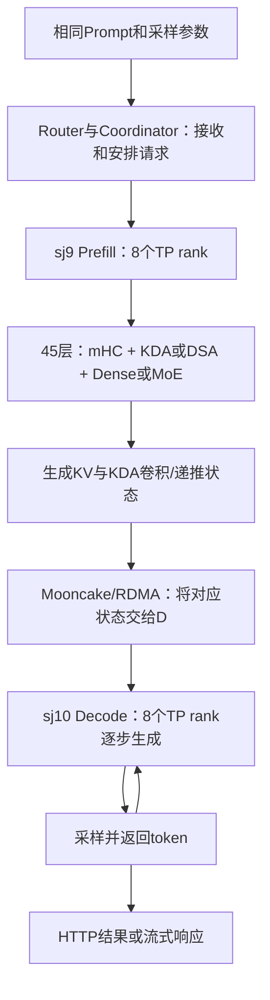

> 仓库发布版：文中本地上一级证据路径对应原始工作目录，公开摘要见provenance，运行/回归日志见raw_logs；MATE第三方实现源码未重新分发。

# 对 GLM-5.3-Flash 的模型结构适配说明

> 最新范围确认：用户已停止本轮剩余基线与两组性能测试。本轮归档65题初始本地响应、100题官方参考、0062/0065诊断及实现说明；后续先接入MegaMoE，再排查完整100题与长输入正确性，之后测速。

> 技术说明对应本文锁定的代码与已取得证据，先解释 MegaMoE 与计算精度两项决策，再逐层解释模型结构、适配、编译与限制。当前测试已按用户要求停止扩展，阶段数字见独立结果报告；完整本地100题和两组性能未完成，不宣布精度验收通过。

## 1. 本文对应的实现版本

- 源码：`https://github.com/fay85/xllm-musa/tree/xiaopang1104benchmark1P1D`。
- 提交：`30b7051ef1c840a9635794e6950f7507ee01b829`；本地源码位于上一级的 `开发仓库`。
- 运行方式：sj9 为 P、sj10 为 D，各 TP8；MoE EP=1，eager。
- MATE：运行环境 `0.2.8.post1`。当前已接入 KDA、RMSNorm、mHC pre 等接口，不代表所有模型模块都已经使用 MATE 的高性能实现。

## 2. 第一项决策：为什么没有立即接入 FP8 MegaMoE

### 2.1 模型 MoE 结构与 MegaMoE 实现不是同一个概念

GLM 当前仍执行路由专家和共享专家。源码 `xllm/python/models/glm5_next.py` 中，`_topk` 实现 sigmoid 路由、带 correction bias 的专家选择、top-8、归一化及 2.5 的缩放；`_forward_bf16_tp` 计算路由专家和共享专家，再执行 TP all-reduce。

实际 eager 专家分支 `Glm5NextExperts._forward_eager` 按命中的专家收集 token，调用 GPU 上的 `F.linear`，处理 SwiGLU 的 gate/up 限幅，再加权汇合。中间汇总使用 FP32，结果转换回 hidden_states 的 dtype。Python 控制专家循环不意味着矩阵乘法在 CPU 执行。

MATE MegaMoE 是另一套高性能专家计算及分发/汇合实现。当前没有接入它，不等于模型没有执行 MoE，也不等于 1P1D 必须依赖 EP 才能成立。当前 TP8/EP1 与准备评估的专家并行方案必须分别记录。

### 2.2 当时的取舍与责任边界

最初优先解决模型注册、KDA、mHC、权重加载、P/D 状态传递以及通信/退出可靠性，再建立可追溯的精度基线。这避免在没有基线时，同时改变模型结构适配、FP8 算子数值行为、专家分组和通信方式，使错误难以归因。

这是一项阶段性工程取舍，不是最终优化完成，也不代表无法接入。此前将“split-prefill 不支持 activation_clamp”作为阻碍的判断不准确，已经撤回：当前安装源码的 `fp8_fp8_mega_moe`、`_run_prefill_mega_moe` 及 stage1 调用已接收并传递该参数。接口可用与真实 GLM 组合已验证是两件事。不能要求 MATE 同事重新开发已经存在的接口。

证据：上一级 `证据/mate_installed_contracts_1604.json`；安装的 `mate/mega_moe.py` SHA256 为 `01dc1864722b6e4522663854c01f69ea9a40db4a8edce880173eb29dc294d840`。

### 2.3 真正待完成的集成工作

| 工作 | 要解决的具体问题 | 不正确时的表现 |
|---|---|---|
| 原始 FP8 专家权重与尺度 | 在专用转换入口前保留 FP8 和 block scale，核对 gate/up 顺序、矩阵转置、专家归属及 MATE 的布局要求 | 程序可能不崩溃，但专家输出错误 |
| EP 进程组和 token 分发 | 明确 attention TP 与 MoE 并行分组、rank 映射、各 rank 输入 token 的所有权及分发/汇合方式 | 重复计算、漏 token、通信不匹配或等待 |
| 路由专家与共享专家归约 | 核对 `output_is_reduced`；已经合并的 routed 输出不能再次求和，共享专家的分片或复制输出也须按正确方式处理 | 输出被重复放大，或共享专家贡献丢失 |
| GLM 特定数学语义 | 验证 sigmoid、选择用 bias、top8、归一化、scale2.5、clamp10 和共享专家 | 形状正确、输出却偏离参考 |
| 工作区与状态切换 | 按调度容量规划缓冲，验证 prefill→decode、不同 token 数及重复调用的生命周期 | 超容量、读取旧数据或性能异常 |

Sivan 的补充实现和回归可作为接入参考，但其已有测试不能替代本任务真实模型、实际依赖版本与双机部署的验证。应先复用现有接口，再依据可复现问题提出库侧需求。

## 3. 第二项决策：为什么 FP8 权重转成 BF16，而不是直接 FP8 计算

### 3.1 精度名称纠正

**当前是 BF16，不是 FP16。** BF16 和 FP16 都占 16 bit，但数值格式不同，不能互换名称。代码明确调用 `.to(torch.bfloat16)`。

还需区分三个层次：

| 层次 | 当前实际情况 |
|---|---|
| checkpoint 中的相关矩阵 | FP8 E4M3FN，配有 FP32 block scale |
| 加载后的相关模型参数与主要计算路径 | 反量化为 BF16 后放入 MUSA GPU；不是原生 FP8 专家 GEMM |
| 稳定性所需的局部中间量 | 部分操作显式采用 FP32，例如路由分数、专家汇总、KDA recurrent state；不能笼统写成每一个算术步骤都是 BF16 |

对 GPU 底层 GEMM 的累加模式，不应仅由输入 dtype 推断；本文所称 BF16 路径描述当前模型参数和主要计算接口，不宣称已逐个审计所有内核的累加类型。

### 3.2 具体如何转换，发生在哪里

新增的 `xllm/python/models/fp8_block_weight.py` 明确限定输入为 CPU checkpoint 张量，检查二维 E4M3FN 权重、FP32 尺度形状、有限值和非负尺度。默认 block 大小为 128×128。

核心计算为：

```text
W_bf16 = BF16(FP32(W_fp8) × 对应 block 的 scale)
```

字段名虽然叫 `weight_scale_inv`，但在这里按 checkpoint 契约作为乘法反量化尺度使用，不能仅看名称就执行除法。

`dequantize_fp8_block_shard_to_bf16` 先确定当前 TP rank 的切片。切片与量化 block 边界对齐时，只展开对应切片的权重和 scale；未对齐时显式选用完整展开再切片的加载路径，避免错误解释 scale。该行为发生在加载阶段，并不是推理遇到不支持算子时退回 CPU。

`glm5_next_weight.py` 的 `load_tensor` / `load_shard` 接入转换；`XLLM_MUSA_FP8_SHARD_BEFORE_DEQUANT` 控制先分片路径，缺少对应 scale 会报错。`glm5_next.py` 的专家加载逻辑以及 `layers/qlinear.py` 的加载接口把相关切片送入模型参数。后续专家矩阵计算在 MUSA GPU 执行。

### 3.3 为什么这样选择

当前已有的 BF16 模型计算语义可以作为初始参考，而原生 FP8 路径还需要解决专用权重布局、算子契约、激活量化以及专家并行/归约的集成验证。先把 checkpoint 转成 BF16，可在打通真实推理时减少这些同时变化的因素，集中检查模型结构与 P/D 状态传递。

这个选择不表示硬件或 MATE 没有 FP8 能力，不表示 FP8 本身导致错误，也不意味着未来使用 FP8 必须采用 EP。FP8 计算与专家并行是不同的设计维度；当前要接入的分布式 MegaMoE 方案需要同时处理相应契约。

### 3.4 代价与不能声称的结论

1. 对原本 FP8 的同一权重矩阵，BF16 数据本体每元素从 1 byte 变成 2 byte。整个服务显存还包括尺度、非量化参数、KV/状态、工作区与分配器，不能直接宣称整机显存精确翻倍。
2. 当前没有利用这套原生 FP8 专家计算实现，其显存带宽和计算收益尚未获得；实际速度差必须测，不能由位宽推断必然加速两倍。
3. 先分片再转换主要减少加载时不必要的展开与临时内存，不改变这一版本的 BF16 推理路径；没有实测不能把它直接归因为 TPOT 改善。
4. 反量化不会恢复 FP8 量化前已经丢失的信息。因此它不是原始未量化 BF16 checkpoint，也不能说理论上必然比官方服务更准确。
5. 当前与官方 API 同题同参数对分，可以验证这一实现的服务级结果；官方内部权重、量化和执行细节未完全公开，不能仅据答案差异就归因到 FP8、BF16 或某个算子。

## 4. 当前停止点与用户确认的后续顺序

本轮停止扩展，保留当前BF16 eager实现作为问题定位参考：官方100题93/100；本地已取得65个初始HTTP200响应，其中60题匹配标签、0065截断，另0031两次HTTP失败保留。0062同参数双方各三次复测完成，0065已有部分诊断。当前没有两组正式性能数字，不能写成完整100题验收完成或性能提升已验证。

**真正尚未完成的是原始 FP8 专家权重布局、EP 进程组、共享专家归约以及 GLM 语义回归的接入验证。** 这项工作是把当前能运行的BF16专家计算路径替换为MATE的FP8 MegaMoE路径，已有MATE算子与Sivan接入代码可参考，不需要从零开发整个MoE。属于跨权重加载、并行通信和模型算子的集成，工作量中等偏大；当前不能承诺工期或提前保证性能收益。

后续按用户最新指示推进，但本轮不实际执行：

1. **接入MegaMoE。** 保留原始FP8和scale，适配专用重排；明确当前TP8专家切片与专家分组/通信的衔接；正确区分已归约路由专家输出与共享专家贡献。不能重复求和，也不能漏算共享专家。
2. **先做算子与通信层数值回归。** 与独立参考逐层比较，覆盖gate/up顺序、scale、sigmoid路由、correction bias仅用于选择、top8、归一化、scale2.5、clamp10、prefill/decode切换及缓冲复用。错误可能不导致崩溃却改变答案，所以不能只看能否返回HTTP200。
3. **完整模型基础问答和固定10题试跑。** 先核对实际Prompt、low参数、最终答案边界、usage和结束原因，再扩大题量。
4. **重新完成本地固定MathQA100题。** 与官方保存的同题参考逐项比较，优先复现0062和0065，再排查其他差异。不能把当前65题拼接成新实现的100题；不能预设MegaMoE一定能修复这两个问题。必要时做参考框架/单机与PD/Token级数值定位。
5. **补充2048token输入、256token输出预算的固定题正确性对比。** 正确性检查允许正常EOS，记录实际生成长度，若预算内截断则标记无效；固定长度测速的ignore_eos另行使用，不能把强制凑满256token当作答案正确。
6. **正确性排查后才进行两组正式性能。** 256/256、2048/256，P/D各TP8，同参数、相同并发、预热与正式样本分离，报告TTFT/TPOT/吞吐，并在需要归因时采集trace。旧BF16结果不替代新FP8路径的精度或性能验证。

当时先用BF16的原因是先验证模型结构、KDA状态传递和1P1D通信，减少同时变化因素；不是因为没有执行路由专家/共享专家，也不是因为1P1D必须有EP。此前关于split-prefill不支持activation_clamp的判断已纠正，实际安装MATE已接收并传递该参数，真正欠缺的是我方集成与数值验证。

## 4A. 除MegaMoE之外，距离“完整适配”还缺什么

### 4A.1 先定义“符合官方模型推理机制”

要区分三个目标：①按模型配置、权重契约和可核对的参考实现，正确执行数学结构与状态更新；②具备所需的服务功能与部署能力；③采用高性能算子、精度和执行方式。MegaMoE、graph和融合算子主要属于实现/性能选择，不能把没用某个融合内核等同于没实现模型结构。

当前已有BF16 eager文本模型路径和真实1P1D结果，但65题服务对分不足以证明完整数学适配，单算子通过也不覆盖所有组合。官方API的具体权重版本、量化、隐藏系统处理、调度和内部推理实现未完全公开，不能承诺逐token与官方服务完全相同。完整验收应首先锁定可复现的模型配置/checkpoint/参考实现，再做逐层数值、状态语义和端到端验证；官方API作为独立任务级参考。

下面列的是**待验证、待补齐或待优化的范围，不是已证明这些模块都有错误**。未来应根据最小复现定位，不能因为0062/0065不一致就断言KDA、mHC或MoE必然算错。

### 4A.2 数学语义和状态：最高优先级的补充验证

| 模块/机制 | 当前已有内容 | 完整验收还要做什么 | 性质与相关文件 |
|---|---|---|---|
| KDA短卷积、gate与递推 | 短卷积为GPU Torch组合，核心chunk/decode为MATE；raw gate/beta只激活一次，FP32 V×K状态 | 在真实权重/形状下，与锁定参考比较投影→卷积→gate→状态→输出；覆盖chunk边界、长历史、多序列不同长度、槽位复用、COW和prefill/decode切换；发现不一致再修，不预设当前实现错误 | 语义/状态正确性；`attention/musa_glm_reference.py`、`kernels_musa/kda.py`、`models/glm5_next.py` |
| mHC与残差流 | MATE pre，GPU参考post，4流和最终HyperHead按模型代码执行 | 核对pre/post系数、Sinkhorn、组合矩阵方向、FP32累加/输出dtype、最终流合并；扩展真实激活和整层/全模型对照，而非只用pre的局部测试替代整模块验证 | 语义正确性；`kernels_musa/mate_ops.py`、`glm_reference.py`、`models/glm5_next.py` |
| DSA / NoPE MLA | 既有投影/权重吸收与GPU参考稀疏attention，BF16 latent cache | 比较吸收前后等价性、top-k位置、mask、cache写入/读取、跨页/长序列与chunk边界；当前短数学题没有覆盖全部长期状态行为 | 语义/缓存正确性；`models/glm5_next.py`、`attention/musa_glm_reference.py` |
| IndexPool/压缩tail | 沿用已有压缩与tail语义，补MUSA状态衔接 | 对齐pool=4时完整组与尾部、不满组、always_select_tail、长上下文和分页状态；确认每次选中的历史位置及更新与参考一致 | 语义/状态正确性；`models/glm5_next_kpool.py`、`glm5_next.py`及backend |
| Routed/Shared MoE | sigmoid+bias选择、top8、归一化×2.5、clamp10、shared贡献和TP归约均已执行 | 除MegaMoE接入本身，还要对完整MoE层的路由ID/权重、专家输出、shared输出、归约后结果逐项比较；不能只测GEMM或只看最终选项 | 语义与并行正确性；`models/glm5_next.py`；未来MegaMoE适配层 |
| 权重/量化与其他投影 | FP8 block scale按契约反量化，先分片再转换，BF16计算；普通Dense/Norm/LM head沿用模型 | 建立层级权重映射/shape/dtype/scale清单，验证TP切片、gate/up排列、Norm/gated norm、输出head；原生FP8激活/权重算子及其数值误差另验收。升为BF16不恢复量化前丢失信息 | 加载及数值契约；`fp8_block_weight.py`、`glm5_next_weight.py`、`layers/qlinear.py`、模型加载路径 |
| 1P1D全部状态交接 | 已修KDA CONV/SSM的TP分片描述，随机fixture与完整模型已运行 | 用真实权重对比单实例与P/D的同一请求，核对KV、SSM、conv、IndexPool tail及序列位置；覆盖长输入、多chunk、不同batch与槽位复用；需要时比较每层中间量或logits | 分布式状态正确性；`cache_layout_builder.cpp`、`py_executor_impl.cpp`与attention backend；不以单次传输success替代内容正确性 |
| Prompt与生成停止语义 | 固定模板和low参数，已有真实token逐项核对；按最终think边界评分 | 核对BOS/EOS、模板、思考边界、输出预算、temperature/top_p、停止原因与参考；0065的截断需区分题面问题、生成行为、数值差异与接口预算，不直接归因硬件 | tokenizer/采样/服务协议；模型模板、现有chat parser及采样路径；不是新增数学算子 |

上述优先级用于未来接入后的问题定位。本轮不再运行这些新测试。对单层误差的容忍度应依据dtype与运算性质制定，保留绝对/相对误差、余弦等原始指标；不能只挑宽松阈值宣布通过，也不能要求不同量化实现必须位级一致。

### 4A.3 服务功能与额外模型能力：按目标明确范围

- **结构化Tool Calling和reasoning输出字段**：当前部署工具输出仍在正文XML中，没有形成`message.tool_calls`；本地reasoning也依赖正文`</think>`分界。要完整支持这些服务协议，需要核对GLM模型类型对应的parser配置、映射和多轮工具返回处理，再跑工具协议回归。仓库已有GLM parser线索，不能据当前部署失败就声称项目完全没有解析器，更不意味着需要从零自建Agent框架。
- **MTP/投机解码**：当前明确未准入、未验证。它涉及draft/verify、接受token数以及KDA状态checkpoint/回滚；如果后续目标包含该加速能力，需要另做模型头、执行和状态管理适配。普通逐token自回归推理的正确性并不依赖开启MTP。
- **视觉/多模态、CP/DP/更广EP、prefix cache等**：本轮只验文本eager TP8，其他能力未验收。若“完整”指包含这些功能，需逐项明确范围和补充测试；不能把它们默认为已经支持，也不把它们全部当作本轮MathQA文本推理的必要前提。

### 4A.4 性能实现：尚未采用不等于数学结构缺失

| 方向 | 当前状态 | 后续适配涉及什么 |
|---|---|---|
| MATE sparse MLA / FP8 cache | 当前用BF16 cache + GPU参考attention | 要迁移缓存写入、量化scale、分页与P/D传输契约；或核对库是否提供匹配BF16缓存的接口。不是直接换函数名 |
| fused短卷积、sigmoid-gated norm、mHC post | 当前已有GPU组合实现 | 先核对MATE现有能力；缺口需给出通用数学/shape/dtype/state契约与最小数值测试，再提出库侧需求 |
| graph / 分段graph | 当前均未在GLM MUSA实现 | 稳定内存与元数据、消除capture中的动态host读取、处理状态槽位/collective/JIT和动态专家路由；详见第9节 |
| grouped GEMM、通信优化、custom-allreduce | 当前逐专家eager和MCCL TP | 基于正确性基线与trace选择，分别验证数值、通信顺序和性能，不预设一定加速 |

最终汇报应使用“已跑通受限的BF16 eager文本1P1D路径；完整数值一致性及若干功能/性能能力仍待验收”，而不是“只差一个MegaMoE，接完即完整”。

## 5. 实际模型结构与 1P1D 执行图

### 5.1 从正在运行的模型配置读取的参数

配置 SHA256：`bb8f01c42cb92a52ca72e65afb4d5bd8d11aef083cd210e8de25dfb904f23e9f`，摘录见上一级 `证据/glm_structure_and_log_scan.json`。

| 项目 | 配置及本轮含义 |
|---|---|
| 模型类型 | 顶层 glm5_next，文本 glm5_next_text；本轮只验证文本推理 |
| 层数与隐藏维度 | 45 层，hidden_size=4096 |
| Attention 组合 | 34 层 KDA；11 层 DSA/MLA，索引为 3/7/11/15/19/23/27/31/35/39/43；最后一层44是KDA |
| KDA | 64 heads，head_dim=128，short_conv_kernel_size=4，gate_lower_bound=-5 |
| DSA | 64 heads，q_lora_rank=1536，kv_lora_rank=512，qk_nope_head_dim=256，qk_rope_head_dim=0，v_head_dim=256 |
| FFN | 前3层 dense，intermediate_size=12288；其余42层为MoE |
| MoE | 288 routed + 1 shared，top8，intermediate_size=2048，scale=2.5，clamp=10；n_group=topk_group=1 |
| mHC | 4条残差流，20次Sinkhorn，hc_eps=1e-6；RMS epsilon=1e-5 |
| IndexPool | pool=4，压缩开启，始终选tail，index_topk=2048，32个index head，head_dim=128 |
| 配置声明的最大位置 | 1048576；这不代表本轮已经验证百万上下文或当前缓存容纳百万token |

TP8 下，每个 rank 的 KDA 与 DSA head 数都是 8。MoE EP1 时每个 rank 持有全部288个专家的 TP 切片，每个专家的 intermediate 切片宽度为256，而不是每卡持有36个完整专家。Dense intermediate 的 TP 切片宽度为1536。

### 5.2 从请求到结果的过程



P/D 之间的状态交接与每台内部的 TP 通信是两件事。当前每台内部使用 MCCL 的相应 collective；custom-allreduce 未启用。P/D 状态交接使用现有 Mooncake/RDMA 路径，本轮修正其所需的状态布局描述，没有自行重写 RDMA 库。

总共16张GPU组成 P(TP8)+D(TP8)，不能称为一个TP16实例。当前测试并发1；这验证请求链路与该负载下的性能，不证明系统最大吞吐容量。

## 6. 各种模型结构如何落到当前实现

### 6.1 KDA：核心递推用 MATE，状态管理和外围操作有我方适配

遇到的问题不是缺少整个 GLM 模型定义，而是共同分支的模型、Python executor、MUSA kernel 选择及 P/D 状态布局尚未构成可验证的完整链路。KDA 对张量布局、gate处理次数和历史状态都敏感，单独调用一个attention接口不足以解决问题。

主要文件：

- `xllm/python/models/glm5_next.py`：沿用已有KDA模型结构，修正配置解析，使真实模型的head数、维度、conv长度、KDA/DSA层列表和gate下界正确传入；不能用默认小模型值代替真实配置。
- `xllm/python/kernels_musa/kda.py::recurrent_kda`：本轮新增MATE适配入口。Q/K/V及raw gate、beta位于同一MUSA设备，要求head_dim=128；初始状态为FP32 `[sequence, head, value, key]`。
- `xllm/python/attention/musa_glm_reference.py::execute_linear`：本轮新增调度状态与模型计算的衔接，负责conv/SSM槽位、序列边界和输入状态有效性。

执行步骤是：已有模型完成QKV与gate/beta投影；适配层读取当前序列的卷积历史，使用GPU上的Torch张量操作完成短卷积与SiLU；将Q/K/V、raw gate/beta和FP32历史状态传给MATE；返回attention输出和更新状态，再写入调度器指定的槽位；模型继续完成门控归一化、输出投影与TP归约。

多token调用 `mate.kda.chunk_kda`，单token decode调用 `mate.kda.gated_delta_rule_decode`。适配层让MATE内部完成Q/K归一化及安全gate、beta sigmoid，避免外部做一次、内核又做一次。Decode指定 `state_v_first=True`、`inplace_final_state=False` 和FP32状态；不允许内核意外覆盖调用方仍需使用的历史快照。

当前卷积外围是我方GPU Torch组合实现，核心KDA递推是MATE；不能笼统说整个KDA都由我方新写，也不能说整个模块已经是一个MATE融合算子。模型原有批量投影等代码属于基线已有内容，不作为本轮新增优化成果。

### 6.2 KDA 状态槽位与 P/D 为什么必须改

卷积历史和SSM状态随每个TP rank的head切片变化。P rank0的状态不能代替其他rank的状态。`core/framework/kv_cache/cache_layout_builder.cpp` 的hybrid MLA分支需要把MUSA纳入CONV/SSM的TP分片处理，在通用MLA复制布局之前识别这些状态。

Python侧必须区分read slot和write slot，处理copy-on-write或槽位置换。当前适配先 `index_select(...).clone()` 保存所有待读状态，再更新写槽，避免先写一条序列破坏另一条尚未读取的历史。保留slot0、检查写槽唯一性；不接收会错误更新状态的padding行。每个slot只支持一个live SSM checkpoint，本轮不支持speculative verify的多checkpoint路径。

这属于正确性修复，不应记成性能优化。小模型单机TP8与跨机1P1D输出对照、状态布局测试和真实完整模型对分提供不同层面的证据，不能互相替代。

### 6.3 DSA / NoPE MLA：保留BF16 cache，使用GPU参考计算

当前真实配置的rope维度为0，因此本适配明确处理NoPE，不声称兼容其他RoPE配置。模型已有投影、权重吸收和IndexPool逻辑保留；`MusaGlmReferenceBackend.execute_mla` 衔接分页latent cache、选中位置、因果mask以及attention计算。

实现按序列、按查询小块组织GPU gather、FP32的QK/softmax/PV计算，再恢复输出dtype。索引、缓存和主体张量保持MUSA设备。Python循环、控制参数读取及动态gather可能产生调度/同步开销，所以它是用于打通正确性的eager实现，不能称为融合的高性能稀疏attention。

未直接换成MATE `sparse_mla_nope_decode`，因为该接口的缓存契约要求inline FP8 cache（512个E4M3数据+4个FP32尺度形成528byte行，另有兼容的656byte布局），当前cache是BF16。不能把BF16缓存直接传入并期待正确运行。要换用该路径，需要同步修改cache写入、量化尺度、分页布局和P/D传输描述并重做精度验证；本轮不做此替换。

### 6.4 IndexPool：沿用模型语义，补齐MUSA状态衔接

`glm5_next_kpool.py` 的主体逻辑是基线已有实现。本轮在 `glm5_next.py` 让MUSA使用已有压缩tail状态契约，并由新backend提供序列长度、当前查询位置、分页index历史和tail读写信息。

其中 `_uses_npu_compressed_tail` 的历史名称不意味着MUSA任务调用NPU算子。NPU融合更新入口仍受NPU可用性条件限制，当前MUSA使用Torch实现及框架状态契约。不要仅看函数名判断执行硬件。

### 6.5 mHC：MATE pre + 我方GPU post组合

4条残差流不能简单当成普通单残差加法。`kernels_musa/mate_ops.py::hc_pre_fused` 调用 `mate.hyperconnection.mhc_pre`，明确设置epsilon、20次Sinkhorn和post系数，并把MATE返回的 `(post, combination, collapsed)` 重排为xLLM所需的 `(collapsed, post, combination)`，同时去掉post的末尾单维。

`kernels_musa/glm_reference.py::hc_post` 是我方GPU Torch组合，按组合矩阵方向处理旧残差流和新hidden的贡献，使用FP32中间量再转换输出dtype。文件中也有参考pre实现，但实际导出的pre使用MATE，不能把参考函数误记为运行路径。

最终模型HyperHead合并残差流沿用已有结构，不与每层mHC post混淆。当前不是全部mHC操作均融合，也没有证据将缺少post融合断言为MATE绝对没有相关能力；后续需求应先核对库已有接口。

### 6.6 RMSNorm、sigmoid gate、投影、Dense与MoE

普通RMSNorm通过 `mate.norm.rmsnorm`，适配层展平token维，计算后恢复形状。GLM的另一处sigmoid-gated norm使用GPU Torch组合；不能拿SiLU融合接口直接替换sigmoid，因为两者方程不同。

批量矩阵乘封装 `batch_matmul_transpose` 使用GPU `torch.bmm`。Dense FFN和共享专家沿用模型的gate/up/down投影及clamp语义。MoE当前路径与未来MegaMoE的差别见第2节，不把基线已有的逐专家实现说成本轮新写的底层算子。

## 7. 按五个框架层次归类本轮改动

下表只描述本轮相对 `7005a557b577955407f619adf7871bbcff19cb34` 的改动，不把整个仓库所有功能算作我方贡献。

| 层次 | 文件与改动 | 问题与处理 |
|---|---|---|
| 服务层 server/API | `xllm/server/xllm_server.cpp`、`xllm/xllm.cpp` 增加Folly兼容初始化 | 防止Folly在bthread切换栈上执行不适合的空闲栈回收；没有重写HTTP、RPC、streaming或tool parser |
| 主控层 master/scheduler/request | `core/distributed_runtime/llm_master.cpp` 调整销毁顺序 | 在engine/scheduler析构前停止并join后台服务线程；本轮没有宣称重写调度或实现EP调度 |
| 执行层 engine/worker/runtime | `core/runtime/py_executor_impl.cpp`、`python/model_executor/executor.py`、`model_platform_support.py`、`models/model_registry.cpp`、`models/models.h` | 注册并准入GLM文本MUSA Python模型，重建所需attention metadata，选择新MUSA backend，明确拒绝未支持的graph/spec/并行组合 |
| 模型层 models/layers/kernels | `glm5_next.py`、`glm5_next_weight.py`、`fp8_block_weight.py`、`layers/qlinear.py`、`attention/musa_glm_reference.py`、`kernels_musa/*` | 配置解析、FP8离线载入、MATE包装、GPU参考attention/conv/mHC post/gated norm；模型主体结构多数沿用共同分支 |
| 后端层 platform/process_group | `python/distributed/collectives.py`、`python/__init__.py`、`core/framework/kv_cache/cache_layout_builder.cpp` | MUSA选MCCL而非其他设备通信后端；选MUSA kernels；修正TP分片的KDA状态描述；没有改驱动或MCCL库源码 |
| 跨层生命周期 | `core/runtime/xservice_client.h/.cpp`、`core/util/folly_bthread_compat.h`及CMake | 后台心跳/协调线程可唤醒退出并幂等join；Folly兼容初始化及测试注册 |

MUSA当前准入限定为文本、eager、单步decode、CP/DP/EP/DCP及layerwise split均为1。模型配置含有其他能力字段，不表示当前组合已支持那些能力。

## 8. 哪些由MATE完成，哪些由我方完成，是否回退CPU

| 部分 | 实现归属 | 运行位置 |
|---|---|---|
| KDA chunk/recurrent核心 | MATE；我方适配参数、形状和状态契约 | MUSA GPU |
| RMSNorm、mHC pre | MATE；我方适配维度与返回顺序 | MUSA GPU |
| KDA短卷积外围、mHC post、sigmoid-gated norm、NoPE sparse MLA参考运算 | 我方Torch组合与backend衔接 | 主体张量计算位于MUSA GPU |
| 模型投影、Dense、路由与逐专家计算、IndexPool主体 | 共同分支模型逻辑及TorchMUSA执行 | 主体张量计算位于MUSA GPU |
| FP8→BF16加载转换 | 我方显式CPU checkpoint转换 | 加载阶段CPU，随后复制到GPU；不是逐token CPU推理 |
| tokenizer、HTTP、调度和控制元数据 | 现有框架及适配控制逻辑 | CPU；`.tolist()`/`.item()`读取设备元数据可能产生同步 |
| 独立高精度oracle | 回归测试参考 | CPU FP64，仅测试时；不属于生产推理路径 |

本轮diff没有新增 `.cu`/`.mu` 底层设备kernel。新写的GPU Torch组合会调用已有设备算子，但不能称为我方开发了一个新的融合MUSA内核。

backend设有MUSA设备检查；已扫描本任务16个rank日志，未出现所检索的CPU fallback告警。但“日志没警告”不能证明所有Torch内部算子绝无任何隐式回退，完整判断需算子级profiling。可确认的是代码没有显式将主模型张量搬到CPU完成attention/MoE后再搬回的计算分支。

## 9. 为什么当前不开graph，分段graph是否已经完成

**当前没有实现或开启GLM的MUSA graph；也没有完成分段graph。** `executor.py` 和backend准入明确拒绝这一组合。仓库有native `musa_graph_executor_impl.cpp` 与 `core/kernels/musa/piecewise_graphs.*` 基础设施，不等于它们自动覆盖当前Python GLM路径。

主要难点：

1. 当前attention/backend与专家路由存在 `.tolist()`、`.item()`、`nonzero`、动态循环和动态数量的gather，捕获时与重放时不能简单复用同一份host决策。
2. KDA状态槽位随请求变化，prefix/COW的read/write不同；padding和warmup不能修改真实历史状态，更不能把保留slot0当真实槽使用。
3. 中间张量的cat/clone/gather等分配需要稳定地址和生命周期；替换为按token批量gather全部专家权重又可能扩大显存，不能只为可捕获而忽略内存代价。
4. MATE首次JIT、工作区与stream处理要在捕获前准备好，并验证replay语义；当前每卡可用余量有限。
5. TP8各rank的collective顺序、stream和重放需要一致；MCCL/custom-allreduce的graph兼容需实证。
6. HTTP、调度与P/D状态交接有独立生命周期；通常把它们留在模型计算graph之外，并用正确事件/流依赖衔接，不能把整个服务请求简单视为一个graph。

后续可以先研究固定形状段（归一化、投影、FFN等）与动态边界分离，然后逐步减少边界，但这是未来设计路线，不是已取得效果。潜在文件包括现有backend的metadata准备、Python executor/runner，以及MUSA捕获/内存机制；必要时新增MUSA decode runner。哪些需要MATE改进必须先核对已有indexed-state、工作区和图支持接口，再用最小复现提需求。

候选库侧需求包括适合当前语义的mHC post、独立sigmoid gate融合、状态索引短卷积、BF16 NoPE cache或FP8 cache迁移支持、真实GLM形状MegaMoE图回归。上述是需确认的方向，不等于已经证明MATE缺失这些功能。本轮均不实施。

## 10. 为什么不只是修改Python，重新编译究竟做了什么

本轮同时修改Python与C++。Python文件随运行源码加载，但模型注册、metadata、缓存布局、Folly及生命周期等native改动需要重新编译xllm。

使用1102-dev镜像的工具链与已有源码/依赖缓存，编译本轮分支。v3曾暴露混合对象文件ABI问题：类布局变化后，不同翻译单元仍使用旧偏移（0x2/0x88）。v4针对依赖的native对象重新构建，并增加跨翻译单元生命周期检查；不是仅复制Python脚本继续运行旧二进制。

当前worker `xllm_glm_v4` SHA256为 `6b152a270bd30755ecf9788097f0395af1682a5234d9e3e7f3285c744df0b609`。构建时MATE0.2.7，GPU运行时MATE0.2.8.post1、TileLang0.1.12+musa.5；两台镜像由同组输入分别构建，镜像ID不同，不声称bit-identical。完整清单见上一级 `源码与编译产物清单.json`。

控制服务 `xllm_master_serving` 是1102-dev镜像已有预编译产物，本轮未重编，其SHA256为 `5ade8b09391c7fced1f286ef83d4f078d668c3e83b4f21f6b3ebeae724c45ee5`。日志里嵌入的engine build ID不能误当成当前worker提交。控制服务源码与构建细节没有全部掌握，不能声称全栈已从源码完全可复现。

## 11. 现有验证及其覆盖边界

- MATE KDA：5例，长度1/17/65/129/257；独立递推参考、输入状态未被修改、分段与单token延续检查。
- RMSNorm与mHC pre：合计5例；RMS宽度128/512/4096，mHC真实hidden4096、token1/17。
- Folly 3例；缓存布局23例；FP8加载10例；生命周期/ABI 5例。
- Python模型集合首次347通过、115跳过、1失败；修复夹具后失败项单独复测1通过，未重新跑全套，不能写成一次348全绿。
- 随机小模型：单机TP8与跨机1P1D在4/17/129输入的输出一致，16个rank正常退出。
- 完整模型：三道基础问答成功；MathQA停在65个本地初始HTTP200响应，性能未执行，详见阶段结果报告。

回归测试证明各自覆盖的契约，不能替代真实长上下文、所有batch、EP、MTP、VL或graph的全面验收。当前未接入能力留作未来待办，不能计作本轮成果。

## 12. 改动清单与追溯方法

本轮相对基线共34个文件、1600行新增、37行删除；其中24个生产文件、10个测试/测试构建文件。下列清单由Git diff生成，源码身份与归档哈希见总清单。文件内定义了某个函数，不等于当前运行时一定选择该分支，需结合第6～9节的实际dispatch判断。

- [`tests/core/framework/kv_cache/CMakeLists.txt`](https://github.com/fay85/xllm-musa/blob/30b7051ef1c840a9635794e6950f7507ee01b829/tests/core/framework/kv_cache/CMakeLists.txt)
- [`tests/core/framework/kv_cache/cache_layout_builder_hybrid_mla_test.cpp`](https://github.com/fay85/xllm-musa/blob/30b7051ef1c840a9635794e6950f7507ee01b829/tests/core/framework/kv_cache/cache_layout_builder_hybrid_mla_test.cpp)
- [`tests/core/runtime/xservice_client_lifecycle_test.cpp`](https://github.com/fay85/xllm-musa/blob/30b7051ef1c840a9635794e6950f7507ee01b829/tests/core/runtime/xservice_client_lifecycle_test.cpp)
- [`tests/core/scheduler/CMakeLists.txt`](https://github.com/fay85/xllm-musa/blob/30b7051ef1c840a9635794e6950f7507ee01b829/tests/core/scheduler/CMakeLists.txt)
- [`tests/core/util/CMakeLists.txt`](https://github.com/fay85/xllm-musa/blob/30b7051ef1c840a9635794e6950f7507ee01b829/tests/core/util/CMakeLists.txt)
- [`tests/core/util/folly_bthread_compat_test.cpp`](https://github.com/fay85/xllm-musa/blob/30b7051ef1c840a9635794e6950f7507ee01b829/tests/core/util/folly_bthread_compat_test.cpp)
- [`tests/musa/test_glm_kda.py`](https://github.com/fay85/xllm-musa/blob/30b7051ef1c840a9635794e6950f7507ee01b829/tests/musa/test_glm_kda.py)
- [`tests/musa/test_glm_mate_primitives.py`](https://github.com/fay85/xllm-musa/blob/30b7051ef1c840a9635794e6950f7507ee01b829/tests/musa/test_glm_mate_primitives.py)
- [`tests/python/conftest.py`](https://github.com/fay85/xllm-musa/blob/30b7051ef1c840a9635794e6950f7507ee01b829/tests/python/conftest.py)
- [`tests/python/test_fp8_block_weight.py`](https://github.com/fay85/xllm-musa/blob/30b7051ef1c840a9635794e6950f7507ee01b829/tests/python/test_fp8_block_weight.py)
- [`xllm/core/distributed_runtime/llm_master.cpp`](https://github.com/fay85/xllm-musa/blob/30b7051ef1c840a9635794e6950f7507ee01b829/xllm/core/distributed_runtime/llm_master.cpp)
- [`xllm/core/framework/kv_cache/cache_layout_builder.cpp`](https://github.com/fay85/xllm-musa/blob/30b7051ef1c840a9635794e6950f7507ee01b829/xllm/core/framework/kv_cache/cache_layout_builder.cpp)
- [`xllm/core/runtime/py_executor_impl.cpp`](https://github.com/fay85/xllm-musa/blob/30b7051ef1c840a9635794e6950f7507ee01b829/xllm/core/runtime/py_executor_impl.cpp)
- [`xllm/core/runtime/xservice_client.cpp`](https://github.com/fay85/xllm-musa/blob/30b7051ef1c840a9635794e6950f7507ee01b829/xllm/core/runtime/xservice_client.cpp)
- [`xllm/core/runtime/xservice_client.h`](https://github.com/fay85/xllm-musa/blob/30b7051ef1c840a9635794e6950f7507ee01b829/xllm/core/runtime/xservice_client.h)
- [`xllm/core/util/CMakeLists.txt`](https://github.com/fay85/xllm-musa/blob/30b7051ef1c840a9635794e6950f7507ee01b829/xllm/core/util/CMakeLists.txt)
- [`xllm/core/util/folly_bthread_compat.h`](https://github.com/fay85/xllm-musa/blob/30b7051ef1c840a9635794e6950f7507ee01b829/xllm/core/util/folly_bthread_compat.h)
- [`xllm/models/model_registry.cpp`](https://github.com/fay85/xllm-musa/blob/30b7051ef1c840a9635794e6950f7507ee01b829/xllm/models/model_registry.cpp)
- [`xllm/models/models.h`](https://github.com/fay85/xllm-musa/blob/30b7051ef1c840a9635794e6950f7507ee01b829/xllm/models/models.h)
- [`xllm/python/__init__.py`](https://github.com/fay85/xllm-musa/blob/30b7051ef1c840a9635794e6950f7507ee01b829/xllm/python/__init__.py)
- [`xllm/python/attention/musa_glm_reference.py`](https://github.com/fay85/xllm-musa/blob/30b7051ef1c840a9635794e6950f7507ee01b829/xllm/python/attention/musa_glm_reference.py)
- [`xllm/python/distributed/collectives.py`](https://github.com/fay85/xllm-musa/blob/30b7051ef1c840a9635794e6950f7507ee01b829/xllm/python/distributed/collectives.py)
- [`xllm/python/kernels_musa/__init__.py`](https://github.com/fay85/xllm-musa/blob/30b7051ef1c840a9635794e6950f7507ee01b829/xllm/python/kernels_musa/__init__.py)
- [`xllm/python/kernels_musa/glm_reference.py`](https://github.com/fay85/xllm-musa/blob/30b7051ef1c840a9635794e6950f7507ee01b829/xllm/python/kernels_musa/glm_reference.py)
- [`xllm/python/kernels_musa/kda.py`](https://github.com/fay85/xllm-musa/blob/30b7051ef1c840a9635794e6950f7507ee01b829/xllm/python/kernels_musa/kda.py)
- [`xllm/python/kernels_musa/mate_ops.py`](https://github.com/fay85/xllm-musa/blob/30b7051ef1c840a9635794e6950f7507ee01b829/xllm/python/kernels_musa/mate_ops.py)
- [`xllm/python/layers/qlinear.py`](https://github.com/fay85/xllm-musa/blob/30b7051ef1c840a9635794e6950f7507ee01b829/xllm/python/layers/qlinear.py)
- [`xllm/python/model_executor/executor.py`](https://github.com/fay85/xllm-musa/blob/30b7051ef1c840a9635794e6950f7507ee01b829/xllm/python/model_executor/executor.py)
- [`xllm/python/model_platform_support.py`](https://github.com/fay85/xllm-musa/blob/30b7051ef1c840a9635794e6950f7507ee01b829/xllm/python/model_platform_support.py)
- [`xllm/python/models/fp8_block_weight.py`](https://github.com/fay85/xllm-musa/blob/30b7051ef1c840a9635794e6950f7507ee01b829/xllm/python/models/fp8_block_weight.py)
- [`xllm/python/models/glm5_next.py`](https://github.com/fay85/xllm-musa/blob/30b7051ef1c840a9635794e6950f7507ee01b829/xllm/python/models/glm5_next.py)
- [`xllm/python/models/glm5_next_weight.py`](https://github.com/fay85/xllm-musa/blob/30b7051ef1c840a9635794e6950f7507ee01b829/xllm/python/models/glm5_next_weight.py)
- [`xllm/server/xllm_server.cpp`](https://github.com/fay85/xllm-musa/blob/30b7051ef1c840a9635794e6950f7507ee01b829/xllm/server/xllm_server.cpp)
- [`xllm/xllm.cpp`](https://github.com/fay85/xllm-musa/blob/30b7051ef1c840a9635794e6950f7507ee01b829/xllm/xllm.cpp)
