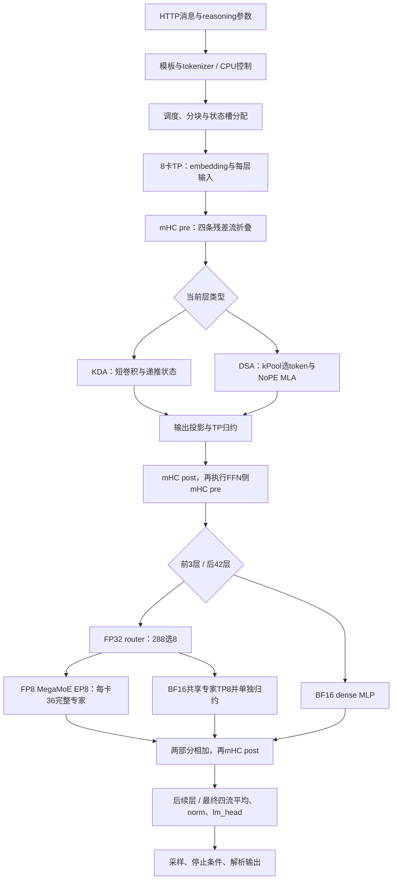
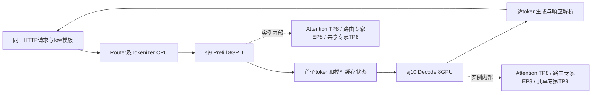
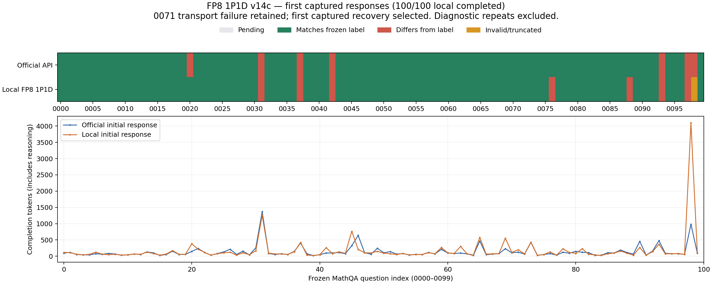
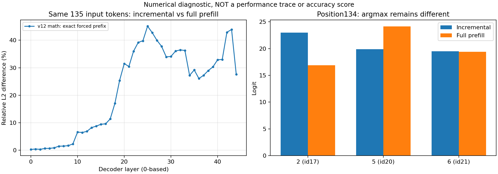

# GLM-5.3-Flash：FP8 MegaMoE 接入、正确性与双机验收

> 2026-11-05最终实验结果：真实1P1D固定100题与两组正式性能已完成。P/D各8GPU；按用户最新指示保留精度问题，不再追加分歧题复测或抓trace；不宣称所有数值问题已经解决。

首先阅读[当前接入状态、0062/0065与数值边界](当前接入状态_0062与0065及数值边界.md)，其中逐项回答哪些模块接到MATE、哪些仍为我方GPU实现及未接入原因。

阅读顺序：先看当前实现和结果，再看各模块与改动文件；需要复盘失败命令、版本取舍和张量图时，查[历史实验与诊断过程](历史实验与诊断过程_截至1105上午.md)。[实时逐题汇总](accuracy/full_pd_fp8_v14c/summary_progress.json)与[逐题CSV](accuracy/full_pd_fp8_v14c/逐题对照.csv)记录真实完成数量，重复请求不加入主分母。

## 1. 目标、基线与提交位置

本轮从已有 BF16 专家路径继续：接入 FP8 MegaMoE，补齐或验证文本推理所需的其他机制，再进行算子与通信回归、基础问答/10题、固定100题覆盖和2048/256检查，最后才进行两组正式性能测试。

共同仓库为 [fay85/xllm-musa](https://github.com/fay85/xllm-musa/tree/xiaopang1104benchmark1P1D)，分支为 `xiaopang1104benchmark1P1D`。本轮最终提交到这个既有个人分支，不推个人 fork，不创建 MR/PR。起点提交 `d2f5bda912de17ba6e90f62fd6dfc0eac5e59d3f`；该点包含前轮报告，前轮主体实现为 `30b7051e`。本报告随本轮最终提交保存；确切提交ID以Git历史及本地/NFS的《提交结果.md》为准，避免将上一轮提交冒充本轮结果。

本地继续使用相邻1104目录中的 `开发仓库`；新证据与报告存本目录。NFS根目录为 `/data/nfs_shared/xiaopang/20261105_glm53_full_adaptation`，内含 `source/`、`tools/`、`artifacts/`、`logs/`、`records/`。各版本源文件逐一SHA256单独保存；当前运行清单为 `records/source_manifest_v14c.json`，源码 `source_v14c/xllm-musa`。v4等历史清单保留，不把不同版本混为同一实现。

## 2. 这次替换的到底是什么

模型的MoE结构一直参与推理，并非此前跳过专家。旧路径把checkpoint中的FP8矩阵反量化为BF16，按TP8分片运行专家。本轮保留路由专家的原始E4M3字节和128×128 block scale，按EP8分配每卡36个完整专家，调用MATE进行FP8专家计算。输入激活按128元素分组动态量化为FP8，结果输出BF16。

Attention仍为TP8；共享专家仍按TP8切片、以BF16计算；MoE内部路由专家为EP8、MoE-TP1。单机TP/EP与两机1P1D是不同维度；本轮当前真实服务已是双机1P1D，早期单实例实验仍单独记录。非专家投影目前仍沿用BF16路径，本轮不能笼统称为“全模型全FP8”。

GLM语义保留：sigmoid路由；correction bias只影响选择；top-8；选中原始分数归一化后乘2.5；SwiGLU上界/区间clamp=10；路由和共享两部分均参与输出。

## 3. 接入的四项核心工作

| 工作 | 具体实现 | 为什么不能只替换函数名 |
|---|---|---|
| 原始FP8权重与scale | `glm5_next_weight.py::load_raw_fp8`检查dtype、shape、有限非负scale；`qlinear.py`转发；模型loader按专家编号装载gate/up/down | 旧路径已转成BF16；FP8字节与scale必须成对保留，gate/up顺序不能交换 |
| 布局与专家归属 | `glm5_next.py::_load_experts_musa_fp8`按EP分配完整专家，适配已有公开checkpoint键别名；`kernels_musa/mega_moe.py`调用MATE权重重排 | 旧TP分片是每卡拥有所有专家的一部分；EP分片是每卡拥有一部分完整专家，两者不能混用 |
| 工作区与通信 | 模型各MoE层顺序复用一个IPC工作区；Gloo只做CPU IPC元数据交换及同步，专家主计算在MUSA | 不能给42层各分配重复大工作区，也不能把CPU元数据通信说成CPU模型推理 |
| 路由与共享归约 | MATE返回完整路由结果；共享专家局部输出另做TP all-reduce，再相加 | 对完整路由结果再次求和会放大输出；共享专家漏归约则丢失贡献，均可能不崩溃却答错 |

权重重排在CPU进行，是一次性离线字节/布局变换，没有把专家GEMM搬到CPU。新增的是模型、权重和通信的适配代码，底层FP8矩阵内核由MATE提供，不是我方从零开发一套MegaMoE。

## 4. MATE契约与发现的问题

参考材料为Sivan提供的内部vLLM commit `c84fd47a90e60989a8102f0043e4b3e97905b63d`和MR144。已核对MR144当前缓存/远端头为`43e255441096eaed39c7943cb134d9068224ea59`，并对照实际安装的MATE `0.2.8.post1`，没有只根据旧接口印象判断支持范围。

此前“split-prefill不支持activation_clamp”的说法不准确，已再次确认split-prefill接收并传给实现。本轮发现的是另一个具体问题：当前decode包装函数虽然接收activation_clamp，却未继续传给decode内核。小形状decode还出现过较大数值偏差，异常行与选中某个专家相关；现有证据不足以断言根因。

为先保留GLM数学语义，当前显式把小token输入补到129行，padding路由ID为-1、路由权重为0，从而选择MATE已支持clamp的split-prefill实现；只返回真实token行。每次调用前后还采用MUSA同步与跨rank barrier，避免IPC写入/读取或工作区复用竞争。这是已通过当前回归的正确性方案，不是已证明最快的实现。

额外问题与处理：

- MUSA SDK 5.1的CCCL扩展类型在JIT编译中报错：只对本任务MATE JIT传入`-DCCCL_DISABLE_FP16_SUPPORT -DCCCL_DISABLE_BF16_SUPPORT -DCCCL_DISABLE_NVFP8_SUPPORT`，关闭的是CCCL模板扩展声明，未关闭GPU的FP8计算，也未改SDK/驱动文件。
- 旧预加载桥接库使独立Python某些设备分派异常：独立算子测试清除`LD_PRELOAD`；实际native xLLM仍使用原桥接库，已通过随机模型完整推理。尝试过一个最小初始化替代库，但未解决独立Python问题，已从开发仓库移走，仅保留实验记录，没有当作正式修复提交。
- 第一版随机夹具H128不满足MATE split-prefill要求H能被256整除，两个rank明确报错退出。修正夹具为H256，并把不支持的形状提前检查。真实模型H4096满足条件，不需要改真实模型结构。

## 5. 已取得的数值与链路证据

### 5.1 独立专家/通信回归

随机专家配置：E16、H256、I512、top8、clamp10，保留同一FP8权重和输入量化，独立CPU FP32算式作为测试oracle；推理被测路径在MUSA。

- EP2：1/16/65/129/1 token全部通过；最大相对RMSE约0.02370，最小cosine约0.999721。
- EP8：同样覆盖1/16/65/129/1，全部通过。
- EP8大幅值输入：幅值20，1/16/129/1，覆盖clamp激活；129-token路由/共享合成测试的相对RMSE约0.016687、cosine约0.999864。
- 阈值预设为相对RMSE<0.08、cosine>0.997，并要求有限值；保留逐rank原始指标，而不是只留下“pass”。不能把这些阈值当作最终任务准确率标准。

### 5.2 真实checkpoint第3层

E288、H4096、I2048、top8；EP8每卡36个完整专家；输入为合成激活，分别测试1/17/1 token。用真实router、bias、路由专家及共享专家权重，分别对照路由结果、共享结果和两者合计。它验证真实层形状与原始FP8权重集成，但不是从真实前序attention采集的激活。

17-token输入：

| 输出 | 相对RMSE | cosine |
|---|---:|---:|
| Routed | 0.0223886 | 0.9997513 |
| Shared | 0.0053731 | 0.9999873 |
| Combined | 0.0196049 | 0.9998101 |

所有8rank及三次调用通过，工作区为200,193,152字节/进程。`tests/musa/run_glm_real_moe_regression.py`保留独立算式、各阶段指标和张量证据。

### 5.3 当前v14c的原生与P/D链路

先用H256、4层、16专家的随机模型验证完整native调用，避免每次框架变化都直接加载真实大模型。它使用FP8专家及真实KDA/mHC/DSA调用结构，不用于评分或真实GLM性能。

- v14c单机TP8/EP8：4/4/140token输入，各8token输出，全部HTTP200，短请求重复一致；8rank正常exit0。
- v14c双机P/D各TP8/EP8：同三组输入，文本、三个token计数和finish_reason与单机完全相同；16rank正常exit0。
- 双机第一次冷启动请求153.956秒，第二次0.311秒，140token分块请求1.780秒。**这些是小模型链路诊断，不是GLM真实模型性能。**
- 初次比较曾因整个usage字典多了router缓存字段而误报；按实际token计数重核通过。原比较和更正版本均保留，没有重写原始响应。

当前候选CPU模型回归559 passed、116 skipped；GPU KDA10 passed（1/17/65/129/257tokens，两种模式）。早期40项及19项子集合是历史阶段检查，不累加进559。早期夹具失败、端口冲突、各版本取舍见历史报告与日志归档。

真实模型的固定题单与长输入结果见第10节，不能用随机模型通过代替真实模型精度。

## 6. 五层改动边界与编译关系

| 层次 | 本轮内容 | 当前边界 |
|---|---|---|
| 服务/API | 已显式指定已有`reasoning_parser=glm5`、`tool_call_parser=glm5` | v4单实例已验证一次工具调用/回传；v14c双机协议待单独实测；不是另写Agent框架 |
| 主控/调度 | 启动时锁定chunk/token容量与工作区容量，超限明确拒绝 | 没有重写scheduler，不启用未经验证的并发/graph组合 |
| 执行 | executor准入“EP等于attention TP、DP1/CP1”的MegaMoE配置 | 继续拒绝未验证的CP/DP/投机/graph |
| 模型/算子 | FP8 raw loader、专家归属、路由/shared归约、MATE wrapper | 非专家仍BF16，MATE底层内核未由我方改写 |
| 后端/通信 | 复用MCCL EP/TP组，CPU Gloo用于IPC元数据和barrier | 不改驱动；EP在各自单机8卡内，跨机为P/D状态传递 |

上轮已验证的native产物包含Folly/bthread兼容及服务生命周期修正（旧轮Folly3例、生命周期/ABI5例）。本轮没有再次修改这些C++文件，也不把旧测试计为本轮新跑的测试；本轮多次正常退出8/16rank提供实际生命周期观察，但不等于所有退出场景覆盖。

本轮以上正式改动为Python，native沿用前轮已重编的`xllm_glm_v4`，SHA256=`6b152a270bd30755ecf9788097f0395af1682a5234d9e3e7f3285c744df0b609`。Python由显式`--python_model_path`加载（v4为`/work/source/xllm-musa`，当前v14c为`/work/source_v14c/xllm-musa`）；日志已逐层输出FP8 dtype/EP分区/设备，不能把“没有重新编译C++”误解成Python改动没有生效。MATE按当前shape JIT编译的设备内核属于另一层编译产物。

## 7. 除MegaMoE之外还需做什么

现有KDA短卷积/递推与状态、mHC pre/post、DSA NoPE、IndexPool/tail、投影和HyperHead都有实际实现；目前没有证据应把它们统称为“未接入”。后续重点是实际权重与状态语义验证：chunk边界、长历史、槽位复用，以及单实例与P/D同一请求的输出/状态对照。发现差异再定位修复，不为追单道题标签随意改方程。

v4单实例服务已显式启用仓库已有GLM parser：一次get_weather调用正确返回message.tool_calls和城市参数，再回传模拟天气结果，模型正常作答；reasoning_content字段也已返回。此为单实例有限协议冒烟，不能替代当前v14c双机路由的协议验证，也不等于完整AutomationBench或所有流式/多工具组合验收。MTP/投机解码、视觉输入、graph、更广CP/DP以及原生FP8 sparse MLA cache迁移不自动等同普通文本逐token推理的缺失数学模块，不能在未做状态/精度测试时宣布支持。

已进一步审计真实checkpoint索引：76,108个tensor/scale键分布于62个safetensors分片；config明确45个主decoder层及1个next-token预测层，索引中另含视觉模块权重。主decoder与额外预测层按实际层号分开计数，见参考材料/checkpoint_key_families.json。因此索引里出现46组某类权重并不表示普通文本主模型应运行46层；本轮未启用MTP/视觉。此检查是权重清单审计，不冒充运行时每个tensor的数值覆盖。

FP8 MegaMoE当前的padding、同步和TP副本重复路由仍有优化空间。后续应先量化它们在trace中的开销，再研究有效decode clamp支持、去掉不必要同步或token分片；不能未经数值对照就删除同步换取速度。

## 8. 按一次forward理解当前各模块（真实配置，不等同全部验收通过）

实际`/model/config.json`的text_config已保存到`参考材料/model_text_config_actual.json`。45个decoder层，hidden=4096、词表154880；34层KDA、11层DSA；前3层dense MLP，后42层MoE。当前服务不启用MTP或graph。

图里的模型张量计算均在MUSA GPU上；CPU负责HTTP、tokenizer、调度、权重读取及IPC元数据，不承担在线专家或attention计算。该图描述单实例的逻辑；P/D分离还要把prefill结束时的缓存/递推状态交给decode实例；本轮已完成小模型单机/双机一致对照，真实模型已完成固定100题与本报告列出的长输入检查。

| 模块 | 配置与当前实现 | 与本轮新改动的关系、验证边界 |
|---|---|---|
| KDA输入投影 | 64 heads、每头128，TP8各8头；q/k/v、beta与f/g低秩输入合并GEMM | `glm5_next.py::Glm5NextKdaAttention`既有实现；6层实际投影切片检查已做，不因分数差异随意撤销合并 |
| 短卷积 | kernel=4，保存3步历史；按q/k/v各自head分片再拼接 | `attention/musa_glm_reference.py::execute_linear`用MUSA上的Torch展开/FP32乘加与SiLU；我方实现的框架桥接，不是CPU回退；独立HF参考补做FP32卷积政策 |
| KDA递推 | gate下界−5；A_log/dt_bias FP32；逐序列SSM和卷积槽有读/写位置 | `kernels_musa/kda.py`调用MATE KDA；真实34层/272切片回归已做。临时Torch GPU参考只用于排除实验，未纳入候选默认路径 |
| KDA门控norm/输出 | o_norm、sigmoid输出门、TP切分o_proj和all-reduce | `kernels_musa/glm_reference.py`中的GPU Torch sigmoid-gated norm和bmm，以及MCCL；仍需把全模型差异细化到这些阶段，不能只看KDA核心pass就宣布整层一致 |
| DSA/MLA | 64 heads、q LoRA1536、KV LoRA512、q/k/v head256；RoPE维度0即NoPE | `Glm5NextMlaAttention`采用吸收式MLA；`MusaGlmReferenceBackend.execute_mla`用GPU Torch读取paged latent并计算稀疏attention，不是MATE FP8 sparse MLA高性能实现 |
| IndexPool | index heads32、dim128、pool4、topk2048、始终包含尾部 | 模型indexer与paged index/tail状态已有实现。11个DSA层×8个前缀共88次检查中valid topk一致；尚不等于长上下文所有分页/复用场景通过 |
| mHC | 每层attention/FFN各一处，4条残差流，Sinkhorn20次 | `Glm5NextHyperConnection`调用MATE HcPre；HcPost是`kernels_musa/glm_reference.py`里的GPU Torch einsum/乘加；本轮新增base/scale原始FP32装载。45个attention站点做独立公式回归；FFN侧90站点合计的全部覆盖未宣称完成 |
| Dense FFN | 前3层，I=12288，SwiGLU clamp=10 | 既有BF16 TP8路径；不应因“接入MegaMoE”误以为这3层也切到EP路由 |
| 路由专家 | 后42层，每层288专家，每token选8；I=2048，sigmoid、bias选择、归一化、scale2.5、clamp10 | 本轮新增FP8 E4M3原始布局、EP8、MATE调用、共享工作区。每卡36专家；attention仍TP8。原始scale是乘法尺度，不是名称中inv就再倒数一次 |
| 共享专家 | 每MoE层1个，BF16 TP8 | 与路由结果分别归约；共享输出不漏算，路由输出不重复all-reduce |
| 最终输出 | 四流无权平均→RMSNorm→词表投影→temperature0采样 | 既有HyperHead；不是DeepSeek某些模型的可学习HyperHead。停止/推理解析与数学实现分开验证 |

### 8.1 P/D传递什么，为什么还必须独立验证

在prefill实例，Prompt各token经过同样45层，更新DSA的paged KV/index和kPool尾部，以及KDA的卷积历史与FP32 SSM状态。decode实例每步处理新增token，依赖之前的全部这些状态。只传普通KV而漏掉KDA或kPool状态，程序可能仍能输出，但输出语义会偏离。

本轮EP8是每个实例内部的专家划分，不要求把expert权重逐请求从P传到D；P/D各自预加载相同版本权重。应核对两侧源码、模型文件、量化布局、缓存shape/dtype、TP rank对应关系，再用同一请求对比单实例与P/D分离的输出及关键状态。现有旧BF16 1P1D成功记录不能替代新FP8路径的这项验证。

### 8.2 哪些是后续优化，哪些会阻挡当前数学验收

仍需保留未定位的同前缀full/decode数值差异；重点题和P/D基础链路已有通过证据，完整题单已收齐，已知分歧及误差边界保留。MTP、graph、跨机EP、CP/DP及高性能稀疏MLA属于另行开通并验证的运行能力；普通逐token文本推理不要求先开启MTP才能成立。

当前图捕获准入明确拒绝：MUSA参考attention存在主机读取控制元数据和动态分页处理；MegaMoE还有主机Gloo barrier及按实际token数分配输出。要实现graph，首先需把状态与工作区地址/shape固定、把依赖主机决策的部分移出捕获范围，并验证MATE内核与IPC通信的捕获支持。仅在启动参数写enable_graph=true不是接入完成；分段graph也需要明确边界及回归，本轮没有宣称实现。

## 9. 当前真实部署怎样理解（以本轮实际配置为准）

这是两个模型实例，各自加载完整模型的分布式分片。不是把45层前半放P、后半放D，也不是跨16卡做一个TP16模型。每个实例有8个native进程，启动参数`nnodes=8`在本次进程编排里指8个分布式worker进程，不代表用了8台物理服务器。P、D各自8卡，全部42个MoE层在每个rank都有加载日志，rank0～7分别持有36个完整路由专家；专家总数每层288。共享专家、attention与其他投影仍需要各自的TP归约。

运行镜像有两个不同ID，不能写成同一镜像：sj9为579005c0…，sj10为e4bb9ca1…。已逐项记录镜像ID、native二进制hash、Python源文件hash、模型index/config/tokenizerhash，以及依赖版本。两侧194个MATE源码/so的组合SHA256均为94ec263d988f36308d24b929b06c9f53dede3b8ef1dd80f9139fb0979d9504f2；MCCL/MUSA/TorchMUSA核心库hash也相同。框架源代码以冻结的source_v14c为准，不凭镜像tag猜实际实现。还记录了rank0实际加载的MATE/TileLang JIT库：共同加载的MegaMoE stage1/2/3及mHC库hash一致；TVM DLPack桥接扩展整文件hash不同，其.text节hash相同、.rodata不同，未据此宣称整个环境bit-identical。`/opt/mate027_cache`是历史目录名，不能据它把运行版本误写成0.2.7。

现场gmi报告每台8张`X10000`、每卡81920MiB，驱动3.3.8-server；任务沿用“S5000”称呼，硬件比较时保留工具返回的产品字段，不额外推断市场SKU。09:14快照P每卡约42537MiB、D约42198MiB，此为当时显存占用，不是峰值或固定最小需求。

## 10. 本轮真实1P1D固定100题结果

协议固定为MathQA原始test前100题，ID0000～0099，不按观察结果筛选题。两边逐题复用完全相同HTTP请求：原题和选项顺序不变，temperature=0、top_p=1、reasoning_effort=low、max_tokens=4096，允许思考后以`ANSWER: X`给出最终A～E。计分只提取最终可见答案；截断、格式错误、HTTP失败分别保留，重复请求不替换初次分数。

本地chat_template已确认把low写成`Reasoning Effort: Low`。这能证明本地选择了该提示策略，不能证明官方未公开的系统模板、内部预算、权重revision和数值实现与本地逐项相同。官方API同payload复测也出现答案及token数波动，因此它是服务参考，不是逐token数值金标准。

基础三问均正确；固定0000～0009及0062/0065共12题，官方与本地同题均12/12，选项一致12/12；本地生成1591tokens，官方同12题1233tokens。0062 D/301tokens/112.545秒，0065 A/577tokens/184.342秒。这里的请求总耗时不是正式TTFT/TPOT；普通非流式请求不能据此拆分每步延迟。重复样本不加入主分母，旧BF16与诊断v12成绩不合并到本轮PD分数。

长输入独立检查：实际模板化输入2048tokens、输出预算256，三个核验码分别放在开头、中部、结尾；本地返回完全正确的三键JSON，正常stop、实际输出32tokens，27.228秒。该检查允许自然结束，不要求硬凑256输出；正式性能用ignore_eos=true另测固定256输出。它验证一个确定长上下文例子，不等同任意长上下文能力或全部稀疏选择边界均已验证。

100题已收齐，模型源码和运行进程在本轮题单期间保持不变。主分数采用预先固定的0071恢复口径：

| 指标 | 官方API | 本地v14c双机 |
|---|---:|---:|
| 原标签正确题数 / 总题数 | 93/100 | 92/100 |
| Accuracy | 93% | 92% |
| 本地减官方 | — | −1个百分点 |
| 双方逐题答案一致率 | — | 95% |
| Completion Token总数（含思考） | 13,776 | 17,383 |
| 首轮截断且无最终答案 | 0 | 1（0098） |

本地原始100次请求曾有0071连接采集失败；若将该次失败计0且不用恢复结果，端到端得分为91/100、HTTP成功99/100。主分数92/100使用预先约定的首次成功恢复响应；原始失败原件与恢复原件均保留，不写成“100次初始请求均成功”。

0098的4,096Token生成耗时1,323.412秒，最终length截断、没有选项；格式缺失与截断指同一个样本，不是两个不同失败。按用户指示不再复测。
分歧题为0020、0031、0076、0088、0098；对原标签错误的8题为0031、0037、0042、0076、0088、0093、0097、0098。题面/标签疑点保留人工备注，但原始标签与分母没有修改。

这只是固定公开子集与官方在线服务的同题比较，不是复现ModelScope榜单分数，不证明统计等价或内部实现相同。AIME/AMC未找到官方模型卡对应的对齐分数；AutomationBench所需的完整工具环境本轮没有搭建，不将本结果称为其官方48.8%的复现。

按用户10:37的新要求：停止继续做不一致题复测与根因追查，保留问题记录，首轮收齐后进入性能；本轮不抓新trace。已完成的官方追加响应和历史v12复测原件保留；本轮v14c双机追加三次的等待队列已取消，未提交任何本地追加请求。性能基线不代表现有精度问题已经修复。

### 10.1 两组正式性能（11:17:52完成）

现有官方EvalScope1.14.1，用原CLI与现有只读venv。相关API插件和计时文件的SHA256与安装分发的RECORD一致，没有为取得指标修改工具内部实现。C1、256/256与2048/256两组，各单独1条暖机与5条正式测量；同组Prompt完全相同、temperature0/top_p1/low，前缀缓存关闭。全部12条请求（含2条暖机）已由SSE request ID关联native完成日志，确认输入/输出token数、prefix cache=0及length结束；SQLite数据库、原始SSE消息、命令和日志均保留。

测速依赖与校验处置：第一次客户端在发送请求前因缺uvicorn退出；新增仅作用于CPU测速子进程的依赖目录后，EvalScope完整导入通过。256/256暖机CLI成功，但SSE没有返回请求指定的usage，原校验器因此失败。随后以SSE的精确request ID关联native完成日志，验证输入256、生成256、cache0及length结束，保留原始日志和失败记录；没有重放暖机，只续跑尚未执行的阶段。EvalScope计时实现、模型源码和GPU环境均未修改。

TTFT按首个可见文本/思考内容输出计算，不把仅有role或空delta当首token；TPOT按`(总请求耗时-TTFT)/(输出token数-1)`。如果一次流式chunk合并多个token，chunk间隔不能直接声称逐个token耗时。当前reasoning token细分计数不可靠，比较总completion_tokens与原始内容。

| 输入/输出Token | 正式成功 | 平均TTFT ms | 平均TPOT ms/token | 平均端到端 s | QPS | 输出吞吐 token/s |
|---|---:|---:|---:|---:|---:|---:|
| 256/256 | 5/5 | 2099.76 | 323.75 | 84.6568 | 0.011812 | 3.0240 |
| 2048/256 | 5/5 | 16985.57 | 322.80 | 99.2984 | 0.010071 | 2.5781 |

两组各1次暖机排除在上述统计外。QPS和输出吞吐以5次正式请求的整体时间窗计算；
1/平均TPOT分别为3.0888和3.0979 token/s，去除了首Token等待，不能与端到端吞吐混称。
这是C1、eager、保守同步及recurrent KDA/FP32归约配置的性能基线；
未做同条件BF16/graph/NVIDIA配对比较，不能据此给出FP8加速倍数或算子归因。
完整样本范围、CSV和数据路径见[性能结果](性能结果.md)。

## 11. 数值策略、改善证据和未解决边界

此次正式候选为v14c，除原始FP8专家外，还保留mHC base/scale原始FP32，提供两项显式选择：`XLLM_MUSA_GLM_KDA_PREFILL_MODE=recurrent`让prefill与decode使用同一MATE递推内核；`XLLM_MUSA_GLM_TP_REDUCE_PRECISION=fp32`在MUSA上将TP局部BF16输出提升到FP32、用MCCL求和，再转回BF16。默认仍是chunk/native，本轮测的是显式recurrent/fp32配置。CPU559 passed/116 skipped；GPU KDA10 passed，覆盖1/17/65/129/257tokens和两种模式。跳过项不算通过。

这些选择优先减少数值路径差异，并非已经证明加速。FP32 TP使归约数据量增加；recurrent prefill逐token执行，牺牲并行度。单独FP32 TP的v9仍答B，GPU FP32参考KDA加FP32 TP的v11答E；MATE recurrent加FP32 TP的v12固定12题通过、0062额外3次均D。当前v14c同数学配置已进入双机验收。尚未完成完整消融，不能把整题改善只归给其中一项。

严格前缀反例仍保留：v13用与v12相同数学配置，强制模型实际输入为相同135tokens；116token prefill加19步增量的关键预测为2，一次135token prefill为5，最终层relative L2=0.275983、logits=0.229722。独立HF也有full/split数值差异但两者均预测5。因此，当前题单答对与“所有形状的数值完全一致”是不同结论；不把该反例藏在通过率后面，也不把非零误差直接判成某个内核bug。

这张是张量数值图，**不是Moore Perf System trace或加速证明**。早期逐层捕获、HF独立参考、KDA272切片、MoE真实激活和TP求和实验的命令/结果见历史记录。当前不按题号修改模型或Prompt，不以新版本答对一题取代系统回归。

## 12. 当前限制与后续优先事项

1. 已完成本版本固定100题覆盖，保留有效选项不同、标签疑点、格式错误及截断；不把官方API当作绝对数学金标准。依用户最新指示，本轮不再追加三次复测或继续追查错误原因。
2. 已按用户授权记录两组固定长度性能；报告准确注明这是保留已知精度问题的eager、保守同步、recurrent KDA/FP32 TP基线，不能称为graph最优结果或预告FP8必然加速。本轮不抓新trace。
3. 以下为留待以后的数值定位建议：固定相同输入、权重、dtype政策和路由，查形状变化导致的投影/归约与mHC放大；本轮不继续执行这些诊断。
4. MATE可协作项：带clamp且经GLM回归的decode MegaMoE；核对IPC流同步契约后减少barrier/padding；图捕获所需稳定工作区和通信支持。当前未改MATE底层源码，也未自行开发新的FP8 GEMM内核。
5. MTP/投机、视觉、graph、CP/DP及跨机EP另行验收。普通文本方程已有实现不等于这些运行模式都已开放；也不能反过来把未启用MTP称为文本MoE结构缺失。

## 13. 证据与复现入口

- 当前代码：共同仓库个人分支，源文件清单`参考材料/source_manifest_v14c.json`；native二进制SHA见第6节。
- 当前结果：`评测/full_pd_fp8_v14c/`，每题原始HTTP请求/响应、token计数、初次评分与已有官方追加文件（本轮PD本地追加复测已取消）；官方初次100题原件冻结在1104目录。
- 数值证据：`日志/diagnostic_evidence_v1～v5.tar.gz`等原始归档，张量大文件只存NFS；图注明版本、误差定义和参考边界。
- 主机/依赖：`参考材料/full_pd_runtime_sj9.json`等；两镜像ID不同，核心库/source/native需按hash对应，不能只看tag。
- 处置记录：[并行通信探针中断记录](并行通信探针中断记录.md)。本轮未重启服务器、未改驱动；只在获准后对精确旧进程一次清理，没有停止他人容器。
- 最终提交只推`fay85/xllm-musa`的`xiaopang1104benchmark1P1D`，不推fork、不创建MR/PR；提交前完成证据和说明的审阅。

具体库侧问题和可转发的简要提问见[MATE协作问题与最小复现入口](MATE协作问题与最小复现入口.md)，尚未向他人发送。

### 采集链路更正

0071出现一次本机连接失败，服务端已正常完成198tokens。保留失败原件，预先固定“首次成功回收响应”政策后，在sj10 CPU侧同参数恢复并继续未测题。恢复结果C/198tokens/64.244秒。模型未改、服务未重启；[完整记录](0071连接失败与续测说明.md)说明计分与初始失败如何分开。最终不能称为100次初始请求全无故障。

### 最终运行状态

11:21只读核对：sj9仅保留我方容器`xiaopang1105_glm_prefill_sj9`，sj10仅保留`xiaopang1105_glm_decode_sj10`。各8个服务rank仍运行，源码清单匹配；sj10的49080端口`/readyz`返回200/READY。服务保持运行，未操作他人容器。状态证据见参考材料/final_service_state_sj9.json及sj10对应文件。
