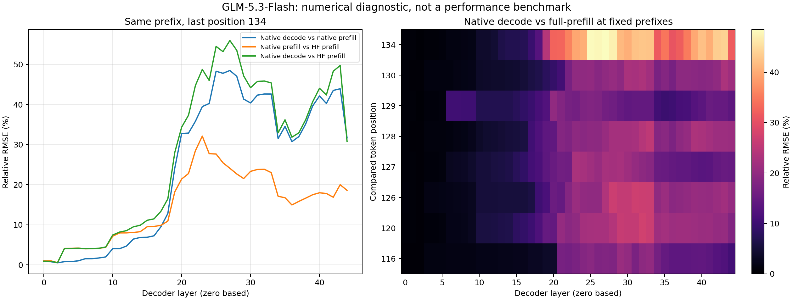
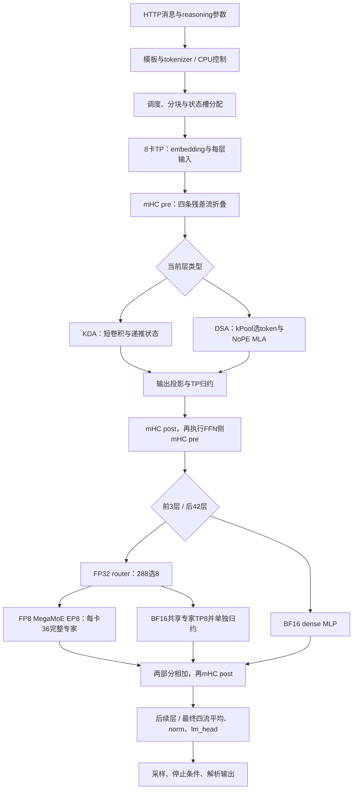
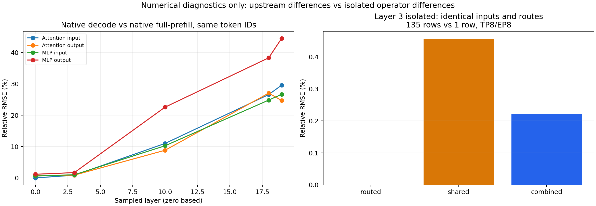
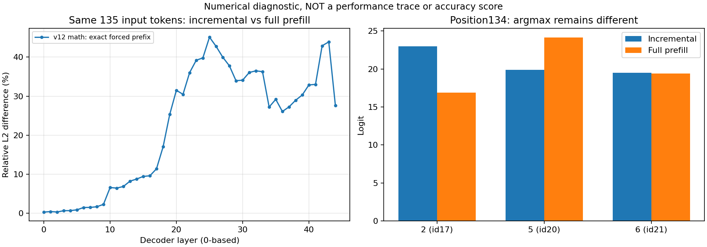
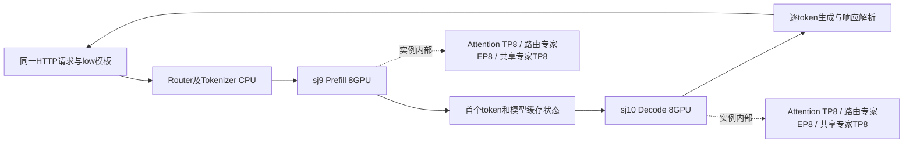

# 历史实验与诊断过程（冻结记录）

以下保留各版本当时的观察、失败和决策。**其中“当前”“尚未完成”“等待授权”均指该小节当时，最新结论请看[本轮详细报告](本轮适配与验证详细报告.md)。** 08:06精确清理已完成，未重启服务器或修改驱动。

# GLM-5.3-Flash：原始 FP8 专家接入与进一步验收

> 工作中报告，最新状态2026-11-05 09:03：FP8专家及数值配置候选v14c已通过CPU559项、GPU KDA10项、原生随机模型及随机模型双机1P1D（P/D各TP8/EP8）。隔离v12的固定12题通过、0062追加3次均D；严格135-token前缀诊断仍有增量2/full5的反例，尚不能宣布完整数值问题已解决。真实模型1P1D正在加载，100题、2048/256正确性及正式性能尚未完成。

## 1. 目标、基线与提交位置

本轮从已有 BF16 专家路径继续：接入 FP8 MegaMoE，补齐或验证文本推理所需的其他机制，再进行算子与通信回归、基础问答/10题、固定100题覆盖和2048/256检查，最后才进行两组正式性能测试。

共同仓库为 [fay85/xllm-musa](https://github.com/fay85/xllm-musa/tree/xiaopang1104benchmark1P1D)，分支为 `xiaopang1104benchmark1P1D`。本轮最终提交到这个既有个人分支，不推个人 fork，不创建 MR/PR。起点提交 `d2f5bda912de17ba6e90f62fd6dfc0eac5e59d3f`；该点包含前轮报告，前轮主体实现为 `30b7051e`。本轮尚未形成最终提交。

本地继续使用相邻1104目录中的 `开发仓库`；新证据与报告存本目录。NFS根目录为 `/data/nfs_shared/xiaopang/20261105_glm53_full_adaptation`，内含 `source/`、`tools/`、`artifacts/`、`logs/`、`records/`。各版本源文件逐一SHA256单独保存；当前运行清单为 `records/source_manifest_v14c.json`，源码 `source_v14c/xllm-musa`。v4等历史清单保留，不把不同版本混为同一实现。

## 2. 这次替换的到底是什么

模型的MoE结构一直参与推理，并非此前跳过专家。旧路径把checkpoint中的FP8矩阵反量化为BF16，按TP8分片运行专家。本轮保留路由专家的原始E4M3字节和128×128 block scale，按EP8分配每卡36个完整专家，调用MATE进行FP8专家计算。输入激活按128元素分组动态量化为FP8，结果输出BF16。

Attention仍为TP8；共享专家仍按TP8切片、以BF16计算；MoE内部路由专家为EP8、MoE-TP1。单机TP/EP与两机1P1D是不同维度，不能把单实例八卡验证写成已完成1P1D。非专家投影目前仍沿用BF16路径，本轮不能笼统称为“全模型全FP8”。

GLM语义保留：sigmoid路由；correction bias只影响选择；top-8；选中原始分数归一化后乘2.5；SwiGLU上界/区间clamp=10；路由和共享两部分均参与输出。

## 3. 接入的四项核心工作

| 工作 | 具体实现 | 为什么不能只替换函数名 |
|---|---|---|
| 原始FP8权重与scale | `glm5_next_weight.py::load_raw_fp8`检查dtype、shape、有限非负scale；`qlinear.py`转发；模型loader按专家编号装载gate/up/down | 旧路径已转成BF16；FP8字节与scale必须成对保留，gate/up顺序不能交换 |
| 布局与专家归属 | `glm5_next.py::_load_experts_musa_fp8`按EP分配完整专家，适配已有公开checkpoint键别名；`kernels_musa/mega_moe.py`调用MATE权重重排 | 旧TP分片是每卡拥有所有专家的一部分；EP分片是每卡拥有一部分完整专家，两者不能混用 |
| 工作区与通信 | 模型各MoE层顺序复用一个IPC工作区；Gloo只做CPU IPC元数据交换及同步，专家主计算在MUSA | 不能给42层各分配重复大工作区，也不能把CPU元数据通信说成CPU模型推理 |
| 路由与共享归约 | MATE返回完整路由结果；共享专家局部输出另做TP all-reduce，再相加 | 对完整路由结果再次求和会放大输出；共享专家漏归约则丢失贡献，均可能不崩溃却答错 |

权重重排在CPU进行，是一次性离线字节/布局变换，没有把专家GEMM搬到CPU。新增的是模型、权重和通信的适配代码，底层FP8矩阵内核由MATE提供，不是我方从零开发一套MegaMoE。

## 4. MATE契约与发现的问题

参考材料为Sivan提供的内部vLLM commit `c84fd47a90e60989a8102f0043e4b3e97905b63d`和MR144。已核对MR144当前缓存/远端头为`43e255441096eaed39c7943cb134d9068224ea59`，并对照实际安装的MATE `0.2.8.post1`，没有只根据旧接口印象判断支持范围。

此前“split-prefill不支持activation_clamp”的说法不准确，已再次确认split-prefill接收并传给实现。本轮发现的是另一个具体问题：当前decode包装函数虽然接收activation_clamp，却未继续传给decode内核。小形状decode还出现过较大数值偏差，异常行与选中某个专家相关；现有证据不足以断言根因。

为先保留GLM数学语义，当前显式把小token输入补到129行，padding路由ID为-1、路由权重为0，从而选择MATE已支持clamp的split-prefill实现；只返回真实token行。每次调用前后还采用MUSA同步与跨rank barrier，避免IPC写入/读取或工作区复用竞争。这是已通过当前回归的正确性方案，不是已证明最快的实现。

额外问题与处理：

- MUSA SDK 5.1的CCCL扩展类型在JIT编译中报错：只对本任务MATE JIT传入`-DCCCL_DISABLE_FP16_SUPPORT -DCCCL_DISABLE_BF16_SUPPORT -DCCCL_DISABLE_NVFP8_SUPPORT`，关闭的是CCCL模板扩展声明，未关闭GPU的FP8计算，也未改SDK/驱动文件。
- 旧预加载桥接库使独立Python某些设备分派异常：独立算子测试清除`LD_PRELOAD`；实际native xLLM仍使用原桥接库，已通过随机模型完整推理。尝试过一个最小初始化替代库，但未解决独立Python问题，已从开发仓库移走，仅保留实验记录，没有当作正式修复提交。
- 第一版随机夹具H128不满足MATE split-prefill要求H能被256整除，两个rank明确报错退出。修正夹具为H256，并把不支持的形状提前检查。真实模型H4096满足条件，不需要改真实模型结构。

## 5. 已取得的数值与链路证据

### 5.1 独立专家/通信回归

随机专家配置：E16、H256、I512、top8、clamp10，保留同一FP8权重和输入量化，独立CPU FP32算式作为测试oracle；推理被测路径在MUSA。

- EP2：1/16/65/129/1 token全部通过；最大相对RMSE约0.02370，最小cosine约0.999721。
- EP8：同样覆盖1/16/65/129/1，全部通过。
- EP8大幅值输入：幅值20，1/16/129/1，覆盖clamp激活；129-token路由/共享合成测试的相对RMSE约0.016687、cosine约0.999864。
- 阈值预设为相对RMSE<0.08、cosine>0.997，并要求有限值；保留逐rank原始指标，而不是只留下“pass”。不能把这些阈值当作最终任务准确率标准。

### 5.2 真实checkpoint第3层

E288、H4096、I2048、top8；EP8每卡36个完整专家；输入为合成激活，分别测试1/17/1 token。用真实router、bias、路由专家及共享专家权重，分别对照路由结果、共享结果和两者合计。它验证真实层形状与原始FP8权重集成，但不是从真实前序attention采集的激活。

17-token输入：

| 输出 | 相对RMSE | cosine |
|---|---:|---:|
| Routed | 0.0223886 | 0.9997513 |
| Shared | 0.0053731 | 0.9999873 |
| Combined | 0.0196049 | 0.9998101 |

所有8rank及三次调用通过，工作区为200,193,152字节/进程。`tests/musa/run_glm_real_moe_regression.py`保留独立算式、各阶段指标和张量证据。

### 5.3 实际native xLLM链路

H256/4层/16专家的随机模型，用FP8专家、真实KDA/mHC/DSA模型路径运行：

- EP2：4输入/8输出，HTTP200，两个进程均退出0。
- Attention TP8、MoE EP8：两次4输入/8输出，输出完全相同；140输入/8输出，多chunk请求HTTP200；最终八个进程均退出0。
- 第一次请求包含JIT，不能计入正式性能。第二次短请求约0.230秒，日志TTFT32ms、平均TPOT27.9ms；这些数字仅用于说明暖机与冷启动的差别，**不是GLM-5.3-Flash完整模型性能**。

CPU权重/并行契约集合首轮40项通过；增加形状/容量拒绝检查后的相关两文件集合19项通过，两个集合不能简单相加说成59个不同测试。

原始日志和JSON已归档到本地`日志/regression_evidence_v1.tar.gz`及NFS同名artifact，失败尝试同样保留。

## 6. 五层改动边界与编译关系

| 层次 | 本轮内容 | 当前边界 |
|---|---|---|
| 服务/API | 已显式指定已有`reasoning_parser=glm5`、`tool_call_parser=glm5` | 已验证一次结构化工具调用与模拟结果回传；不是另写Agent框架 |
| 主控/调度 | 启动时锁定chunk/token容量与工作区容量，超限明确拒绝 | 没有重写scheduler，不启用未经验证的并发/graph组合 |
| 执行 | executor准入“EP等于attention TP、DP1/CP1”的MegaMoE配置 | 继续拒绝未验证的CP/DP/投机/graph |
| 模型/算子 | FP8 raw loader、专家归属、路由/shared归约、MATE wrapper | 非专家仍BF16，MATE底层内核未由我方改写 |
| 后端/通信 | 复用MCCL EP/TP组，CPU Gloo用于IPC元数据和barrier | 不改驱动，未进行跨主机EP；1P1D另验 |

本轮以上正式改动为Python，native沿用前轮已重编的`xllm_glm_v4`，SHA256=`6b152a270bd30755ecf9788097f0395af1682a5234d9e3e7f3285c744df0b609`。Python由显式`--python_model_path`加载（v4为`/work/source/xllm-musa`，当前v14c为`/work/source_v14c/xllm-musa`）；日志已逐层输出FP8 dtype/EP分区/设备，不能把“没有重新编译C++”误解成Python改动没有生效。MATE按当前shape JIT编译的设备内核属于另一层编译产物。

## 7. 除MegaMoE之外还需做什么

现有KDA短卷积/递推与状态、mHC pre/post、DSA NoPE、IndexPool/tail、投影和HyperHead都有实际实现；目前没有证据应把它们统称为“未接入”。后续重点是实际权重与状态语义验证：chunk边界、长历史、槽位复用，以及单实例与P/D同一请求的输出/状态对照。发现差异再定位修复，不为追单道题标签随意改方程。

服务层已显式启用仓库已有GLM parser：一次get_weather调用正确返回message.tool_calls和城市参数，再回传模拟天气结果，模型正常作答；reasoning_content字段也已返回。此为有限协议冒烟，不等于完整AutomationBench或所有流式/多工具组合验收。MTP/投机解码、视觉输入、graph、更广CP/DP以及原生FP8 sparse MLA cache迁移不自动等同普通文本逐token推理的缺失数学模块，不能在未做状态/精度测试时宣布支持。

FP8 MegaMoE当前的padding、同步和TP副本重复路由仍有优化空间。后续应先量化它们在trace中的开销，再研究有效decode clamp支持、去掉不必要同步或token分片；不能未经数值对照就删除同步换取速度。

## 8. 验收账本及v4时点记录

旧BF16轮的65题、官方100题、0062/0065复测均冻结保留。本轮每个请求记录精确payload、实现hash、题目ID、旧官方参考hash、生成Token数、截断、格式错误、选项及耗时。先重点跑0062/0065/0031及固定10题，后续按版本继续未测题；不会每次修一处就无条件重跑100，也不会拿旧BF16答案冒充新FP8结果。

0065既有题面/答案标签疑点，应独立记录，不能为了对齐标签把模型适配改错。API同题参考也不等于复现官方私有榜单。

以下为v4历史时点（已被后续恢复和v14c进展更新），不是当前容器状态：v4真实模型当时在sj9加载完成：42层MoE逐层日志确认使用FP8专家，每个rank专家区间明确。三道基础问答均HTTP200且正确（2、北京、156）；工具调用和模拟结果回传也通过，0062同参数本地追加3次仍为B/B/B、官方追加3次为D/D/D；0065本轮正常结束为A、246 tokens。100题及正式性能未完成。sj10旧rank在正常TERM后的MCCL销毁等待尚未释放，等待精确清理授权；无D态，不重启、不动驱动、不操作他人容器。sj9现唯一我方容器为`xiaopang1105_glm_prefill_sj9`，sj10仍为`xiaopang1104_glm_decode_sj10`。

## 9. 初始v4问题题与独立参考诊断过程

| 题号 | 本轮本地 FP8 | 官方参考 | 当前判断 |
|---|---|---|---|
| 0062 | 初始B；追加B/B/B，均52 completion tokens | 本轮追加D/D/D，150/407/171 tokens | 精确请求payload一致；稳定差异不能简单归因随机性，也不能宣称MegaMoE已解决 |
| 0065 | A，246 tokens，stop、未截断 | 先前同协议初始A | 旧路径曾生成到4096截断，本次未重现；题目精确算术137.5与选项不符，标签一致也需保留题面疑点 |
| 0031 | B、1436 tokens，HTTP200、stop | 已有同协议参考、答案不同 | 60/16km/h、同向50秒推出对向约28.947秒，选项不匹配；不篡改题目或标签 |

0062已逐项核对temperature=0、top_p=1、reasoning_effort=low、max_tokens=4096，Prompt、题目和选项也保持一致。相同请求参数不保证两个不同实现/服务一定产生相同内部思考轨迹，因此进一步用独立Transformers 5.20.2的GLM模型方程，读取相同checkpoint，逐层做全prefill。该诊断的FP8存储权重反量化为BF16，并在MUSA GPU7执行参考计算；它不使用xLLM/MATE模型算子，CPU只加载/排布权重。每次只驻留一个层以限制显存，设置进程显存上限35%，不作为部署或性能方案。

独立参考保存每层hidden state和两个固定位置的logits：原始116-token Prompt末尾，以及强制喂入本地已有推理前缀“Thursday minus Saturday =”之后。比较必须使用完全相同token ID序列；仅凭最终选项不同无法定位某个算子。参考脚本也需核对权重映射和模型调用语义，不能把新参考输出自动当作绝对真值。

完整CPU模型回归集合：556 passed、116 skipped、0 failed，用时2.58秒。跳过项不计为通过，也不能替代真实GPU或完整模型精度验收。证据：NFS `logs/glm_cpu_model_regressions_v1.log` 与 `.exit`，本地远程命令原始回执。

服务返回非空reasoning_content时，usage中的reasoning_tokens仍为0；这是当前计数边界，不能说模型没有思考。报告保存总completion_tokens和原始文本，暂不使用该0值比较两边思考Token消耗。

### 9.1 当时为什么先停止扩大评测

已发现一个可以复现的路径差异：对0062同一135-token前缀，本地完整prefill预测数字5，logprob=-0.0196598；原始连续decode预测数字2，logprob=-0.0466220。原始completion接口也复现了chat输出的错误推理，因此不是仅凭聊天显示文本推测差异。模型实现、权重和token ID前缀保持一致。此时应先定位差异，再扩大100题，而不是为提高标签分数改Prompt或换答案。

34个真实KDA层在独立输入回归中，逐token续写与完整prefill的最大相对RMSE约0.004987、最小cosine约0.999988，最终state最大相对RMSE约0.003854。现有证据尚不支持把整模型差异直接归因MATE KDA内核；实际engine状态槽、DSA/IndexPool以及其他逐层计算仍需检查。

临时诊断副本会保存每步最后token的逐层输出与状态槽元数据。副本启动时发现Python工作目录优先级会覆盖PYTHONPATH：第一次仍导入原repo，已核对并正常退出；第二次显式切换工作目录。这个过程说明运行证据必须核对实际加载文件，不能只看启动参数。原始完整FP8 v4及第一次诊断启动都已正常退出8/8 rank，未强杀。

### 9.2 逐层证据图与尚待确认的精度边界

左图比较相同135-token输入在末位置134的逐层隐藏状态；右图覆盖多个固定前缀位置。它是张量数值诊断图，不是Moore Perf System trace，也不是性能图。native连续decode与full-prefill在位置134最终层的relative RMSE约31.67%；第一步decode（位置116）的最终层约10.70%，不支持把所有差异简单归到128-token边界。状态元数据明确读取非零历史，未发现每步全部清空的情况。

独立HF full-prefill在关键位置也选5（logit24.125），其次6（20.25）、2（16.5）。独立HF的真实DynamicCache逐token路径也已完成：位置134仍选5（logit24.0），其次6（19.75）、2（17.875）。HF自身full/split也有数值差异；因此不能仅凭hidden RMSE非零宣布某个内核错误，但关键token差异仍值得继续定位。

checkpoint敏感参数核对：mHC `fn`、KDA卷积和router权重本身为BF16；mHC `base/scale`、A_log/dt_bias和router correction bias为FP32。当前loader已恢复router bias与KDA常量的FP32装载；mHC base/scale却在模型整体dtype转换后以BF16接收权重，再转回FP32缓存。第0层base的BF16往返最大绝对偏差0.0146322、scale为0.000120971。隔离v6实验只保留这两个mHC参数的原始FP32：最后一层prefill相对HF的RMSE由18.58%降至10.63%，但连续decode仍预测2，未修复0062。基于checkpoint dtype及独立mHC回归证据，现将该装载修正纳入候选v8；不得把这一局部数值修正宣称为整模型对分通过。

HF诊断脚本保留了checkpoint非FP8张量的原始dtype，这与服务的部分转换策略存在上述区别；报告必须保留这一参考边界，不能把参考值称为所有精度设置下唯一的正确输出。

### 9.3 KDA与mHC进一步排除实验（11月5日凌晨）

| 实验 | 范围与结果 | 决策 |
|---|---|---|
| MATE KDA实际TP8局部head | 34层×8切片，每片8 heads；full/split最大相对RMSE 0.0096224 | 局部误差量化；不是八卡通信试验 |
| 单token也强制chunk KDA | 同272切片，最大full/split RMSE 0.0260469 | 比原路径更大，不采用 |
| 显式预归一化Q/K | 同272切片，最大full/split RMSE 0.0102250 | 未改善，不采用 |
| GPU FP32逐token参考KDA | 同272切片full/split误差均0，对HF最大RMSE 0.000145393 | 仅诊断，无CPU算子回退 |
| 真实mHC参数回归 | 45个attention侧mHC，MATE和HF独立公式、整批和单行，全部通过预设RMSE<0.01、cosine>0.9999 | 只覆盖这45个站点，不称为全部90个站点均已测 |
| 原生全模型v7替换GPU参考KDA | 与v6相同FP8专家、FP32 mHC控制参数；唯一额外数学改动为KDA参考实现 | 连续decode关键位置仍预测2，同前缀prefill预测5；不纳入候选v8 |

v7的80-token原始completion诊断因预算到达而结束，后文出现自行质疑并算出5的思考，但没有最终选项。该请求不能记为MathQA答对或完整同参数复测。其前19个生成token与原v4相同，因此位置134的逐层对照有效；后续文本已变化，不再强行按位置对齐。v7最后一层decode/prefill RMSE=0.260897，decode/HF split=0.282970。这些变化仍不能证明MATE KDA是0062根因。

### 9.4 当前候选版本与继续验收

候选v8 = 原始FP8 MegaMoE v4 + mHC base/scale原始FP32装载；保持MATE KDA，不包含临时逐层dump或GPU参考KDA。源hash清单为`参考材料/source_manifest_v8.json`，NFS部署副本`source_v8/xllm-musa`，native二进制不变。相关16项CPU契约测试通过；真实模型已加载；按原temperature=0/top_p=1/reasoning_effort=low/max_tokens=4096复测0062仍B/57tokens。0065被后续基础设施停滞中断，固定10题尚未运行；详见第11节。

固定10题用于观察局部修正后的覆盖情况，不能绕过尚未解决的路径差异直接宣布100题/性能验收通过。后续100题沿已完成记录增量推进；不混用v4/v8答案，也不为匹配标签修改题目。新FP8路径的两机1P1D、2048/256正确性和正式性能仍未完成。

### 9.5 参考精度政策与题库质量的补充检查

独立HF脚本前版直接保留checkpoint中BF16的卷积权重；而当前Transformers模型类的`_keep_in_fp32_modules_strict`明确包含`conv1d`。补做FP32卷积的full-prefill已完成（位置134预测5，logit23.875）；真实cache逐token对照因后续基础设施问题在第32层后中断。目录分别为`logs/hf_q62_fullprefill_fp32conv_v3`、`logs/hf_q62_split_fp32conv_v2`。原参考结果保留并标注dtype政策；不能把它冒充官方服务的精度设置。

实际KDA输入投影另做6层×2个TP局部切片检查：合并投影与逐个投影在单行输入下完全一致；batch与single最大相对RMSE约0.000111752。该范围尚未支持“合并输入GEMM导致大幅错误”的判断，也未覆盖输出投影/TP归约全部环节。原始数据`日志/real_projection_batch_v1.json`。

[MathQA题面与标签疑点说明](MathQA题面与标签疑点说明.md)列出冻结官方100题中7个标签不匹配案例的独立算式，以及0062/0065的歧义。原始评分规则保持不变；比如0042/0097的官方API答案符合题面但不符合标签，而0020确实是官方API算错。不能把“标签准确率”“API一致率”“数学事实正确性”混成一个指标，也不能对题号写特殊逻辑追分。

候选v8首个0062结果仍为B、57 completion tokens、正常stop。它的冷启动耗时以及本轮问答耗时都不作为正式性能：GPU参考诊断同时在同机运行，会竞争资源。正式性能必须在正确性合格、停止参考作业后独立执行。

## 10. 按一次forward理解当前各模块（真实配置，不等同全部验收通过）

实际`/model/config.json`的text_config已保存到`参考材料/model_text_config_actual.json`。45个decoder层，hidden=4096、词表154880；34层KDA、11层DSA；前3层dense MLP，后42层MoE。当前服务不启用MTP或graph。

图里的模型张量计算均在MUSA GPU上；CPU负责HTTP、tokenizer、调度、权重读取及IPC元数据，不承担在线专家或attention计算。该图描述单实例的逻辑；P/D分离还要把prefill结束时的缓存/递推状态交给decode实例，本轮新FP8两机验证仍待完成。

| 模块 | 配置与当前实现 | 与本轮新改动的关系、验证边界 |
|---|---|---|
| KDA输入投影 | 64 heads、每头128，TP8各8头；q/k/v、beta与f/g低秩输入合并GEMM | `glm5_next.py::Glm5NextKdaAttention`既有实现；6层实际投影切片检查已做，不因分数差异随意撤销合并 |
| 短卷积 | kernel=4，保存3步历史；按q/k/v各自head分片再拼接 | `attention/musa_glm_reference.py::execute_linear`用MUSA上的Torch展开/FP32乘加与SiLU；我方实现的框架桥接，不是CPU回退；独立HF参考补做FP32卷积政策 |
| KDA递推 | gate下界−5；A_log/dt_bias FP32；逐序列SSM和卷积槽有读/写位置 | `kernels_musa/kda.py`调用MATE KDA；真实34层/272切片回归已做。临时Torch GPU参考只用于排除实验，未纳入候选默认路径 |
| KDA门控norm/输出 | o_norm、sigmoid输出门、TP切分o_proj和all-reduce | `kernels_musa/glm_reference.py`中的GPU Torch sigmoid-gated norm和bmm，以及MCCL；仍需把全模型差异细化到这些阶段，不能只看KDA核心pass就宣布整层一致 |
| DSA/MLA | 64 heads、q LoRA1536、KV LoRA512、q/k/v head256；RoPE维度0即NoPE | `Glm5NextMlaAttention`采用吸收式MLA；`MusaGlmReferenceBackend.execute_mla`用GPU Torch读取paged latent并计算稀疏attention，不是MATE FP8 sparse MLA高性能实现 |
| IndexPool | index heads32、dim128、pool4、topk2048、始终包含尾部 | 模型indexer与paged index/tail状态已有实现。11个DSA层×8个前缀共88次检查中valid topk一致；尚不等于长上下文所有分页/复用场景通过 |
| mHC | 每层attention/FFN各一处，4条残差流，Sinkhorn20次 | `Glm5NextHyperConnection`调用MATE HcPre；HcPost是`kernels_musa/glm_reference.py`里的GPU Torch einsum/乘加；本轮新增base/scale原始FP32装载。45个attention站点做独立公式回归；FFN侧90站点合计的全部覆盖未宣称完成 |
| Dense FFN | 前3层，I=12288，SwiGLU clamp=10 | 既有BF16 TP8路径；不应因“接入MegaMoE”误以为这3层也切到EP路由 |
| 路由专家 | 后42层，每层288专家，每token选8；I=2048，sigmoid、bias选择、归一化、scale2.5、clamp10 | 本轮新增FP8 E4M3原始布局、EP8、MATE调用、共享工作区。每卡36专家；attention仍TP8。原始scale是乘法尺度，不是名称中inv就再倒数一次 |
| 共享专家 | 每MoE层1个，BF16 TP8 | 与路由结果分别归约；共享输出不漏算，路由输出不重复all-reduce |
| 最终输出 | 四流无权平均→RMSNorm→词表投影→temperature0采样 | 既有HyperHead；不是DeepSeek某些模型的可学习HyperHead。停止/推理解析与数学实现分开验证 |

### 10.1 P/D传递什么，为什么还必须独立验证

在prefill实例，Prompt各token经过同样45层，更新DSA的paged KV/index和kPool尾部，以及KDA的卷积历史与FP32 SSM状态。decode实例每步处理新增token，依赖之前的全部这些状态。只传普通KV而漏掉KDA或kPool状态，程序可能仍能输出，但输出语义会偏离。

本轮EP8是每个实例内部的专家划分，不要求把expert权重逐请求从P传到D；P/D各自预加载相同版本权重。应核对两侧源码、模型文件、量化布局、缓存shape/dtype、TP rank对应关系，再用同一请求对比单实例与P/D分离的输出及关键状态。现有旧BF16 1P1D成功记录不能替代新FP8路径的这项验证。

### 10.2 哪些是后续优化，哪些会阻挡当前数学验收

当前阻挡项是未定位的同前缀full/decode差异、重点题结果，以及尚未完成的新路径P/D交接验证。MTP、graph、跨机EP、CP/DP及高性能稀疏MLA属于另行开通并验证的运行能力；普通逐token文本推理不要求先开启MTP才能成立。

当前图捕获准入明确拒绝：MUSA参考attention存在主机读取控制元数据和动态分页处理；MegaMoE还有主机Gloo barrier及按实际token数分配输出。要实现graph，首先需把状态与工作区地址/shape固定、把依赖主机决策的部分移出捕获范围，并验证MATE内核与IPC通信的捕获支持。仅在启动参数写enable_graph=true不是接入完成；分段graph也需要明确边界及回归，本轮没有宣称实现。

## 11. 本轮并行通信实验的中断与当前恢复边界

[并行通信探针中断记录](并行通信探针中断记录.md)保留具体脚本、命令、进程、时间、栈和处置。00:32:28我在v8仍处理0065时额外启动独立八rank MCCL探针，共享同一组GPU。其后原服务token计数停在2696，新探针没有产出数值结果。这一并行安排不稳妥；后续必须把通信诊断和在线服务顺序执行。

探针8个子进程均已正常TERM退出；原服务正常TERM后仍等待设备同步/服务退出，未见D态。独立HF split也已TERM，full参考已正常结束。没有执行SIGKILL、服务器重启或驱动修改，没有操作他人容器。现等待仅针对两组已核实我方故障进程的SIGKILL授权；收到后也须重新验证PID归属和状态，不能扩大操作范围。

0065未收到完整HTTP答案，标为基础设施中断并排除评分，不能列为模型答错或生成预算截断。固定10题队列已暂停。当前新FP8完整100题、P/D各TP8、2048/256正确性及两组正式性能均未完成。提交材料中的未完成项会明确保留，不提交虚构分数或吞吐提升。

本轮临时诊断归档v3已复制本机/NFS；最终共同分支commit尚未提交。当前服务使用冻结v8源码；本地最后仅整理了新模块/测试的import顺序，ruff通过。最终源码manifest必须记录这类字节差异，不能把最终提交hash与旧运行副本hash混写。

## 12. 08:06恢复后的通信和参考对照

精确清理和恢复已完成，详见[事件记录](并行通信探针中断记录.md)。sj9原进程经MCCL 600秒watchdog超时后SIGABRT退出；sj10旧8rank在获准后各SIGKILL一次。双机显存归零后才运行新诊断。当前两个容器为xiaopang1105_glm_prefill_sj9和xiaopang1105_glm_decode_sj10。第7/11节的等待描述为当时时点，不代表当前仍等待。

独立归约测试8rank×4层确认BF16批量/单行相对RMSE为0.00371125～0.00475616，FP32为0；但隔离v9完整题0062仍B（52tokens，stop），prefill/decode关键预测仍5/2。因此未采纳FP32 TP归约为正式修复，不能根据单个算子数值更近就宣称模型正确或性能提升。v9顺序实验结束后8rank正常exit0。

HF FP32卷积split参考已恢复至45层全部完成，position134预测5，logit24.75；完整prefill预测也5。这继续支持检查native路径差异，但参考专家使用FP8权重反量化BF16，与服务的FP8激活/专家计算有精度实现边界。

### 12.1 分阶段捕获与同输入专家对照

v10从候选v8复制，只增加rank0张量捕获，不改模型数学。对比前已逐token核对前缀ID一致。第0层attention输入相同、输出相对RMSE=0.00744974；第10层mHC输入约0.02165、合并后的输入约0.10916，MLP输入约0.10256、输出约0.22578。这里输入已经不同，输出更不同不能直接证明该模块实现错误，可能包含数值敏感性与上游误差放大。

右图另外固定真实第3层MLP输入和路由，按135行/1行/135行/1行调用相同FP8专家：8rank中路由专家批量/单行差异均为0；共享专家约0.00457119，合并约0.00220919；两次同形状重复均为0。它排除了这一组真实激活上FP8路由专家因批量形状造成大幅变化，但不能代替所有层/所有输入回归。第10层同类对照也完成，路由为0、共享约0.00454589、合并约0.00325427。

这张图是逐层张量数值误差图，**不是Moore Perf System trace、不是性能提升图**。后续抓trace时需要另行标注事件、设备时间和版本，不能拿本图代替profiling证据。

F/G两路投影也新增了6层×2个TP头切片的独立检查：BMM合并与分开线性计算、批量与单行的最大相对RMSE约1.31e-5，未见足以解释当前偏差的大误差。DSA top-k需比较有效ID多重集合，不能把选择顺序变化算成选择了不同token；第19层顺序不同、有效多重集合一致。最初comparison.json对整数ID也计算RMSE，仅为原始调试产物，应以comparison_v2.json的集合判定解释该项。

v9/v10已分别正常停止，8rank均exit0，无自动强杀。接下来v11把已分别检查过的GPU FP32 KDA递推与FP32 TP求和组合测试；它仍是隔离诊断、不是已经通过验收的新基线。不能将组合结果归因于其中单独某一项。

### 12.2 后续精度组合与独立参考的边界

v11组合GPU FP32 KDA参考递推和FP32 TP求和，0062正常结束但答案为E，530tokens，222.702秒，仍不同于官方D。该组合没有通过，不能写作修复成功。对应8rank正常TERM退出，全部exit0。

另外采用MATE的同一递推内核逐token执行prefill和decode，在全部34个KDA层、272个TP8头切片上，输出和最终state的full/split差异都为0，与独立HF数学参考最大相对RMSE为0.00350043。v12将其与FP32 TP归约组合，仍是隔离候选。预先固定的后续题单为0062、0065及0000～0009，不按观察分数挑选。

独立HF FP32卷积full/split的45层参考，最后层相对RMSE=0.143707，两边关键位置仍预测5；native v8对应0.302588。这表明非零中间误差不自动意味着语义实现错误；应综合算子数值、状态/前缀核对与任务输出，不能仅凭API答案不同断言某一底层实现错误。

为了进一步查看独立框架的完整生成，新增 `工具/hf_resident_reference.py`：逐层放置在8张MUSA GPU，调用未改写的Transformers5.20.2 decoder、router和Experts.forward。为控制显存，路由专家以原始FP8权重驻留GPU，通过一个索引适配器，在被选中时按原scale反量化为BF16矩阵，交给HF原有线性层算式；第3层专家0的gate/up已与原CPU装载反量化逐元素相同。原HF forward的方程没有由本任务重写，但内存放置和权重访问方式确由本任务编排，不能称为未经改动的官方发布服务。

这个参考无TP/EP/MCCL，也不使用MATE/xLLM算子。CPU只管理权重、调度和取最终argmax；模型算子全部MUSA。运行前先用同一138-token固定前缀检查position134，再用原116-token提示词、greedy和4096预算完整生成0062。它不是部署候选、不是正式性能数据，也不能据其耗时评价HF框架正常部署的性能。本次参考已完成：最终D、212tokens、157.673秒，正常EOS；关键前缀的top10 logits与此前逐层HF full参考完全吻合。但最终解释包含日期算术错误，不能把这一段参考推理当作无瑕疵金标准。保留原文和权重访问适配说明。

### 12.3 当前候选恢复了哪些问题，尚未证明什么

v12固定题单0000～0009、0062、0065的12个原始标签均命中，与官方API选项一致；全部正常stop、无截断/格式错误。0062首次D/301tokens，额外三次D/D/D、均301tokens；三次不重复加入精度分母。0065 A/577tokens，不再出现此前4096token耗尽。原始题面和标签存在的歧义仍保留独立标记，不以修模型为名改题库。

不能凭12/12宣布全量精度合格，也不能把单机结果当作1P1D正式结果。此组合改善了当前样本表现，但没有完成全部消融，无法把整题变化只归因于KDA或TP归约之一。FP32归约扩大通信数据，逐token prefill限制并行度，属于优先验证数值一致性的保守方案，不能预先声称加速。

### 12.4 从诊断补丁整理为可选择、可复测的实现

冻结正式候选`source_v14c/xllm-musa`，新增配置`musa_kda_prefill_mode`（chunk/recurrent）及`musa_tp_reduce_precision`（native/fp32），分别由同名大写环境开关选择。默认保留chunk/native。recurrent显式使用现有MATE decode内核逐token处理prefill，非自行新增CPU计算；fp32明确在GPU上转换、MCCL求和、转回BF16。初始化检查平台和dtype，packed输入的recurrent模式提前拒绝，不采用运行异常后的静默回退。

`glm5_next.py`管理配置并把5处TP输出归约统一经受控函数执行；`attention/musa_glm_reference.py`把模式传给`kernels_musa/kda.py`；测试覆盖配置优先级/非法枚举与两种KDA模式。CPU559通过、116跳过，MUSA GPU10通过（1/17/65/129/257token，两种模式），均保留原始日志。v14/v14b的旧测试fixture未补配置导致2失败，也保留，没有覆盖成“首次全通过”。v14c只修fixture后通过，未改此轮数学实现。

本轮不涉及新的C++修改，仍使用已有`xllm_glm_v4`二进制，Python源码通过固定工作目录与PYTHONPATH加载；每份运行代码有SHA256清单。不能把只改Python的操作写成重新编译了完整C++框架。最终提交仍须经过原生小模型、真实1P1D回归，不能仅以pytest替代部署验收。

### 12.5 不可省略的反例：135token严格相同，关键预测仍不同

额外v13将每一步**模型实际输入**强制为同一固定前缀，比较116-token预填充加19步增量，和一次135-token预填充。逐个核对实际输入ID相同，排除了采样后历史不同的干扰。第44层relative L2差异0.275983，logits relative L2差异0.229722；增量top1为token17“2”、logit23，而full top1为token20“5”、logit24.125。因此统一KDA内核和FP32归约并未让整个模型两种形状的输出完全一致。不能把12题通过描述为根因全部解决。

这是数值诊断图，不是Moore Perf System trace。该诊断覆盖的是已知异常历史前缀，而非重新按候选自然生成的答案。强制生成文本不参与准确率；保留为后续定位线索。已知参考HF自身也有BF16形状差异，所以需要结合误差来源、路由变化和任务覆盖判断，不能只凭“非零误差”判死刑，也不能只凭一道题最终对了就忽略。

### 12.6 原生及双机启动验证

v14c原生随机小模型TP8/EP8完成4/4/140token输入、各8token输出；两次独立4token请求一致，全部HTTP200，八rank正常exit0。140token覆盖32token分块。测试模型为随机H256、4层、16专家，不冒充GLM真实精度。

第一轮1P1D启动因端口冲突失败：sj9进程组TCPStore40212、sj10传输端口41403被占用；两者处在主机临时端口32768～60999范围。日志还显示Mooncake的单端口min=max配置无效，会回退默认范围。双方16rank均已结束（部分SIGABRT，非全部正常exit0），没有再次SIGKILL。调整为P21000段、D22000段、每rank互不重叠10端口Mooncake范围，不改主机sysctl。新一轮已建立双机连接，推理对照进行中。

### 12.7 小模型双机交接验证完成，真实模型验收开始

P/D各TP8/EP8，4/4/140token输入、各8输出的文本、token计数及finish_reason全部与单机一致。初次冷启动153.956秒，第二次0.311秒，140token分块请求1.780秒，均为小模型链路诊断而非真实GLM性能。首次比较脚本把usage整个字典比较，因为router额外返回缓存计数而误报；按三个实际token数重新核对后通过，原失败比较保留。

三请求08:57:09已完成，随后收集结果时曾因终端输出尚未取回将无新日志误解为仍有请求等待；已按原始时间戳更正。后续只读采栈时服务实际上空闲，空Python栈不能据此解释为死锁。正常停止后两侧16rank exit0、显存归零。等待TCP TIME_WAIT自然过期，再于09:01:45启动真实模型双机P/D。控制面请求预算延长为3600000ms，以容纳固定4096生成预算的精度协议，首输出watchdog600000ms不变。此处改变请求截止时间，不改变采样或模型数学。

## 13. 当前真实部署怎样理解（以本轮实际配置为准）

这是两个模型实例，各自加载完整模型的分布式分片。不是把45层前半放P、后半放D，也不是跨16卡做一个TP16模型。每个实例有8个native进程，启动参数`nnodes=8`在本次进程编排里指8个分布式worker进程，不代表用了8台物理服务器。P、D各自8卡，全部42个MoE层在每个rank都有加载日志，rank0～7分别持有36个完整路由专家；专家总数每层288。共享专家、attention与其他投影仍需要各自的TP归约。

运行镜像有两个不同ID，不能写成同一镜像：sj9为579005c0…，sj10为e4bb9ca1…。已逐项记录镜像ID、native二进制hash、Python源文件hash、模型index/config/tokenizerhash，以及依赖版本。两侧194个MATE源码/so的组合SHA256均为94ec263d988f36308d24b929b06c9f53dede3b8ef1dd80f9139fb0979d9504f2；MCCL/MUSA/TorchMUSA核心库hash也相同。框架源代码以冻结的source_v14c为准，不凭镜像tag猜实际实现。

现场gmi报告每台8张`X10000`、每卡81920MiB，驱动3.3.8-server；任务沿用“S5000”称呼，硬件比较时保留工具返回的产品字段，不额外推断市场SKU。09:14快照P每卡约42537MiB、D约42198MiB，此为当时显存占用，不是峰值或固定最小需求。

## 14. 本轮真实1P1D验收增量（09:15，尚非最终结果）

基础三问均正确；固定0000～0009及0062/0065共12题，官方与本地同题均12/12，选项一致12/12；本地生成1591tokens，官方同12题1233tokens。0062 D/301tokens/112.545秒，0065 A/577tokens/184.342秒。这里的请求总耗时不是正式TTFT/TPOT；普通非流式请求不能据此拆分每步延迟。重复样本不加入主分母，旧BF16与诊断v12成绩不合并到本轮PD分数。

长输入独立检查：实际模板化输入2048tokens、输出预算256，三个核验码分别放在开头、中部、结尾；本地返回完全正确的三键JSON，正常stop、实际输出32tokens，27.228秒。该检查允许自然结束，不要求硬凑256输出；正式性能用ignore_eos=true另测固定256输出。它验证一个确定长上下文例子，不等同任意长上下文能力或全部稀疏选择边界均已验证。

当前继续未测试的88题。格式错误、截断、HTTP失败、选项不同分别统计，数据集标签疑点独立备注但不改评分。完整题单完成并审阅差异后，再开放正式性能门禁。

### 14.1 测速协议已准备，但尚未运行

现有官方EvalScope1.14.1，用原CLI与现有只读venv。相关API插件和计时文件的SHA256与安装分发的RECORD一致，没有为取得指标修改工具内部实现。C1、256/256与2048/256两组，各单独1条暖机与5条正式测量；同组Prompt完全相同、temperature0/top_p1/low，前缀缓存关闭。最后实际server usage必须确认输入和输出token数；SQLite数据库、原始SSE消息、命令和日志均保留。

TTFT按首个可见文本/思考内容输出计算，不把仅有role或空delta当首token；TPOT按`(总请求耗时-TTFT)/(输出token数-1)`。如果一次流式chunk合并多个token，chunk间隔不能直接声称逐个token耗时。当前reasoning token细分计数不可靠，比较总completion_tokens与原始内容。
