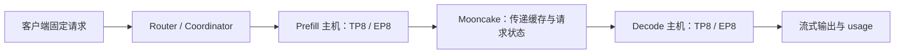

# DeepSeek-V4.1-Flash：MUSA / MATE / xLLM 初始适配说明

> 工作记录，2026-11-05。当前已完成原生编译、有限算子/通信回归，以及 dev7 单机八卡完整 0909 模型加载和两道基础算术题。**尚未完成双机 1P1D 验收，尚无本轮正式性能成绩**。模型结构存在、算子回归通过、基础问答通过和正式部署验收分别记录，不互相替代。

## 1. 本轮到底要做什么

在 dev4/5/6/7 中选两台完全空闲的八卡 S5000，各启动一个 TP8 实例，一台 Prefill、一台 Decode，组成真正的 1P1D 服务。先验证两道简单题，再在 eager 模式、并发 1 下分别测 2048/256、256/256，各 5 次。记录原始请求、实际输入输出 token 数、TTFT、TPOT、总时延及端到端输出 token/s。

这次不做 MathQA100，不声称复现官方准确率，不把单机或同机 P/D 的成绩当成两机 1P1D。现有 0909 权重用于本轮部署；1017 权重下载是独立任务，不能在测量中途混换版本。0909 是用户约定的简称，官方仓库初次发布记录不一定就是 9 月 9 日。

- 基线仓库：[fay85/xllm-musa，1103-merged-dev](https://github.com/fay85/xllm-musa/tree/1103-merged-dev)
- 锁定起点：`0cfd82700e164e8aa7951064b652925dd6b24d18`
- 个人开发分支：[xiaopangDeepseeekV41Flash](https://github.com/fay85/xllm-musa/tree/xiaopangDeepseeekV41Flash)，按用户指定保留三个 e 的拼写。已经在共同仓库建立；不提 MR/PR。
- 原始模型：`/data/nfs_shared/models/DeepSeek-V4.1-Flash`，只读使用。
- NFS 工作目录：`/data/nfs_shared/xiaopang/deepseek_v41_flash_1p1d/20261105跑通PD分离/`。
- 本地源码：`../代码/xllm-musa/`；NFS 源码：`repos/xllm-musa/`。

## 2. 先澄清三个不同层次

**模型结构有实现**，不等于 **当前 MUSA 平台已接入**，也不等于 **该路径已通过全模型测试**。1103 合并基线已经有 V4.1 的 Python 模型与 CSA2、Engram、Mega-mHC 等结构，但原有平台入口主要面向 NPU。家明此前的 DeepSeek-V4 TP8、1P1D/2P1D 成果可借鉴服务、通信、部署和构建方法，不能直接作为当前 V4.1 的数值或性能验收。

MATE 是算子库；TorchMUSA 是 PyTorch 在摩尔 GPU 上的实现；xLLM 负责模型、调度、执行器、缓存和服务。某段张量计算通过 TorchMUSA 在 GPU 上执行，不等于它已调用 MATE 融合算子。下表分别注明。

## 3. 当前模型配置与显存约束

配置来自实际模型的 `config.json`，不是按“284/13B”的旧 V4 描述推算：

| 项目 | 当前 V4.1 原始配置 |
|---|---|
| 主干层数 / hidden | 40 / 5120 |
| attention heads / head_dim | 64 / 512 |
| routed experts / 每 token 选中 | 384 / 6 |
| MoE intermediate / shared expert | 2304 / 1 |
| routing | sqrtsoftplus；选择加 correction bias；权重来自未加 bias 的分数；归一化后乘 1.5 |
| SwiGLU clamp | gate 上界 10；up 范围 -10～10 |
| mHC | hc_mult=4，Sinkhorn 20 次 |
| SWA | 128 token |
| KV 来源层 | 2、8、14、20 |
| index 来源层 | 2、8、14、20、24、28、32、36 |
| Engram | 第 1、14 层；表行数 384006168、384016682；head_dim=256 |
| 原始量化 | dense FP8、32×32 block、ue8m0 scale；routed expert MXFP4、每 32 元素一个 scale |
| 附加资产 | vision tower、3 层 DSpark draft；本轮文本 eager 不验收这些功能 |

按主干配置计算，路由专家共有 `40×384×3×5120×2304 = 543581798400` 个标量权重。如果全部在加载时展开为 BF16，即使 EP8，每卡仅这部分也要 **126.5625 GiB**，已经超过 S5000 每卡 80 GiB；尚未包括 Engram、attention、缓存和运行时工作区。因此不能直接照搬原有 NPU 的全量 BF16 展开路径。

新路径保留原始 packed MXFP4 和 scale，在 GPU 上只对当前活跃的本地专家临时解量化为 BF16 后执行 GEMM。主干路由专家 packed 数据约 **31.640625 GiB/卡（EP8）**，scale 约 **1.97754 GiB/卡**，临时展开的单个专家用完即释放。Engram 表仍有很大开销，实际能否加载必须以 GPU 实测为准。这是显存可行性设计，不是已经证明性能优良。

规划 attention TP8，专家 EP8 / MoE-TP1，EP 组限制在各自 P 或 D 实例内。TP 与 EP 是不同的切分维度；P/D 分离不等于把一个 TP 组跨两台服务器。具体启动配置和实际 rank 拓扑还要在运行日志验收。

## 4. 逐模块实现状态

| 模块 | 基线已有实现 | 本轮接入方式 | MATE / MUSA 状态 | 尚待验证或缺口 |
|---|---|---|---|---|
| 模型注册与配置 | `models/llm/deepseek_v41.h` 解析嵌套 text_config | 在 USE_MUSA 注册；允许 Python model_impl | xLLM C++ 改动，需要重编 | 编译、实际加载 |
| Python 执行入口 | PyExecutor + Python executor | MUSA 下重建 V4.1 attention metadata，选择 CSA2 | xLLM 执行层 | 真正服务输入、缓存布局 |
| TP/EP 通信 | native collective 和 Python distributed 桥 | MUSA 后端选择 MCCL，优先 native TP/EP all-reduce | MUSA/MCCL，不是自写网络协议 | 8 rank 数值、P/D 两组隔离、正常退出 |
| Embedding、LM head、投影 | hidden/column/row parallel linear | 沿用分片、gather/reduce，TorchMUSA GEMM | GPU BF16 GEMM；不声称 FP8 激活计算 | 全权重加载与数值 |
| RMSNorm | FP32 reference contract | FP32 输入保留 TorchMUSA FP32；FP16/BF16 可调用 MATE RMSNorm | 已检查 MATE0.2.7仅接受 FP16/BF16 | 小形状 GPU 已通过；真实全层待验收 |
| RoPE / YaRN / output de-rotation | V4.1 配套旋转实现 | 保留原算法，TorchMUSA 张量运算 | 未替换为 MATE 专用融合实现 | prefill/decode 一致性 |
| CSA2 / CED | Full/Reindex/Reuse/SWA、压缩、候选池、sink softmax | 开放 pure-Torch eager 给 MUSA；NPU fused 路径仍按设备约束 | 没有把 NPU QLI/SMLA 算子当成 MUSA 算子 | 6 层小模型 GPU 已通过；P/D cache transfer、完整回答待验收 |
| Mega-mHC | single-pass、shifted pre_mix、Sinkhorn | 沿用 V4.1 数学实现 | 当前 TorchMUSA；未套用 GLM 的 MATE mHC 调用 | 小形状 GPU 与参考已核对；完整层待验收 |
| 路由 gate / top-k | FP32 sqrtsoftplus + correction bias | 不改变选择与加权语义 | TorchMUSA；不是 GLM sigmoid top-8 | GPU 与 CPU oracle、EP 汇合 |
| routed experts | MXFP4 解量化、clamped SwiGLU、共享专家组合 | 新增 packed 存储，活跃专家 GPU 临时展开 | **尚未接入 MATE MegaMoE，也不是原生 FP4 GEMM** | 小形状 GPU 参考路径通过；完整模型及 fused/grouped 接入待完成 |
| shared expert | 单独完整计算，再与 EP 汇总路由输出相加 | 沿用基线，避免重复 EP 求和 | GPU BF16 | EP8 验证没有漏算或重复算 |
| Engram 大表 | FP8 table/scales，按 TP head-bucket 分片 | 沿用量化存储，不全表展开 | 当前非 MATE 专用算子 | 表加载峰值、查表、gate、conv、history |
| Engram tokenizer hash | tokenizer-derived token_map 与 PCG64 multipliers | 在我方模型视图生成 sidecar，不改原始权重目录 | CPU 离线预处理，非在线张量计算回退 | 已与官方全词表及 RNG 逐项对齐；GPU history 另验收 |
| P/D Engram history | 基线已有 SWA/history 恢复路径及测试 | 复核并进行真实传输验证 | xLLM 缓存 / 服务协议 | 不以 CPU mock 测试代替真机 P/D |
| graph / DSpark / vision | 基线部分 NPU 路径已有 | 本轮 eager 文本不启用，未宣称适配完成 | 不作为本轮交付性能机制 | 各自需要独立接入和验收 |

## 5. 为什么暂时不是 MATE MegaMoE

此前 GLM 接入的 MATE MegaMoE 面向 FP8 expert、相应 block scale、gate/dispatch/combine。当前 V4.1 的原始专家是 MXFP4（E2M1 两个数一个字节，ue8m0 每 32 个数一个 scale），其路由、clamp 和权重施加位置也有独立约束。不能只替换函数名或把 `ep_size` 改为 8，就声称接入成功。

本轮先保留原始 packed 数据以满足显存要求，不对磁盘权重重新量化；使用现有参考解码函数，按活跃专家临时生成 BF16 权重。路由分数由 GPU 算出；原有 eager 实现将活跃专家编号及 token 数这类小型控制信息取回 CPU 以组织循环，**专家的矩阵计算和解量化张量运算仍在 GPU**。因此不能笼统写“全流程没有任何 CPU 同步”：这条参考路径存在同步和逐专家 launch，会影响性能，也不能捕获为完整 graph。

下一阶段若接 MATE，应逐项确认 MXFP4/ue8m0 接口、sqrtsoftplus gate、top-6、bias 仅用于选择、scale=1.5、clamp=10、route weight 在 down projection 之前施加、EP 汇合与 shared expert 只加一次。不能把转换为另一种量化格式的结果称为原始格式直接推理。

## 6. 为什么不能直接复用 GLM 的 mHC / attention

V4.1 的 attention 是 CSA2，GLM 此前核心难点是 KDA recurrent state，状态形状和传输语义不同。V4.1 的 Mega-mHC 还采用跨 block 的 pre_mix 使用顺序：attention 使用前一 block 的 ffn_pre，FFN 使用当前 block 的 attn_pre，最后再做 learned pre 合并。仅接口中都有“mHC”不能证明某个 fused kernel 的输入输出顺序相同。

本轮保留已有 V4.1 reference 语义，用已存在的单测检查再上 GPU。后续若融合，要拿相同输入、权重、残差与 pre_mix 逐项比对，而不是只以程序能启动为标准。

## 7. 当前验证记录与边界

已在我方 CPU-only 容器 `xiaopang1105_cpu_test_dev6` 中运行新增 packed expert 数值测试，**3 passed**：1 token 和 17 token，两种输入下，与独立 nibble/scale 解码后填入的 BF16 专家路径逐元素一致；另测非法维度提前拒绝。覆盖路由、clamp、shared expert 组合。日志：NFS `evidence/packed_expert_cpu_tests.txt`。

该容器使用 `--runtime=runc`，没有映射 GPU，CPU 测试不能证明 MUSA 算子或 EP8 正确。测试中出现无 GPU 的运行时警告符合该隔离条件。正在运行基线已有的模型、mHC、Engram、P/D history、chunked-prefill、RoPE 回归；结果须区分 CPU mock 的范围、NPU-only skip 和真实失败，不以简单汇总掩盖问题。

本机预装 Torch 有运行库依赖缺失，未修改本机驱动或系统库来强行加载，改在现有开发镜像内执行 CPU 数值测试。C++ 改动已用 clang-format 20.1.6 格式化；尚待编译验证。

## 8. 代码改动落在哪一层

- **模型层**：`xllm/python/models/deepseek_v41.py` 添加 packed FP4 专家存储、scale 缓冲、按活跃专家 GPU 解量化和原始字节加载检查。保持现有 gate / clamp / shared expert 数学；增加 MUSA 原始量化及 BF16 计算配置边界。
- **后端层**：新增 `xllm/python/kernels_musa/__init__.py`，提供本轮需要的 RMSNorm、row-parallel 权重准备和 SwiGLU；`distributed/collectives.py` 选择 MCCL/native collective。
- **执行层**：`model_executor/executor.py` 开放 MUSA eager CSA2；`core/runtime/py_executor_impl.cpp` 确保 Python 模型收到重建的 attention metadata。
- **注册层**：`models/models.h`、`models/model_registry.cpp`、`python/__init__.py`、`model_platform_support.py` 连接模型、平台与 Python kernels。
- **服务层**：修复合并分支 protobuf 重名 RPC 的构建阻塞；按真实缓存叶节点生成 Native Provider cache group，避免将 allocator 类型误当成 BlockType。详细范围及尚未完成的端到端验证见第 14 节。没有改变外部聊天 HTTP 请求格式。

## 9. 家明与 DeepInfer 可借鉴什么

已 fetch 家明相关历史，作者记录为 `jiaming.wang`：`f8dd0663`（verified PCP/MATE runtime fixes）、`a2468f85`（2P1D validation）、`47bc0af9`（executor creator binding）、`02c441f4` / `41e335c6`（projection GEMM 数值与形状）、`79980282`（prefill context parallelism）。这些给出构建、服务与数值保护经验，不自动证明 V4.1 CSA2 或 MXFP4 已由相同代码覆盖。

[DeepSeek 官方 DeepInfer](https://github.com/deepseek-ai/DeepInfer) 可作算法和实现语义参考；其公开支持硬件和离线推理范围不同于当前 S5000 xLLM 服务，不把其算子直接当作已可在 MUSA 上运行，也不把它当作现成的 P/D 服务框架。

## 10. 接下来的验收顺序

1. 修复 CPU 回归发现的本轮真实问题，区分基线既有测试问题。
2. 完成可复现构建、记录镜像 digest、依赖版本、源码状态与二进制 SHA；不得将旧二进制冒充新构建。
3. 生成 tokenizer hash sidecar 和只读模型视图，核对 TP/EP 分片显存估算。
4. 两台八卡同时空闲后，先做有限规模 GPU / 通信验证，再加载正式模型；保留完整日志。
5. 真正两机 1P1D 回答“1.3+2.9”和“7×8”，核对实际 P/D rank、cache transfer、输出和正常退出。
6. 同一实现 eager、并发 1，预热后 2048/256 与 256/256 各 5 次。TTFT 为请求发出至首 token，官方 EvalScope TPOT=(请求总时延−TTFT)/(实际输出 token−1)，端到端输出 token/s=实际输出 token/请求总时延。已核对安装包 `utils/benchmark_util.py` 的实际公式：该 TPOT 包含末 token 后到请求结束的尾部时间，不与纯 decode kernel 时间等同。记录测量端点及 streaming chunk 与 token 的区别。
7. 整理初始版本已完成/未完成模块、失败尝试和真实性能，再提交个人分支。commit message 用第一人称向王家明说明工作、数值、限制和后续计划，不提 MR。

## 11. 已解决的实际问题：Engram hash 初始化与官方不一致

生成 sidecar 时复现了基线错误：原构造器得到 98556 个 compressed ID，配置要求 99092。排查确认有两个独立原因：

1. `tokenizer.decode_batch` 默认跳过 special tokens，官方明确使用 `skip_special_tokens=False`。只改这一项仍得到 99784，不能认为修好了。
2. 基线用 Python `unicodedata.combining` 近似 Rust tokenizer 的 `StripAccents`，二者不等价。真实 tokenizer 第 4384 个 token 的孟加拉文 spacing mark 已触发不同结果，随后首次出现顺序改变，最终 116676 个 token ID 的映射与官方不同。

改动位置：`xllm/python/models/deepseek_v41_engram.py`。离线构造时使用官方相同的 `tokenizers.normalizers.Sequence`，缓存该 normalizer，并显式保留 special tokens。在线从 sidecar 读取，不增加推理时归一化或 CPU 权重计算。

验证没有只比较“最后数量相同”：独立执行模型原始 `inference/engram.py`，与修正后的构造器比较 **129280 个 token 的完整映射，差异 0**；compressed vocab **99092**，第 1、14 层的 hash multipliers 也逐元素相同。生成的我方 sidecar SHA256：`3e2d686e32f041aed82b8298054daa1e2312c67175e977d49b32665957ba3627`。官方原始权重目录没有改动，sidecar 位于我方 `artifacts/model_view_0909/`。

证据：`evidence/engram_hash_diagnosis.json`（修复前拆因）、`evidence/engram_sidecar_validation.json`（全量对照）、`evidence/engram_hash_unit_tests.txt`（2 passed，覆盖 Unicode spacing mark 与 special tokens）。此项是已完成的正确性修复，不能据此声称整个模型已正确推理。

CPU 广泛回归第一轮为 25 failed / 565 passed / 130 skipped。其中 2 项是本轮开放 MUSA 后旧测试仍要求“NPU only”的断言，需要更新平台合同；已更新并与 packed 测试合计 **10 passed**。另 23 项在未修改的 `0cfd8270` 独立源码归档里同样失败（基线：23 failed / 564 passed / 130 skipped），涉及无 GPU 环境不能分配 pinned memory，以及 NPU 测试把 `privateuseone` 假定为 NPU、而 TorchMUSA 将其注册为 MUSA。未把它们伪装为通过，也没有修改生产行为来迎合这些测试。后续真机验证仍需覆盖本轮实际启用的路径。

## 12. 已完成的 S5000 单卡验证

仅使用 dev6 持续空闲的 GPU 0；启动前再次确认利用率、显存均为 0。容器仅映射该卡及对应 render 节点，没有操作占用 GPU 7 的外部任务。两次有效测试均正常退出。

- `musa_primitives_v1.json`：8 项通过。MXFP4 解量化误差 0；FP32 RMSNorm 最大绝对误差 1.43e-6；MATE BF16 RMSNorm 误差 0；1/17 token packed 专家计算误差 0；Mega-mHC pre/post/comb 最大误差分别约 8.94e-8、1.79e-7、5.96e-8。均为合成小形状，不代表真实 5120 维全层数值已验收。
- `musa_csa2_fixture_v2.json`：使用真实 MUSA ModelExecutor 跑 6 层随机小模型，含 SWA、CSA2 ratio-2 / ratio-1、Full/Reuse/Reindex、Mega-mHC、packed experts 和第 1 层小 Engram 表。2 条序列、每条 9 token，整段 prefill 与逐 token decode 的每个位置 logits 最大差异均为 0。
- 小模型的 page table / cache metadata 为测试夹具，没有经过 native C++ 或网络传输；不是完整模型，也不是 1P1D 验收。
- 第一次 CSA2 夹具启动失败源于测试缺少 `model_path/config.json`，现有量化模式检测只读取该文件，不能只在 Python 字典里设置 quantization_config。第二版建立独立的随机夹具配置文件后通过；没有改动正式模型配置。
- 修正后的 CPU 回归：**572 passed、130 skipped、23 deselected**。23 项明确保留为当前无 GPU 测试环境不适用，并附未修改基线复现证据；不是“全部测试通过”。

## 13. 沿用上一轮已经定位的服务可靠性修复

1103 合并基线未包含上一轮我方修复的 Folly/bthread 空闲栈回收问题，也没有在 LLMMaster 销毁其 engine/scheduler 前停止 XServiceClient 后台线程。本轮把这些已有补丁迁移到新分支，并带回回归测试：

- `core/util/folly_bthread_compat.h`：在启动服务前设置 Folly 明确支持的 no-idling 模式，避免在 bthread 切换栈时回收错误的栈区间。代价是禁用这项空闲栈/缓存回收，不是修改 GPU 驱动。
- `core/runtime/xservice_client.h/.cpp`：后台心跳、注册协调等待可被退出信号唤醒，停止操作幂等 join；后台线程结束后再清理 engine/scheduler 指针。
- `core/distributed_runtime/llm_master.cpp`：析构开始时先停止上述后台任务，保留新基线自身的 request thread pool drain 改动。
- `server/xllm_server.cpp` 与 `xllm.cpp`：嵌入式和命令行入口均初始化 Folly 兼容设置。

这是复用先前已定位的问题修复；在本分支中的 C++ 编译、Folly/生命周期测试尚待执行。不会以旧轮测试日志替代本轮验证，也不会混用不同类布局的旧对象文件。

## 14. 完整构建发现的集成问题（验证进行中）

采用 `registry.mthreads.com/presale/devtech/xllm:1102-dev`，digest `sha256:0db0efa929d5711b1b78037eb66829b084e40f7d21871c702ba1328e0aa79c8a`，image ID `sha256:09b8f5f4a467fc73332dee57b36a2e5610ba3264357dfc87f103cf7bd7430be3`。本镜像实际安装 MATE **0.2.7**、Torch/TorchMUSA **2.9.1**、TVM FFI **0.1.11.post1+musa.1**、TileLang MUSA **0.1.12+musa.2**。不能把此前某个已更新容器的 MATE0.2.8 状态套到原始镜像。

镜像保留 C++/MUSA 开发环境和第三方库，但没有 Cargo/rustc。本轮明确启用 `XLLM_PREBUILT_RUST_BINDINGS`：逐文件比对 tokenizer / safetensors 的 `Cargo.toml`、Rust 源码、C ABI 头文件，全部与镜像保留源码一致后，仅复用这两个 Rust 静态库。safetensors 库 SHA256 `03954bb7298ad657361d134e13b3767069d24e6eb9cdb6c28c44a7d3c2f427a7`，tokenizers 库 SHA256 `1d60dd93baf05dc5ad09d9d3510c01cd754a86d8afc0b33819f79c466c4ed760`。这不是声称从源码重建了 Rust 依赖，也不能证明旧库的 Cargo 锁定依赖来源；镜像 digest、参考源码和产物 SHA 均作为复用边界记录。xLLM 的 C++ 及本轮更改的运行时代码在新 build 目录重编，不沿用旧 native 对象。

第三方依赖复制自镜像工作树，各 Git revision、未提交 diff SHA 保存在 `evidence/image_dependency_seed_musa.json`；未使用的 NPU/CUDA 子模块明确排除。此方式复现的是镜像依赖组合，不声称每个依赖都与主仓库 gitlink 完全一致。

**实际构建失败：重复 RPC。** `xllm/proto/disagg_pd.proto` 同一服务中同时声明旧 `CancelRequest(CancelRequestRequest)` 和新增 `CancelRequest(AttemptControlRequest)`。protobuf 不支持这种重载，protoc 明确报 `CancelRequest is already defined`，连带 worker/xservice 协议生成失败。本轮保留旧 RPC 名称，将尝试级接口改为 `CancelAttempt`，同步 C++ 服务覆盖函数。后续 Native V2 调用方若要使用尝试级取消，必须采用此接口；本轮 legacy 1P1D 的旧取消接口保持原名称。证据：`evidence/native_build_v3.log`，修复后编译继续进行，不能提前称为全构建成功。

**源码定位：重复 cache group。** `configure_dsv4_block_manager_options` 中的 `manager_types={1,0,0}` 表示 sliding allocator 和两个普通 allocator，并非 SWA/C2/C1 的 BlockType 编号。原 `native_provider_runtime.cpp` 直接 cast，生成 `group:1,group:0,group:0`，触发 descriptor 对唯一性的检查。新实现从已构建的 composite pool 读取真实叶类型，再排序输出，V4.1 应为 SWA=1、C1=6、C2=7，也自然包含可选 embedding/linear 叶。新增测试覆盖 V4.1 两类压缩组、普通 KV、speculative embedding、DP 重复隔离。这是源码定位及待执行测试，尚未宣称完整模型注册成功；不能把简单去重后丢失 C1/C2 当成修复。

## 15. 补充核查：MATE 已有 FP4FP8 GEMM 接口

对本镜像安装包进行逐文件审查后，发现 `mate/gemm.py` 中已有 `ragged_moe_gemm_mixed_dtype` 和 `masked_moe_gemm_mixed_dtype`，`mixed_dtype=FP4FP8`。因此，本轮“尚未接入”不能被解读为“MATE 完全没有 FP4 支持”。接口要求 E2M1 packed 权重、E4M3 激活、BF16 输出；权重 scale 为 `(residual_e8m0, epilogue_fp32)`，shape 分别为 `[expert, out, ceil(in/32)]` 和 `[expert, out]`；激活只支持逐 token scale `(1,-1)`，权重 `(1,32)`，MUBIN 后端、alignment_m=256。`mate-mubin` 0.2.7 已安装。

这比从零实现 FP4 GEMM 更有希望，但仍需要验证：原始 ue8m0 与该 residual/epilogue 表示的对应关系、packed 字节顺序、masked/ragged token 布局、现有 MP31 kernel map 是否包含匹配二进制、V4.1 激活量化语义，以及组合 SwiGLU/clamp/route-weight 的准确性。正在独立做二进制解析和小算子验证；尚未改变完整模型默认执行路径。接口证据存于 `evidence/mate_v41_capability_audit.json`、`evidence/mate_api_sources/`。它不等于已经接入整个 MegaMoE dispatch/combine。

### 官方参考的精度机制与本轮路径仍有差异

进一步核对原始 `inference/model.py` 的 `linear()`：FP8 dense 和 FP4 expert 两条分支都会先将激活按 **32 元素分组**量化为 FP8，scale 为 ue8m0；并非仅权重是低精度。当前基线的 BF16 reference linear 没有模拟这一步。本轮应明确称为“原始量化权重解码后的 BF16 参考计算”，不能称为已逐算子复现官方混合精度执行。

MATE 当前 FP4FP8 接口只开放激活 `(1,-1)`，即每 token 一组 scale，与官方 `(1,32)` 不同。即使小 GEMM 通过，也不能无说明地当作完全等价替换。后续可向 MATE 同事提出 grouped-A `(1,32)` 支持需求，或先用 GPU 量化/反量化参考检查其数值影响。CSA2 indexer 当前沿用基线的 INT8 cache/FP16 scale 路径，而官方参考的 index q/k 使用 FP4 量化后反量化；这也是需要独立说明和验证的精度差异。本轮仅两道基础问答是用户要求的轻量准入，不足以消除这些精度边界。

### FP4 GEMM scale 拆分实验（单独算子，不替换模型默认实现）

17:24 前完成独立验证：MATE masked FP4FP8 在 `[E=2,M=256,N=256,K=256]`、有效 token 数 3/17 下，全 1、随机 FP4 字节、随机 FP8 激活且 scale=1 的三个用例均与独立参考结果一致。直接把原始负指数 ue8m0 当作 residual、epilogue 设为 1 时失败，随机组合出现 NaN。不能据此泛称算子不支持 FP4，也不能忽略失败直接上线。

进一步将每行原始指数 `s` 精确拆成 `m=min(s)`、`residual=s-m+127`、`epilogue=2^(m-127)`，保持权重数学值不变。相同量化激活条件下，该随机用例通过，最大绝对误差 0。说明 residual / epilogue 的表示是接入重点；目前只是该小形状下的实验结论，随后 v5 在真实矩阵尺寸 `K=5120,N=2304` 与 `K=2304,N=5120`（单专家、17 个有效 token，随机测试权重）也通过，最大绝对误差均为 0；仍未覆盖原模型实际权重的全部 scale 范围及完整 MoE。原始激活 block-32 与 MATE per-token 的差异也仍然存在。日志 `mate_fp4_primitive_v3/v4/v5.*` 保留失败与修正对照。v5 仍返回 FAIL，因为它故意保留两个原始 scale 直传的失败对照；不能把该总退出码描述为全套通过。三个 factored 用例分别通过。

## 16. 构建失败不能只看最后一行：合并缺口与错误码被吞掉

v4/v5 构建最后报 `draft_model_config.cpp.o: No such file or directory`。回看完整编译输出，真正原因在合并基线 `core/runtime/draft_model_config.cpp`：DSpark 参数函数中的 `#if USE_NPU` 缺少 `#else/#endif`，使 USE_MUSA 下的函数闭合与外层条件编译失配。补回非 NPU 的 `dspark_use_native_sas(false)` 与条件闭合，保留已有 V4.1 draft 参数逻辑。此处仅修复构建，不宣称本轮已验收 DSpark。

同时，1102 镜像的 `/usr/local/musa/tools/musamapping/mcc_wrapper` 在 `mcc` 和 `g++` 执行后无条件 `exit 0`，导致 Ninja 误判成功并继续链接。仅在本次 CPU 构建容器中把两个最终调用改为 `exec`，正确传播编译器退出码；完整原脚本、修正版与 SHA 记录在 `evidence/compiler_wrapper/`。没有修改宿主机驱动或其他容器。已重新构建，并把现有 `draft_model_config_test` 纳入本轮检查；结果待完成后更新。

补充可复用依据：1103 基线的 C++ `layers/musa/deepseek_v4/deepseek_v4_moe.cpp` 本身已有 packed FP4 保存与逐专家解码的参考路径。它支持“保留紧凑权重、按需解量化”的工程选择，但原 V4 与 V4.1 的路由、attention、Engram 和量化参数仍需分别核对。本轮 Python V4.1 路径复用自身的模型语义，没有把 C++ V4 模型改名冒充 V4.1。

### 补充到真实 checkpoint 的 FP4 投影验证

`mate_fp4_checkpoint_v1.json` 使用原始 0909 的 `layers.0.ffn.experts.0.w1/w3/w2` 实际权重及 scale，逐张量记录所在分片、shape、原始 payload SHA256。17 个固定随机、已经量化到 FP8 的激活 token 下，三种投影经上述 residual/epilogue 拆分后，MATE 结果与同量化激活的独立 FP32 GEMM→BF16 参考比较均通过，最大绝对误差均为 0。原始 scale 字节范围分别为 119～122、119～122、119～123。

这比仅测试随机权重更接近目标资产，但范围仍只是**第 0 层第 0 个专家的三个矩阵**，没有串接路由、SwiGLU、路由权重、EP 通信和 shared expert，也没有复现官方 block-32 激活量化。当前服务模型仍使用按活跃专家 GPU 展开 BF16 的路径。后续接入 MATE 时可直接复用本轮确认的 packed int8 位解释、scale 拆分及验证工具；不能把这里的成功写成“全模型 MegaMoE 已接入”。

## 17. 八卡 EP8 数值与退出预检

17:46 在 dev7 八卡完全空闲时运行约 16 秒的有限预检。使用 8 个独立 rank、每 rank 对应一张 S5000，TorchMUSA 的 MCCL 后端；不是 CPU 模拟，也不是同一张 GPU 上启动八个进程。`validate_ep8.py` 通过本分支的 `moe_ep` Python collective 路径，测试 packed MoE（hidden=64、intermediate=32、16 专家、top-6、EP8 每 rank 2 专家）。该规模不代表完整模型性能。

- 基本 FP32 all-reduce：各 rank 的 1～8 相加，结果均为 36。
- MoE 1 token、17 token：每个 rank 仅计算自己的专家，EP 汇合后再加一次共享专家；与完整未分片 CPU oracle 比较，8 个 rank 的最大绝对误差均为 **0**。
- 8 个进程退出码均为 **0**，没有使用 SIGKILL。原始记录：`evidence/ep8_dev7_v1/`。
- 该测试验证 standalone Python/MCCL 分组及参考 MoE 汇合，没有覆盖 C++ native collective bridge、真实 40 层/384 专家、跨机 Mooncake 或 P/D 缓存传递。后续服务日志仍需核验这些边界。

此外，dev7 驱动 5.2.0-server + 同一 1102 镜像的 6 层 CSA2/Engram 小模型回归也通过：2 条序列各 9 token，prefill/decode 逐位置 logits 差异 0，日志 `musa_csa2_fixture_dev7_v1.*`。因此不能将此前 dev6 驱动 5.1.0-server 的测试直接替代 dev7 验证；本轮分别留证。

## 18. 一次请求的运行分工与尚未完成的边界

这是部署目标图，完整链路尚未通过验收。单台内，attention 的 64 个 query heads 按 TP8 分配，每 rank 8 个；词嵌入沿 hidden 列切分，使用 TP all-gather 恢复完整 hidden；行并行投影使用 TP all-reduce。两台之间并不组成 TP16，每台有独立的 TP8/EP8 进程组。

专家采用另一种分片：384 个路由专家按 EP8，每 rank 保存 48 个完整专家的 packed 权重。当前各 rank 已有相同 token hidden，因此在本地筛选自己负责的专家，计算局部路由输出，再 EP all-reduce；共享专家在每个 rank 完整计算，**只在 EP 归约后相加一次**。这条参考路径没有采用 MegaMoE 的 token dispatch/combine 或 all-to-all，不能用“EP8”三个字暗示已启用那些高性能通信机制。17 节的小测试已经覆盖该数学组合，真实全模型分组还需核对日志。

Engram 的 max_ngram=4，3 种 n-gram × 每种 8 heads，共 24 个 hash 列；TP8 每 rank 负责 3 列及其 head-bucket 表，两个大表不应展开为 BF16。tokenizer 及离线 hash sidecar 构造在 CPU；在线查表、反量化、小投影、gate/conv 使用 MUSA 张量计算。MoE eager 循环仍把专家编号/段长同步回 CPU，这属于控制路径同步，不能被写成“整条推理完全没有 CPU 参与”。

剩余事项分清两类：

1. **本轮必须完成的工程验收**：可复现完整构建、原生运行时/滑窗缓存测试、两机模型加载、真实缓存传递、两道基础题、两组 5 次正式性能。目前仍在进行，不能把前面的有限测试替代这些结果。
2. **后续性能与精度适配**：MATE FP4 专家矩阵已取得有限验证依据，尚未串成完整 MoE；官方 block-32 FP8 激活与当前 BF16 reference、官方 FP4 indexer 与当前 INT8 cache 的差异还需专项回归；CSA2/mHC/Engram 当前 GPU reference 算子尚未全面融合。Graph、DSpark 推测解码、图像输入不在本轮 eager 文本验收范围，不能声称已经验证。注意，checkpoint 含 vision_config 时基线会初始化 vision tower 参数；“本轮不使用图像推理”不等于“必然不加载视觉参数”，最终以加载日志记录实际情况。

## 19. 缓存接口的合并缺口与修复范围

原生编译又暴露了两处接口不一致。第一处是 CompositeBlockManager 已调用 `release_out_of_window_for_sequence`，但基类接口、并发包装转发和 composite 的实现未完整合入。参考 `feihu-1016-dev`，补齐虚接口及默认无操作实现，滑动窗口管理器提供 override，并发包装在原有递归锁下转发；composite 将释放操作传给实际叶节点，在扩容前及提交后回收窗口外缓存。保留当前分支已有的滑动窗口分配前回收逻辑。这不是去释放别人的 GPU 进程，而是请求自己的逻辑 KV block 生命周期管理。需要用现有 composite、hierarchy、concurrent 缓存回归检查没有重复回收、误回收。

第二处是 `Sequence::block_hashes` 已改成按 block_size 保存多条 hash 链，但 `deepseek_v4_prefix_cache_policy.cpp` 的四处调用仍无参数。修复为传入与前一行 `update_block_hashes(base_block_size, hasher_type)` 一致的 `base_block_size`，避免不同压缩层步长混用。即使本轮启动时关闭 prefix cache，这个编译单元仍须正确编译，不能删除功能来绕过编译错误。当前仍以编译和缓存回归结果验收，未声称真实 P/D 缓存传输已经通过。

另一个独立的合并错误出现在 `speculative_engine.h`：`start_profile/stop_profile` 同时保留了声明与类内定义，而 `.cpp` 也有对应定义。删除重复类内定义，保留已有 `.cpp` 实现；不启用本轮未验证的 speculative decoding。编译器此前报告的派生类 override 和 unique_ptr 转换错误随之消失，说明它们是这个类声明冲突引发的连锁错误。

多模态 RPC 的空 payload 也保留了旧字符串写法，但参数类型已经改为显式构造的 `BinaryPayload`，导致整个 API 服务编译失败。将这个空参数改为 `BinaryPayload{}`；仍表示没有二进制附件，不改变本轮文本请求的输入与评分协议。此处仅修复类型衔接，不代表本轮完成了多模态推理验收。

## 20. 新二进制已构建，原生回归结果分开看

`native_build_v11` 已成功（退出码 0，编译/链接日志无 error）。产物 `/work/artifacts/bin/xllm` 为 340,513,104 字节，SHA256 `7265c5997a5877d548178a3c80522034e3aeac6e5d3358763878588bf8bbfbb9`。这是当前源码新构建的 xLLM，不是镜像自带 xLLM；运行依赖来自锁定的 1102-dev 镜像。`ldd` 未发现缺失库。二进制公布的 477 个 flag 中包含当前计划使用的全部启动参数，候选配置已生成但尚未启动 P/D。

原生 CPU 回归目前 6 个可执行测试集通过：Folly/bthread、XServiceClient 生命周期、Native Provider 缓存组、draft 配置、V4.1 C++ chat template、concurrent block manager。综合 `mtp_prefix_cache_test` 含 264 用例，先出现旧 V4 C4 计数预期不一致（32 与 1），随后因 C4/C128 总 token 容量未对齐触发断言而中止。正在逐用例隔离运行，防止这个失败遮住后面的 V4.1 用例；未将整个综合套件记为通过，也未删除断言或放宽生产校验来消除报错。详细记录保存在 `evidence/native_validation_v1/` 和 `evidence/native_cache_cases_v1/`。

独立运行后的综合缓存结果为 **189/264 通过，75 失败**。70 个失败停在旧 V4 的 C4/C128 pool capacity 对齐断言；另有 4 个 EXPECT/ASSERT 不一致、1 个 LINEAR 稀疏 host checkpoint 断言。名称含 V41 的用例 **42/43 通过**；唯一失败 `V41PrefixCacheFollowsV4EnableSwitch` 已先检查 V4.1 SWA/C1/C2，再构造旧 V4 SWA/C4/C128 对照组，在后者触发上述容量断言。不能把这些结果写成“全部测试通过”。本轮 V4.1 使用 C1/C2、不使用 C4/C128 和 LINEAR；保留失败清单，暂不扩展到旧模型缓存全面修复。其他 6 个通过的原生测试集合计 **40 个用例**。

## 21. 完整八卡加载预检发现的 Python 源码优先级问题

dev7 单机八卡预检 `load_precheck_v1` 在加载 Python runtime 时失败，8 个进程均自行退出，容器已归档并删除，没有执行 SIGKILL。日志明确指向镜像自带 `/workspace/xllm-mt-main/xllm/python/__init__.py`，而非我方源码。原因是镜像默认工作目录包含旧 xLLM 包；虽然指定 `PYTHONPATH` 和 `--python_model_path`，C++ helper 发现该路径已经存在后直接返回，没有把它移到 `sys.path` 最前面。当前工作目录仍优先命中了旧包。

部署脚本改为显式 `--workdir /work/repos/xllm-musa`，并在 CPU 容器检查 `xllm.__file__`、`xllm.python.__file__` 均来自我方目录。没有把旧镜像源码覆盖成新代码来掩盖来源。`load_precheck_v2` 已进入实际 48 个分片加载；初始每卡约 67,264 MiB 占用。这个数字是加载阶段瞬时占用，不能当作最终稳态峰值，也不能当作单机/两机推理已经完成。正式 P/D 启动脚本同样固定工作目录。

## 22. 完整模型单机八卡基础问答（2026-11-05 18:20）

`load_precheck_v2` 在 dev7 完成完整权重加载，18:19:32 原生 HTTP 服务启动。使用新的 native xLLM 和我方 Python 源码；attention TP8、专家 EP8/MoE-TP1、40 层、eager、无 MTP、无 prefix cache。八个 rank 的日志确认分别使用 MUSA 0～7、world_size=8、tp_size=8、ep_size=8。加载后每卡约 68,290 MiB。此服务是**单机预检，非双机 1P1D**。

| 输入问题 | 模型答案 | 实际输入 / 生成 token | 结束原因 | 客户端总耗时 |
|---|---|---|---|---|
| 只输出计算结果，不要解释：1.3 + 2.9 = ? | 4.2 | 21 / 4 | stop | 13.2000 s |
| 只输出计算结果，不要解释：7 × 8 = ? | 56 | 17 / 2 | stop | 3.6747 s |

请求统一 temperature=0、top_p=1、reasoning_effort=none、thinking_mode=chat、max_tokens=96、stream=true；实际 reasoning_content 为空，reasoning_tokens=0。第一题包含首次模型执行开销，两题输出很短，因此上述耗时仅作为可复核的基础问答记录，**不能用来替代正式 256/256、2048/256 各 5 次的 1P1D 性能**。

本地原始请求、逐行 SSE 时间戳、usage、答案检查与二进制 SHA 见 `raw/runs/load_precheck_v2/basic_questions/`；服务器同名 `runs/load_precheck_v2/basic_questions/`。完整 rank 日志留在该 run 的 `dev7/`。真实运行还确认 RoPE、hc_post、compressor、QLI 的 NPU fused op 没有在 MUSA 注册，实际沿用 TorchMUSA eager 路径；不是自动调用了 MATE 同名融合实现，也没有把这些计算转到 CPU。

P/D 控制面另外完成有限 CPU 预检：初次因 `librust_tokenizers.so` 搜索路径缺失失败，添加镜像 `/opt/xllm_service/lib` 到**控制面进程**的 LD_LIBRARY_PATH 后，etcd、ROUTER、COORDINATOR 健康检查通过并正常退出。证据 `evidence/control_preflight_v3/`。这只证明控制服务能启动，不证明跨机状态传输已经成功。

256/8 与 2048/8 的单机输入长度预检也已完成：usage 分别为 256+8 和 2048+8，prefix cached token 均为 0；返回同样的开头 `Keeping experiment records helps engineers because it creates`，按设定输出 8 token 后结束。总耗时分别 12.8560 s、36.1021 s，仅验证输入长度、chunked-prefill 和 decode 可执行，不作为正式性能成绩，也不评价被截断英文的完整回答质量。

单机预检完成后，通过我方 supervisor 的 `stop.request` 对 8 个 rank 各发送一次正常 TERM，**8 个 rank 全部退出码 0，容器退出码 0，八张 GPU 显存全部回到 0 MiB**；已归档并删除预检容器。未使用 SIGKILL，未重启服务器或修改主机驱动。当前继续等待第二台整机空闲，再重新加载两台 P/D 实例进行正式 1P1D 测试。
