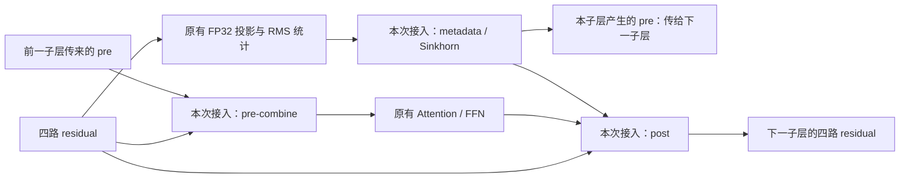

# mHC 的三项独立接入与数值问题

更新：2026-11-10。本文解释本次实现与已完成的单卡验证；整模型性能以 `../今日工作总结.md` 的最终结果为准。

## 1. 本次复用了谁的代码

复用 1103 基线中已有的 V4 MUSA kernel，与家明 V4 的优化工作对应。调用实现位于 `xllm/core/kernels/musa/deepseek_v4_dsa_cache_ops.cu`，接口在 `musa_dsv4_ops_api.h`。

**这三项是 xLLM 仓库已有的编译 MUSA kernel，不是本次新写了三套 GPU kernel，也不是直接调用 MATE Mega-mHC。** 当前模型主体继续由 Python 组织，经过 `xllm_runtime` 的 C++ binding 调用 GPU 实现。MATE 版本仍为 0.2.7。

新增接入点：

| 层次 | 文件 | 改动 |
|---|---|---|
| 模型层 | `xllm/python/models/deepseek_v41.py` | 构造时选定三个独立实现；只在相应原语的位置替换调用 |
| Python 后端接口 | `xllm/python/kernels_musa/hyper_connection.py` | 检查设备、dtype、shape；非连续输入先在 GPU 整理；独立配置 pre/post/metadata |
| C++ 运行时绑定 | `xllm/core/runtime/py_musa_kernel_bindings.h` | 向正式嵌入运行时及数值测试扩展导出同一接口；检查参数，设置 device guard，释放 GIL |
| 已有 GPU 算子 | `xllm/core/kernels/musa/deepseek_v4_dsa_cache_ops.cu` | 直接复用，没有为了本轮另外修改数学实现 |
| 测试 | `tools/musa_deepseek_v41/validate_hyper_connection.py` 等 | 原语、边界、stream、真实参数、小模型与累计接入对照 |

改动不涉及新的模型权重量化，不修改专家路由和 P/D 协议。

## 2. 三项分别做什么

设 residual 为 `[T,4,H]`，当前 H=5120，四路残差流。

**pre-combine：** 用上一个子层传下来的系数 `carried_pre[T,4]`，把四路残差合成当前 Attention 或 FFN 的输入：

```text
input[t,h] = sum_i residual[t,i,h] * carried_pre[t,i]
```

**post：** 当前 Attention/FFN 输出 `value[T,H]` 后，把它按 post 系数写回四路残差，并加上旧残差经 comb 的混合：

```text
output[t,j,h] = value[t,h] * post[t,j]
                + sum_i residual[t,i,h] * comb[t,i,j]
```

**metadata/Sinkhorn：** 接收现有 FP32 投影产生的 `mixes[T,24]`，按 scale/base 算 pre、post、4×4 comb；comb 经 row softmax、列归一化、后续行列迭代。本次模型使用 20 次 Sinkhorn、eps=1e-6。FP32 投影和 RMS 统计仍沿用原实现，没有包含在本次 metadata kernel 的计时收益中。

V4.1 的关键是 **shifted pre_mix**：本子层产生的 pre 是后一个子层使用的，当前子层使用外部传入的 carried_pre。本次没有更改这条状态传递，也没有把 V4 的整体 mHC forward 直接替换进来。测试特意让 carried_pre 与本层新产生的 pre 不同，以便发现误接。



图中的三个接入点都调用 MUSA GPU kernel；原有投影、Attention/FFN 和状态传递没有被这三个原语整体替换。

## 3. 为什么拆成三项

三个开关均在模型构造时固定，取值为 `reference` 或 `v4_fused`：

```text
XLLM_DSV41_MUSA_HC_POST
XLLM_DSV41_MUSA_HC_PRE
XLLM_DSV41_MUSA_HC_METADATA
```

累计实验是 reference → post → post+pre → post+pre+metadata。这样出现差异时能确定是哪个原语带来的。未选融合时仍在 GPU 上走原有 PyTorch 运算；选择融合却缺少编译符号或参数不符合要求时直接报错，不悄悄改走另一种实现，也不把计算搬到 CPU。

## 4. 原语与小模型验证

单卡 dev6，实测设备显示 MTT S5000，镜像 `1102-dev`。BF16 residual/value，FP32 系数，hc_mult=4。

原语覆盖 T=0/1/17/256/2048、非连续 tensor、外部 carried_pre、饱和 logits、Sinkhorn 1/2/20 次，以及非默认 stream。验收阈值预先固定：BF16 rtol=1/128、atol=1e-3；FP32 rtol=2e-5、atol=1e-6。

第二次测试通过 39 项检查。随后从官方 1017 中抽取层 0、1、14、39 的 attn/ffn 参数，真实维度 H5120，再验证 24 项 metadata 结果，总计 63 项通过；进一步把真实参数产生的系数用于 pre/post，新增 16 项检查，最终 **79 项通过**。这里输入 hidden 是随机生成的；这是“真实层参数测试”，不是采集整模型运行时 hidden 后做逐层比对。

权重子集只供测试，来源与 SHA 保存在 `证据/hc_1017_subset_manifest.json`：共 24 个张量，15,731,608 bytes，SHA256 `fae7ae678b5847c2282720fcfcce1109c836db5c86f95e25b54801aa0504e4b8`。它没有替换服务所用的完整模型。

六层随机小模型含 CSA2 和 Engram，2 条序列、每条 9 token。reference/post/post+pre/all 四种配置分别做整段 prefill 与逐步 decode；每个配置九个位置的 logits 最大绝对差均为 0。相邻累计配置的 hidden、prefill logits、decode logits 也逐元素一致，greedy token 一致率 100%。这些结果的适用范围是该 fixture，不能推广成整模型全输入严格等价。

## 5. 一次真实失败及如何判断

初次测试没有通过，失败位置是 `saturated_metadata_comb_iters1`，融合结果与原 MUSA PyTorch 参考最大差约 0.0046243。没有修改 kernel 去迎合这个结果，也没有放宽误差阈值。

用保存的同一输入进一步比较了四条路径：原 MUSA PyTorch、复用的原生 MUSA kernel、CPU FP32、CPU FP64。结果：

| Sinkhorn 次数 | 原生 kernel 对 CPU FP64 最大差 | MUSA PyTorch 对 CPU FP64 最大差 |
|---:|---:|---:|
| 1 | 1.8563e-7 | 0.00462430 |
| 2 | 9.6580e-8 | 0.000370271 |
| 20 | 1.3608e-7 | 7.22271e-6 |

进一步逐步保存 softmax、加 eps、列和、分母及归一化结果，发现第 16 个样本的一列在 MUSA PyTorch `sum(dim=1)` 中出现差异：根据同一组已保存的 FP32 元素，CPU 双精度相加约 **4.5797e-6**，GPU 求和约 **4.6723e-6**。这些是很小的值，但作为归一化分母时会放大影响。softmax 与后续除法本身的对照不足以解释这一差异。

所以，饱和输入的验收改用独立 CPU FP64 数学参考，同时保留旧 GPU 参考的差异作为诊断。验收阈值保持原值。CPU 计算仅用于测试中的 oracle；实际模型推理和融合算子仍在 MUSA GPU 上。

目前可确认的是这组输入和环境中的归约差异，不能据此泛化成所有 TorchMUSA sum 都有问题，也不能仅凭这一结果判断模型精度已经全面改善。要给框架同事反馈时，应提供 `mhc_diagnostic.pt`、`mhc_stage_diagnostic.pt`、环境版本与最小复现；这些在 dev NFS 的 stage2/evidence 中。

## 6. 每个原语的性能测试

每条路径先暖机 10 次，再测 5 组，每组连续调用 30 次后同步，报告每次调用 wall time 的中位数。计入 Python binding、输出分配与调用本身；同时保留 GPU event 计时；该 elapsed time 也可能包含 host 发射之间的空隙，不能当成从 trace 中汇总出来的纯 kernel 时间。输入是实际 H5120 的连续张量。测试没有测整个模型，也没有测 P/D 网络。

| 原语 | T | 原实现 μs | 融合 μs | 耗时下降 |
|---|---:|---:|---:|---:|
| pre | 1 | 65.960 | 11.565 | 82.47% |
| post | 1 | 99.534 | 13.955 | 85.98% |
| metadata | 1 | 1584.088 | 47.179 | 97.02% |
| pre | 256 | 114.308 | 28.330 | 75.22% |
| post | 256 | 384.988 | 24.845 | 93.55% |
| metadata | 256 | 1603.986 | 46.883 | 97.08% |
| pre | 2048 | 1000.765 | 227.305 | 77.29% |
| post | 2048 | 3055.413 | 218.663 | 92.84% |
| metadata | 2048 | 1612.904 | 91.497 | 94.33% |

原始 5 组 wall/device 值在 `证据/mhc_v2.json`，便于导入表格的结果在 `证据/mhc_microbenchmark.csv`。这里采用完整 v2 原语测试的计时，v3 是添加真实参数后的复验，不从两次测试里挑更好的值。

metadata 的大幅局部改善有明确实现原因：原路径要反复发起行/列求和与除法，20 次迭代涉及很多小运算；已有 kernel 在 GPU 内完成这一串工作。没有抓 trace，因此只能按源码与计时解释这一机制，不能声称已从 trace 数出了 launch 次数。实际 TPOT 是否改善、改善多少，须看 sj9/sj10 的完整 A/B。

## 7. 未在这次改动中完成的内容

- 完整 Mega-mHC 的投影/归一化/状态传递整体融合。
- 原始 FP4 + block32 的高性能专家 GEMM、GPU 完整专家分组/combine。
- Indexer 官方量化、CSA2 的全部高性能路径、CED bounded replay、完整 Engram 优化。
- 原生 C++ V4.1 整模型。
- Graph、MTP/DSpark、60% SOL 或 H20/H200 的同条件比较。

这些分别列入 `../今晚待运行的goal.md`；不能把本次三个原语通过等同于整个 V4.1 算子已经覆盖。


## 8. 完整模型目前观察到的输出变化

在 256/256 的开放式性能 prompt 上，B（只在 D 打开共享 SwiGLU）与 C（再打开两侧 mHC post）的请求体 SHA 完全相同，各自五次输出也分别相同；但 B/C 的输出文本不同。共同前缀为 `Keeping experiment records helps engineers because it `（54 个字符），随后 B 为 `preserves the exact details...`，C 为 `creates a reliable memory...`。

这道题要求解释实验记录的价值，没有唯一标准措辞，不能据此判定 C 的答案错误。但它也没有证明 full-model logits 等价：浮点累加/舍入差异或接入问题都需要用相同 token 前缀的数值进一步区分。原语容差通过、两道基础算术题通过，不能代替这一检查。

由于输出序列改变，后续专家路由及计算负载也可能变化，所以 C 的整模型性能差异不能全部归因于 post kernel。该短输入组的平均 TPOT 为 1100.25 ms/token，相对 B 的 1094.95 ms/token 约慢 0.48%；微基准变快而端到端暂未改善的事实均保留。完整长输入结果和后续配置以今日总结为准。

原始比较：`证据/C_256_hash_comparison.json`、`证据/C_256_output_divergence.json`。这些是开放式性能负载的输出变化，不能混写成 MathQA 正确率或官方 API 对分结果。


D（post+pre）短输入组也已完成：五次正式请求通过验收，平均 TPOT 1100.46 ms/token，相对 C 的 1100.25 ms/token 约慢 0.02%，尚未测出增量加速。相同请求在 C/D 间的开放式文本又发生变化，共同前缀为 201 个字符；具体文本、每次输出和请求 SHA 见 `证据/D_256_output_comparison.json`。这进一步说明：原语微基准收益和整模型输出/性能需要分开验收，不能直接按微基准百分比推算全局收益。

## metadata 接入后的完整模型短输入结果

E 在 256/256 的 1 次暖机和 5 次正式请求全部完成，已按 P/D 原生计数验收。平均 TTFT 6246.94 ms、TPOT 1061.41 ms/token、端到端 276.9067 s、输出吞吐 0.9245 token/s。相对 D（post+pre）的 TPOT 1100.46 ms/token，耗时下降约 3.55%。2048/256 最终结果以今日总结为准。

D/E 的请求正文相同；各配置内五次输出完全相同，但 D/E 彼此不同。共同前缀为 `Keeping experiment records helps engineers because it `（54 个字符）：D 接 `creates a reliable memory...`，E 接 `preserves the exact details...`。E 与原始 A 的完整文本 hash 也不同。证据为 `证据/E_256_output_comparison.json`。

这不是数学题答错的证据，也没有证明 E 全模型数值等价。它说明必须把集成性能改善和纯算子收益区分开：metadata 的归约/迭代融合确实在局部微基准更快；但完整生成序列和可能的专家负载同时改变。固定前缀的首个数值分歧仍需后续定位，不能仅凭改进的 TPOT 跳过。
