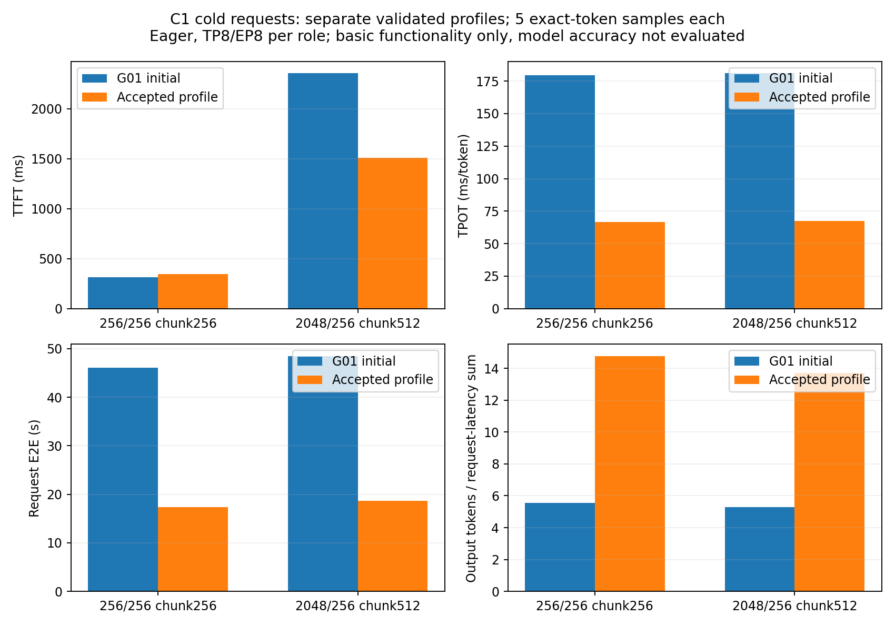

# 最终验收总表与累计最佳结果

本轮已按速度优先口径执行G01/G02及T01～T14：有提升的按负载接受，负收益保留证据并关闭，容量/接口受限项明确按分析收口。T15为后续储备。**这不表示所有性能问题已经解决，也不表示达到60%SOL。** 最终Git提交/推送信息由独立发布验收补充。

**仅通过基础功能检查，未完成模型精度验收。** 使用SJ9/SJ10，P/D各8卡，TP8/EP8、DP1/CP1、eager；实际GMI为X10000 80GiB。权重为已核验的MooreThreads W4AFP8-mt1017，路径`/data/nfs_shared/models/DeepSeek-V4.1-Flash-1017-W4AFP8-mt`。没有混用原版FP4/group32，也没有重占H200/SJ11/SJ12。

## C1冷请求：当前推荐的两组实测

短输入采用E50 OFF的chunk256，长输入采用E47的chunk512；这是分别验证的长度profile，不是假装同一轮统一配置。两组均各1暖+5正式，请求成功且实际输入/输出满足目标。

|输入/输出|Prefill chunk|TTFT ms|TPOT ms/token|端到端 s|输出token/s|QPS|
|---|---:|---:|---:|---:|---:|---:|
|256/256|256|347.04|66.60|17.3313|14.7710|0.057699|
|2048/256|512|1510.82|67.31|18.6741|13.7088|0.053550|

C1此表输出/QPS沿用请求延迟和口径（256/mean latency，1/mean latency），官方会话wall口径也保留在原始报告。对初始G01，两组TPOT分别降低62.89%/62.81%，端到端降低62.39%/61.50%。短输入TTFT314.05→347.04ms，增加10.51%，如实保留；不能称每项指标都提升。

mHC本项独立对照：TPOT75.04/76.20→67.15/66.19ms，降低10.51%/13.13%，完整GPU trace减少400kernel/step。Chunk512本项长输入TTFT2693.98→1510.82ms，降低43.92%；短输入无收益。各项是按顺序加入的结果，不可把百分比相加。

## 热前缀是另一种负载

E28长输入实际输入2048、命中1792，TTFT345.40ms、TPOT66.30ms、端到端17.2528s、输出14.8382token/s；5条正式均通过请求ID与P终态日志核实命中。不能把该值当作冷请求TTFT。详见`ToDoList_28/07_结论/前缀命中正式结果与冷请求边界.md`。

## C2/C4：同并发队列与真实批处理

每组一轮C条暖机，再5条正式；两组各10条有效。吞吐统一为1280/官方Test Duration，QPS为5/同一wall。单条延迟均值包含排队/交错，不能当成设备step时间；5条正式存在尾部不足批，不能据此宣称稳态峰值吞吐。

|并发|输入/输出|路径|TTFT ms|TPOT ms/token|端到端 s|聚合输出token/s|聚合QPS|
|---:|---|---|---:|---:|---:|---:|---:|
|2|256/256|排队q1|494.37|123.94|32.0997|14.4359|0.056390|
|2|2048/256|排队q1|1760.47|115.00|31.0855|14.8560|0.058031|
|2|256/256|batch2|412.72|104.46|27.0495|16.8045|0.065643|
|2|2048/256|batch2|1737.54|102.18|27.7928|16.4516|0.064264|
|2|256/256|batch2+小批mHC|426.48|103.22|26.7474|16.9867|0.066354|
|2|2048/256|batch2+小批mHC|1839.22|101.55|27.7337|16.4357|0.064202|
|4|256/256|排队q1|755.07|180.19|46.7024|15.3017|0.059772|
|4|2048/256|排队q1|3208.76|171.04|46.8238|15.3462|0.059946|
|4|256/256|batch4+小批mHC|741.37|115.79|30.2671|25.5344|0.099744|
|4|2048/256|batch4+小批mHC|3157.94|116.87|32.9605|24.3334|0.095053|

C2纯batch本项相对同C队列吞吐提高16.41%/10.74%；真实D行保持62，步骤62×q1→30×q2+2×q1，mm21700→12010。小批mHC单独叠加时吞吐只+1.08%/-0.10%，未单独晋级。C4控制/候选两边small-mHC开关均1，q1控制不触发多行分支，batch4则自然触发；因此C4结果是当前批处理路径的整体收益，不声称纯GEMM批量化独立贡献。

E53：`ACCEPTED_CONCURRENCY_SPECIFIC_SPEED_OPTIMIZATION`；两组聚合吞吐变化分别+16.41%/+10.74%，实际D步骤见该项`05_trace/full_native_entry_work.json`，图文见该项07_结论。

E54：`SMALL_OR_MIXED_CONCURRENCY_EFFECT_NOT_PROMOTED`；两组聚合吞吐变化分别+1.08%/-0.10%，实际D步骤见该项`05_trace/full_native_entry_work.json`，图文见该项07_结论。

E56：`ACCEPTED_CONCURRENCY_SPECIFIC_SPEED_OPTIMIZATION`；两组聚合吞吐变化分别+66.87%/+58.56%，实际D步骤见该项`05_trace/full_native_entry_work.json`，图文见该项07_结论。

## G01/G02与T01～T14实际完成度

|任务|本轮实际闭环|证据|
|---|---|---|
|G01|completed|ToDoList_1/07_结论/G01基线验收.md|
|G02|completed_conservative_measurement_fallback|ToDoList_3/07_结论/G01_G02总结与进入核心优化的边界.md|
|T01|completed_TP_and_EP_speed_accepted|ToDoList_6/07_结论/EP通信速度改进与trace解释.md|
|T02|cache_reuse_and_SWA_fusion_accepted|ToDoList_11/07_结论/SWA读取融合收益与trace解释.md|
|T03|completed_cumulative_mhc_formal_and_all32_trace_accepted|ToDoList_38/07_结论/mHC融合正式性能与trace晋级说明.md|
|T04|shared_TP_accepted_D_gate_cache_formal_trace_mixed_not_promoted|ToDoList_46/07_结论/Gate权重缓存正式结果与未晋级说明.md|
|T05|completed_three_mode_formal_trace_negative_rejected|ToDoList_27/07_结论/Graph正式性能与未晋级决定.md|
|T06|packed_shared_two_trials_small_gain_not_promoted_QKV_mixed_not_promoted|ToDoList_30/07_结论/两轮正式测试与保留候选的决定.md|
|T07|D_stream_accepted_P_operational_fence_with_progress1_boundary; no_progress_trial_failed_cleaned|ToDoList_40/07_结论/当前流完成边界诊断与正式数据.md|
|T09|completed_long_TTFT_gain_all32_trace_accepted_short_no_gain|ToDoList_47/07_结论/Chunk512长输入收益与短输入边界.md|
|T08|existing_real_transfer_logs_analyzed_no_network_change_no_gain_claim|ToDoList_16/07_结论/P_D搬运日志与收益判断.md|
|T10|completed_formal_and_all32_trace_small_mixed_not_promoted|ToDoList_48/07_结论/CED行裁剪路径与正式性能结论.md|
|T11|completed_warm_prefix_formal_all32_trace_accepted_workload_specific|ToDoList_28/07_结论/前缀命中正式结果与冷请求边界.md|
|T12|completed_C2_C4_formal_all_rank_trace_actual_batch_and_small_mhc_ablation|ToDoList_56/07_结论/C4真实Decode批处理正式结果与trace解释.md|
|T13|current_layout_capacity_and_interface_analysis_complete_alternative_runs_not_done|ToDoList_24/07_结论/并行布局容量与接口边界.md|
|T14|native_MUSA_DSpark_basic_formal_trace_complete_speed_regression_not_promoted|ToDoList_50/07_结论/T14原生功能完成与性能回退说明.md|

T08只完成真实transfer日志分析（非零region约2.003ms），未更换通信传输协议/网络设备；关键路径ready/wait未知，没有网络提速成绩。T13完成同16卡预算的权重/加载容量分析，TP4EP8必要静态量约80.454GiB已超80GiB，未做新布局成功测速，不能当作所有替代布局都已实现。

## 明确拒绝、没有掩盖的结果

Graph真实三模式TPOT约74→127～128ms，关闭；packed shared两轮小幅/不稳、QKV/Gate两组取舍，关闭；CED长输入端到端约1.86%小幅收益且短输入回退，不晋级。

原生DSpark/MTP完成真实draft模型、辅助层hidden、缓存状态快照恢复/回放、P/D接入、512/576缓存布局修复；两道算术、10次长请求稳定性及两组正式+全部前后32rank trace完成。但接受率约20～23%，D target输入行7→30、kernel24787→50941，TPOT66～67→172～174ms。因此spec0保留为推荐，不能把功能跑通称为加速完成。

P端仍有可靠性边界：E57删除逐层progress后长输入RPC超时，短输入成功不能证明整轮通过。按持续授权归档、正常TERM，核验后只对7个明确故障P rank各一次SIGKILL，全部释放；没有D态/设备异常/重启/驱动变更。E52v2另有SWA预留不足，后来同条件预算4096解决该资源门槛，但不能把资源修正当作E57时序问题的根治。

## 源码、环境与证据对应关系

分支`fay85/xllm-musa:xiaopangV41FlashCppFromSglangtoXllm`。源码父4411c026；最终编译快照E51的30源码文件逐字节集成。实际ELF f54260ea3ad2a75e558c430791528b9ee23dfab279d83221b6f61dbe71537abe；同C2/C4对照使用此ELF。C1长度profile的实际历史ELF为931741c3…，只在后续默认关闭的多行mHC开关处有源码差异，不能冒充在f542上重新跑了C1正式。

镜像1102-dev，固定imageID09b8f5f4…；pip mate0.2.7，实际显式W4A8/sparse/mHC SO分别冻结SHA。W4A8来自`/donor/mate`源码与SGLang修正编译条件，build-v2库SHA6757da6f…与当前运行库一致，不是凭pip0.2.8的名称作保证。详见`当前两端镜像依赖与实际SO指纹.json`、`实际W4A8生成库来源.json`和`17_源码变更与默认开关说明.md`。

本地根即本文件上一级：每个`ToDoList_n`下00目标、02代码、03正确性、04性能、05trace、06图表、07结论。SJ共享结构根`/data/nfs_shared/xiaopang/deepseek_v41_flash_1p1d/20261112_new_start`；原始运行/大trace/ELF在`/data/nfs_shared/xiaopang/deepseek_v41_flash_1p1d/20261112_sglang_mt_cpp`。NFS索引保留路径、字节与SHA；可交互Perfetto另压缩归档。Git放源码、短回归、原始小日志包、PNG及摘要，不放权重、ELF、大trace或凭据。

## 怎样继续

先看`18_下一轮真正值得继续的工作.md`：P端可靠性、batch Attention/metadata摊薄、MTP有效工作比、Graph边界，再是CED/新布局。学习读图见`19_怎样从性能数值读回实际trace.md`。当前仍缺完整模型精度与SOL口径，不计算虚构的理论收益兑现率，也不承诺达到60%。

## 测量环境补充

为串行使用GPU并收齐证据，上一轮的CPU-only trace审核/打包以nice19在SJ10继续执行，可能与后一轮正式请求重叠；它不初始化GPU，也未并行启动另一套模型。未进一步做CPU核/内存带宽的严格隔离，因此不把小幅差异说成稳定的发布级收益。原始5条样本及方差全部保留；C2小批mHC约1%变化不晋级。吞吐结论限定为本轮同条件有界负载，后续发布级对照应固定后台活动并增加稳态轮次。

## 仓库证据阅读方式

各ToDoList编号是实验编号，不是优化优先级。07_结论优先阅读；04_性能保留原始小归档（SQLite、请求/SSE、官方日志、角色参数），需要时解压。05_trace保存文件SHA、计数、紧凑16rank审核及NFS大trace/交互Perfetto归档入口；原始全量trace、ELF、权重不提交Git。紧凑审核是原始JSON的导出，不冒充未修改原始日志。图表都来自实际trace或正式数据。历史running字段是当时检查点，最终状态以最终验收总表为准。
