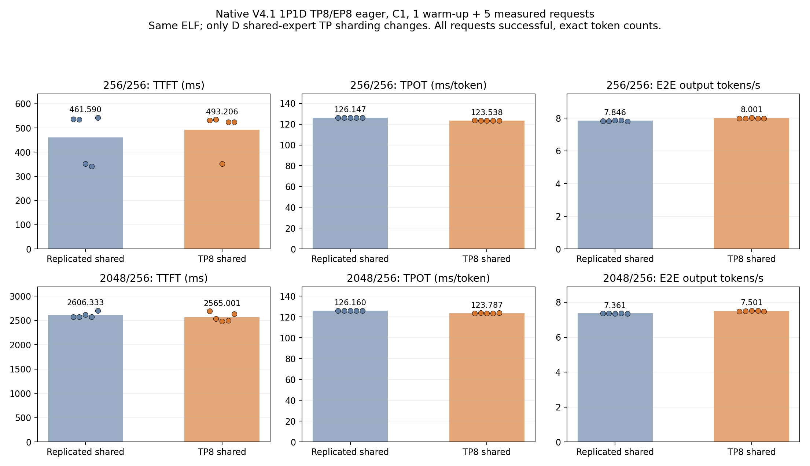
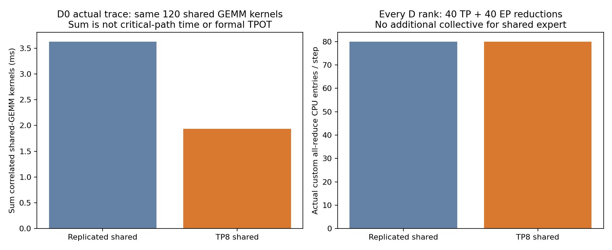
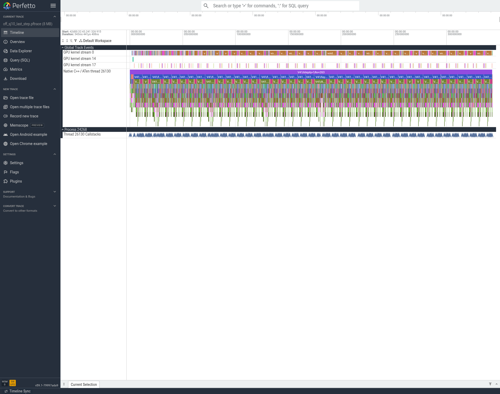
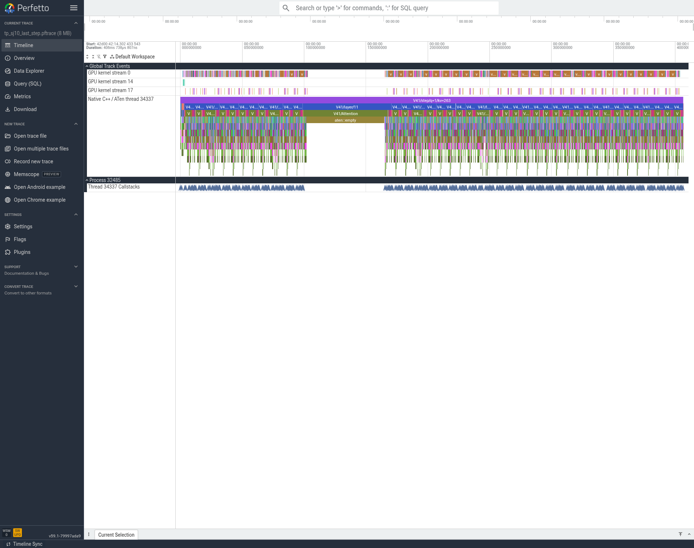
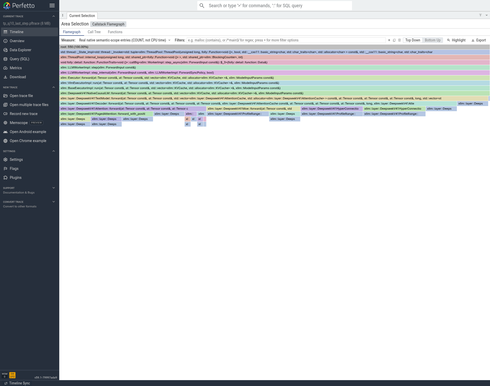

# T04：共享专家按TP8分片，复用既有EP归约

**接受为累计速度基线。仅通过基础功能检查，未完成模型精度验收。**

## 正式结果与取舍

同一ELF、SJ9为P/SJ10为D、各8卡、TP8/EP8、eager、并发1、chunk256。保持D端TP/EP custom、缓存复用与SWA融合；P端保持显式FFI同步。仅D的`XLLM_DSV41_SHARED_EXPERT_TP`切换。官方EvalScope，每组1暖+5正式，profiler关闭；trace另抓。

|输入/输出|共享专家|TTFT ms|TPOT ms/token|E2E s|端到端输出token/s|QPS|
|---|---|---:|---:|---:|---:|---:|
|256/256|off|461.590|126.147|32.629078|7.845763|0.030648|
|256/256|tp|493.206|123.538|31.995417|8.001146|0.031254|
|2048/256|off|2606.333|126.160|34.777055|7.361175|0.028755|
|2048/256|tp|2565.001|123.787|34.130642|7.500591|0.029299|

两组TPOT下降2.068%/1.881%，E2E下降1.942%/1.859%。256输入TTFT回退31.62ms（6.85%）；2048输入TTFT改善41.33ms（1.59%）。所有20个正式请求成功，实际输入256或2048、实际输出256，请求参数与prompt哈希相同，保留每个样本。

**文本差异边界：** 前后两组分别5/5输出文本不同，原文及观察记录见`03_正确性/正式输出文本一致性仅观察.json`和官方SQLite。本轮按用户速度优先口径记录、不做精度调查，不把文本一致性作为晋级门槛。不同生成轨迹也会改变路由专家工作量，因此不能把端到端约2%的全部差值严格归因为共享专家分片。两道计算题4.2与56均通过，但不代表模型精度验收。

## 为什么这样改、改在哪里

参考家明V4中专家并行/输出归约的组织方式和当前原生MoE路径：路由专家已经按EP8分配，但共享专家原先在8个D rank重复完整计算，最后每rank都在EP结果之后加入同一份共享输出。共享专家适合TP切中间维，避免把相同权重与计算重复8遍。

`deepseek_v41_native.h`在加载后按rank把gate/up的2048行切成256行、down的2048列切成256列；对齐block32量化边界。`moe.h`改为本rank的共享专家局部BF16输出转FP32，与本rank路由专家输出相加，再走原有一次EP求和。不开开关仍保留原先完整共享专家在归约之后加入的行为。启动要求TP/EP覆盖同一完整rank集合，所有rank投票确认配置。没有增加共享专家的第二次all-reduce，也没有对已经归约的路由结果重复求和。

## 基本检查

独立8rank用例覆盖0/1/50输入幅度、真实TP切分、部分路由贡献加和及缓冲复用，结果满足已记录的BF16分块舍入容差；完整与分片down投影并非逐位等价，不能把预期舍入差描述为完全一致。原始检查在`../ToDoList_9/03_正确性`，本目录复制其归档。所有正式角色共32个生命周期均正常exit0；没有SIGKILL、重启、驱动或其他容器操作。

## 从实际trace看到什么

前后各16rank的trace和实际ELF SHA/回溯关联通过。所有D rank：每step仍是40次Attention TP归约、40次MoE EP归约，总计80次custom AR，证明没有因共享专家引入额外collective。D0的40层中，OFF的3个共享GEMM都在EP归约之后；TP模式的3个共享GEMM都移到EP之前，与代码预期相符。

每step共享GEMM kernel数量仍是120；变化在shape和工作量而非减少调用次数。D0相关kernel时间累计3.628407→1.936682ms，下降46.62%；CPU mm enqueue累计10.738111→10.754511ms基本未变。原trace未打开InputDims，因此不能声称从图直接读到了2048→256的矩阵shape；shape证据来自实际配置、校验过的ELF及加载代码。

图中TP模式有一处Attention/aten::empty附近的主机长间隙，选中重profiler区间反而更长；不能用自动缩放的整图宽度证明正式性能提升，也不能把这处空隙直接归因于共享专家。应把同语义kernel关联、通信次数和profiler关闭的20个正式样本分开核对。入口COUNT火焰图两边550，其宽度表示真实C++入口次数，并非CPU采样时间。

## 上限、产物与后续

共享GEMM在本次trace的关联累计时间减少约1.692ms，但含采集扰动、stream重叠且不覆盖所有rank的关键路径，因此严格可移除全局比例及理论兑现率未知。不能用3.63ms/126ms伪造严格Amdahl上限；没有声称60% SOL。

- `04_性能/t04_shared_tp_*_v1_raw.tar.gz`保存官方报告、SQLite、请求与角色日志；两个归档均经SHA核验。
- `05_trace/processed_trace_bundle_v1.receipt.json`给出本地代表窗口及完整大trace的NFS路径、大小、SHA；32个rank文件审核未只挑rank0。
- `02_代码/build_and_delta_manifest.json`、`relay_receipt.json`记录二进制/模块、CPU编译和跨共享盘搬运。
- 离线收集器的artifact目录文字错误已修正并单列收据，仅重做离线打包，未重跑推理或覆盖旧结果。

后续继续在本项累计最优上单独验证模型计算流、Graph、投影、CED与其余至T14事项。目录ToDoList_14是实验序号，不表示DSpark/MTP任务T14完成。
