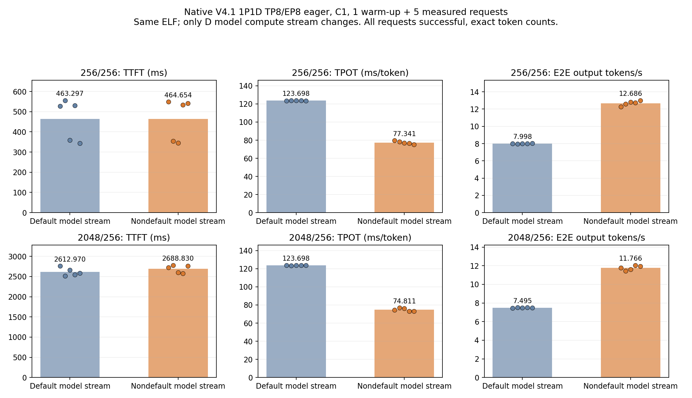
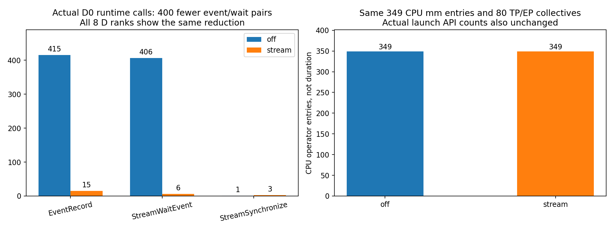
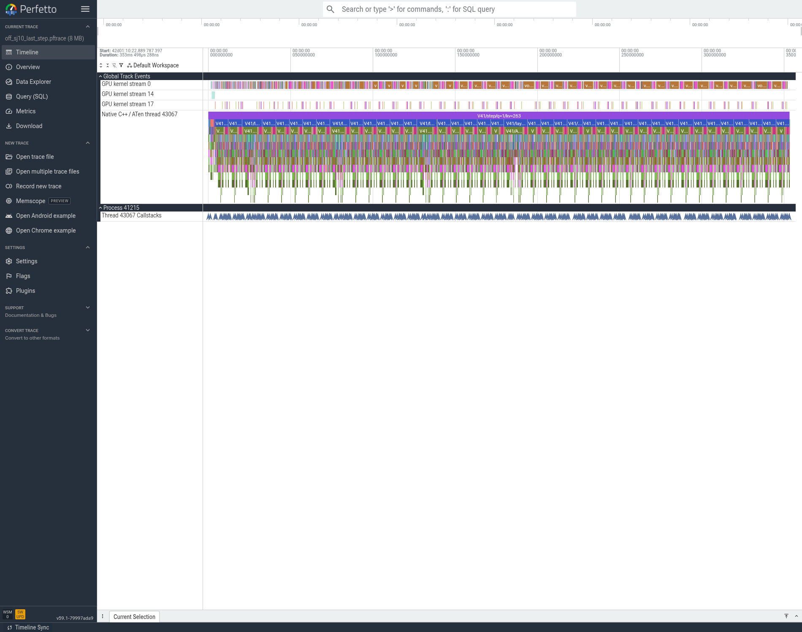
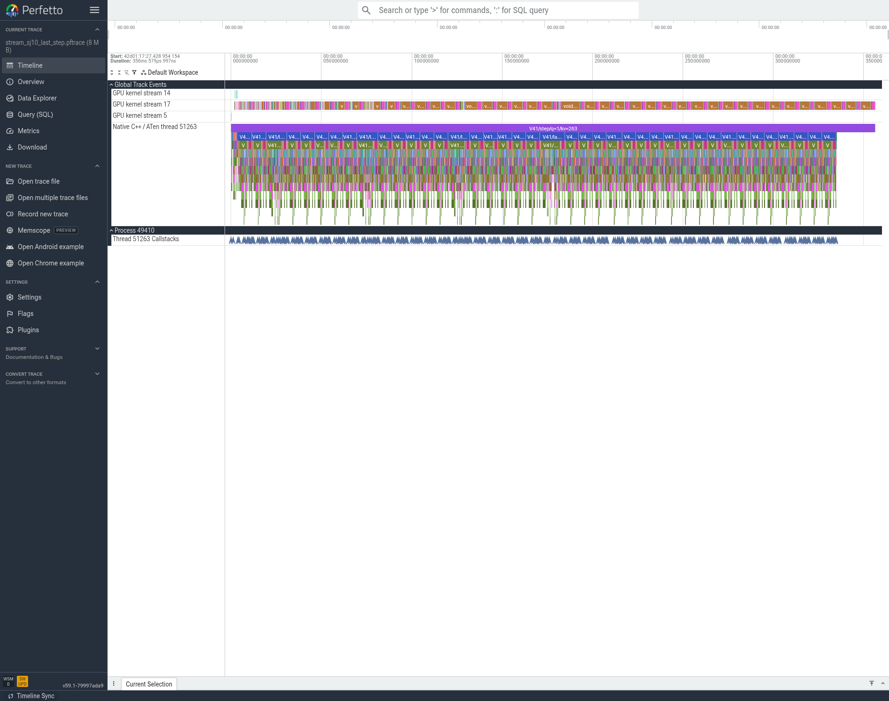
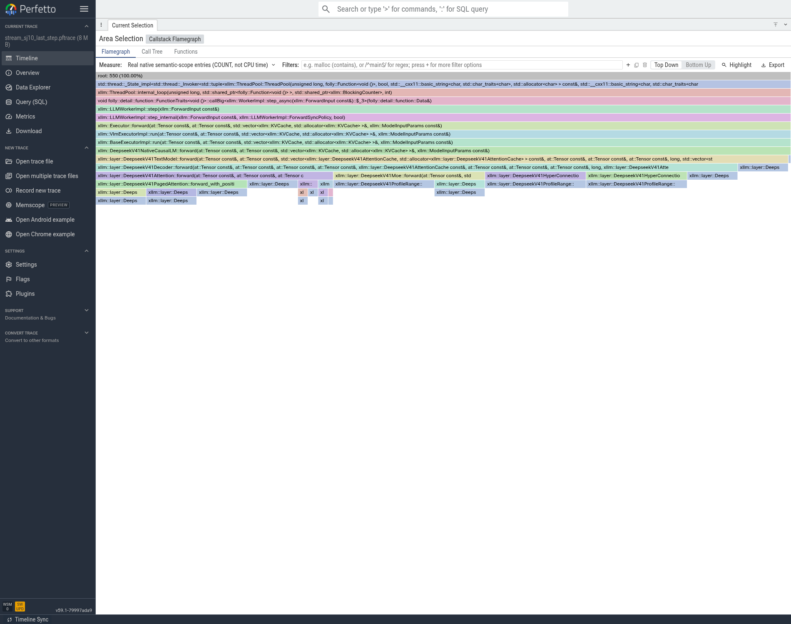

# T07：模型forward使用有效的非默认Torch流

**接受为累计速度基线。仅通过基础功能检查，未完成模型精度验收。**

## 正式结果

SJ9为P、SJ10为D，当前设备实际gmi标识X10000/80GiB；P/D各8卡、TP8/EP8、eager/C1/chunk256。沿用D端TP/EP custom、压缩缓存复用、SWA融合和共享专家TP8；P固定原设置（显式FFI同步）。同一ELF，只切换D端`XLLM_DSV41_MODEL_NONDEFAULT_STREAM`。官方EvalScope，各1暖+5正式；profiler关闭，trace另抓。

|输入/输出|计算流|TTFT ms|TPOT ms/token|E2E s|端到端输出token/s|QPS|
|---|---|---:|---:|---:|---:|---:|
|256/256|off|463.297|123.698|32.006386|7.998404|0.031244|
|256/256|stream|464.654|77.341|20.186499|12.681744|0.049538|
|2048/256|off|2612.970|123.698|34.156048|7.495012|0.029277|
|2048/256|stream|2688.830|74.811|21.765725|11.761611|0.045944|

两组TPOT下降37.48%/39.52%，E2E下降36.93%/36.28%，端到端输出速度提高58.55%/56.93%。**TTFT未改善**：分别增加1.36ms和75.86ms（0.29%/2.90%），如实保留。全部20个正式请求成功、实际输入256或2048且输出256，请求SHA与参数一致；没有缩短输出、失败请求或prefix命中来换指标。

## 从源码与当前trace想到的改动

MUSA的Torch默认流可能以空句柄表示；当前TVM FFI流桥接为得到可用句柄，会另取池内流，借助event在Torch流与FFI流之间交接。40层反复调用MATE/FFI，形成大量跨流交接。参考既有MUSA流桥接与SGLang交付中统一当前计算流的做法，本项没有重写MATE算法，而是在原生模型forward边界选择一条有效非默认Torch流，使Torch算子、MATE和本地kernel直接使用同一条计算流。

新增`core/platform/musa_model_compute_stream.h`：进入前同步原输入流；线程/设备局部复用一条池内计算流；在同一流执行完整forward；返回前同步该计算流并恢复原流；将输出storage登记到后续原流消费者，避免allocator跨流过早回收。`models/llm/musa/deepseek_v41_native.h`只在显式环境开关打开时使用这个guard。当前接受的配置只在D打开，P保持原设置。原server调度、Mooncake、模型方程与权重量化不变。新增同步是明确边界，没有删除输入依赖、伪造完成事件或CPU模型计算fallback。

## 实际trace如何证明机制变化

前后各16rank的文件SHA、40层、实际C++ PC与新ELF关联全部通过。在8个D rank上，同一个q=1/kv=263 step均少400次EventRecord、少400次StreamWaitEvent；mm调用数、kernel launch API数及80次TP/EP custom归约均相同。

|实际D0同形状step|OFF|STREAM|
|---|---:|---:|
|musaEventRecord|415|15|
|musaStreamWaitEvent|406|6|
|musaStreamSynchronize|1|3|
|aten::mm|349|349|
|custom TP/EP归约CPU入口|80|80|
|musaLaunchKernel|3534|3534|
|musaLaunchKernelExC|300|300|

D0图中原先大部分Torch工作在stream0、MATE工作在stream17；之后主要工作集中到stream17。stream编号是该次进程的实际追踪编号，不是需要写死的配置。原来的event交接减少，同时保留入口/出口同步；模型层数与调用的数学kernel并未因为减少工作量而消失。

**不要把重profiler图的整段宽度当正式TPOT：** 选中CPU区间约353.50→356.58ms，包含大量采集扰动和边界等待，反而略长。STREAM的末尾显式等待GPU完成，而OFF的部分异步kernel还在CPU范围之外；两者的完整窗口kernel数也不能机械对比。应该读取同语义的流归属和交接次数，再用关闭profiler的正式77.34/74.81ms/token判断实际收益。入口COUNT火焰图两边550，宽度表示调用入口数，不是CPU采样耗时。

## 基本正确性、归因限度及上限

18个实际C++边界guard检查覆盖NativeSharedMlp、真实MATE mHC、原流消费者、输出释放后的allocator压力，均严格相等；原始归档从E20复制入本次证据。完整P/D两模式都回答4.2和56。正式输出10对中8对文本一致，2对不同；按用户口径只记录、不复测、不开展精度原因排查，不作为速度晋级门槛。未开展API、MathQA或固定前缀logits/logprobs验收。

性能差值不是400个API的CPU duration简单相加。实际D0重trace中EventRecord+StreamWaitEvent的CPU累计仅约2.323→0.051ms；改动还会改变GPU跨流依赖及rank等待，而入口/出口同步又增加了显式完成等待。不能把这些计数推成精确的46ms分解，也不能把重trace同步耗时直接套到正式测试。机制证据支持“减少跨流交接”，正式A/B测得速度收益；严格关键路径可消除比例、理论兑现率及数值漂移对自由生成路由的影响仍未知。不宣称60%SOL。

## 产物、运行可靠性与后续

- `04_性能/t07_model_stream_*_v1_raw.tar.gz`：EvalScope报告、SQLite、全部请求、角色配置/日志及二进制manifest。
- `05_trace/计算流全部D_rank运行时核对.json`：8个D rank的原始runtime次数、CPU API累计、stream分布及逐rank比较。
- `05_trace/processed_trace_bundle_v1.receipt.json`：7.1MB代表窗口包和两个完整大trace的NFS路径、大小、SHA。
- `02_代码/source_provenance_annotation.json`：更正继承的build purpose文字，本次实际已包含被接受的共享专家TP；原始build manifest保持不改，源码SHA为准。
- 本机AFTER Perfetto首次页面加载超时，保留失败目录；复制成功OFF页面的缓存到新profile后重渲染同一pftrace成功，未重跑推理。

32个模型进程生命周期全部正常exit0，本项没有TERM超时、SIGKILL、重启或驱动操作。后续在此累计最优上测试只读Gate转换缓存、投影/Graph、chunk/CED，以及真实前缀状态、多请求与DSpark/MTP到T14；尚未完成的项不标完成。
