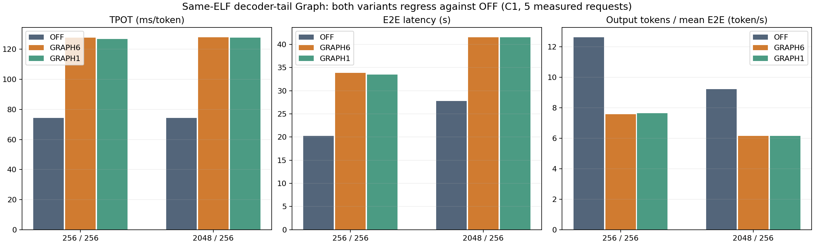
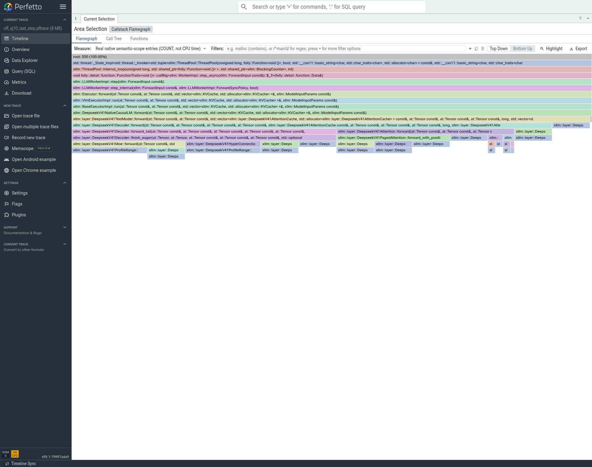
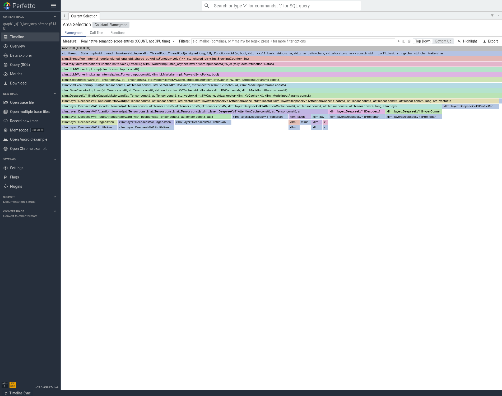
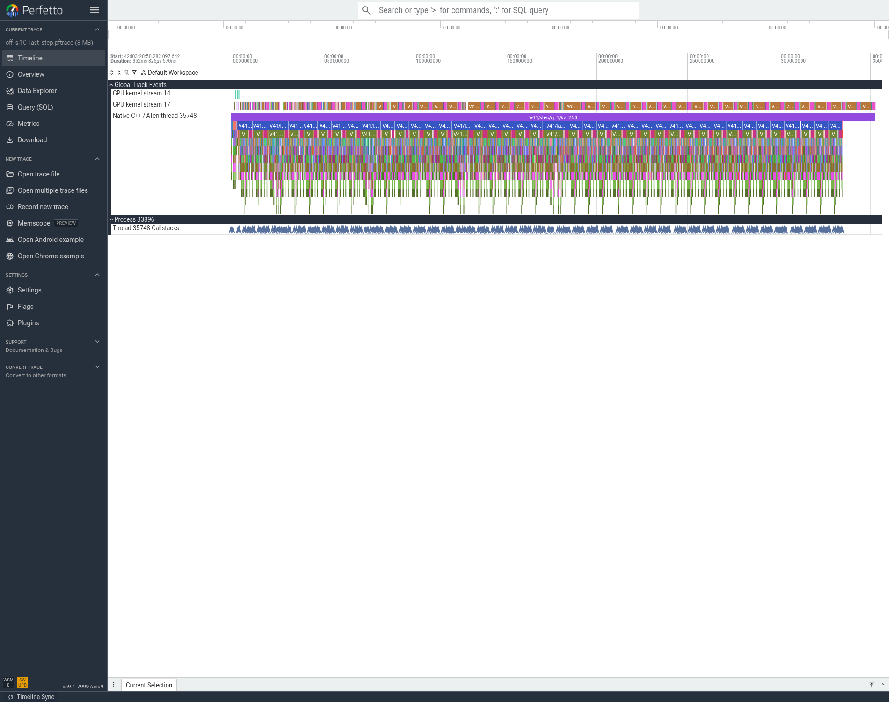
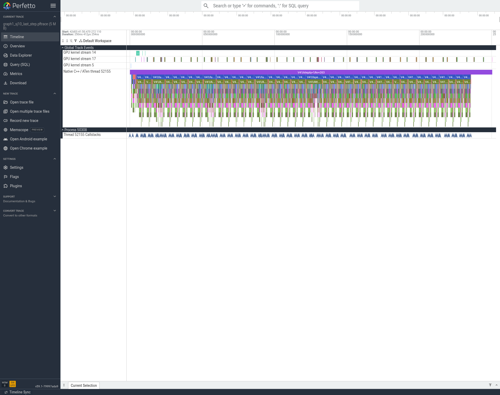

# Decoder tail Graph：两种输入拷贝方案均未晋级

仅通过基础功能检查，未完成模型精度验收。

同一9b28367c… ELF，P端固定stream0/FFIsync1/MCCL blocking wait1，D端沿用4411累计最优。全局enable_graph仍false，局部Graph只覆盖Attention输出后的TP、mHC、MoE/共享专家、EP与残差；Attention/Indexer/Cache保持eager。OFF、GRAPH6、GRAPH1依次进行，后两者分别使用6次输入copy和1次融合copy。

|模式|输入/输出|TTFT ms|TPOT ms/token|E2E s|输出token/s|QPS|
|---|---|---:|---:|---:|---:|---:|
|off|256/256|1304.014|74.419|20.280750|12.622807|0.04930784|
|off|2048/256|8856.636|74.295|27.801931|9.207994|0.03596873|
|graph6|256/256|1264.105|127.761|33.843128|7.564313|0.02954810|
|graph6|2048/256|8921.030|128.018|41.565531|6.158949|0.02405840|
|graph1|256/256|1180.529|126.824|33.520565|7.637103|0.02983243|
|graph1|2048/256|8953.210|127.835|41.551065|6.161094|0.02406677|

三种模式均通过两题、两组各1暖+5正式、独立256/8 trace及各16rank正常退出0；合计30个正式成功请求，实际token数全部符合要求，48个rank生命周期正常退出，没有SIGKILL。这证明本轮功能运行完成，不代表模型精度验收通过。

两种Graph都明显慢于OFF，融合输入copy没有消除整体回退，故均不晋级；后续候选仍以4411的有效非默认D计算流和已接受的custom/cache/shared路径为基础，Graph默认关闭。P端blocking wait的TTFT代价在所有三模式固定，不归因给Graph；它本身也不是累计速度最优配置。

原始EvalScope SQLite、每次请求日志、参数与服务端日志在04_性能各模式_raw；数值从5条成功请求重新计算，输出token/s=256/平均单请求E2E，QPS=1/平均E2E。实际trace的48rank SHA、C++关联和前后ATen/GPU工作量正在CPU核验；尚不把原因写死为Graph launch、通信或内存，也不凭CPU launch少就声称加速。

## 从实际时间线与ATen里读到什么

以下为同样的最后一个q1/kv263解码step（D rank0）；三模式全部48个rank、96个原始文件已经核对SHA、RecordFunction ID/OS线程与实际ELF C++回溯。参考区间在heavy profiler开启时，不能把它的352.83/260.45/250.41ms当作正式TPOT。

|实际观测|OFF|Graph6|Graph1|
|---|---:|---:|---:|
|Native语义入口COUNT|550|310|310|
|CPU/annotation事件总数|24105|18785|17585|
|aten::mm CPU调用数|349|189|189|
|aten::copy_ CPU调用数|997|957|717|
|aten::item CPU调用数|461|301|301|
|musaGraphLaunch CPU调用数|0|40|40|
|可见的融合输入copy GPU kernel|0|0|40|

Graph1相比Graph6少了240次aten::copy_（每层6次、40层）并换成40个输入copy kernel；这与代码中的独立开关相符。尾部mHC/MoE的C++函数不再每次在CPU展开，转为40次graph replay，因此调用链里相应的CPU分支变窄。这些证明减少了CPU提交，不能证明总GPU工作减少或正式性能提升。

火焰图标题明确使用ENTRY COUNT；其宽度是实际语义入口计数，不是耗时。Graph中没有再次执行相同CPU函数体，所以图上看不到原MoE分支，不能据此说没有执行MoE。

## 为什么不凭“kernel变少”解释提速

已进一步核对三个模式D rank0的**完整原始trace**，每份先和原始manifest的SHA、大小匹配后读取，不只是检查本地裁切片段。完整7个decode step中，OFF可见560个custom allreduce及560个MATE专家GEMM；两种Graph各记录280次GraphLaunch，却不暴露Graph内部的这些kernel活动。Graph1在Graph外的融合copy仍可见280次。见`05_trace/full_graph_kernel_visibility.json`。因此，Graph图上GPU活动变稀疏有采集可见性原因，不能把空白当作GPU空闲，也不能说专家计算或通信被删掉。

CPU侧40次GraphLaunch合计约0.52ms（profiler开启）；这个API提交耗时本身不能解释正式TPOT增加约53ms。当前能够确认CPU展开工作减少、正式性能反而变差；尚不能凭现有trace把全部回退归因到Graph launch、custom allreduce或内存。正确结论是拒绝晋级、保留原最优，而不是用缺失的GPU节点图凑一个根因。

后续若再研究Graph，先补支持Graph内部节点的活动采集，或用低开销设备事件分别量tail计算/通信等待与整步端到端时间；同时检查40段Graph的捕获流、工作区和IPC注册行为。源码每层取得capture stream是一条待验证线索，当前trace不能证明它就是瓶颈。此前单卡micro已略慢，不能从“分段Graph理论上减少launch”推断八卡一定更快。严格可消除关键路径占比和理论兑现率仍未知。

当前任务继续按Graph关闭的累计方案推进mHC、投影打包、prefill策略和T14，不以负收益方案替代基线。
