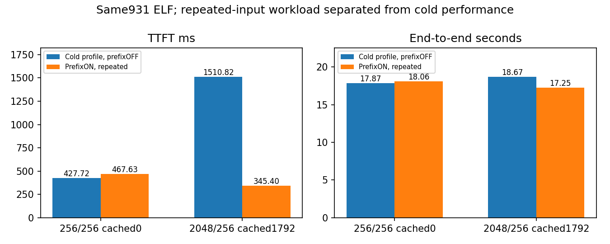
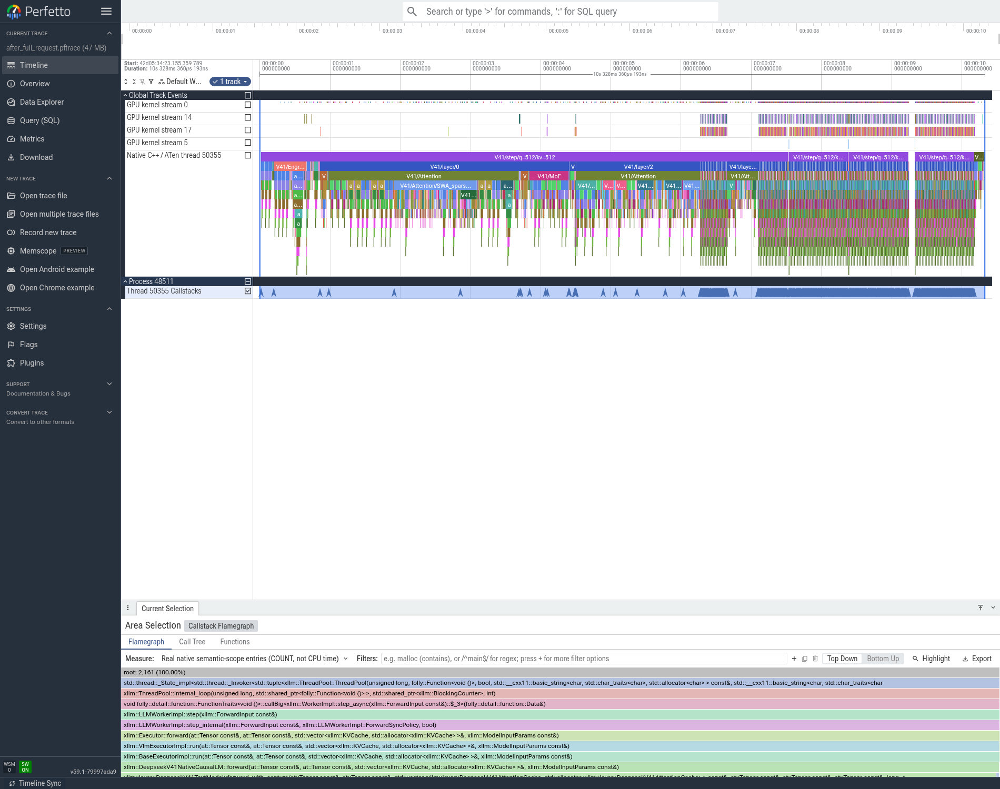
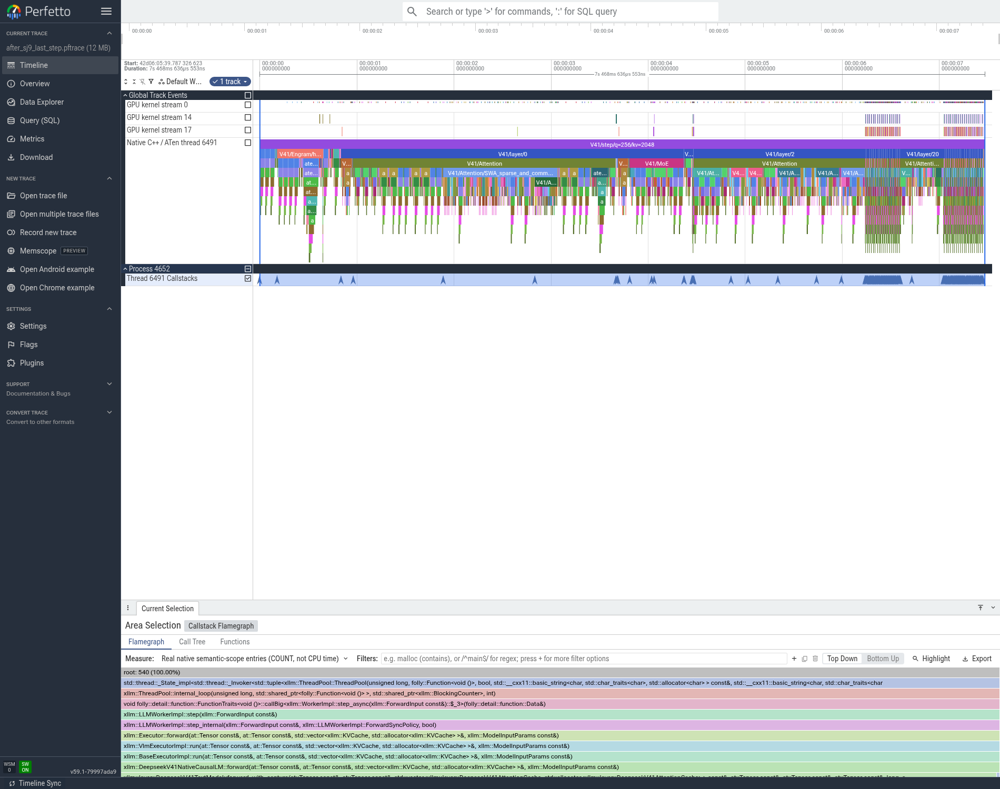

# T11：现有前缀缓存路径已跑通，收益仅属于命中场景

## 接入与基本检查

沿用现有generic CompositeBlockManager的C1/C2与SWA别名/缓存路径，不盲目扩展MUSA私有V4快照tag协议；本项没有增加新的GPU kernel或模型forward。P端enable_prefix_cache=true，D端false，保留长输入chunk512、mHC融合及已接受的通信/SWA/模型流配置。spec、CED、Graph、batch关闭，P/D各TP8EP8、DP1CP1、eager、C1、同931 ELF。

除两道计算题外，新增4条短输出请求观察请求边界：2048输入cold命中0，重复命中1792；追加Reply briefly后实际2051输入命中1792，再回原2048仍命中1792；四条都成功生成实际8token。cold与repeat的贪心文本不同，已在03_正确性/缓存文本差异_仅记录.json记录，依当前要求不继续做精度定位。

这里只证明相关调用、缓存命中和请求边界可运行，不能证明缓存数值与冷路径逐token等价。**仅通过基础功能检查，未完成模型精度验收。**

## 两组正式结果

各1次暖机+5次正式请求，10/10成功，全部原生usage为目标输入256/2048和输出256。正式SQLite中的response ID与实际P端terminal日志逐题关联，确认短组5条cached0、长组5条cached1792，见04_性能/formal_cached_token_counts.json。16rank正常退出，无强杀。

|输入/输出|模式|实际cached tokens|TTFT ms|TPOT ms/token|端到端s|输出token/s|
|---|---|---:|---:|---:|---:|---:|---:|
|256/256|冷请求|0|427.72|68.42|17.8742|14.3223|
|256/256|prefixON重复请求|0|467.63|68.99|18.0605|14.1746|
|2048/256|冷请求|0|1510.82|67.31|18.6741|13.7088|
|2048/256|prefixON重复请求|1792|345.40|66.30|17.2528|14.8382|

长输入TTFT下降77.14%、端到端下降7.61%、输出吞吐上升8.24%。短输入没有完整可复用C2单位，TTFT增加9.33%、端到端增加1.04%，不宣称改善。接受的是重复长前缀工作负载；冷请求基线不改为这个结果，默认不能假定所有线上请求都命中1792。

## trace支持的原因与限制

全32rank/64文件SHA及准确931 ELF原生PC核验完成。8个P rank一致：before为4个q512 prefill step，kv512/1024/1536/2048；after为1个q256、kv2048 step，说明总上下文仍2048、但只重新计算末256token。P0完整捕获kernel29974→7495，其他rank也对应少了大部分prefill步骤。D仍要生成剩余7个decode token，不能说整个模型只处理了256上下文。

本项优势是复用已计算的1792token状态，减少重新执行层，而不是让一个GEMM自身快77%。before最后chunk512与after新算256在矩阵形状上也不同。火焰宽度为原生入口COUNT，不能按宽度直接算耗时占比；正式速度来自关闭profiler的EvalScope。

严格的可移除关键路径占比仍未知。对照整个TTFT仅占端到端8.09%，本轮端到端下降7.61%还包含TPOT约1.49%的变化；不能简单将两者比值当作prefix理论兑现率，更不能把缓存命中率当作SOL。

## 产物与继续方向

本地04_性能保留全部原始SQLite、SSE、角色配置、服务日志；05_trace保留全rank审计与代表实际窗口。NFS根/data/nfs_shared/xiaopang/deepseek_v41_flash_1p1d/20261112_sglang_mt_cpp，run为t11_prefill_prefix_v1。大trace路径、SHA见05_trace/processed/analysis_receipt.json与原始产物NFS索引。

后续先跑同请求并发C2/C4下B1排队与真正B2/B4的吞吐对照；prefix关闭，以免命中率遮盖合批效果。保持无MTP/无CED，未验证组合不自动叠加。
