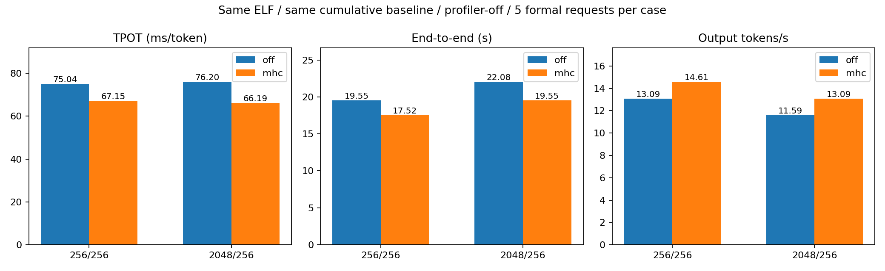
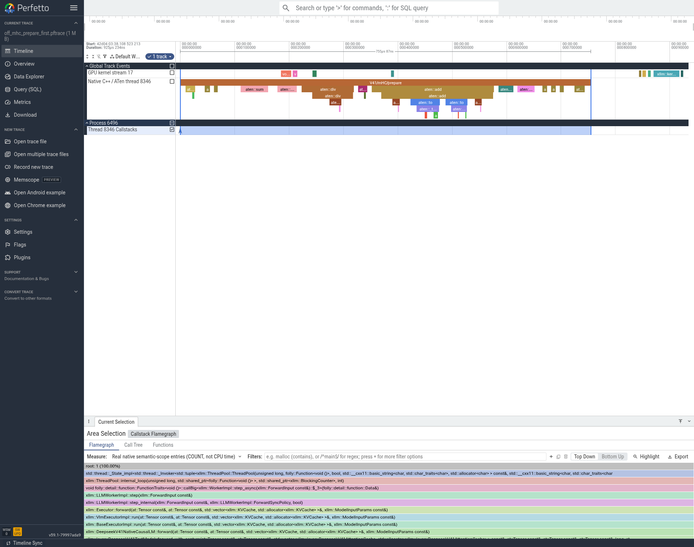
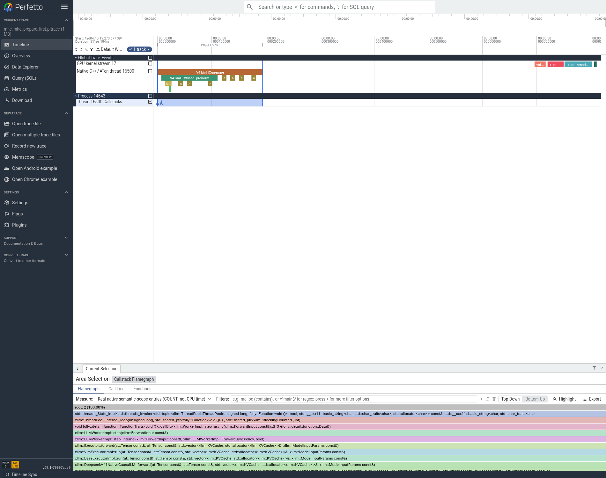
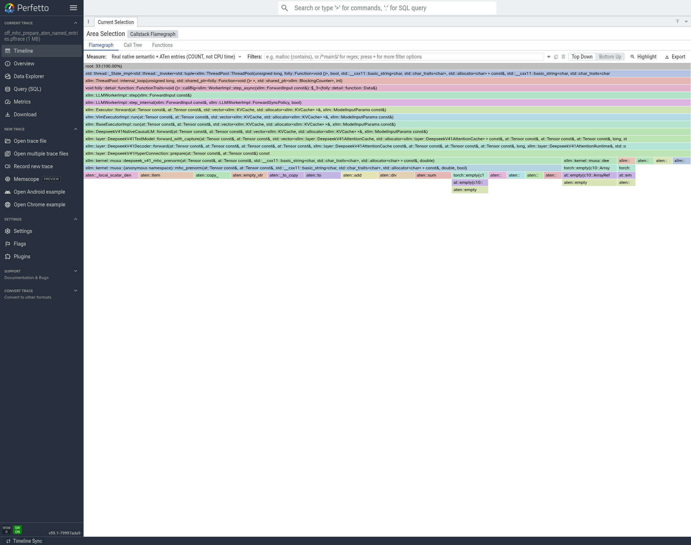
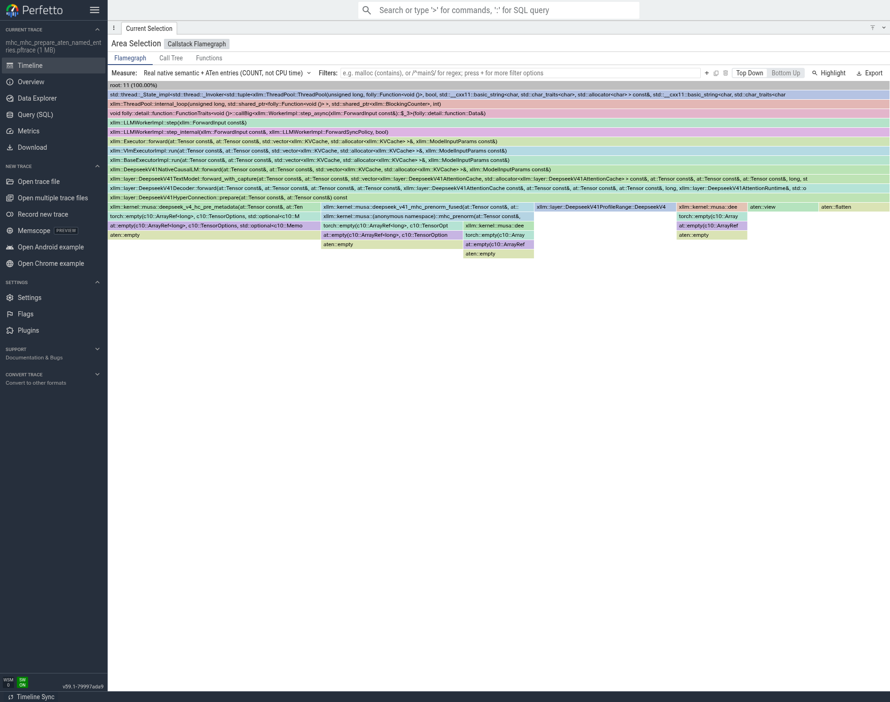

# mHC 归约融合：正式性能、实际 trace 与晋级决定

本项接受，纳入累计最优。只切换 Decode 的 `XLLM_DSV41_DECODE_MHC_FUSED_REDUCE`；两边使用同一 ELF，保留已经接受的 TP/EP custom all-reduce、缓存复用、SWA 融合、共享专家 TP 和非默认模型 stream。Prefill 固定使用 E40 已验证的当前流完成边界，未开启 blocking wait。Graph、Gate cache、packed、CED、批处理和 DSpark 均关闭。

**仅通过基础功能检查，未完成模型精度验收。** 两个模式均通过 1.3+2.9 与 7×8；改动相关的 40 个合成用例和 6 个实际 mHC 用例通过。两组各一次暖机、五次正式请求，使用官方 EvalScope，profiler 关闭。20 次正式请求均成功，实际输入分别为256/2048，输出均256；32个rank正常退出，无强制清理。

## 结果

|输入/输出|模式|TTFT ms|TPOT ms/token|端到端 s|输出 token/s|QPS|
|---|---|---:|---:|---:|---:|---:|
|256/256|off|419.65|75.04|19.5543|13.0918|0.051140|
|256/256|mhc|395.42|67.15|17.5186|14.6130|0.057082|
|2048/256|off|2649.08|76.20|22.0801|11.5941|0.045290|
|2048/256|mhc|2672.03|66.19|19.5510|13.0940|0.051148|

256/256 的 TPOT 降低10.51%，端到端降低10.41%，输出速度提高11.62%；2048/256 分别降低13.13%、降低11.45%、提高12.94%。TPOT 样本标准差分别为 OFF 1.44/1.42 ms、ON 1.86/0.85 ms，提升明显大于这轮波动。长输入 TTFT 从2649.08升至2672.03 ms（+0.87%），应如实保留；P端未切换该优化，不能把短输入TTFT的下降归因于Decode融合。

## 为什么想到这样优化、具体改了什么

此前 trace 中每层两处 mHC prenorm 反复执行 FP32 的归约、缩放、epsilon 与 rsqrt 等细粒度操作。40层×2处，每步80组。保持权重、混合顺序、归一化语义和后续MATE GEMM不变，把原有6个GPU kernel的prenorm归约阶段合并成一个 `mhc_prenorm_reduce_kernel`。实现位于我方MUSA kernel与模型调用层；不是把完整mHC删除，也不是换精度/缩短输出。详细源码见 E43 的相对4411补丁和构建manifest。

## 从实际图与原始数据看到了什么

原始前后trace覆盖全部P/D各8rank，32个rank的64个trace/stack文件均完成SHA校验及实际ELF的native PC符号化。八个Decode rank每个q=1 step都看到80个新增的融合kernel；`aten::sum`160→0、`aten::div`160→0、`aten::rsqrt`80→0、`aten::add`204→44、`aten::mul`116→36，`aten::mm`349→349。

完整原始trace每个rank包含7个decode step，总GPU kernel数均减少2800，即每步减少400。截取的单步区间因异步边界有1个kernel的归属差，不能要求裁剪窗口的总数刚好差400；因此这里用完整原始trace核实总量。机器可读证据见 [all8_fused_path_effect.json](../05_trace/all8_fused_path_effect.json)。

实际Perfetto时间线与native调用链图保存在 `06_图表/BEFORE_D0_PAINTED`、`06_图表/AFTER_MHC_D0_PAINTED`。ENTRY_COUNT火焰宽度表示入口次数，不是CPU或GPU耗时。正式性能与profiler-on的单步耗时不可混用。证据支持“减少细粒度launch和中间操作”的机制，但未测出可严格扣重的关键路径占比，不能把kernel时长相加后声称解释了全部8～10ms的TPOT收益，也不能给出虚构的理论上限兑现率。

## 可追溯资产

- 源码父提交：`4411c026583457c5f454100ccafcf3db8fc7291d`；当前候选补丁 `ToDoList_43/02_代码/source_delta_vs_best_4411.patch`，SHA256 `5ec51874f45ccd10de61e02a843e0c9bfe795b458ed1d3b266444805def27829`。尚未为本项单独创建新Git提交，不能说4411已包含它。
- 实际ELF：`artifacts/native_t14_native_block/bin/xllm`，SHA256 `c608c4bf811f0349dec2e2954044bbf43b5d5ae79bce6221b07712d79c8a79cf`。
- NFS实验根：`/data/nfs_shared/xiaopang/deepseek_v41_flash_1p1d/20261112_sglang_mt_cpp`。
- 原始两组报告/SQLite/请求日志：`new_start_t03_mhc_integrated_off_v1/performance` 与 `new_start_t03_mhc_integrated_mhc_v1/performance`；本地汇总见 `04_性能/ab_summary.json`。
- 原始完整trace：根目录 `new_start_t03_mhc_integrated_off_v1_raw_trace.tar.zst`（88,997,993字节，SHA256 `864f3d11f6faa01545433b7665203b6e6b148b77a910ddeb845512a987ab2d59`）与 `new_start_t03_mhc_integrated_mhc_v1_raw_trace.tar.zst`（83,623,693字节，SHA256 `d43225bba429cccc3086acde6cdc12c8b8beb6782228efb80f16cb3c17b94f11`）。
- 已处理bundle：`new_start_t03_mhc_integrated_trace_analysis_v1`，7,098,610字节，SHA256 `760aaac115657d4403403533e4679586ff6b0da95bf52d3ac490aeb15de178cc`。

下一项从本项ON配置继续，只开启共享专家gate/up投影合并。不会把Graph或其余未验收候选一起打开。

### 图片查看说明

首次自动截图时，UI轨道已经存在但时间线canvas尚未绘制，原 `BEFORE_D0/真实CPU区间与GPU时间线.png` 是空白界面，不能用作读图证据。保留该初始产物并重新等待实际区间与选择数据加载，以 `BEFORE_D0_PAINTED` / `AFTER_MHC_D0_PAINTED` 下的图为准；原始trace与转换文件未修改，也未重新跑模型。

补充读图边界：本项新融合阶段新增了native语义范围，因此ENTRY_COUNT从550变为630；它表示被记录的语义入口增加80，不能理解为GPU工作增加或性能变慢。GPU kernel实际减少400/step，与入口计数是两个不同指标。

## 单次 mHC prepare 放大图：怎样读优化发生的位置

下面是同一D rank、同一层位置的实际区间放大；图中时间受profiler影响，不能当正式延迟。关闭时能看见 `aten::sum`、`aten::div`、`aten::add` 等分散调用；开启后该段进入 `V41/mHC/fused_prenorm`，归约、除法与归一化的组合改由融合GPU kernel执行。`mHC prepare`的原生语义入口由1个变为2个，因为增加了融合路径注释，这与GPU kernel减少不矛盾。

此处是图上的路径证据，正式收益以关闭profiler的EvalScope结果为准；火焰图宽度为ENTRY_COUNT，不能解释为CPU耗时比例。

## 真实ATen入口火焰图：同RecordID、同ELF回溯

为把调用链具体落到ATen，离线转换器新增可选include-aten。每个叶子aten::名称来自同一原始RecordFunction ID，父调用链来自实际c608 ELF的回溯PC；不是凭源码手绘的火焰图。两张图都只截同一位置的单次mHC prepare。

总入口33→11（包含语义注释），其中aten::sum2→0、div2→0、rsqrt1→0、mul1→0，标量item3→0；开启后保留MATE投影和融合尾归约，主要ATen叶子是必要的empty/flatten/view。不能仅凭item名称声称消除了GPU到CPU同步，因为该标量也可能是CPU scalar装箱/提取。全模型的400个kernel/step减少与正式10.5%/13.1% TPOT改善由前文独立数据支撑。

宽度为COUNT，不是CPU时间，也不代表每个ATen消耗一样多。实际CPU区间仍可在同图时间线与此前放大图中查看；重profiler时间不能替代正式服务速度。转换器在两张真实trace上通过TraceProcessor0错误验证，原默认仅语义入口输出与旧pftrace字节完全一致，见05_trace/aten_converter_real_trace_regression.json。没有重新跑模型或抓新的GPU trace。
