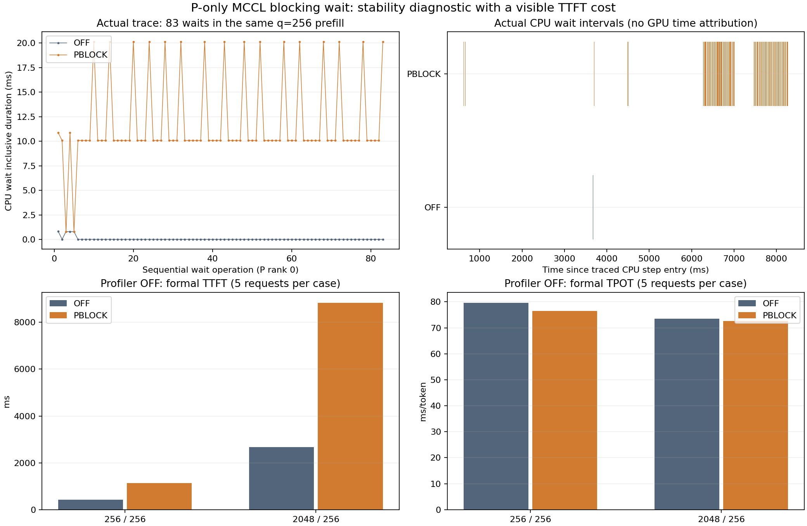

# P端blocking wait：本轮未停滞，速度未晋级

仅通过基础功能检查，未完成模型精度验收。

P恢复stream0/FFIsync1，仅开启TORCH_MCCL_BLOCKING_WAIT；D维持累计最优。使用同一c404 ELF，Gate/Graph关闭。两道计算题通过、10条2048/8无缓存全部成功；两组各1暖5正式均成功且实际token合格，16rank正常退出0。独立256/8 trace已保存，CPU核验仍在运行。

|输入/输出|TTFT ms|TPOT ms/token|E2E s|端到端输出token/s|
|---|---:|---:|---:|---:|
|256/256|1136.831|76.483|20.639966|12.403121|
|2048/256|8837.778|72.658|27.365632|9.354799|

当前2048 TTFT约8.84秒，高于此前累计最优约2.69秒；不能称为速度优化。暂时把它作为后续D端候选的固定诊断条件，以便同场AB有稳定的P端参考，同时保留原速度最优配置和全部历史结果。它没有证明根因已解决或长期稳定。下一步应进一步定位MCCL异步完成边界，避免用高代价的主机轮询等待代替最终实现。

原始数据及SQLite在04_性能/t07_prefill_blocking_wait_v1_raw；所有指标从5个成功请求原始行重新计算；output_tps为256/平均单请求E2E，QPS为1/平均E2E，与EvalScope整场时长吞吐有小差异。

## 实际trace中看到的等待代价

同一c404 ELF，固定q=256/kv=256的P rank0实际trace，83次record_param_comms的Collective name=wait在OFF合计3.862ms、中位0.008ms；PBLOCK合计980.088ms、中位10.074ms。操作数没有减少，等待时间明显变长，符合当前安装源码中每轮10ms sleep的行为。完整16rank/32文件SHA、C++入口与ELF符号关联已核验，摘要及SHA见05_trace/pblock_processed/analysis_receipt.json。

这些是重profiling下的CPU wait包含时长，不能当作无profiling的TPOT、也不能把多层父子CPU事件时长相加成关键路径。正式性能独立从EvalScope SQLite的成功请求行计算。图中的时间线仅画实际CPU wait区间，没有补造GPU归属或把CPU与GPU时钟当作同一时钟。该证据支持继续测试低等待代价的同步边界，但没有证明此前停滞的根因。
