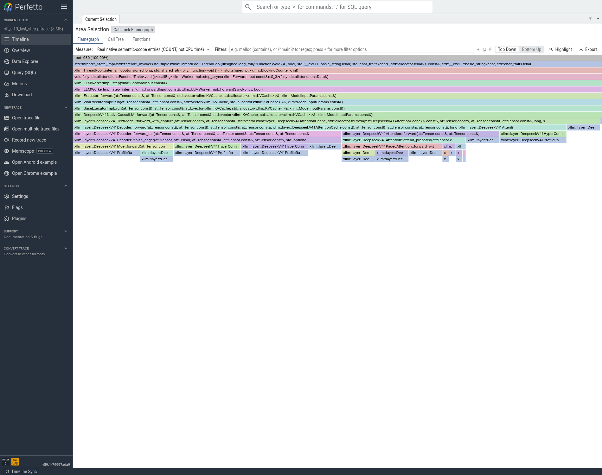
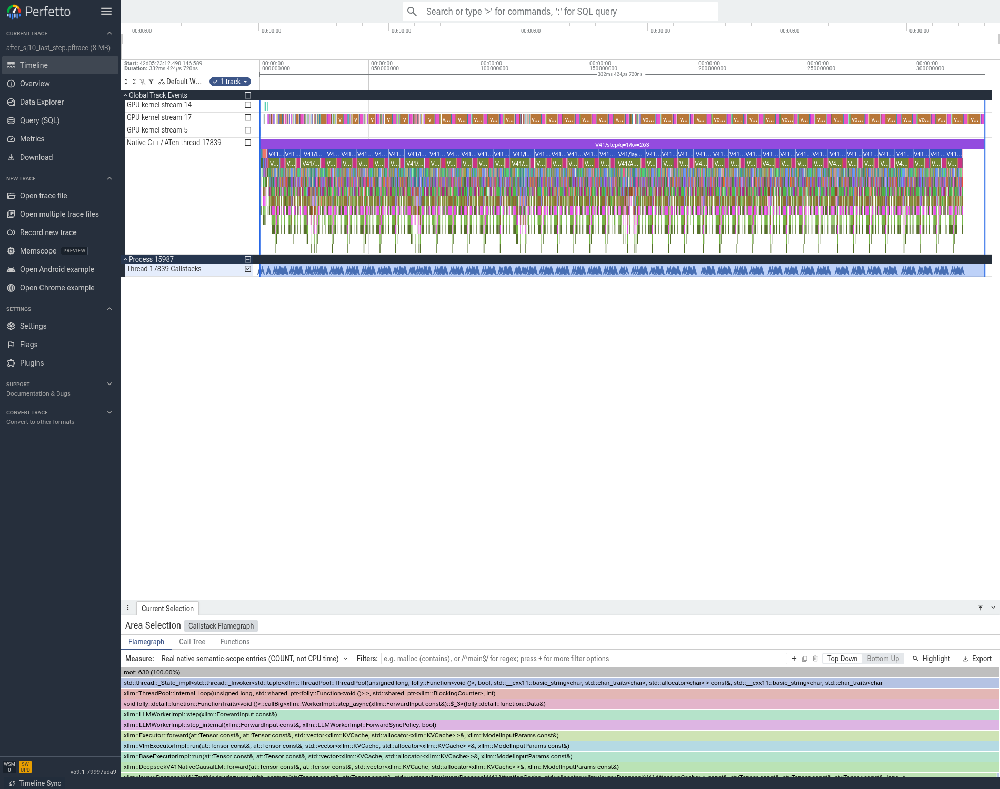

# T04：D 侧 Gate FP32 权重缓存，局部消除拷贝但未晋级

本轮直接在累计最优 mHC 融合版本上比较，仅在 D 开启 `XLLM_DSV41_GATE_CACHE_FP32_WEIGHT=1`。同一 `931741c3…` 二进制，P/D 各 TP8/EP8、eager、并发1；每组1次暖机后5次正式请求。

|输入/输出|原 TTFT(ms)|缓存 TTFT(ms)|原 TPOT(ms/token)|缓存 TPOT(ms/token)|TPOT变化|
|---|---:|---:|---:|---:|---:|
|256/256|347.041|436.403|66.605|67.783|+1.77%|
|2048/256|2693.981|2676.572|67.384|64.971|-3.58%|

两道算术题通过，正式请求10/10成功且实际输入/输出 token 数与目标一致；16个 rank 正常退出。仅通过基础功能检查，未完成模型精度验收。

## 从 trace 能确认什么

已核验前后共32个 rank 的64个 trace/回溯文件、实际 ELF SHA 和原生PC。D 的8个 rank 均观察到每步 `aten::_to_copy` 595→555、`aten::copy_`837→797，`aten::mm`349保持不变；完整7步捕获的GPU kernel数每 rank 减少280。解释是40层 Gate 的静态权重预先缓存为FP32，避免每步再转换/拷贝，计算仍在GPU上执行。

代价为每张GPU额外约300MiB静态FP32权重缓存。这些计数证明优化路径执行，但不能把40个操作的次数直接当成关键路径时间。短输入反而变慢、长输入小幅改善，因此默认保持关闭，不将其加入累计最优。

## 可复核产物

- `04_性能/ab_summary.json`：全部5次样本及均值/样本标准差、EvalScope会话吞吐。
- `04_性能/t04_gate_cache_decode_v2_raw/`：实际服务配置、原始日志、两道题和正式数据库。
- `05_trace/processed/`：前后全rank审核、原生PC解析及可交互Perfetto文件。
- `05_trace/all8_gate_cache_effect.json`：8个D rank的上述操作/核数证据。

结论：保留可选实现及负/混合结果，不追加重测来筛选好看的数字。

## 实际Perfetto图

两侧原生模型语义入口均630，优化发生在Gate内部的权重转换。图不支持单凭肉眼断言其主导了全局延迟，具体40次拷贝下降由全rank计数核验。
