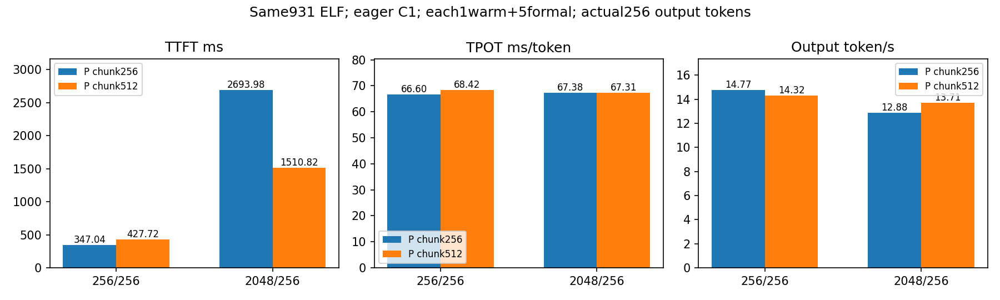
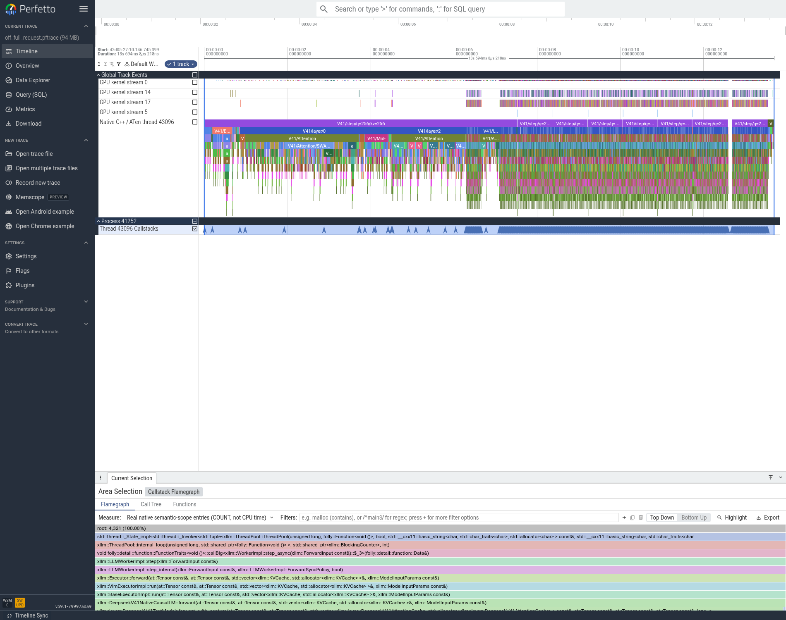
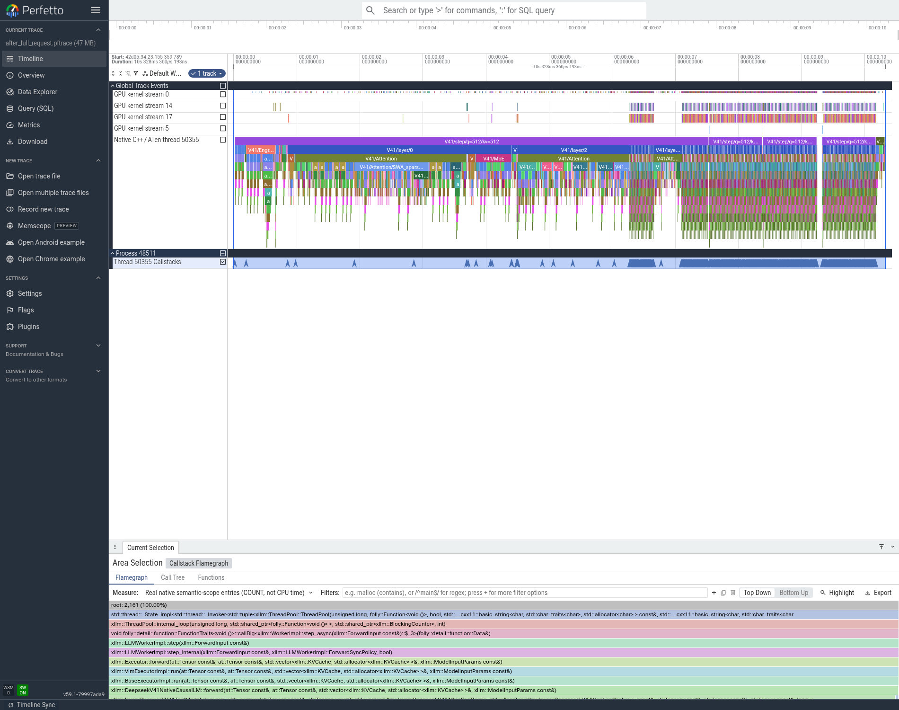

# T09：Prefill chunk512改善长输入TTFT，短输入结果未改善

## 测了什么与决定

保留累计已接受的TP/EP custom allreduce、SWA读融合/压缩缓存复用、共享专家TP、D模型流以及D mHC融合。只将P的max_tokens_per_batch和max_tokens_per_chunk_for_prefill从256改为512；D不变，prefix/spec/Graph/Gate/packed/CED/batch均关闭。P/D各8卡、TP8EP8、DP1CP1、eager、C1、同931741c3 ELF。

对照正式数据引用E50已完成的关闭投机run，没有重跑来筛选对照；新的E49仅补真实2048/8长输入trace，不伪造额外正式测速。两组各1暖5正式，全部10次成功且原生usage符合256/256或2048/256。两道计算题通过，16个rank正常退出。仅通过基础功能检查，未完成模型精度验收。

|输入/输出|P chunk|TTFT ms|TPOT ms/token|端到端s|输出token/s|
|---|---:|---:|---:|---:|---:|
|256/256|256|347.04|66.60|17.3313|14.7710|
|256/256|512|427.72|68.42|17.8742|14.3223|
|2048/256|256|2693.98|67.38|19.8769|12.8793|
|2048/256|512|1510.82|67.31|18.6741|13.7088|

2048输入TTFT下降43.92%、端到端下降6.05%、输出吞吐上升6.44%，TPOT仅下降0.11%，符合主要作用于Prefill的预期。256输入TTFT增加23.25%、TPOT增加2.72%、端到端增加3.13%，如实保留，不能宣称两组全面提升。当前接受的是**长输入冷Prefill配置**；短输入默认仍可用原chunk256配置，后续长输入路径以chunk512继续单变量比较。

## 实际trace支持的解释

前后32个rank、64个原始文件完成SHA及实际ELF原生PC关联。所有8个P rank一致：长输入从8个q256 step、KV依次256到2048，变为4个q512 step、KV依次512到2048。非零P rank完整捕获kernel数59976→29972，P0为59978→29974；D仍为7个q1输出step，额外边界核数以完整捕获为准。

总输入仍2048，不是删了题目或减少输出。每层的大部分投影/专家计算被组织成更大的M，Prefill调度和整层启动重复次数减少，GPU计算形状也改变。证据能说明重复步骤/启动减少；不能仅用核数下降50%推断全局延迟一定下降50%，也不能认定收益全来自GEMM或全来自CPU launch。

完整P0实际捕获放在05_trace/full_p0；06_图表的CHUNK256/CHUNK512完整长输入P0图可逐步看到8个与4个step。原生火焰宽度是入口COUNT、不是CPU时间。profiler开销与正式耗时分开。

## 上限与边界

对照长输入整个TTFT只占端到端2693.98/19876.90=13.55%。哪怕不现实地将整个TTFT变为0，端到端最多下降13.55%；本轮实测下降6.05%，约为这个宽松零TTFT天花板的44.65%，这不是局部可实现上限的兑现率，更不是SOL。尚未量到去掉重叠/等待后的可移除Prefill模块占比，严格的局部Amdahl上限仍未知。

该优化主要改变TTFT，不解决剩余约67ms/token的Decode时间。后续CED仍需单独测试；前缀缓存只适用于命中场景；并发合批的吞吐也必须另列。

## 原始结果位置

- 本地04_性能/ab_summary.json：每条正式原始数值、标准差和EvalScope会话吞吐；04_性能/t09_chunk512_cumulative_v1_raw：SQLite/SSE/配置/日志。E50保留正式before原始数据。
- E49：只补长输入trace；04_性能/t09_chunk256_long_trace_v1_raw有两题和真实2048/8捕获。
- 本项05_trace/all8_prefill_chunk_effect.json与processed：全rank步骤、kernel计数、PC审核。
- NFS运行与完整trace根：/data/nfs_shared/xiaopang/deepseek_v41_flash_1p1d/20261112_sglang_mt_cpp；具体原始archive路径、大小和SHA见05_trace/processed/analysis_receipt.json及本项原始产物NFS索引。

## 完整真实Prefill捕获对照图

图中首个step包含重profiler首次回溯/采集开销，正式TTFT不从图上读取。原始P0提取bundle为25483239B，SHA256：86d7f9c2c18db77473699a00151309b725b37fd54da9f44aa85786d7226c8d65。

补充发现：基线仍开启DIAGNOSTIC_PROGRESS逐层日志，8个step与4个step日志量也不同；本轮不能把收益全部归给GPU启动减少。已在E57登记同chunk512、只移除逐层日志键的独立对照，结果另列，不改写本轮数据。
