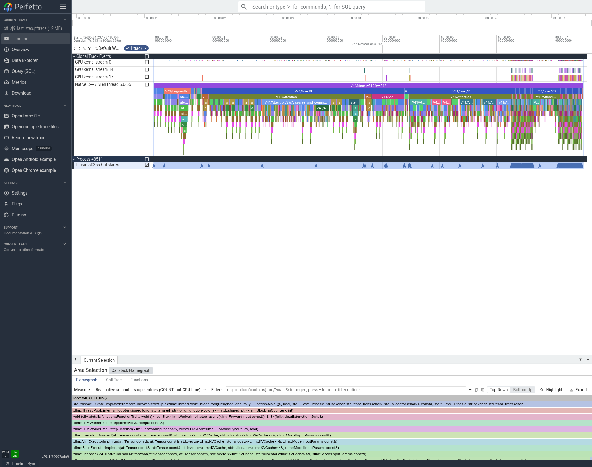

# T10：CED bounded replay接入与实测，小幅混合结果，默认关闭

## 改了哪里

同931741c3原生C++ ELF，在已接受的长Prefill chunk512/mHC/通信/SWA/共享专家/模型流之上，只在P开启XLLM_DSV41_BOUNDED_PREFILL_REPLAY=1。D关闭、spec/prefix/batch/Graph均关闭。最后一个compressed KV source为20层，从21层开始只计算本chunk末128行，并同步裁剪hidden、shifted pre、token/position、Engram与复用topK；SWA读取限定replay起点，防止读到未写入旧槽；logits选择索引扣掉裁剪偏移。相关NaN/stale/physical floor与索引20例检查、E43集成模块复查已通过。

这不是删除路由专家或跳过整层。21～39层仍执行Attention、mHC和MoE，只改变这部分query行与SWA保留范围。该策略尚未证明完整模型逐token等价，不能声称已复现官方CED完整语义。仅通过基础功能检查，未完成模型精度验收。

## 正式结果

P/D各TP8EP8、DP1CP1、eager、C1，两组各1暖5正式，全部10次成功且实际输入/输出正确；两道计算题通过，16个rank正常退出。

|输入/输出|模式|TTFT ms|TPOT ms/token|端到端s|输出token/s|
|---|---|---:|---:|---:|---:|
|256/256|关闭|427.72|68.42|17.8742|14.3223|
|256/256|128行tail|386.98|69.59|18.1334|14.1176|
|2048/256|关闭|1510.82|67.31|18.6741|13.7088|
|2048/256|128行tail|1372.87|66.49|18.3267|13.9687|

TTFT分别下降9.53%与9.13%，但短输入端到端反而增加1.45%，长输入仅降低1.86%。因此不把此项加入默认累计最优；保留可选功能和证据。未因模型文本/数值差异开启精度排查，未跑API对分或评测集。

## trace和实际执行几何

前后32rank/64原始文件SHA及931 ELF原生PC核验完成。8个P rank的长输入最后chunk日志均明确：0～20层q512，21～39层q128，kv2048；before全层q512。完整P捕获仍为4个q512外层step，selected aten::mm仍349，aten::narrow365→372，kernel总数几乎不变。**这是矩阵行变少，并不是少启动了算子**。不能按“核数没降”判定代码没生效，也不能把矩阵行数比例当作端到端收益。

若仅把decoder逐层query行相加，40×512→21×512+19×128，即35.625%的行工作代理减少；Attention缓存、投影/GEMM效率、Engram、通信和D端不按这个比例缩短。整个对照TTFT只占1.5108/18.6741=8.09%的端到端；严格可移除模块关键路径占比未知，不计算虚假的理论兑现率。

图片来自实际CPU/GPU区间与原生PC；时间受profiler影响，只定位路径，正式耗时以上表为准。火焰宽度是ENTRY_COUNT。

## 边界、原始日志与接续

本实现拒绝DSpark辅助态全行capture组合；prefix别名状态与真实多请求的交叉语义也未验证，所以后续prefix/batch继续在兼容的非CED基线上单独测。不能把该实验与所有开关无条件叠加。

原始正式日志/SQLite/SSE/角色配置在04_性能/t10_ced128_cumulative_v1_raw。NFS根为/data/nfs_shared/xiaopang/deepseek_v41_flash_1p1d/20261112_sglang_mt_cpp，原始日志archive为new_start_t10_ced128_cumulative_v1_small_evidence.tar.gz（459228B，SHA82d21afb8c5b1f38d338bd99a034b0229da84c67137be89b1c402b2cd28b041e）。大trace及处理bundle路径、字节和SHA见05_trace/processed/analysis_receipt.json和processed_trace_bundle_v1.receipt.json。

离线收集器曾以143退出；远端CPU审核继续完成。随后仅续取已有审核bundle，没有重启模型或重复测速，恢复记录见result.json的scope。

图片的审计选中窗口是首个q512/kv512步骤，文件名中的last_step来自通用转换脚本命名，不据此判断位置；最后kv2048的逐层q512→128日志证据另存all8_ced_row_geometry_and_counts.json。
