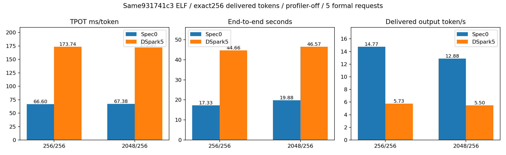

# T14：原生DSpark功能链路跑通，当前性能回退，不作为默认方案

## 实际完成了什么

在SJ9的Prefill和SJ10的Decode各8卡上，以原生C++ target和专用三层C++ V4.1 drafter完成1P1D。两端均设置num_speculative_tokens=5、DSpark算法和draft_model路径，P端传递37/38/39层辅助隐藏态以及draft context KV，D端执行非因果5位置proposal、6位置target verify、接受/拒绝和状态恢复。模型为W4AFP8-mt 1017；TP8/EP8、DP1/CP1、eager、C1。不是Python模型forward。

先通过了相关的状态回滚18例、辅助态capture4例、draft非因果query/三层body等组件检查；真实整机运行再通过两道算术题、10次2048/8状态稳定性、两组各1暖5正式请求和全16rank trace。对照关闭投机，使用同931741c3 ELF和相同其余已接受开关，也完成相同正式测速/trace。两侧20个正式请求全部成功，实际输入分别256/2048、实际交付输出均256；两模式32个rank正常退出，无SIGKILL。

**仅通过基础功能检查，未完成模型精度验收。** 没有进行API对分、MathQA或固定前缀logits验收。

## 先遇到的接口问题及修复

E44首题P端CHECK失败：write_context_kv真实值为[21,512]，框架缓存为[21,576]。create_dsv4_cache_tensors只将deepseek_v41识别为V4.1，而专用drafter类型deepseek_v41_dspark误入V4 FlashMLA分配分支，附加了64维RoPE副本。

修复位于xllm/core/framework/kv_cache/deepseek_v4_kv_cache_impl.cpp：只在MUSA设备缓存创建时把V4.1 DSpark归入V4.1缓存分支；纯SWA三层因此分配512维。V4的576维布局保留，尺寸检查保留，不靠填零或裁剪绕过。E44八个P rank主动abort，D端八rank正常TERM退出，资源释放；失败日志及SHA留在ToDoList_44。修复后两题、长输入和正式请求均通过，证明越过该错误点。

编译时另有一次打包脚本错误：误要求未修改的测试模块mtime也必须更新。Ninja本身已成功生成新xllm；随后核对源码SHA、再次确认ninja目标up-to-date、验证模块与上一版SHA完全一致后完成打包，保留原错误记录，没有通过伪造时间戳或强制重编译掩盖。当前真实ELF为931741c398ec88a02e1d472becbcf8f69a24f9abb4405852c6a203aaa274e05d；模块仍为ed860e3d06af639852df0469f170de992e891fba404f8f81e89e56c6b4f69dfa。

## 正式性能与决定

|输入/输出|模式|TTFT ms|TPOT ms/token|端到端s|QPS|输出token/s|
|---|---|---:|---:|---:|---:|---:|
|256/256|关闭投机|347.04|66.60|17.3313|0.057699|14.7710|
|256/256|DSpark5|352.58|173.74|44.6550|0.022394|5.7328|
|2048/256|关闭投机|2693.98|67.38|19.8769|0.050310|12.8793|
|2048/256|DSpark5|2694.21|172.07|46.5733|0.021472|5.4967|

开启DSpark后，短输入TPOT增加160.84%，长输入增加155.36%；端到端输出速度分别下降61.19%和57.32%。性能回退明显超过样本波动。决定：功能实现保留，默认num_speculative_tokens仍为0；这次不能称为投机加速成功。

正式SQLite响应ID已与真实D端request_terminal/sequence_terminal日志关联，见04_性能/formal_request_draft_acceptance.json。短输入5次均为135/605（22.31%）；长输入首条128/635（20.16%），其余四条139/595（23.36%）。这是被接受草稿token/实际提出草稿token，不能当成最终输出数量或吞吐；所有性能分母只用实际交付256。没有使用非spec情况下无意义的通用SpecAcceptRate数值。

长输入首条与后四条生成文本不同，已在03_正确性/正式请求文本差异_按指示只记录.json记录，同一请求温度0、原因未判定；按用户当前要求未展开精度定位，也未用这项差异作为速度验收门槛。

## 从真实trace看额外工作

前后都是256输入、实际交付8输出的独立profile请求，所有P/D各8rank、共64个原始trace/stack文件SHA与实际931 ELF的native PC完成关联。E50额外提取了完整原始D0捕获，而非只用最后一个q1/replay小窗口，原文件SHA保留；完整Perfetto图在06_图表/OFF_完整8输出请求_D0和DSPARK_完整8输出请求_D0。

八个D rank一致：关闭投机是7次q1 target forward，共计算7个target输入位置；开启后是4次q6 verify，以及q1、q4、q1三次接受前缀重放，共30个target输入位置，另有4次三层drafter调用。target forward调用次数同为7次，但每次的行数与附加工作完全不同，不能只按调用次数说工作变少。

D0完整捕获GPU kernel数24787→50941；aten::index_select1002→3138，index_copy_33→420，sort8→432，unique_consecutive0→220，clone1696→2086。cache checkpoint与restore/replay源码提供了其中一部分来源，query几何变化也增加缓存读写；这些计数说明工作量增加，不能直接换算成某一模块占正式TPOT的百分比。

当前prepare_speculative_state在下一轮先恢复原快照，再重放已接受prefix，这条保守路径重复计算target。与此同时，q1专用快路径并未都覆盖q6：mHC融合在普通捕获执行560次，在spec捕获仅160次；q6/q4走原分散归约。三层drafter增加12个层执行，每层包含2次mHC prepare/post及1次Attention/MoE。因此是接受率、额外target计算、缓存事务和不同shape快路径共同影响，不能只说“草稿算得慢”或“模型C++就一定更快”。

重要边界：replay嵌套在verify的CPU区间中，不能把父子inclusive时间相加。profiler回溯/符号采集开销很大，首个step可被放大到数秒；正式速度必须以上方profiler-off测试为准。火焰宽度为实际native语义入口COUNT，不是CPU采样时间。当前没有可靠可去重的无重profiler关键路径占比，故不报虚构的Amdahl兑现率或60% SOL。

## 接续工作与资产

优先继续非spec累计最优上的Gate/chunk/CED/prefix/真实batch。mHC已验证operator支持多行，但模型开关只选择q1；小批量2～8行扩展以独立默认关闭开关在ToDoList_51实现，14例真实权重层检查通过；同B2对照性能尚未完成，因此尚未晋级。选择性只回退拒绝后缀以减少replay、以及更短proposal/async策略，留作有trace依据后再判断的方向；不能直接删除replay而不处理ratio2奇偶边界和Engram。

- 源码父提交4411c026583457c5f454100ccafcf3db8fc7291d；E50完整补丁SHA d340d088b5c67d85e84fcf4d0d3099134c69b821a1b4a66c26b3ca4a2ae3def9，尚未为本轮新建最终Git提交。
- NFS根：/data/nfs_shared/xiaopang/deepseek_v41_flash_1p1d/20261112_sglang_mt_cpp。
- 两组原始日志、SQLite、SSE、完整角色配置：new_start_t14_native_cache_off_v1_small_evidence.tar.gz（868830B，SHA b3c5215302ef14cf7e6840df4a6e7b46d6c01d4f4589b86e63d1e365385bfb84）与new_start_t14_native_cache_dspark_v1_small_evidence.tar.gz（9882573B，SHA93a2d06df56df7c43e4a9a8d93b7bba45f81c2148aaf890122ad684c9176a4d5）。
- 原始全rank trace：new_start_t14_native_cache_off_v1_raw_trace.tar.zst（83648186B，SHA0b3f77afb4c5df11a4147b6397d6b7cfe64708daf529ec1c724a7107eb93537c）与new_start_t14_native_cache_dspark_v1_raw_trace.tar.zst（135520177B，SHA794bb81c36dcccbc0bb20ae135f8c766d78d1b004ac319dfc8dfa4799153e169）。
- 已处理bundle：new_start_e50_trace_analysis_v1.tar.zst，7044439B，SHA918dfab724926eff337517607a9dbf9fb6190d19e9eb12d6e6a9b420d4e629fa。
- 完整原始D0提取：new_start_e50_full_d0_v1.tar.zst，23058356B，SHA4c5f87ce24c3233d8b62c4b11b419093d04edec71e61ca7fbefa4b2650c2e642。原始文件未改，转换工具仅用真实CPU/GPU区间包络作为查看窗口，不添加虚构trace事件。
