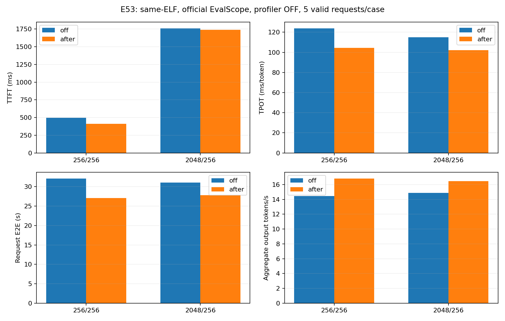
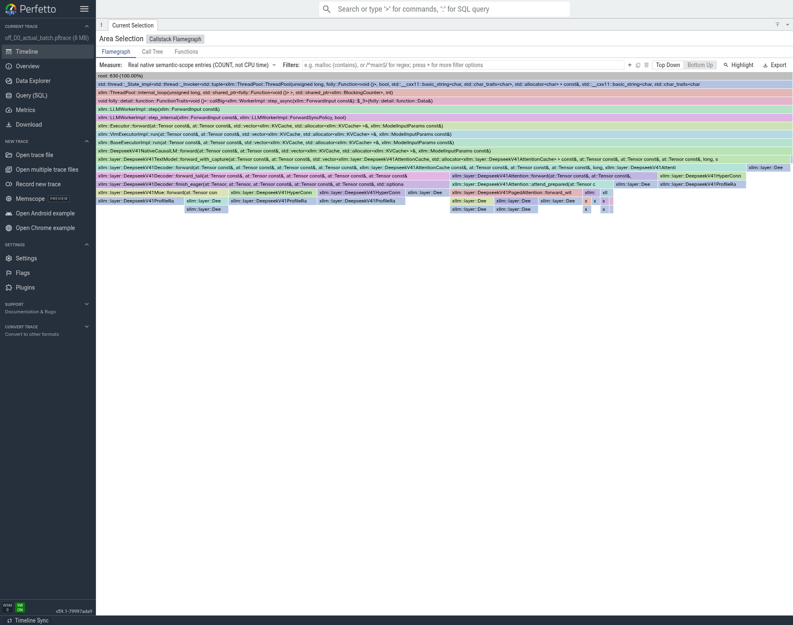
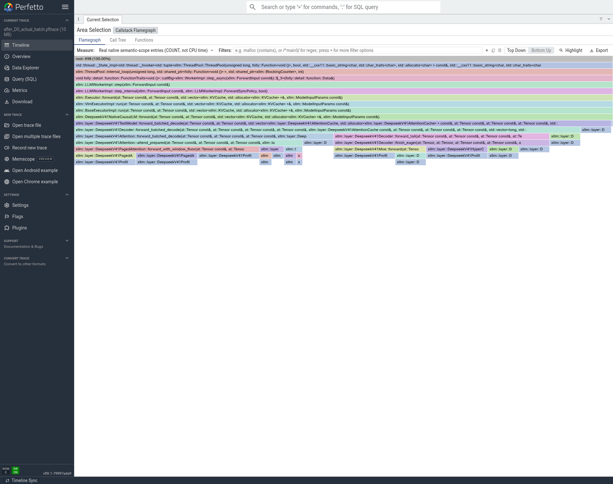

# T12：C2真实Decode批处理，正式性能与真实调用链

**仅通过基础功能检查，未完成模型精度验收。** 两道算术及同轮并发基础请求通过。每条实际输入256/2048、输出256；每组先一轮C条暖机，再5条正式，成功10/10。前后32个rank均正常退出。前后共32rank的64个trace/回溯文件核验SHA，PC使用同一f542 ELF。

结论：ACCEPTED_CONCURRENCY_SPECIFIC_SPEED_OPTIMIZATION。这是并发2的负载，不可与C1的token/s直接声称单请求更快。

|输入/输出|模式|TTFT ms|TPOT ms/token|端到端 s|聚合输出 token/s|聚合QPS|
|---|---|---:|---:|---:|---:|---:|
|256/256|off|494.370|123.942|32.0997|14.4359|0.056390|
|256/256|after|412.720|104.458|27.0495|16.8045|0.065643|
|2048/256|off|1760.471|115.000|31.0855|14.8560|0.058031|
|2048/256|after|1737.542|102.177|27.7928|16.4516|0.064264|

吞吐=本轮实际1280个输出token/官方Test Duration；QPS=5/同一wall。TPOT为逐请求平均，包含排队/交错，不是一个q>1 forward的设备耗时。正式性能关闭profiler，trace另跑同C的每条256/32请求。样本仅5条，保留逐条、标准差和尾部不满批情况，不用单条最短延迟替代均值。

## 代码、请求隔离与缓存

保留累计TP/EP custom、SWA读取融合、共享专家TP、D模型stream和q1 mHC。P实际maxseq1/chunk512，D缓存4GiB，两侧token预算4096用于SWA环预留；三种资源参数在同C对照中相同。Graph/spec/prefix/CED/packed/Gate关闭。batch_metadata只接受2～8条请求各1个decode token，保留每请求context与cache页表；没有把多请求当作同一序列。短小真实MATE、缓存状态/解析检查见E29/E51。

本对照只把D maxseq1/批处理关闭改为maxseq2/真实batch开启，小批mHC开关两边均0。模型层mHC/Dense/MoE共享批矩阵执行，Attention按请求保留独立缓存与跨层状态。

## 实际trace证明了什么

完整捕获每条32输出，其中每条首token来自P，D实际计算62行。before步骤直方图`{'1': 62}`；after`{'1': 2, '2': 30}`，八个D rank各自校验一致，实际D行总数保持62。

D0完整native `aten::mm`入口从21700降/变为12010，每个D输出行从350.0000变为193.7097。这证明实际多行执行/工作摊薄，不是只提高HTTP并发却仍逐请求forward。计数不代表耗时占比，完整数据见`05_trace/full_native_entry_work.json`及前一控制目录。

时间线显示真实q和GPU kernel；火焰宽度是ENTRY_COUNT，不能解释为CPU时间。选取最大实际q的代表step，完整trace直方图另行保留，避免只看最后不满批的q1而误判batch没发生。不同批次行数的总kernel不能直接相减声称每token收益，应先按实际D行归一化。

## 上限、收益兑现和限制

当前尚无扣除通信/异步重叠的可靠关键路径占比p，理论全局上限与兑现率记unknown。不能把batch C理想线性加速当作可达上限，因为Attention仍按请求处理、异步到达/尾批不满、通信和scheduler仍占时间。这里只报告正式同条件吞吐与请求延迟。60%SOL口径待确认。

原始EvalScope/SQLite、SSE、两道算术、并发基本检查、角色配置和服务日志位于`04_性能/t12_batched_c2_final_v1_raw/`。远端实验根`/data/nfs_shared/xiaopang/deepseek_v41_flash_1p1d/20261112_sglang_mt_cpp`，正式请求目录`new_start_t12_batched_c2_final_v1/performance`；大trace完整路径/大小/SHA见`05_trace/processed_trace_bundle_v1.receipt.json`和NFS索引。

## 全捕获的GPU工作量补充

相同两条256/32请求，D实际行数62保持。D0完整GPU kernel为219440→152510，按D行归一化为3539.35→2459.84。它支持工作摊薄的解释；不等于对应百分比的GPU时间下降，因为kernel大小、并行度与等待改变。实际调用链从forward_with_capture进入forward_batched_decode，Attention仍逐请求使用独立页表，其余投影/专家计算可以批量化。

## 测量环境补充

为串行使用GPU并收齐证据，上一轮的CPU-only trace审核/打包以nice19在SJ10继续执行，可能与后一轮正式请求重叠；它不初始化GPU，也未并行启动另一套模型。未进一步做CPU核/内存带宽的严格隔离，因此不把小幅差异说成稳定的发布级收益。原始5条样本及方差全部保留；C2小批mHC约1%变化不晋级。吞吐结论限定为本轮同条件有界负载，后续发布级对照应固定后台活动并增加稳态轮次。
