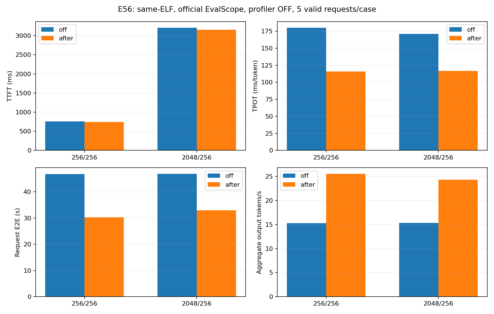
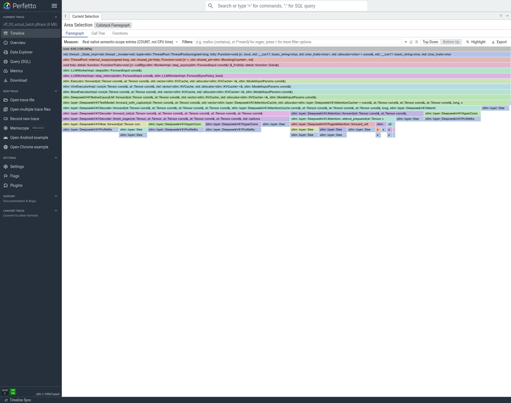
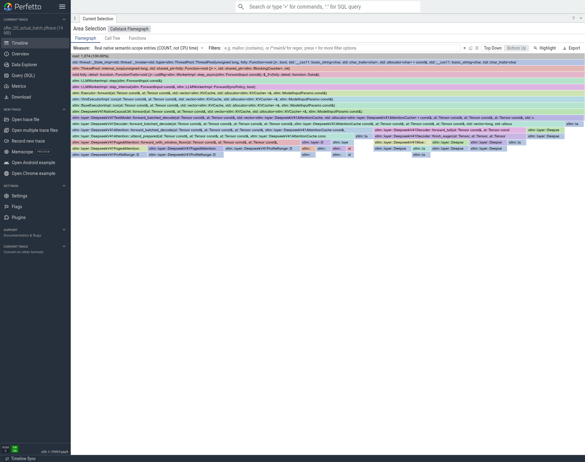

# T12：C4真实Decode批处理，正式性能与真实调用链

**仅通过基础功能检查，未完成模型精度验收。** 两道算术及同轮并发基础请求通过。每条实际输入256/2048、输出256；每组先一轮C条暖机，再5条正式，成功10/10。前后32个rank均正常退出。前后共32rank的64个trace/回溯文件核验SHA，PC使用同一f542 ELF。

结论：ACCEPTED_CONCURRENCY_SPECIFIC_SPEED_OPTIMIZATION。这是并发4的负载，不可与C1的token/s直接声称单请求更快。

|输入/输出|模式|TTFT ms|TPOT ms/token|端到端 s|聚合输出 token/s|聚合QPS|
|---|---|---:|---:|---:|---:|---:|
|256/256|off|755.071|180.186|46.7024|15.3017|0.059772|
|256/256|after|741.365|115.787|30.2671|25.5344|0.099744|
|2048/256|off|3208.765|171.040|46.8238|15.3462|0.059946|
|2048/256|after|3157.937|116.873|32.9605|24.3334|0.095053|

吞吐=本轮实际1280个输出token/官方Test Duration；QPS=5/同一wall。TPOT为逐请求平均，包含排队/交错，不是一个q>1 forward的设备耗时。正式性能关闭profiler，trace另跑同C的每条256/32请求。样本仅5条，保留逐条、标准差和尾部不满批情况，不用单条最短延迟替代均值。

## 代码、请求隔离与缓存

保留累计TP/EP custom、SWA读取融合、共享专家TP、D模型stream和q1 mHC。P实际maxseq1/chunk512，D缓存4GiB，两侧token预算4096用于SWA环预留；三种资源参数在同C对照中相同。Graph/spec/prefix/CED/packed/Gate关闭。batch_metadata只接受2～8条请求各1个decode token，保留每请求context与cache页表；没有把多请求当作同一序列。短小真实MATE、缓存状态/解析检查见E29/E51。

两侧small-batch mHC开关均1，control只跑q1；batch4后q2～4也进入已有融合。因此本对照衡量“当前同配置的真实批处理路径”整体，包含按行数自然触发的融合收益，不能声称纯粹由GEMM批量化独立贡献。E53已另测small-MHC关闭的纯batch，E54另测相同batch2的mHC开关。

## 实际trace证明了什么

完整捕获每条32输出，其中每条首token来自P，D实际计算124行。before步骤直方图`{'1': 124}`；after`{'1': 1, '2': 2, '4': 29, '3': 1}`，八个D rank各自校验一致，实际D行总数保持124。

D0完整native `aten::mm`入口从43400降/变为14007，每个D输出行从350.0000变为112.9597。这证明实际多行执行/工作摊薄，不是只提高HTTP并发却仍逐请求forward。计数不代表耗时占比，完整数据见`05_trace/full_native_entry_work.json`及前一控制目录。

时间线显示真实q和GPU kernel；火焰宽度是ENTRY_COUNT，不能解释为CPU时间。选取最大实际q的代表step，完整trace直方图另行保留，避免只看最后不满批的q1而误判batch没发生。不同批次行数的总kernel不能直接相减声称每token收益，应先按实际D行归一化。

## 上限、收益兑现和限制

当前尚无扣除通信/异步重叠的可靠关键路径占比p，理论全局上限与兑现率记unknown。不能把batch C理想线性加速当作可达上限，因为Attention仍按请求处理、异步到达/尾批不满、通信和scheduler仍占时间。这里只报告正式同条件吞吐与请求延迟。60%SOL口径待确认。

原始EvalScope/SQLite、SSE、两道算术、并发基本检查、角色配置和服务日志位于`04_性能/t12_batched_c4_final_v1_raw/`。远端实验根`/data/nfs_shared/xiaopang/deepseek_v41_flash_1p1d/20261112_sglang_mt_cpp`，正式请求目录`new_start_t12_batched_c4_final_v1/performance`；大trace完整路径/大小/SHA见`05_trace/processed_trace_bundle_v1.receipt.json`和NFS索引。

## 测量环境补充

为串行使用GPU并收齐证据，上一轮的CPU-only trace审核/打包以nice19在SJ10继续执行，可能与后一轮正式请求重叠；它不初始化GPU，也未并行启动另一套模型。未进一步做CPU核/内存带宽的严格隔离，因此不把小幅差异说成稳定的发布级收益。原始5条样本及方差全部保留；C2小批mHC约1%变化不晋级。吞吐结论限定为本轮同条件有界负载，后续发布级对照应固定后台活动并增加稳态轮次。

## 完整GPU计数与审核复用

D0完整kernel438880→194456，每个实际D行3539.35→1568.19；mm43400→14007。实际124行未变，步骤从124个q1变为29个q4、1个q3、2个q2、1个q1。最大q4代表步mm430，相对q1的349总次数更大，但服务4条独立请求，需按行数解释。对应两组吞吐的66.87%/58.56%提升来自独立正式测速，不是由kernel计数比例推算。

控制组的全16rank审核已在E55完成，E56重新核对其压缩原档SHA及32个原始文件manifest后复用，不重复解析。重复的CPU-only off审计用一次正常TERM取消，部分目录/日志完整保留；没有SIGKILL或GPU进程操作。复用来源、audit自身SHA与重新核对的raw归档SHA见`05_trace/processed/reused_off_audit_provenance.json`及`05_trace/重复CPU审核正常取消与复用.json`。after全部16rank独立完成审核；复用不减少任何rank或原档验证覆盖。
