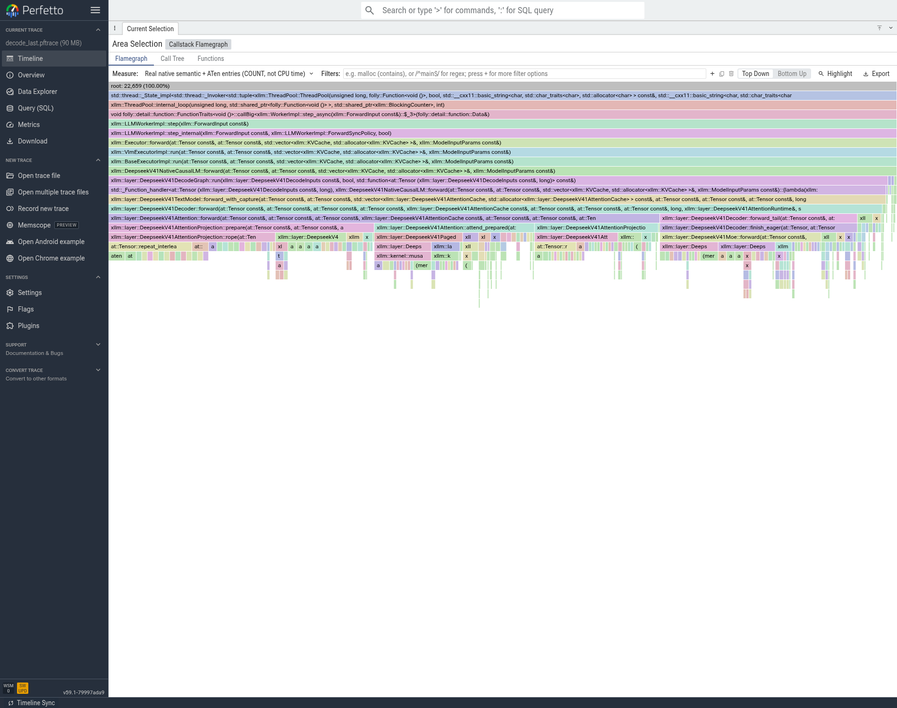
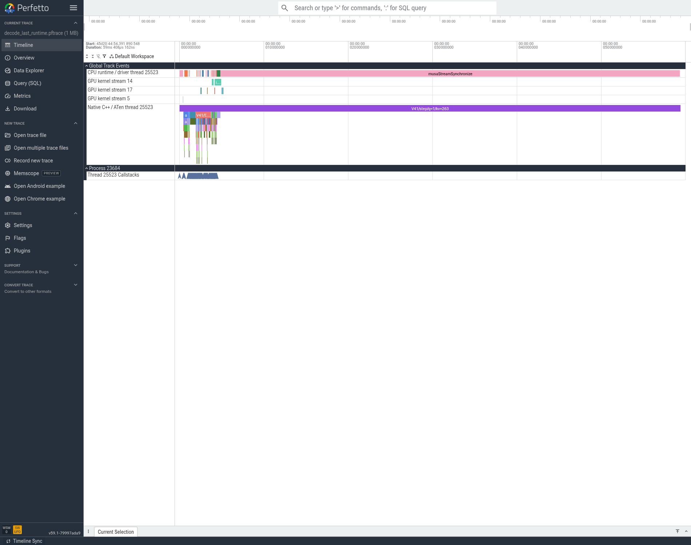

# 实验002：普通 Decode 跨40层 Graph 带来阶段性提升

当前结果是阶段晋级，尚未追平 SGLang B。仅通过基础功能检查，未完成模型精度验收。

## 为什么做

基线仍逐步在主机侧组织40层执行，真实 C++/ATen 入口可见反复的 empty、copy_、to 和多次算子发射。参考 SGLang 的静态输入/Graph组织及既有原生图执行器，把稳定形状的普通C1 Decode固定到图中。这里没有照搬旧的40个FFN小图：此次是一张图跨越 embedding、40层、最终norm，Engram哈希/查表和LM-head仍在图外。

## 实际改动与边界

- `decode_graph.h`保存固定地址的tokens、positions、SWA及压缩页表、Engram输入；图键同时含容量512/4096、position奇偶和SWA页表宽度。
- `pair_pool.cu`增加读取GPU position的q1路径；`compressor.h`与`token_cache.h`在固定容量下按真实长度屏蔽不可见项，覆盖NaN未分配页，不把padding当有效token。
- `attention.h`、`text_model.h`接收固定容量；native模型适配器只为q1、context≤4096选择新路径，Prefill继续既有路径。当前不支持投机verify捕获，未声称把全部serving变成Graph。
- 捕获前后的SWA、压缩KV及recurrent状态以有界checkpoint恢复；图内custom all-reduce完成地址注册。长→短请求复用做了实际验证。
- 所有计算仍在MUSA GPU，Python仅用于离线构建、客户端和证据处理。

## 同条件正式结果

SJ9 P/SJ10 D，各8卡；Attention TP8、专家EP8，C1，W4AFP8-mt1017；实际256输入/256输出；每配置独立1暖机+5正式；正式请求profiling关闭；温度0、top_p1、chat模式、ignore_eos。图外调度配置保持不变。

|配置|TTFT ms|TPOT ms/token|TPOT样本标准差ms|E2E s|端到端输出token/s|
|---|---:|---:|---:|---:|---:|
|本轮控制组|396.5881|68.92345|1.03429|17.97207|14.24433|
|同静态布局，Graph关闭|393.3074|71.49490|1.24053|18.62451|13.74533|
|同静态布局，Graph开启|423.5601|59.58716|0.38447|15.61829|16.39104|

Graph相对控制组E2E下降13.10%、输出速度提升15.07%；相对相同静态布局Graph关闭，E2E下降16.14%。静态布局单项变慢，作为有证据的前置实现保留，未提前晋级。最终选择Graph开启为当前阶段最优；尚未进行最终三轮达标验收。

## 基本检查与长输入

54项真实GPU检查覆盖pair-pool奇偶、跨页、动态输入、gather可见长度和padding NaN。两道基础计算题回答4.2和56。独立2048/256单次冒烟实际输出256token，E2E23.05596s、首内容2.55656s，包含首次长图桶捕获，不是正式性能轮；随后再次通过两道题和256/8短请求，检查长桶返回短桶的状态复用。

两台各8个rank正常exit0，无SIGKILL，无驱动或主机修改。

## 从实际trace可以解释什么

采集与正式性能分离。16rank均验证真实GPU事件、原生C++ record ID和符号关联。静态输入Graph关闭时，D rank0在7步中可见25228个GPU kernel；Graph开启只可见299个kernel，同时明确记录7次musaGraphLaunch和7次V41/full_decode_graph_replay。当前Kineto/MUPTI未完整展示Graph内部节点，**299不是实际执行全部kernel数，不等于计算量减少98%**。

下面两幅图来自原始trace和实际ELF符号化，在Perfetto渲染后目视检查；火焰图宽度是ENTRY_COUNT，不是CPU耗时抽样。

Graph关闭时，40层Attention、MoE等入口反复由主机组织；Graph开启后，这些图内算子的每步CPU入口不再重复执行。单步q1/kv263中，CPU模型区间59.408ms，GraphLaunch约0.403ms，其后流同步等待54.486ms。补充Runtime轨道后可直接看到这段等待：

长等待并不证明该同步是无用操作，也不意味着GPU空闲。图内GPU节点缺失时，必须另测回放设备跨度。实验003已按捕获后再开启event的方式进行独立校准；不拿重型trace的占比直接计算正式收益上限。

## 身份、原始证据与复现

- 源码基于共同仓库 `9ce7f8498fd4275183587a81cba39c72d527025e`；最终提交链接见总控提交记录。
- 候选ELF SHA256：`34e600ce14f4d2d10ebb50baf6a793b8edd43d474961acbf7a7a4191a0b1b22a`。
- NFS：`/data/nfs_shared/xiaopang/v41_xllm_match_sglang_20261116/runs/p2_full_decode_graph_v1/`；正式原始报告为`client/measured/`，完整请求统计为`client/status.json`，实际配置与SO指纹在`sj9/`、`sj10/`。
- Graph关闭对照：同根`p2_static_decode_v1/`；本轮控制组：`p0_baseline_profilefixed_v2/`。
- 本地：`完整Graph原始证据/client/`、`静态无Graph原始证据/client/`；完整压缩包、SHA回执在本实验根。
- `完整Graph原始证据/trace_analysis/all_rank_validation.json`及对应trace/sidecar支持读图；完整大trace/ELF保留NFS，Git仅含短日志、摘要、必要图与manifest。

## 认知收获和下一步

静态布局是Graph的必要准备，本身可能增加工作；不能因它单项变慢就剪掉组合。Graph消除了重复主机发射，并未自动解决图内算子、通信和冗余计算。当前仍比目标21.57ms/token慢约2.76倍，下一步依据低开销计时核查Attention并行、专家通信及投机的有效工作量，不用完成清单代替速度达标。
