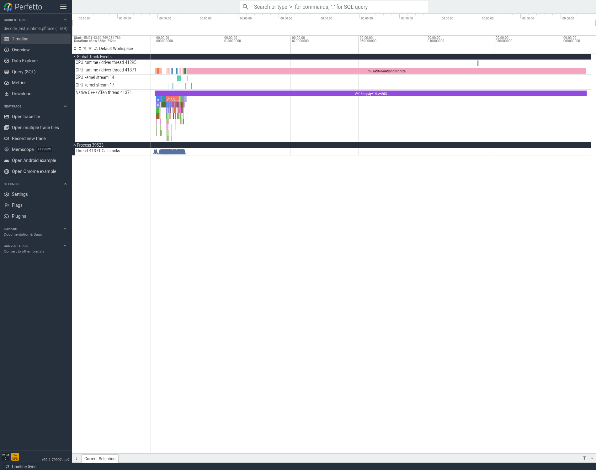
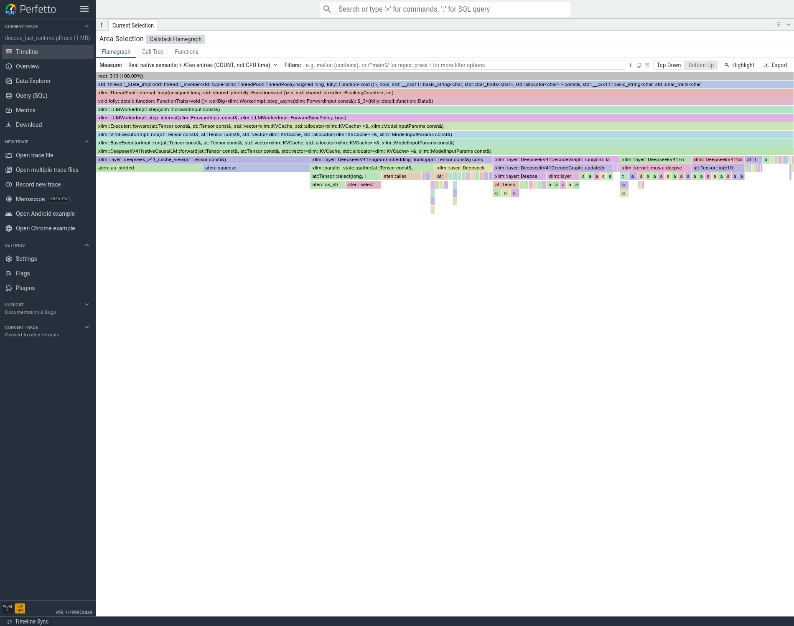

# 实验004：减少Attention归约没有带来端到端收益

本项完成了原生H64稀疏算子接入、Attention与Engram/词表头并行组解耦、GPU短检查、双机基础问答、正式1暖5和独立16rank trace。**不晋级**。保留受默认关闭开关保护的实现，为后续真正DP8/DeepEP LL提供布局和算子基础。当前累计最佳仍是实验002B。

## 结果

同W4AFP8-mt1017、双机1P1D各8卡、实际256/256、C1、prefix关闭，EvalScope1.14.1、正式profiler OFF。2道题分别输出4.2和56，全部正式请求成功、实际输入输出均为256。

|方案|TTFT ms|TPOT ms/token|E2E s|输出token/s|
|---|---:|---:|---:|---:|
|累计最佳：Attention TP8完整Graph|423.56008|59.58716|15.618287|16.391042|
|候选：复制Attention TP1/H64完整Graph|426.47242|63.67564|16.663761|15.362678|

候选TPOT增加6.86%，E2E增加6.69%，输出速度下降6.27%。候选TPOT样本标准差0.05605ms，不将该负收益当作优化成功，也不以其替换当前最佳。本项未做最终三轮或2048/256正式回归，因为独立性能候选已经被拒绝；不能因此宣称它通过最终验收。

## 做了什么、为何这样做

SGLang B的Attention是DP8/TP1，而Engram和LM-head仍TP8。以前直接降低全局TP会复制Engram而超显存。本项把Attention单独解耦，40层查询与输出投影及sink复制至每rank，额外7.656258GiB/rank。Engram/embed/head仍全局TP8，路由EP8、共享专家TP8及其合并归约不变。

本项**仍由8rank计算同一个C1请求，不是DP8调度**，也未引入DeepEP LL。图内custom归约buffer每桶从80变40，表明Attention归约确实移除。但完整Attention投影及H64稀疏计算增加，而旧H8单组wo_a GEMV在G8时走einsum。这是新增成本线索，尚不能分别量化贡献。SGLang的DP/LL/投机是整体执行组织，不能由本项负结果断言其路线无效。

D加载后每卡可用8.36GB；为保留相同1GiB KV，将D memory fraction从0.9设为0.95，P仍0.9。KV均2538blocks，未因扩容改变请求长度和cache命中。详细身份见[配置与容量说明](01_代码与构建/配置与容量说明.md)。

## trace读图与边界

[原始trace和16rank验证](原始证据/all_rank_validation.json)，本地保留D/P rank0原始trace、C++sidecar和完整NFS索引。

图中最后一步q1/kv263：候选step63.688742ms，原最佳59.408162ms；对应musaStreamSynchronize区间58.920648ms对54.485537ms。GraphLaunch主机区间0.313297ms对0.402945ms；两图外可见ATen均310个、整个7step可见GPU kernel均299个。**不能把这个299当作模型全部GPU节点数**，图内节点仍未完整呈现。主机启动略短与端到端变慢可以同时发生：等待的设备工作更长。

该火焰图是313次真实原生/ATen入口关联，宽度为COUNT，不是CPU时间采样。可确认仍走NativeCausalLM、Engram lookup和DecodeGraph；不能由宽度推断耗时占比。addr2line有DWARF FORM警告，部分行号可能缺失，未把未知行补成推测结果。

采集请求实际256/8；未采集前0.802/0.790s，采集时10.481s，关闭后0.834s，扰动明显。正式性能只使用独立profiler OFF的5次256/256；本图不能用于精确Amdahl收益估计。图片已打开检查，非加载占位画面。

## 失败与经验

测试扩展最初缺util/Platform等依赖；整套服务依赖又引入不能用于shared object的non-PIC ffmpeg。更值得记住的是mcc_wrapper在真实链接失败时返回0，已通过检查产物和实际import识别，之后用g++链接所需真实库。最终模块import、12稀疏形状、4Graph回放、2投影布局比较通过。所有失败日志保留，未替换真实框架符号为假实现。

独立图内event计时探针出现invalid resource handle，尚无可用内部event计时。探针失败不改变本项正式数据，不为此升级驱动或重置GPU。

16个模型进程均正常exit0，无SIGKILL，两机显存释放证据已保存。原始回传归档3947016bytes，SHA e1654afb208457394d7e6b6f6ef1d5785290b9e9b40550ef339cd5127ee6f06e。

## 后续

从原TP8完整Graph冠军继续；本项作为READY_DEPENDENCY保留。进一步对照SGLang的DP/LL与MTP状态更新，优先消除当前投机实现中的已接受前缀整模型重放，并为verify准备静态缓存与Graph。不能仅打开旧T14负收益配置重测，也不能以少算缓存恢复/减少输出换速度。H64投影、稀疏与分组解耦可用于下一步真正DP布局，无需重复本项已通过的相同检查。

**仅通过基础功能检查，未完成模型精度验收。目标尚未达成。**
