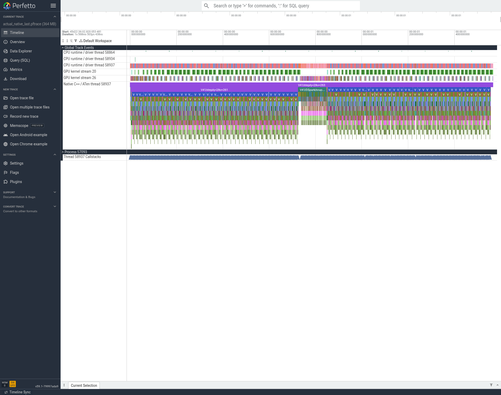
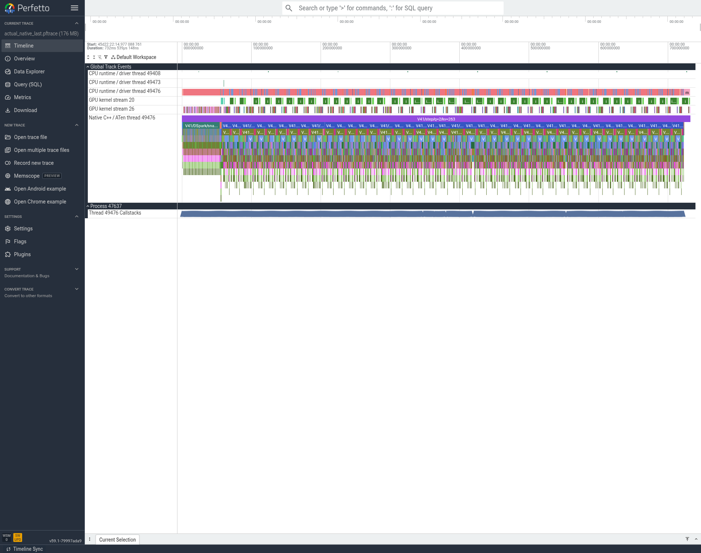
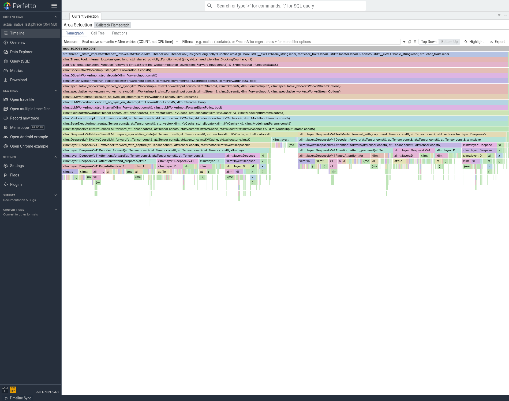
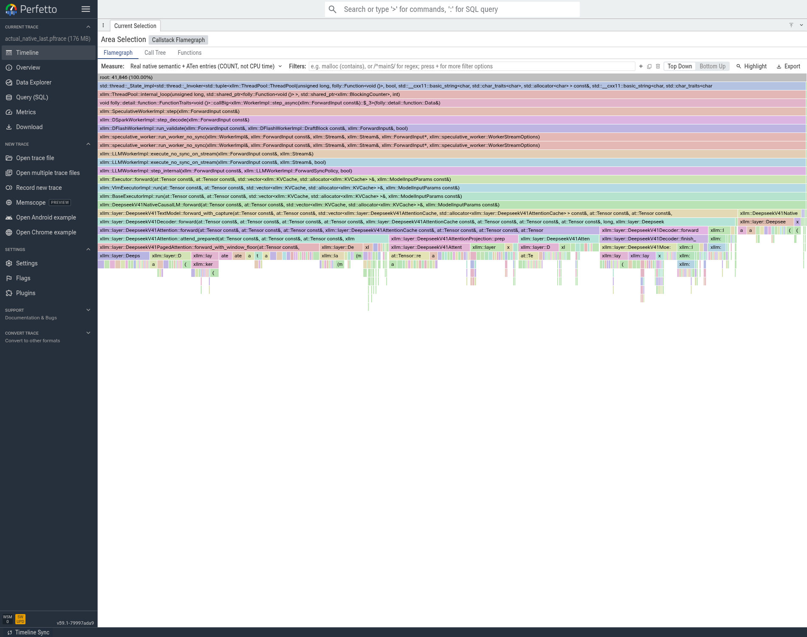

# 实验005：选择性提交的实现、证据与当前边界

## 改什么、为什么

旧 native DSpark 在每次 target verify 后，把这一轮触及的状态全部恢复，再对接受的输入前缀执行一次完整 target forward。新候选把缓存行与“至少接受几个输入才能保留这一行”对应起来，只恢复被拒绝的写入，保留已经算过的接受前缀。它减少的是重复执行的工作，并未删除 Attention、专家或任何模型层。

新增 `XLLM_DSV41_SPEC_SELECTIVE_COMMIT`，默认关闭且要求 native DSpark 开启。所有 TP rank 启动时核对策略一致。普通 q1 Graph 冠军及旧回滚重放路径继续保留。本次尚不支持 spec + full Graph，保护检查没有解除。

## 具体接线

- `core/kernels/musa/deepseek_v41_prefix_restore.{h,cu}`：在当前 MUSA 流上按行恢复拒绝后缀，数据留在 GPU。每次验证最多6个输入；复制原始字节，支持 BF16 缓存、FP32 recurrent state、INT32 Engram history。
- `core/layers/musa/deepseek_v41/prefix_checkpoint.h`：SWA/ratio1 KV/Engram 按输入行提交；ratio2 KV/index 只有完成一对输入才提交；compressor 仅保留偶数绝对位置的 parked 行。必须恢复被拒绝行覆盖的旧 SWA 数据，不能假设未来会覆盖而不恢复。
- `models/llm/musa/deepseek_v41_native.h`：核对请求身份、下一轮位置和 scheduler accepted 长度；选择性模式跳过旧完整 replay。新请求不把上一个请求快照写回到已经由 P/D import 占用的页面。
- 新增两个 focused GPU 检查工具，绑定实际 Native Attention、实际 AOT Engram 和生产恢复 kernel。Python只组织离线检查，不承担模型计算。

参考的是冻结 SGLang commit `7c97bb0e6d8b0f8fd41cd797a77b54f7162c79f6` 的 verify epilogue 接受长度与状态提交组织，文件SHA已在本实验`02_SGLang参考核验`保存。SGLang `online_c128` 的 prefix bank 不是我方 ratio2 的直接接口证据，不能混称已原样移植其全部 MTP。

## 已完成的检查

84个实际 ratio2 Attention 场景：默认与非默认流；begin=31、32、127、128、257、511；每轮验证6个输入，分别接受0～6个。使用单页 SWA 强制环形覆盖、压缩页置换、MATE sparse、真实 indexer AOT 与 pair pool。对照从相同旧状态仅执行接受前缀的路径，并检查下一真实 token。

实际结果：接受前缀输出、下一 token 输出、SWA/key/index 都逐值相同；FP32 compressor state 的最大相对RMS约4.23e-8；不应改变的行逐值相同。接受0输入时所有状态精确恢复。完整 scheduler 正常轮次仍至少提交 anchor，0输入仅作为底层事务回滚覆盖。

另有84个实际 AOT Engram 场景，验证 hash、mask、INT32历史及下一 token，全部精确相同。两组GPU进程均正常exit0，随后确认显存释放。

基本检查原始包：`选择性回滚基本检查原始证据.tar.gz`，47,884字节，SHA256 `95f94ec0aa1c5c835afc7c4c14a942304644d984197d64d5aa733cdfc51906a7`。NFS：`/data/nfs_shared/xiaopang/v41_xllm_match_sglang_20261116/exports/p4_prefix_primitive_checks.tar.gz`。

第一次独立kernel编译缺少构建所需映射环境（包括PYTORCH_INSTALL_PATH），不是GPU执行故障；失败日志已保留，补齐既有构建环境后编译和导入通过。没有改驱动。

## 完整服务快筛：尚未晋级

完整ELF：`/expt/artifacts/native_spec_commit_v1/bin/xllm`，SHA256 `c6e61a606b4395ce3c4e15fa4c231ee9cb8fff763c9362f8ef2135c0c6c6a81d`。构建完成并核对无待编译项。

`p4_spec1_selective_v1` 为双机 TP8/EP8、proposal1、eager、selective1。同一冻结256/256 C1输入，基本题4.2与56通过，1暖机后2次快筛实际256输入/256输出成功。TTFT均值464.391ms，TPOT122.144ms/token，E2E31.6111s，latency-sum输出8.09842token/s。

这只是快筛，明显慢于完整Graph阶段冠军59.587ms/token，不能晋级，也不是“选择性回滚使性能更慢”的单变量结论：当前同时使用了投机eager。同ELF、相同proposal1、仅恢复旧回滚重放方式的串行对照与两组独立16rank trace均已完成，见下方结论。未进行无意义的最终三轮验收。

代码核查的新发现：当前TP/EP custom all-reduce仅用于q=1；q=2～6仍走MCCL。`DIAGNOSTIC_PROGRESS=0`也因检查变量存在而启用，普通q1没有日志，但verify多行有日志。后续需保持配对实验条件明确，分别处理这些开销；不能把所有提升归于某一个改动。

## 下一步实现顺序

1. 已完成快筛、两组独立trace、同ELF旧重放对照、归档和正常退出服务。
2. 将通过基本检查的选择性提交作为前置实现保留，冠军仍是E2B。先验证并接入2～6行 TP/EP custom AR；P保留已验证的同步/日志条件，D日志问题单列处理。
3. 扩展静态 verify 输入和 compressor 动态起点：pair pool分组数量由捕获桶中的行数/奇偶决定，GPU实际位置逐次更新；固定容量索引按每行position做可见性mask。
4. 实现多行 SWA 固定形状读取与唯一槽位直接提交，移出当前布尔索引产生的动态长度；保留拒绝后缀恢复。
5. 扩展Graph键为容量、起点奇偶、query行数、页表布局；捕获前后恢复全部受写缓存。辅助层37/38/39的hidden必须随图回放更新到稳定buffer，不能仅回放最终hidden。
6. 先实际短检查，再普通Decode与spec的服务快筛，按计划比较proposal1/2/3/5及组合；有实际正收益后才替换累计最佳并完成正式测速与独立trace。

上述第2～6项尚未完成，当前不能宣称已实现SGLang的DP8、DeepEP LL、多行full Graph或已达到目标。

**仅通过基础功能检查，未完成模型精度验收。**

## 同 ELF 配对结果和实际读图结论（18:59补充）

|路径|实际256/256快筛次数|TTFT ms|TPOT ms/token|E2E s|输出token/s|
|---|---:|---:|---:|---:|---:|
|旧回滚后重放，spec1/eager|2|454.143|231.300|59.4356|4.30718|
|选择性恢复，spec1/eager|2|464.391|122.144|31.6111|8.09842|
|累计最优普通完整Graph，独立正式5次|5|423.560|59.587|15.6183|16.39104|

选择性路径相对旧投机对照TPOT减少47.19%、端到端输出增加88.02%，这是两次快筛观察，不是正式晋级或稳定性结论。它仍明显慢于冠军，标记READY_DEPENDENCY。两组只有选择性提交开关不同，但实际投机接受数略不同：选择性正式快筛每条99/156，旧重放96/160。因实际生成内容或数值路径可能变化，不能将全部百分比解释为完全等工作量的算子收益；按本轮授权只记录，不展开模型精度排查。

独立256/8采集两组均有4次外层verify，产生相同8个输出token。旧路径另有3次嵌套target重放（2、1、2输入，共5行），总目标输入行数13；新路径只有4次target调用，总8行。最后外层q2/kv263，旧路径内部还能看到q2/kv261的整段target；新路径是restore_rejected_suffix后直接做本轮verify。这是实际调用链和工作量证据。

图中不能只选“最后一个V41/step”：旧路径的最后一条是嵌套重放，遗漏外层本轮verify。本次修正转换器，按最外层目标调用选取时间窗口；原来选到的嵌套图仍保留在“旧重放”，完整对照图在“旧重放完整verify”。所有图都来自真实trace与native record ID，COUNT火焰图表示调用次数，不能当成CPU时间采样。

旧路径采集请求39.235s，而未采集1.732～1.791s；新路径采集28.421s，未采集1.106～1.195s。因此图中1.569s/0.733s等耗时不能直接作为正常推理模块占比。最后一轮全部接受，新路径恢复区间2.013微秒只是无需复制的分支，不代表所有拒绝情况成本为零。snapshot、ATen item/clone/index/select等仍有大量主机调用，下一步multirow Graph有明确可验证的价值。

原始日志、EvalScope SQLite、请求计数及有效GPU/native trace校验保存在两份“spec1快筛与trace原始证据”目录。大trace与完整包留本地/NFS，Git保留小日志、数据库、manifest、图和说明。旧重放包26,435,870字节，SHA256 `09aecc6dc8cb790f88e0a675b10d37fcf5dd629a5b872383354dc353aeb3a490`；选择性包18,042,642字节，SHA256 `9f1f57a6450a0648cfb946460a2b5f61bc0a657169423c7c4c90481395a33fe0`。NFS根 `/data/nfs_shared/xiaopang/v41_xllm_match_sglang_20261116`，包在`exports`、全16rank trace在`profiling`、原始请求在`runs`。

两组服务均16rank正常exit0；18:53重新读取GMI，两机16卡0MiB、0%且没有运行GPU进程。没有SIGKILL、GPU reset或驱动变更。目标仍未达到；后续多行通信与Graph接入继续。
