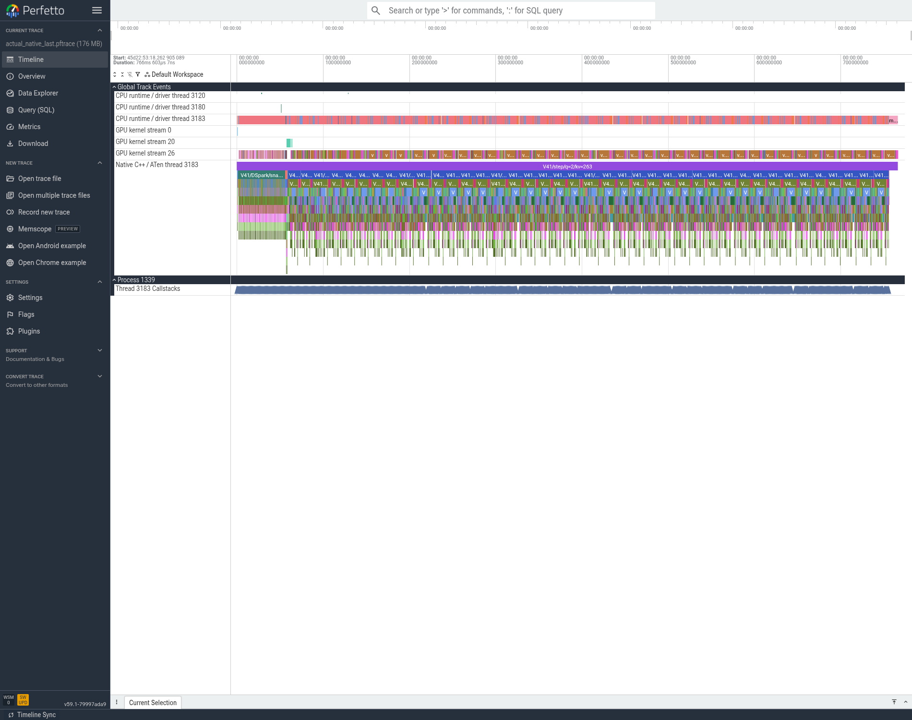
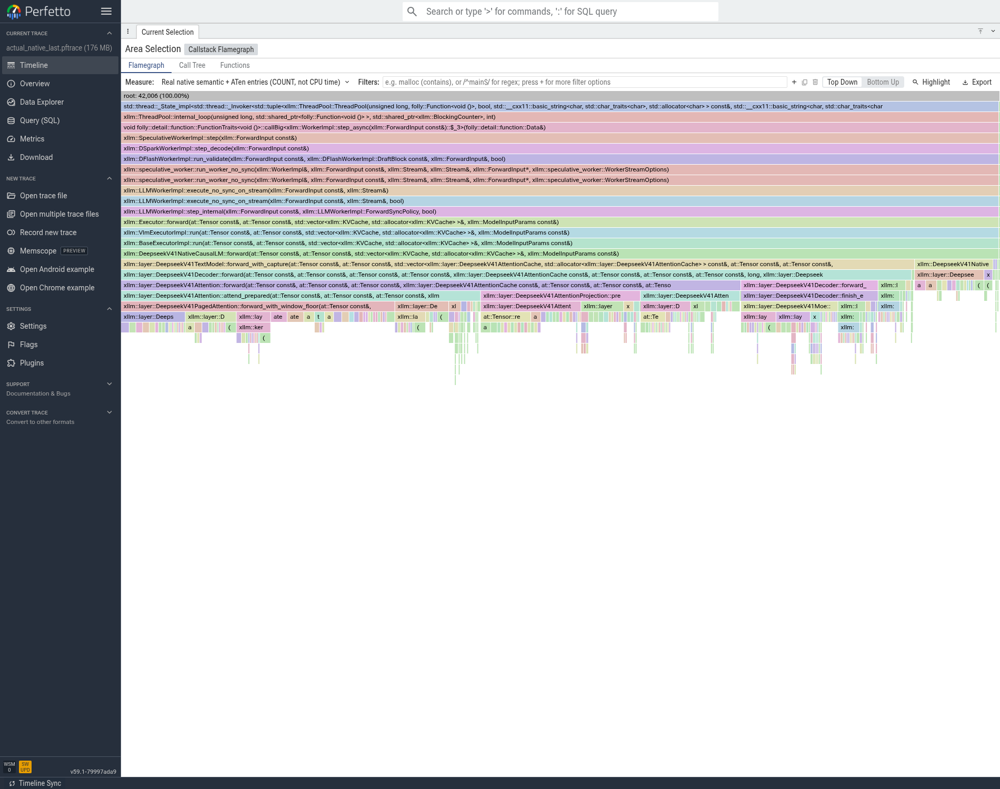

# 实验006：多行验证通信接入结果

## 结论和边界

我把已有 custom all-reduce 从普通单token Decode 扩展到投机 target 验证的2～6行，默认关闭，只在候选 D 端打开。真实8卡短检查通过，双机两道题返回4.2和56。实际256/256、C1、profiler OFF、各1暖2快筛：TPOT从122.14398降到92.69539ms/token（下降24.11%），输出从8.09842到10.66527token/s。但它仍慢于累计最佳完整q1 Graph的59.58716ms/token、16.39104token/s，所以只保留为多行Graph的前置实现，**没有替换累计最佳，也没有宣布目标达成**。本轮为快筛，未再开展不必要的正式5次负收益晋级测试。

**仅通过基础功能检查，未完成模型精度验收。** 两组token接受数量不同，不能把全部改善归因为单次通信快了相同比例。

## 为什么做，以及具体改动

实验005的真实q2 trace，每40层仍各有一次BF16 Attention TP归约与FP32专家归约，合计80次MCCL AllReduce；此前已有生产custom通信只允许q1。需要先核验多行、两种dtype、空贡献rank、非默认stream和真实Graph输入变化，再接入模型。

- `decoder.h` / `moe.h`：在明确开关开启、行数不超过6时复用生产custom all-reduce；更大行数仍走既有路径。Attention输入BF16与专家输出FP32保持不变，没有把FP32强制降精度。
- `deepseek_v41_native.h`：新增默认关闭 `XLLM_DSV41_VERIFY_CUSTOM_AR`；要求native DSpark及TP/EP custom前置已开启，并纳入全rank启动投票，避免各rank选路不一致。
- 新增真实生产ProcessGroup/MusaGraphHandle绑定的小测试；CPU FP64仅作为短检查的数值参考，在线模型计算在GPU。

P仍TP8 eager，D TP8/EP8、spec1、选择性prefix提交；本实验D仍eager。只切换D多行custom归约，保留上一实验的DIAGNOSTIC_PROGRESS环境，未把删除日志混入收益。

## 基本检查和性能

真实8卡每rank48场景：q1～6、5120列、BF16/FP32、默认/非默认流、精确/随机数据，rank2/6为空贡献。共12个Graph桶，各改变输入后回放3次；精确模式逐值相同，随机BF16最大相对RMS约0.001719，FP32误差在2e-6以内。q5在第一批未覆盖，追加8场景，原40项不重复跑。两批均8rank正常exit0。

|候选|TTFT ms|TPOT ms/token|TPOT样本标准差 ms|平均E2E s|输出 token/s|
|---|---:|---:|---:|---:|---:|
|E5选择性恢复、MCCL多行归约|464.39107|122.14398|2.59492|31.61111|8.09842|
|E6选择性恢复、custom多行归约|365.82959|92.69539|1.09060|24.00315|10.66527|
|累计最佳E2B普通Decode完整Graph，1暖5正式|423.56008|59.58716|0.38447|15.61829|16.39104|

前两组各1暖2、实际输入和提交输出均256、成功响应、相同请求协议；最后一行只用于判断是否替换最佳，不是同一ELF开关消融。各正式输入的接受计数：E5为99/156（0.6346），E6为106/149（0.7114）。归约顺序可影响边界token，按本轮要求记录，不展开模型精度排查；已提交token数仍实测为256，未用缩短输出改善速度。

## trace能证明什么

独立采集256/8请求，两端16rank的真实GPU/native trace均验证通过。同一外层 `V41/step/q=2/kv=263`，E5的40次BF16及40次FP32 MCCL AllReduce被E6的40次 `vllm::cross_device_reduce_1stage<__mt_bfloat16,8>` 和40次float版本替换，3次MCCL AllGather仍保留。总GPU kernel从8299到8301，并没有减少；ATen empty仍4718、item仍2426。因此这次主要是**通信实现替换和投机有效工作量变化**，不能描述成减少kernel launch或主机调用的优化。

实际Perfetto时间线：

真实调用入口计数图：

计数图root为42,006 entries，表示入口次数，不是CPU独占耗时。旧图41,846，不能从图宽推算全局收益上限。E6重型采集请求28.495s，无profiler对照约1.01～1.25s；外层trace跨度E5为732.539ms、E6为766.603ms，反而与无profiler快筛改善方向不同。说明采集扰动很大：本次trace用来证明选路和调用结构，不用于估算Amdahl占比、硬件极限或精确收益兑现率。

## 可复现身份与原始证据

候选ELF `/expt/artifacts/verify_custom_ar_v1/bin/xllm`，SHA256 `81377115e0abe159a2bdaf0154477beceb9607c790b69f7766191b55d0c657cd`；模块SHA `afb54095004abcdd6c3e0d7ccee4a3bf7ef149abe105b3d56ea47e9b4790e45a`。

NFS根：`/data/nfs_shared/xiaopang/v41_xllm_match_sglang_20261116`。

- 性能/逐题/官方EvalScope DB：`runs/p5_spec1_verify_custom_v1/client`；本地[完整小日志与客户端](多行通信spec1快筛与trace原始证据/client)。
- 全rank trace：`profiling/p5_spec1_verify_custom_v1`；归档 `exports/p5_spec1_verify_custom_v1_evidence.tar.gz`，17,778,724字节，SHA `b93aa6d28f1dd68e7ec04163616b0b602f9a0b9b53474cccd5d9d45a0fbb6a33`，本地已回传核验。
- 通信基本检查：`builds/verify_collective_v1`；归档 `exports/p5_verify_collective_checks.tar.gz`，18,120字节，SHA `7d88985df2da92e7672a91480d532d53f07ceea2e8c2762200aa67129e5fb623`，本地[基本检查](真实八卡通信基本检查原始证据)。
- 两机16个模型rank正常exit0，显存已释放；没有SIGKILL、重启或驱动修改。

## 下一步

在已经通过基本检查的选择性状态提交与多行custom通信上，继续多行静态输入和完整target Graph组合试验。必须补齐GPU动态起点、压缩缓存可见长度、SWA写入、图捕获期间状态恢复以及MTP辅助hidden；不能仅删除“q1才能Graph”的保护。即使组合前置已经通过，也要重新通过整模型两道题和实际长度快筛后才能判断加速。
