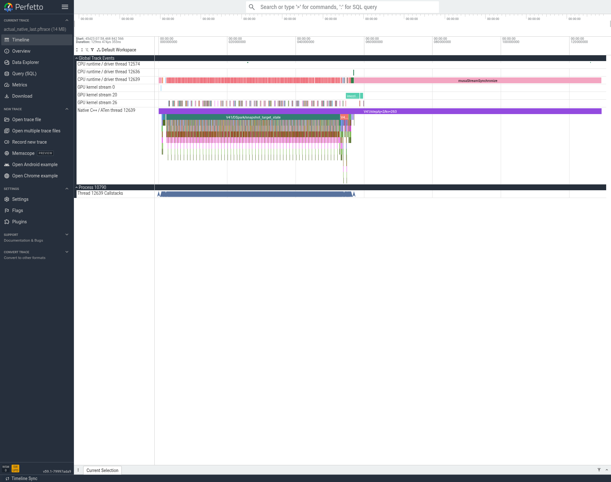
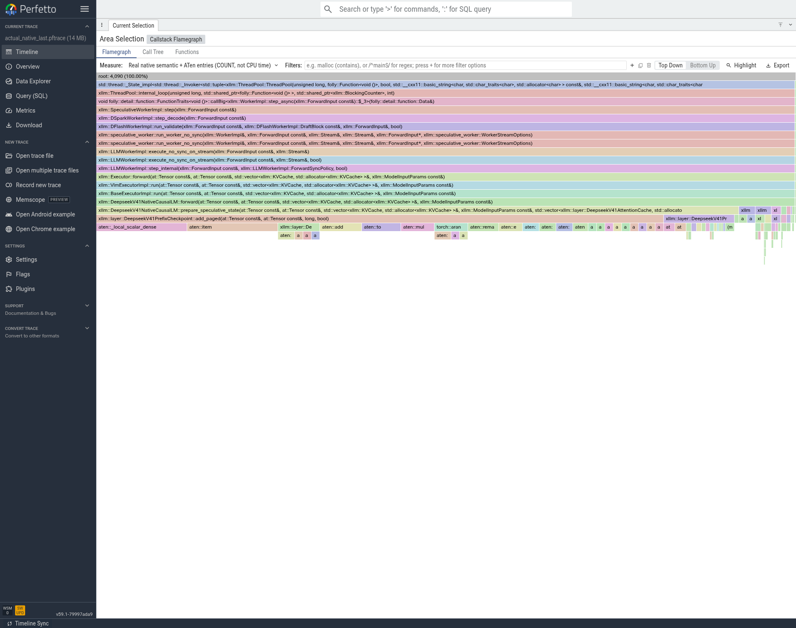

# 实验007：完整target Graph降低多行投机执行成本

## 已完成与未完成

我把经过144项真实Attention Graph短检查的多行静态输入、缓存访问与图捕获状态恢复接到40层C++ target模型。SJ9/SJ10两道题返回4.2/56，实际256/256、C1、1暖2快筛成功，全部请求保留。TPOT从E6的92.69539降到60.51086ms/token，输出从10.66527升到16.00492token/s。不过累计最佳E2B为59.58716ms/token、16.39104token/s，因此本候选**不晋级，保留作为继续增大投机proposal的前置**。没有将两次快筛称为5次正式或最终3轮验收。

仅通过基础功能检查，未完成模型精度验收。

## 同阶段trace与工作量

两组固定同一256/8 trace请求的最后一个外层`V41/step/q=2/kv=263`，本轮能看到一次真实 `musaGraphLaunch` 和 `V41/full_decode_graph_replay`。图回放外的主机ATen调用中，`aten::empty` 从4718降到333，`aten::item`从2426降到597，`aten::to`从2645降到270。40层逐层ATen进入了捕获后的回放，体现主机逐算子调度减少；仍有597次item，说明状态快照/提交、Engram、采样等图外工作值得继续定位。

两组256输出正式快筛请求的投机计数都是accepted106/proposed149（0.7114），同一短trace返回文本也一致；本轮没有靠提高接受率或减少实际输出取得这个快筛差异。这个检查仅确认当前请求的工作量，不是全模型精度结论。

trace中可见GPU kernel数从8301变成795，但图内节点覆盖不足，**不能据此说计算减少了90%**。完整40层模型仍在图中执行。外层profile跨度从766.603ms到129.474ms，完整profile请求20.147s，而OFF对照0.776～1.028s，扰动很大。图中占比和加速比不等于无profiler正式速度，不据此声称Amdahl收益上限或SOL。

图已实际渲染并目视核验，COUNT root为4090入口；COUNT宽度表示入口次数，不是CPU时间。首次首页input.trace_file加载超时，没有伪造截图；保留失败记录后仅重试UI渲染，未重新采集模型trace。原始调用证据在[Graph前后调用与输出工作量](03_结果对比/Graph前后调用与输出工作量.json)。

## 如何复现

NFS根`/data/nfs_shared/xiaopang/v41_xllm_match_sglang_20261116`；run=`p6_spec1_full_verify_graph_v1`。两端8卡，P TP8 eager，D TP8/EP8、proposal1；选择性提交、verify custom、static/fullGraph启用。Engram hash/lookup与head在图外，draft仍既有路径；不能称整个serving链都已Graph。

ELF `artifacts/full_verify_graph_v1/bin/xllm`，SHA256 `d4770abc334cc0aea75fc15806fcfbd1cb042a8f9f76fbbd1822bad23cce8d11`；源码构建manifest和实际SO身份随原始证据保存。基本检查测试夹具后来修正，两个失败版本和修正后的脚本均保留，不能用后来脚本覆盖曾编译模型的源码快照。

- 基本检查归档`exports/p6_multirow_attention_graph_checks.tar.gz`，22,990字节，SHA `f9fb56516fb0ba278f1c7f9a136ea1a2d6a6b6bc2574b5ae3f05a38849d0b054`。
- 模型原始小日志、EvalScope DB、trace索引及rank0实际trace包`exports/p6_spec1_full_verify_graph_v1_evidence.tar.gz`，6,202,460字节，SHA `84b905dfb68dcdb18465ade0914947937a9616e2d9f6e879d739938531a555c4`，AI Book已经回传核验。
- 全部16rank原始trace仍在`profiling/p6_spec1_full_verify_graph_v1`。符号解析器报告DWARF FORM 0x23警告，未知源行保留未知，不补造调用栈。
- 两机模型rank均正常exit0；本轮没有SIGKILL、设备reset或重启。

## 下一步和认知收获

普通Decode完整Graph有效，不意味着proposal1一定更快。多行target Graph需要把动态位置和缓存数据搬到固定GPU地址，接受前缀状态和辅助hidden也要正确传递；仅放开shape保护不够。现在已有这条经过基础检查的路径，应继续用同ELF逐个比较proposal2、3、5，记录每轮实际接受token数与整请求速度。只有比累计最佳更快、完成正式测速和独立trace后才晋级；目标21.57ms/token/39.45token/s仍未达到。
