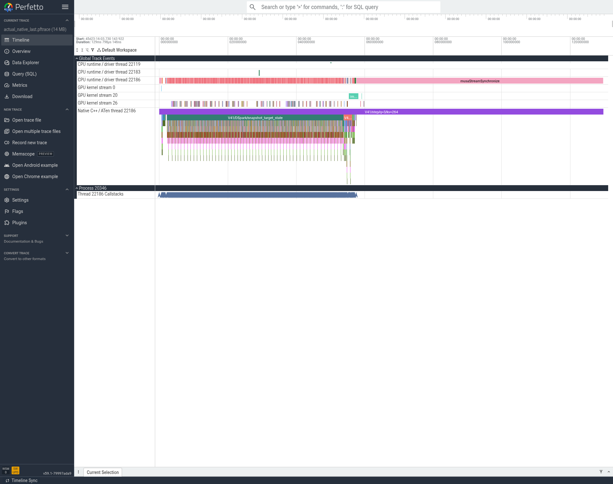
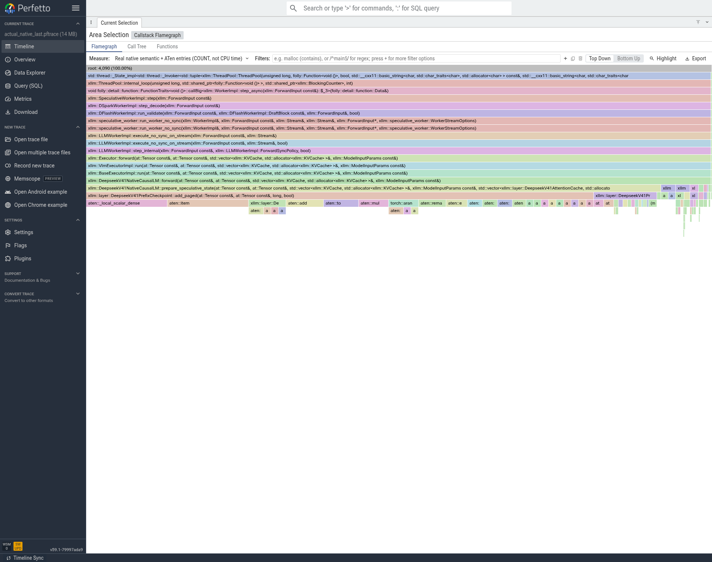

# 实验008：proposal2成为新的阶段最佳

## 实际结果

同一个ELF d4770abc…，仅将proposal1改为proposal2，保持选择性prefix提交、multirow custom、完整target Graph。P TP8 eager，D Attention TP8/专家EP8，两台各8卡；W4AFP8-mt1017、实际256/256、C1、无prefix缓存、profiler OFF。两道题返回4.2/56。独立1暖5正式全部成功：

|方案|TTFT ms|TPOT ms/token|TPOT标准差 ms|E2E s|端到端输出 token/s|
|---|---:|---:|---:|---:|---:|
|E2B此前最佳，普通Decode完整Graph，正式5次|423.56008|59.58716|0.38447|15.61829|16.39104|
|E7 proposal1，多行target Graph，快筛2次|564.80799|60.51086|0.40459|15.99508|16.00492|
|E8 proposal2，多行target Graph，正式5次|399.13281|51.15159|0.22791|13.44279|19.04367|

相较此前正式最佳，输出提高16.18%，TPOT降低14.16%，本轮阶段晋级。相比同ELF proposal1结果是有意义的探索比较，但proposal1只有快筛，不能伪称配对的双方5次正式检验。当前仍远未达到21.57ms/token和39.45token/s，不是最终目标完成；三轮同版本、2048/256和同窗口SG B尚未完成。

仅通过基础功能检查，未完成模型精度验收。

## 为什么接受率下降仍然更快

proposal1每轮最多提出1个候选；该256输出请求accepted106/proposed149，149轮target验证，接受率71.14%。proposal2为accepted130/proposed250，250/2=125轮验证，接受率52%。由服务端真实计数，130个accepted加125个每轮新token，再加P端首token，正好256个输出。接受率比例下降了，但每轮平均交付增加，target执行轮数从149降到125。这个关系解释了为什么不能只看接受率决定是否加速；还要计入draft、每次verify行数、缓存维护和端到端成本。

## trace能看见的内容与限制

独立256/8 trace的外层target为q3，最后一轮`V41/step/q=3/kv=264`有真实`musaGraphLaunch`。ATen empty333、item597、to270，和proposal1单个验证轮类似，说明增大块长没有按token逐个重复40层主机调度。

图已实际渲染并目视核验，COUNT root4090是调用次数。prepare_speculative_state/add_paged仍出现大量小ATen；下一步可以把生成slots、prefix与保存缓存合成一个GPU kernel，但收益大小必须通过OFF测速确认。Graph内节点未被完整展示，不能把图内可见kernel少等同于计算减少。

独立profile请求20.61251s，OFF前后0.76445～0.82793s。当前重型profiler不适合精确Amdahl占比预测；不把首个trace scope的额外时间当成正常每轮固定成本。实际正式计时与profile完全分开。

## 代码、原始报告和清理

实现代码来自共同分支提交`28fba06c5872c18ae8fb1f7235ca64a8b8863480`，与E7相同ELF。当前实验只有参数变化，没有把尚未验证的融合快照候选混入模型。

NFS根 `/data/nfs_shared/xiaopang/v41_xllm_match_sglang_20261116`：

- 配置、两道题和快筛：`runs/p7_spec2_full_verify_graph_v1/{sj9,sj10,client}`。
- 正式原始日志与EvalScope DB：`runs/p7_spec2_full_verify_graph_v1/formal_client`。
- 全部16rank trace：`profiling/p7_spec2_full_verify_graph_v1`。
- 本地已回传核验的原始包：`exports/p7_spec2_full_verify_graph_v1_evidence.tar.gz`，6,361,907字节，SHA256 `1a954df4b894fdd565687a9c98afa61b6a058b6a7ba6c8e241dd348d28f3dd7c`。

全部16rank正常exit0，19:34显存释放，没有SIGKILL或设备级操作。接下来在同ELF测试proposal3/5；融合快照候选先独立做基本检查，再在届时累计最佳上测试。
