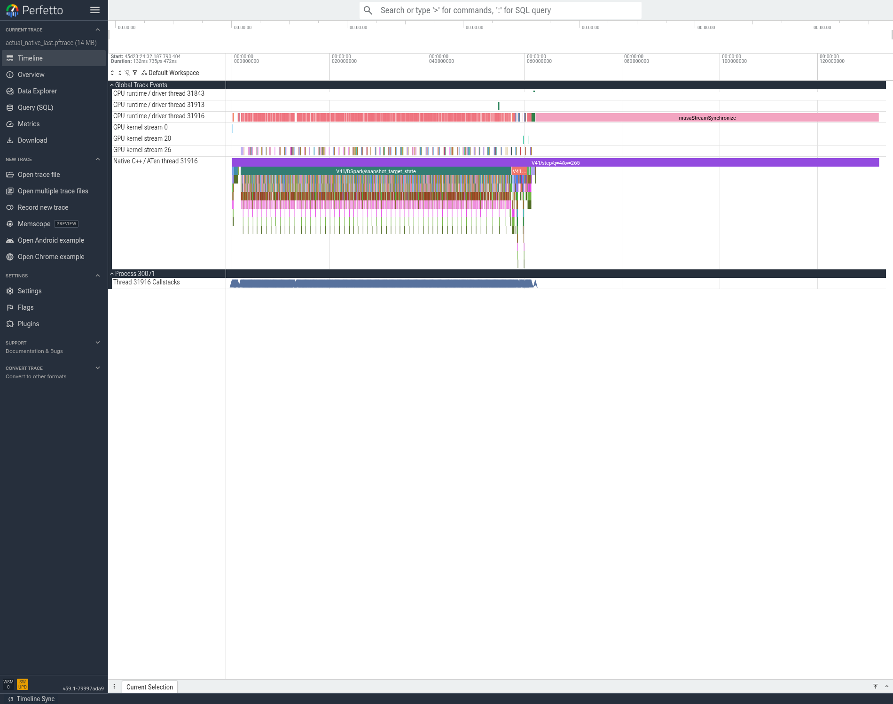
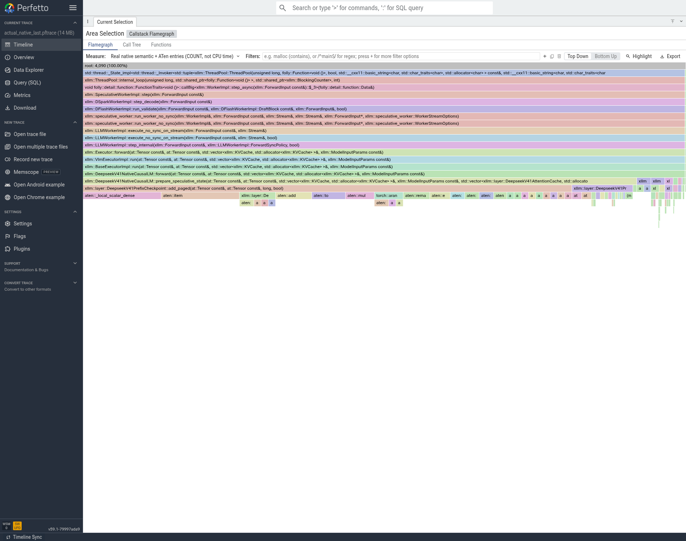

# 实验009：proposal3继续提高阶段最佳

## 改动与正式结果

沿用E8的同一个ELF `d4770abc334cc0aea75fc15806fcfbd1cb042a8f9f76fbbd1822bad23cce8d11`，只将proposal2改为proposal3。P TP8 eager，D Attention TP8/专家EP8、选择性prefix提交、多行custom归约、完整target Graph；SJ9/SJ10各8卡，同W4AFP8-mt1017、实际256/256、C1、prefix缓存关闭。此处完整target Graph指跨层模型主体；Engram/hash、head、draft及快照还在图外。

|方案|TTFT ms|TPOT ms/token|TPOT标准差 ms|E2E s|端到端输出 token/s|
|---|---:|---:|---:|---:|---:|
|E8 proposal2，1暖5正式|399.13281|51.15159|0.22791|13.44279|19.04367|
|E9 proposal3，1暖5正式|407.06404|46.10459|0.31834|12.16373|21.04617|

相对E8输出提高10.52%，TPOT降低9.87%；TTFT增加7.93ms，仍低于990.04ms门槛。两道题返回4.2/56，五次正式均成功、实际输入输出均256；阶段晋级。离21.57ms/39.45token/s仍有明显差距，最终三轮、2048/256及同窗口SGLang B未完成。

早期1暖2快筛与SJ9上的CPU编译有重叠，只作筛选参考。两项CPU编译均结束后，于19:39:02重新开始独立1暖5；本表使用的是这组正式数据，未把受干扰快筛混入正式均值。profiling始终与正式测速分开。

**仅通过基础功能检查，未完成模型精度验收。**

## 为什么proposal3更快

同一256输出请求，proposal2记录accepted130/proposed250，对应125轮验证。proposal3记录accepted143/proposed336，对应112轮验证；143个接受token + 112个每轮新token + P端首token = 256。接受率由52%降到42.56%，但每轮交付数增加，target验证轮数降低10.4%。因此应比较每个最终交付token摊到的draft、target和缓存维护总成本，不能仅看接受率百分比。

## 真实trace与后续方向

独立256/8请求，D最后target为`V41/step/q=4/kv=265`，有1次`musaGraphLaunch`；该轮empty333、item597、to270，与proposal2单轮相同，说明扩大块长没有按行重复一整套40层主机调用。真实native COUNT为4090，属于次数而非耗时。

图已经实际打开检查。`prepare_speculative_state → add_paged`仍有大量小ATen和item；这是后续融合快照的直接代码线索。但profile请求20.45291s、OFF前后0.77955～0.95743s，扰动很重，不能把图中快照占比直接当作正式运行的Amdahl比例。Graph内GPU节点覆盖有限，也不能根据可见kernel少声称计算量相应减少。

## 可复查资产

代码实现提交：`28fba06c5872c18ae8fb1f7235ca64a8b8863480`，本实验只改配置。共同分支：`xiaopangV41FlashCppFromSglangtoXllm`。

NFS根：`/data/nfs_shared/xiaopang/v41_xllm_match_sglang_20261116`。

- 正式原始报告、请求与EvalScope数据库：`runs/p8_spec3_full_verify_graph_v1/formal_client/`。
- 启动参数、实际ELF/运行库指纹、两题和快筛：`runs/p8_spec3_full_verify_graph_v1/{sj9,sj10,client}/`。
- 16rank原始trace：`profiling/p8_spec3_full_verify_graph_v1/`。
- 已回传原始包：`exports/p8_spec3_full_verify_graph_v1_evidence.tar.gz`，6,377,540字节，SHA256 `c31dc76361a2ccc92f5692e6aec8956d29869059df252210e023f0ccfec1b6fd`。

全部16rank正常exit0；新候选启动前19:48两机GPU均0显存/无进程。没有SIGKILL、重启或驱动操作。后续以proposal3为新控制，先测试融合快照，再按计划测试proposal5和其他关键路径优化；不会把未验证候选提前替换累计最佳。
