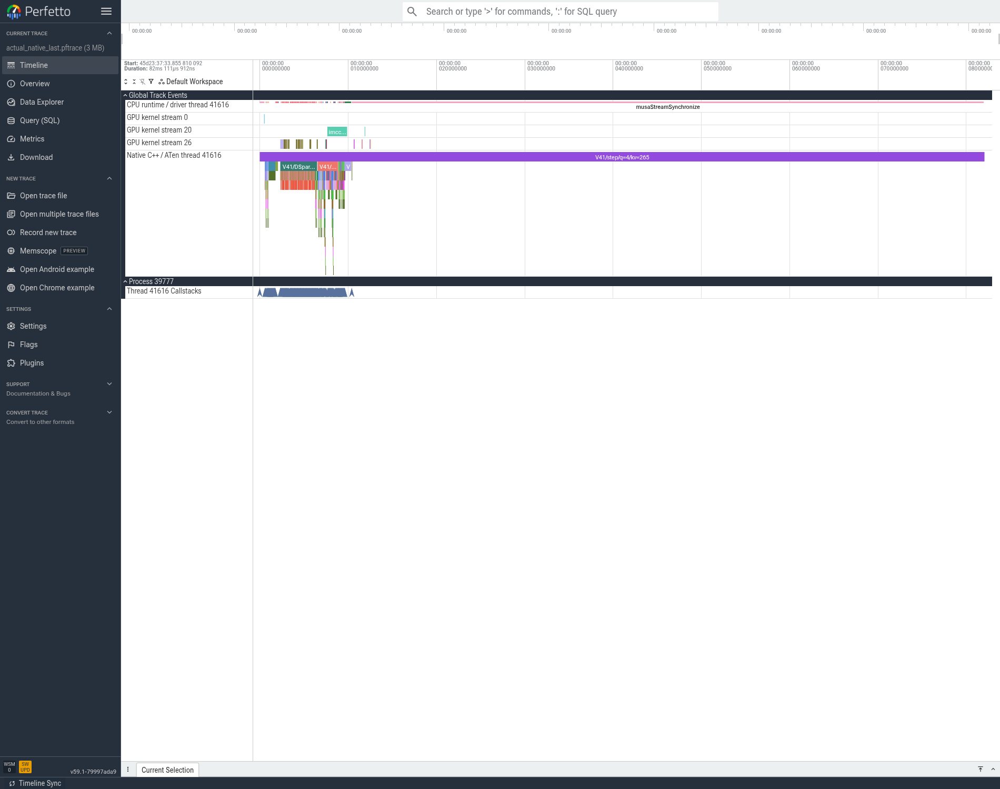
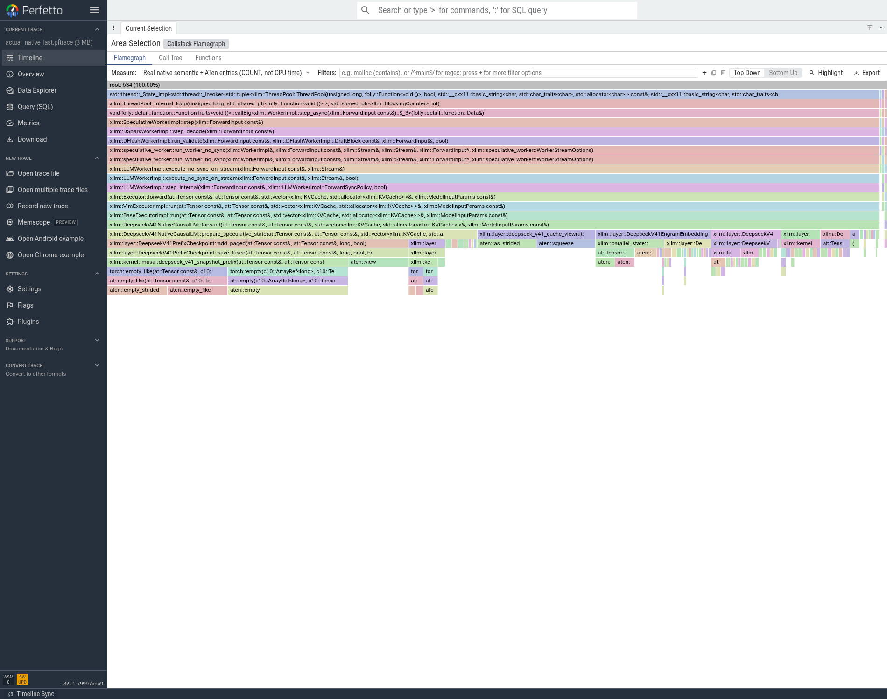

# 实验010：融合缓存快照，输出速度再提高9.53%

## 这次做了什么

以E9 proposal3完整target Graph为控制，只在D开启新增的`XLLM_DSV41_FUSED_SPEC_SNAPSHOT`。在MUSA kernel层把每个cache的物理行索引、接受前缀编号和原始内容备份合成一次GPU调用，原来的拒绝后恢复数学不变。P继续关闭，proposal3、并行、Graph、模型权重、测试输入和其他配置全部保持一致。该开关默认关闭，已有路径保留可回滚。

## 正式性能

SJ9/SJ10双机1P1D、各8卡、P TP8/D Attention TP8专家EP8、同W4AFP8-mt1017、实际256/256、C1；两道题4.2/56通过。EvalScope1.14.1，profiler OFF，各1次暖机后5次正式请求全部成功。

|方案|TTFT ms|TPOT ms/token|TPOT标准差 ms|E2E s|端到端输出 token/s|
|---|---:|---:|---:|---:|---:|
|E9 原多ATen快照|407.06404|46.10459|0.31834|12.16373|21.04617|
|E10 GPU融合快照|390.48983|42.01836|0.17089|11.10517|23.05232|

输出提高9.53%，TPOT下降8.86%，本轮阶段晋级。两组同一请求accepted143/proposed336、112轮target验证、最终256输出，说明收益不是靠缩短输出或改变接受工作量。不同ELF是本项源码修改重新编译的结果，并非换了依赖。当前仍未达到21.57ms/39.45token/s；三轮最终复验、2048/256和同窗口SGLang复验待完成。

**仅通过基础功能检查，未完成模型精度验收。**

## trace把改善定位到哪里

两边选同一段`V41/step/q=4/kv=265`，同为单个target验证轮、相同4行。以下为真实trace计数，原始计算见`trace计数对照.json`：

|该轮可见调用|改动前|改动后|
|---|---:|---:|
|aten::item|597|0|
|aten::empty|333|121|
|aten::to|270|11|
|aten::arange|110|0|
|aten::index_select|110|0|
|snapshot_prefix_kernel|0|55|
|musaGraphLaunch|1|1|

这条证据链是：旧`prepare_speculative_state/add_paged`逐缓存发起多个ATen并读取标量 → 新kernel一次生成索引并备份 → 相关item/arange/index_select消失 → 每个verify的图外准备减少 → 同工作量正式TPOT改善。没有删除模型层、专家、缓存回滚或改用CPU。

对照图见[实验009](../实验_009/05_结论与读图说明.md)。图中时长由132.74ms变成82.11ms，只能用于这次profile窗口，不是正式step加速比；本次profile请求18.39s，OFF前后0.73～0.93s，扰动明显。Graph内部GPU节点不完整，可见kernel数849→143也不能当作全部GPU计算减少的比例。尚没有可靠的无profiler快照占比，因此不虚构理论收益上限或兑现百分比。

## 基本检查与实现边界

2448项原始字节级检查、84项真实Attention、84项真实AOT Engram通过，覆盖q1～6、接受0/1/全部、ratio1/2、SWA/压缩/循环状态、页边界与环形覆盖、默认/非默认流。详见[检查说明](02_基本检查/检查解释.md)与[实现说明](01_代码与构建/实现说明.md)。原来的suffix恢复kernel保持不变，事务保存量预算保持64MiB。测试只是本项修改相关检查，不扩展为全模型精度结论。

初次证据打包脚本误引用不存在的module manifest，已保留失败并修正；没有重跑已通过GPU检查。克隆启动配置后顶层binary说明曾保留旧值，rank argv始终指向新ELF；已经保留原件并作元数据修正，归档时再次读取16个实际/proc/exe，全部SHA与新ELF一致。不能只靠分支名或配置说明证明实际生效。

## 可复查资产与下一步

新原生ELF：`/expt/artifacts/fused_prefix_snapshot_native_v1/bin/xllm`，SHA256 `1a071df743c7cd185ad7a0f4e2028f0fb602ab09f1cce963ce950e442c84b486`。生产源码已逐文件核对build source_manifest。所有16rank正常exit0，19:55两机显存均释放，没有SIGKILL或设备级操作。

NFS根`/data/nfs_shared/xiaopang/v41_xllm_match_sglang_20261116`：

- 正式原始日志、请求与EvalScope DB：`runs/p9_spec3_fused_snapshot_v1/formal_client/`。
- 配置、两题、实际进程/运行库：`runs/p9_spec3_fused_snapshot_v1/{sj9,sj10,client}/`。
- 全部16rank trace：`profiling/p9_spec3_fused_snapshot_v1/`。
- 本地已回传核验的原始包：`exports/p9_spec3_fused_snapshot_v1_evidence.tar.gz`，5,437,954字节，SHA256 `ed45a7c47b6d54ea4bcbeb482df4946c206391e0f8686faa8c1e05d72747aefa`。

下一步同ELF仅改变proposal3→5；然后根据新瓶颈继续draft Graph、状态buffer复用及并行/通信路径。当前结果只是阶段最佳，不能将完成候选清单当作速度目标已经完成。
