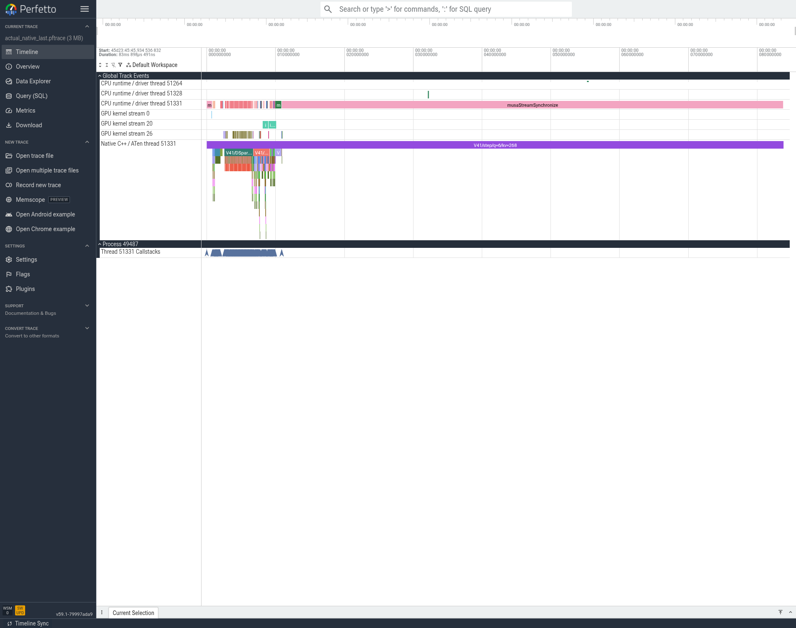
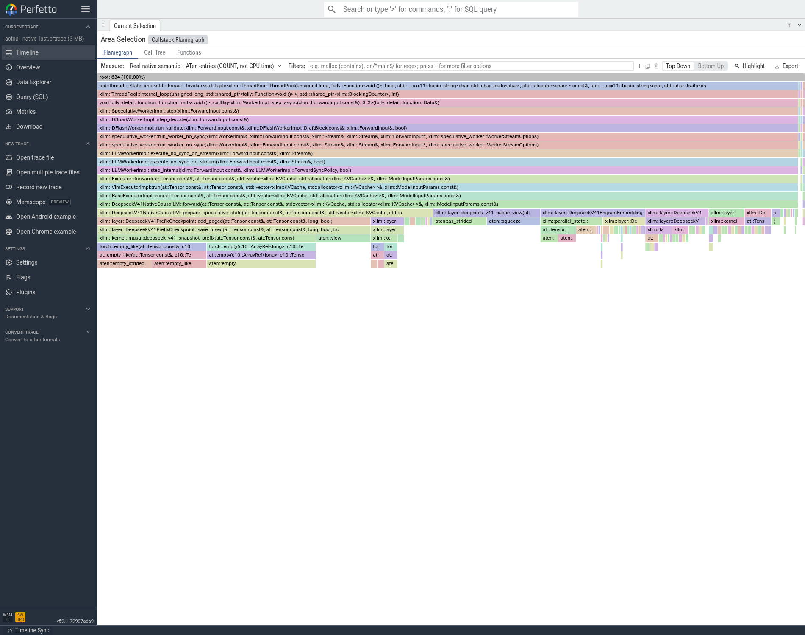

# 实验011：proposal5不晋级，反向控制确认保留proposal3

## 同条件正式比较

同ELF `1a071df743c7cd185ad7a0f4e2028f0fb602ab09f1cce963ce950e442c84b486`，只改变proposal长度。SJ9/SJ10双机1P1D各8卡、同W4AFP8-mt1017、Attention TP8/专家EP8、完整target Graph和融合快照、实际256/256、C1、prefix关闭。三轮均独立1暖5，profiler OFF；这是按顺序跑的控制→候选→反向控制，不是最终达标验收三轮。

|顺序|方案|TTFT ms|TPOT ms/token|TPOT标准差 ms|E2E s|端到端输出 token/s|
|---|---|---:|---:|---:|---:|---:|
|1|E10 proposal3|390.48983|42.01836|0.17089|11.10517|23.05232|
|2|E11 proposal5|394.87313|43.30674|0.18473|11.43809|22.38136|
|3|恢复proposal3，反向控制|436.40334|42.07204|0.08437|11.16477|22.92926|

proposal5在前后控制比较中均更慢，保留proposal3为阶段最佳。反向控制TPOT与前控制接近；TTFT存在主机侧波动，因此端到端速度也稍不同，全部请求均保留，没有挑选最优请求。两题4.2/56通过，所有正式请求成功且实际256/256。

**仅通过基础功能检查，未完成模型精度验收。** 当前目标21.57ms/39.45token/s仍未达到。

## 接受率和工作量解释

正式256输出请求：proposal3为accepted143/proposed336，112轮target验证；proposal5为accepted143/proposed560，同样112轮。两者143+112+P端首token=256。增加proposal数量没有带来更多接受token，也没有减少验证轮数；反而每轮draft与target需要处理更多行，故不能把更大的block当成必然的优化。这是当前冻结请求的观测，不代表所有请求都不适合proposal5。

## 独立trace

proposal5保存了16rank真实GPU/native trace，实际进程与ELF/SO身份核验通过。最后可见target轮为`V41/step/q=6/kv=268`，仍是一轮完整Graph回放，native COUNT634为调用次数。verify的试探位置可超过最后真正提交位置；正式性能仍以实际提交的256输出核算。

两张图已实际打开检查。profiler请求18.447s、OFF前后0.7457～0.9574s，扰动明显；proposal3/5的verify行数及短trace窗口接受情况也不同，不用单轮profile时长推算全局收益。反向控制使用同一实现，仅复验1暖5，没有重复采集已经验证过的相同实现trace。

## 原始证据和资源

NFS根：`/data/nfs_shared/xiaopang/v41_xllm_match_sglang_20261116`。

- proposal5原始正式报告：`runs/p10_spec5_fused_snapshot_v1/formal_client/`；trace：`profiling/p10_spec5_fused_snapshot_v1/`。
- proposal5归档：`exports/p10_spec5_fused_snapshot_v1_evidence.tar.gz`，5,414,064字节，SHA256 `498ea6ff5950dd8e9ea89f043071370f131ed7961904422805bda9147b0fbe59`。
- proposal3反向控制正式报告：`runs/p11_spec3_reverse_control_v1/formal_client/`。
- 反向归档：`exports/p11_spec3_reverse_control_v1_evidence.tar.gz`，130,702字节，SHA256 `3868051c7b22c23d8bb87d3104414b962b2ebd4acb4acb4addb058fdebeb6b56`。

两组各16rank都正常exit0，未用SIGKILL或设备级操作；原始包均已回传核验。源代码仍是E10 `cc53d34a…`，这项实验只有配置变化。下一步回到E10累计最佳，对三个draft层接入已有多行custom归约，然后研究draft静态化/Graph及D端并行通信。
