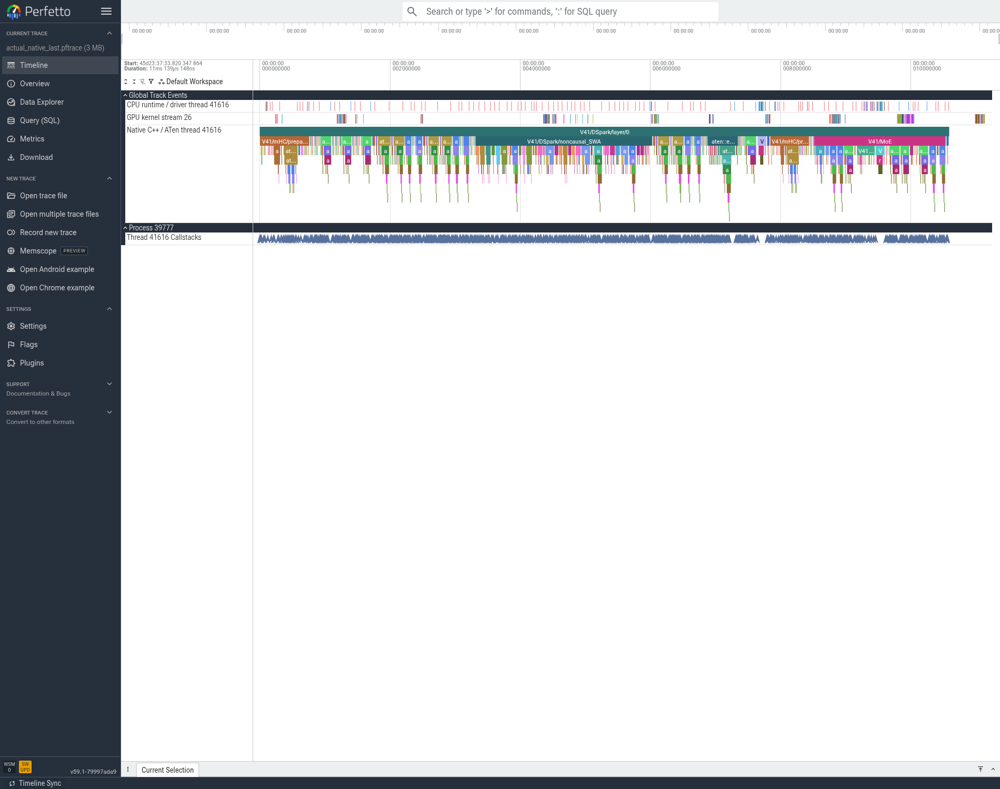
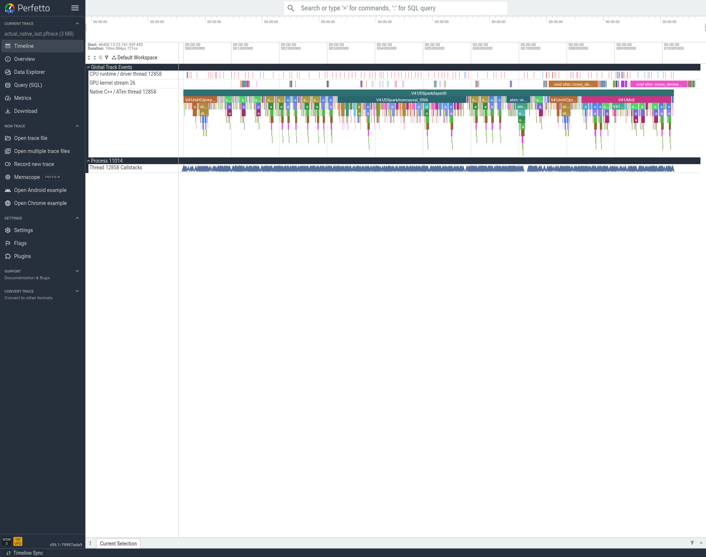
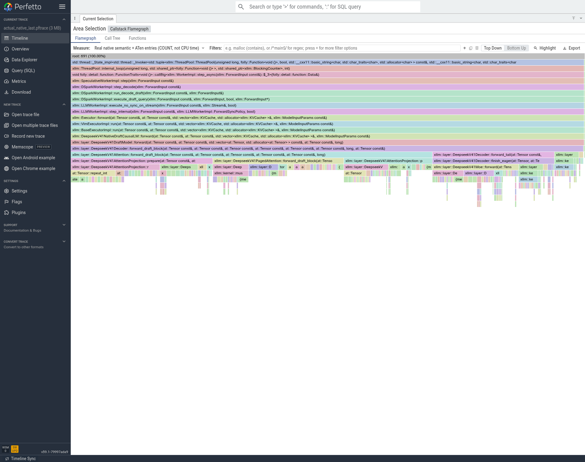

# 实验012：draft 通信复用 custom allreduce

## 结论

在实验010累计最优的 proposal3、完整 target Graph、选择性恢复和融合快照上，只给三层 draft 接入已有的 BF16 Attention TP 与 FP32 MoE EP custom allreduce。两道基础题通过；正式请求实际均为256/256、C1。TPOT由42.01836降至39.51973ms/token（下降5.95%），端到端输出由23.05232增至24.39507token/s（提升5.82%）。本项晋级为阶段最佳，尚未完成目标三轮验收与长输入回归。

**仅通过基础功能检查，未完成模型精度验收。** 目标21.57ms/token、39.45token/s仍未达到。没有进行MathQA、API对分或logits排查。

## 正式性能与协议

|指标|E10控制|E12 draft custom|
|---|---:|---:|
|TTFT ms|390.48983|416.39211|
|TPOT ms/token|42.01836|39.51973|
|TPOT样本标准差 ms|0.17089|0.55096|
|E2E s|11.10517|10.49392|
|总输出token/请求latency之和 token/s|23.05232|24.39507|

两端各8卡，P TP8 eager，D Attention TP8/专家EP8、proposal3、target跨层Graph；draft仍eager。EvalScope1.14.1，固定同模板token IDs、temperature0/top_p1、ignore_eos、prefix cache关闭，独立1暖5、profiler OFF。服务端日志与客户端数据库核对实际256/256和成功状态。正式测量没有与编译或GPU小检查重叠；快筛与正式分别保留，不混为一轮。

E10 formal与本项formal各5次。相邻E11反向控制的proposal3为42.07204ms/22.92926，支持控制值未明显漂移；本项收益超过3%，仍只作为阶段晋级，不能代替最终同配置三轮复验。

## 改动与一次真实失败

改动位于`xllm/models/llm/musa/deepseek_v41_dspark_native.h`。新增默认关闭`XLLM_DSV41_DRAFT_CUSTOM_AR`；所有rank在加载时核对开关一致；启用时仅支持当前CP1/DP1的TP8/EP8。沿用实验006已测的多行BF16/FP32通信实现，不改量化、专家权重或采样规则。shared专家仍为复制版，在路由输出EP求和后加一次。

v1 漏掉了通信组适配：Attention先成功执行，随后`musa_allreduce_tp_custom(moe_ep_group, ...)`返回unsupported，触发显式CHECK；8个D rank退出-6，未产生有效性能。v2借鉴目标模型`expert_reduction_group()`，仅custom开启时将同成员同序的EP8求和交给TP8通信组；专家所有权仍按EP rank。没有屏蔽错误或捕获异常后继续服务。失败日志与归档保留，P正常TERM退出，未用SIGKILL或设备级操作；结束后16卡已核验释放。

短检查复用相同通信kernel的48项/rank、多行、空专家、默认/非默认流与Graph回放证据；首次失败也证明kernel检查不能代替模型接线验证。

## trace 说明：改善的是通信组织，不是少算了层

独立256/8 profile，16rank GPU事件、ATen与真实native Record ID关联已验证。对比同一最后一次`V41/DSpark/layer/0`：

- 整份rank0 trace包含4轮draft，各3层。原BF16与FP32 MCCL AllReduce各12次，本项各0次；仍有20次AllGather，不能说所有通信都替换了。
- 在选中的draft层，出现各1次`cross_device_reduce_1stage<__mt_bfloat16,8>`与`<float,8>`，证明新归约实际执行。
- 该层主机runtime事件的`musaEventRecord`由10次变0，`musaStreamWaitEvent`由4次变0；原通信流切换依赖不再出现在该层调用链。
- ATen调用677→681、native entry COUNT 687→691，相关GPU kernel110→112，并不是减少kernel launch数量的一项优化。自定义归约多了输出分配，却减少了MCCL通信流组织；真实全局收益以profiler OFF正式请求为准。

完整CPU区间与GPU时间线：

图中的火焰宽度是实际调用entry COUNT，不是CPU时间采样。局部GPU关联按runtime correlation；原MCCL可能经通信线程发射，局部图未关联到它不等于没执行，以上12→0依据整份原始trace计数。重型profile请求18.43388s，OFF为0.7264～0.9207s，因此不能把图中毫秒/占比当正式耗时，也不给虚构的Amdahl兑现百分比。`addr2line`有DWARF行号警告，C++函数符号已解析核对，不声称所有源码行号均可靠。

## 数值与投机边界

本项256输出的投机接受数为142、提议339、target验证113轮，控制为143/336/112轮。`142+113+P首token=256`，全部9条快筛/暖机/正式长输出记录核验通过。归约顺序改变可能影响边界，不能声称逐token结果完全不变；本轮仅记录，未展开精度原因排查。性能收益不是靠缩短输出获得，但也不声称是固定完全相同推理工作量下的纯kernel提速。

## 资产和下一步

正式run：`/data/nfs_shared/xiaopang/v41_xllm_match_sglang_20261116/runs/p12_spec3_draft_custom_ar_v2/formal_client/`。
二进制：`/expt/artifacts/draft_custom_ar_v2/bin/xllm`，SHA256 `1143b490701331cf767d311393c342308548fc5162a9ac3614f8549f4a11e7b8`。
原始包：`exports/p12_spec3_draft_custom_ar_v2_evidence.tar.gz`，5,380,457字节，SHA256 `43be0d1bdc4b378ebc51ec8735786635c83bc0e236033a0f6d75d31cb5d34a4b`。
本地原始报告在`draft通信正式与trace原始证据/formal_client/`；trace与native侧文件在该目录`trace_analysis/`。失败包`首次失败原始证据.tar.gz`另存，SHA1292b3b1…。

下一项以本版本为控制，先测试draft静态非因果SWA读取、再开三层draft Graph。图外context写入、词表头和Markov bias仍保留，不能把局部图说成整个推理流程完全入图。
