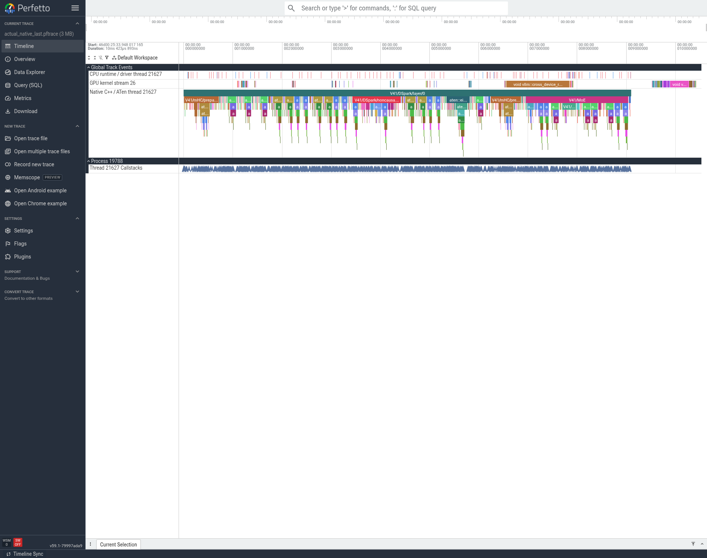
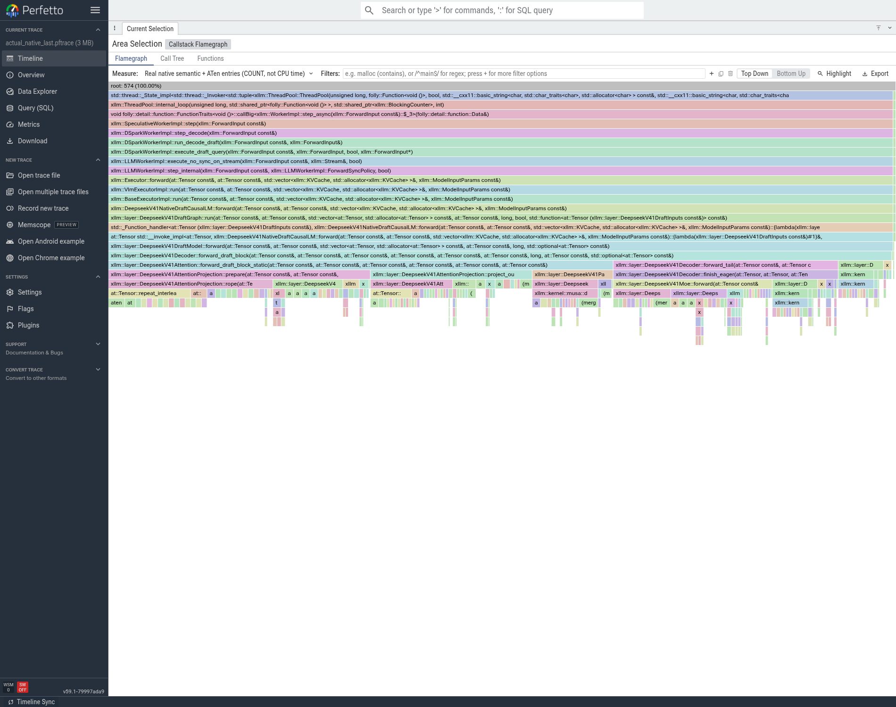

# 实验013：固定 draft 输入并融合非因果 SWA 读取

静态draft关闭Graph后的正式结果为 **TPOT38.80429ms、输出24.94626token/s**。同ELF反向控制为39.56418ms、24.40671token/s，端到端约改善2.21%、TPOT降低1.92%。之前控制ELF的39.51973ms/24.39507也与反向控制接近，方向一致。这是小幅阶段结果，不能代替最终同配置三轮验收。

## 具体改了什么

沿用E12的draft custom归约，新增 `deepseek_v41_swa_draft_read` MUSA kernel，一次产生draft读取历史KV所需的rows和picks，替换逐次arange、索引、where、cat等组合。历史context长度改为GPU标量，每轮原地更新；tokens、positions、page table有固定地址。这为下一项完整draft Graph提供前置条件。

不能直接用target的因果读取替代draft：同一proposal块的各query需要看见本块所有query KV，而非只看当前及之前的query。它只读取已接受的历史，不把未验证的proposal写入target或draft缓存。新kernel仍调用原有MATE sparse attention；未修改模型权重、量化格式、路由专家或投机验证规则。

文件层次：`core/kernels/musa/deepseek_v41_swa_decode_read.{h,cu}`实现融合读取；`core/layers/musa/deepseek_v41/{paged_attention,attention,decoder,draft_model}.h`传递GPU context及调用；`draft_graph.h`管理静态输入和后续可选图；`models/llm/musa/deepseek_v41_dspark_native.h`接线，默认开关关闭。此实验只有STATIC_DRAFT开，FULL_DRAFT_GRAPH关，后者的模型集成验证另见实验014。

## 基本检查与性能

120项eager精确检查、24项真实MUSA Graph动态输入检查全部通过，覆盖q1～6、context0～1024、不同流、int32/int64表、负padding、非连续物理页、实际MATE结果和cache不被修改；小检查不等价于完整模型精度验收。

两道题输出4.2与56。两组正式均EvalScope1.14.1、1次暖机后5次、实际256/256、C1、profiler OFF、同一ELF `9720e7efb1ae89aebf1e7ab462fcef6fd7e23cfde70b5487ec7cb3cc571f5b49`；保持target verify Graph、proposal3、TP8/EP8、prefix关闭不变。

|配置|TTFT ms|TPOT ms/token|TPOT样本标准差 ms|E2E s|latency-sum输出token/s|
|---|---:|---:|---:|---:|---:|
|反向控制：静态draft关|400.05441|39.56418|0.35217|10.48892|24.40671|
|静态draft开，Graph关|366.96576|38.80429|0.12785|10.26206|24.94626|

两组日志的标准256/256请求均为accepted142/proposed339，即113轮target验证，142+113+P首token=256；不能把速度变化归因于更短输出或更多投机接受。未展开数值对分。

## trace里怎么看

同一请求的最后一个 `V41/DSpark/layer/0` 原生范围：ATen681→564，`aten::item`21→9，arange6→0，index_select5→3，where7→3，cat4→2，empty80→66，`musaLaunchKernel`103→80。该范围GraphLaunch均0，说明这里仍是静态eager。融合读取减少主机组合与kernel启动，随后实验014将单独评价Graph的贡献。

对照图见实验012的 `04_trace与图/draft通信自定义归约/Perfetto图`。火焰图宽度是native入口次数COUNT，不是采样CPU时间。16rank GPU事件、原生record ID和实际ELF均已验证。profile256/8请求18.053s，而OFF为0.698～0.747s，因此只用图定位调用与路径，局部占比、Amdahl上限和兑现百分比均未知。

Perfetto在线UI两次加载失败、首轮本地缓存缺WASM均已留日志。已从此前成功的同版官方UI缓存恢复页面及WASM，使用localhost渲染成功，CPU时间线与完整native COUNT图均实际打开检查。渲染工具新增可选--ui-url，默认仍是官方页面。

## 原始证据与资源

候选原始包5,274,403字节，SHA `f89b320a772cb3068d4de8f19d968d6657e021315c2055d419445d4e4b77881a`；反向控制130,795字节，SHA `1722054cdd2ab780d2d57348240008d861e834d83f4bb24b7074281c8a9b7b64`。本目录分别完整解压保存；NFS exports对应run `p13_spec3_static_draft_v1`和`p13_spec3_draft_reverse_control_v1`，运行日志在runs、完整trace在profiling。两组全部16rank正常exit0，20:51两机GPU0；没有SIGKILL、驱动调整或服务重启。

仅通过基础功能检查，未完成模型精度验收。仍未达到21.57ms/39.45token/s最终目标，下一步推进同ELF完整draft Graph，不以本项小收益收口。

后续复测补充：实验014后的第二轮静态draft为TPOT39.25543ms、输出24.67092token/s；当前静态方案两轮范围38.80～39.26ms、24.67～24.95token/s。保留两轮而不是只报告较快一轮，最终稳定性仍需三轮统一验收。
