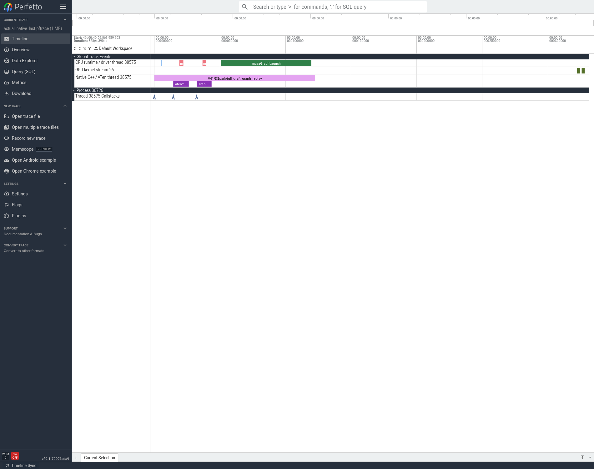
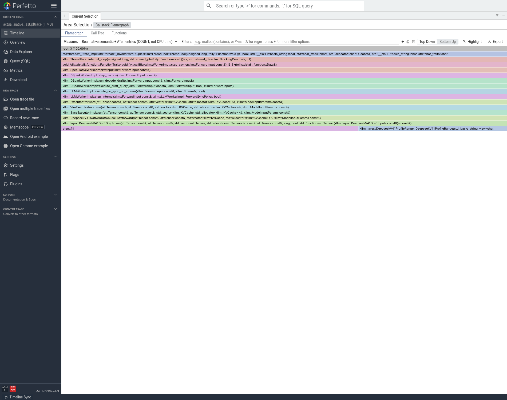

# 实验014：完整draft Graph已接通，但独立收益尚未成立

两道题、实际256/256、独立1暖5与16rank trace全部通过；Graph正式 **TPOT38.75659ms、TTFT357.11803ms、输出24.99988token/s**。它比首轮静态draft快约0.21%，反向静态控制为39.25543ms/24.67092。幅度随控制轮变化，不足以宣称稳定独立提升；标记 `INCONCLUSIVE / READY_DEPENDENCY`，累计最佳继续使用静态draft而不开这个图。不能把“图已接通”写成“性能已提升”。

## 做法与边界

参考冻结SGLang `dspark_draft.py` 的query-only draft图执行，使用与实验013相同ELF9720e7ef，仅D的FULL_DRAFT_GRAPH从0变1。覆盖embedding、三个draft decoder层及norm；context投影/写入、词表头、Markov bias、逐位置采样仍在图外。固定GPU输入缓冲及context标量，每轮更新内容。按proposal长度和表宽建图桶，校验cache地址、shape/stride；暖机与捕获只读KV，不提交未接受的proposal；custom AR图注册结束后回放。Graph失败不捕异常回退掩盖。

## 正式结果

均为SJ9/SJ10双机1P1D、每台8卡、Attention TP8/专家EP8、W4AFP8-mt1017、proposal3、target完整verify Graph、融合状态快照、draft custom归约、C1、实际256/256、prefix关闭、EvalScope1.14.1，profiler OFF，各自1暖5。

|配置|TTFT ms|TPOT ms/token|TPOT样本标准差 ms|E2E s|latency-sum输出token/s|
|---|---:|---:|---:|---:|---:|
|先前静态draft，Graph关|366.96576|38.80429|0.12785|10.26206|24.94626|
|完整draft Graph开|357.11803|38.75659|0.12531|10.24005|24.99988|
|反向静态draft，Graph关|366.45662|39.25543|0.28615|10.37659|24.67092|

全部标准请求同样accepted142/proposed339、113轮验证，真实生成256，未用提前结束或失败获得更好指标。无完整精度验收。

## 从图中确认什么

独立256/8 trace的rank0有4次full_draft_graph_replay，合计8次GraphLaunch，其中另4次是target。draft层内的CPU RecordFunction不再逐轮执行：选中最后一次完整draft回放可看到实际musaGraphLaunch，native COUNT为3。

这不是三个decoder层计算消失。图内GPU节点在当前profiler中的可见性不完整，不能用显示的kernel数量减少宣称数学工作减少；也不能把完整Graph与实验013单层COUNT574直接解释为全模型计算缩短比例。图只证明主机执行方式变了。首次加载捕获3个表宽桶，之后正式测量使用已捕获桶。

profile请求15.29876s，对照OFF0.7255～0.8991s；重型trace明显扰动。为何Graph独立收益很小仍待低开销测量：可能减少的主机工作不在关键路径，也可能存在图回放的额外成本，当前不能确定。下一步用当前q4 target图边界event、关闭/开启/再关闭对照，避免沿用旧q1数字或盲目继续扩大图。

## 证据及资源

完整图原始归档4,574,377字节，SHA `8b1c0c8a741c96fc361a856bdc1bf03e9f4956b3479fa28b72f8ff7faeeb3285`。反向控制130,574字节，SHA `dd2276fe21a6fd656e40e3cdc2e51d4d8e12b0315581d9e4f4ac825d065e59ad`。本目录完整解压；NFS根 `/data/nfs_shared/xiaopang/v41_xllm_match_sglang_20261116` 的runs/profiling/exports同名run保存完整记录。两轮全部16rank正常exit0，21:04:50两机显存0；没有SIGKILL、GPU reset、驱动调整或服务器重启。

仅通过基础功能检查，未完成模型精度验收。尚未达到21.57ms/39.45token/s，最终同配置三轮、2048/256回归、同窗口SGLang复测仍未完成。
