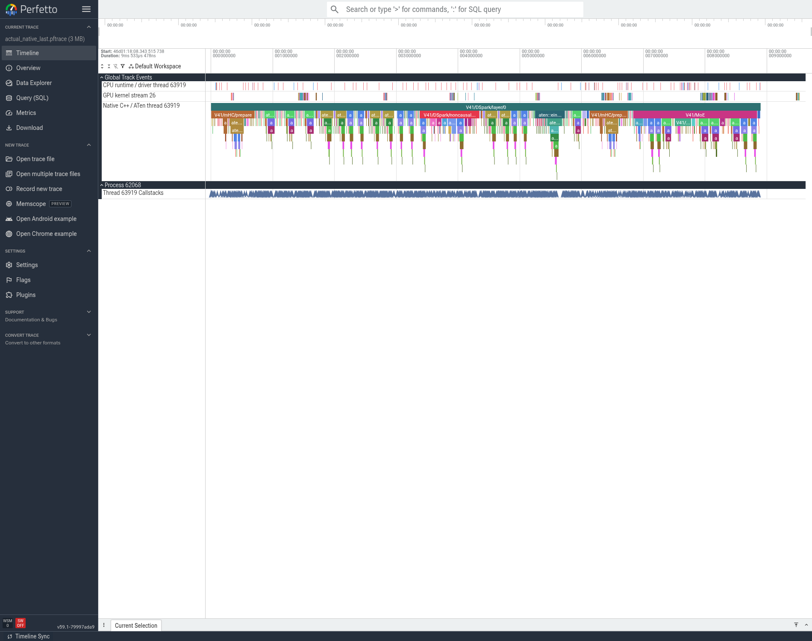
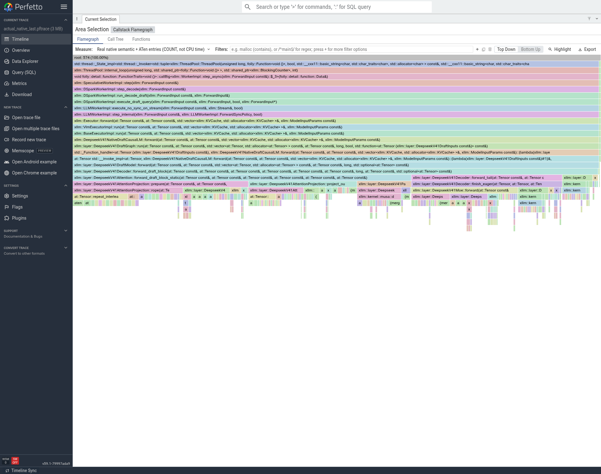

# 实验016：checkpoint静态激活scale接入完成，单独未提速

本项基于实验013累计最佳，仅将target和draft专家输入改为checkpoint原有静态激活scale，并显式选择MATE Apertoken GEMM。原权重、W4/group128、专家归属、归约、proposal3及Graph配置保持一致。`XLLM_DSV41_W4A8_STATIC_ACTIVATION`默认关闭，当前不晋级。**仅通过基础功能检查，未完成模型精度验收。**

## 结果

同W4AFP8-mt1017、SJ9/SJ10双机各8卡、实际256/256、C1、1暖5、profiler关闭：

|配置|TTFT ms|TPOT ms/token|E2E s|端到端输出token/s|
|---|---:|---:|---:|---:|
|E13静态draft累计最佳首次|366.96576|38.80429|10.26206|24.94626|
|E13反向复测|366.45662|39.25543|10.37659|24.67092|
|E15同最佳路径计时关闭|439.79134|39.12196|10.41589|24.57783|
|E16静态激活scale|433.60096|40.40938|10.73799|23.84058|

E16五次TPOT样本标准差0.13680ms。基础题分别答4.2和56；正式请求全成功且实际输入/输出均为256。2048/256单次冒烟成功，TTFT2.68327s、E2E22.74279s，包含首次长图桶捕获，不能作正式长输入性能。没有做本次ELF的static OFF反向复测，因此以上是观察参考，不能把差值全归因于GEMM本身；未观察到收益，不晋级，后续可以作为有依据组合试验的READY_DEPENDENCY。

## 做了什么，为什么有必要核对

SGLang实际路径保留checkpoint静态activation scale；我方此前每128列动态求scale。两者都是现有模型资产可表达的路径，但不能只更换GEMM函数名。新实现加载每个本地专家的gate/up及down scale，取相应本地最大值，保留原FP8激活和权重量化语义，dispatch及SwiGLU直接写FP32每token scale；MATE接口显式传per_token_scale，不依靠张量shape猜测ABI。target和draft均接线，无CPU专家计算回退。

小检查使用实际模型权重，24组含M=1/4/6/17/128/256、两种scale、默认/非默认流、空本地路由；最大GEMM归一化RMS误差gate/up0.00166924、down0.00169850，均低于0.01；SwiGLU量化参考误差0。三个真实Graph桶各变化输入和路由回放三次通过。这里只证明相关基本数值行为，不代表完整模型精度已验收。

首个独立测试构建缺少TorchMUSA CUDA映射环境，在GPU执行前失败，日志保留；第二版直接链接生产构建的实际kernel/GEMM对象并记录SHA，避免拿另一个编译版本代替受测算子。

## trace能说明什么

16rank均有真实GPU、ATen及native record ID关联；rank0时间线和C++ ENTRY_COUNT火焰图已实际打开检查。图上看到真实原生draft调用链经过Attention、mHC及MoE；COUNT是入口次数，不能解释成CPU/GPU耗时占比。完整target Graph内部节点覆盖不全，不能把可见kernel减少解释为计算减少。

可见GEMM实例由group128路径变为`Mp31MixedDtypeMaskedMoeGEMMS4FP8<...,3u,-1,false>`，说明实际进入Apertoken实现。独立256/8请求关闭profiler约0.811～0.839s，开启18.206s，扰动很大，不能用该trace直接计算正式收益上限。实测每个正式请求accepted140/proposed354，约118次verify；此前accepted142/proposed339、约113次verify。最终输出仍256，服务器accepted计数可能包含末轮被token上限裁掉的提议，不能直接当已交付token。数值路径变化会改变投机工作量，不宣称“kernel更慢导致全部回退”。

下一项回到E13累计最佳动态group128路径，借鉴SGLang masked preparation仅遍历有效专家行的实现，减少我方SwiGLU按128行容量启动的大量空CTA。保留MATE物理capacity和GPU counts，先做字节级与Graph检查，再同ELF开关对照。CTA减少是线索，尚不能承诺全局收益。

## 身份、原始证据和清理

ELF `eda9a53809f68b8c8949fb5f2fa482ece0f77d5c8afe0255a9eeef3fff966555`；静态MATE SO `ec95aa472eaa7d785972eef8627dc5558421e9e4a30aadcd8ebeeda4d6551ab3`。实际16rank的/proc/exe及映射SO已核验。

快筛客户端模板原来硬编码旧ELF路径，导致原identity.json元数据写旧SHA；原件完整保留，另有identity_correction.json和修正summary，不覆盖原始指标。正式客户端已从本轮role_config获取路径，实际ELF一致。以后不能只复制旧模板的identity路径。

NFS完整运行目录：`/data/nfs_shared/xiaopang/v41_xllm_match_sglang_20261116/runs/p16_spec3_static_activation_v1`。本地原始包`静态scale正式与trace原始证据.tar.gz`为5552017B，SHA256 `58222e3db2658b66105ad1369a2507a233f158e028fb564f84e69289355ce271`；算子/构建包SHA256 `15cda535675784a7329a6703d08ebec580cf4e65650b05576348bd42905c72fb`。包含EvalScope数据库、全部逐请求结果、失败构建、源码/产物指纹、配置、trace及进程身份。

21:38核验两端16rank全部正常exit0且GPU显存释放；没有SIGKILL、重启或驱动操作。最终三轮验收、正式2048/256和同窗口SGLang B仍未完成，整体goal未达标。
