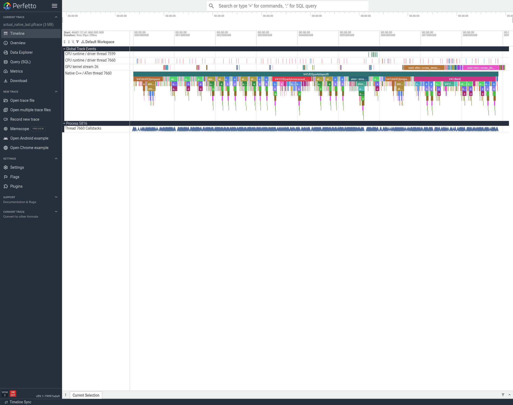
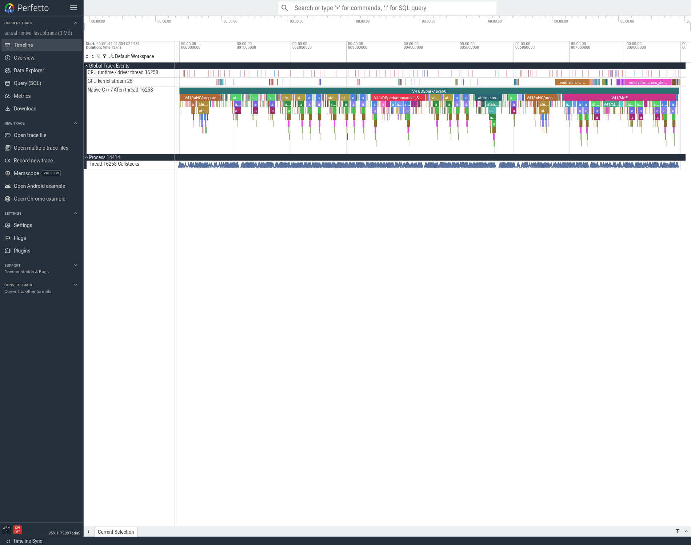
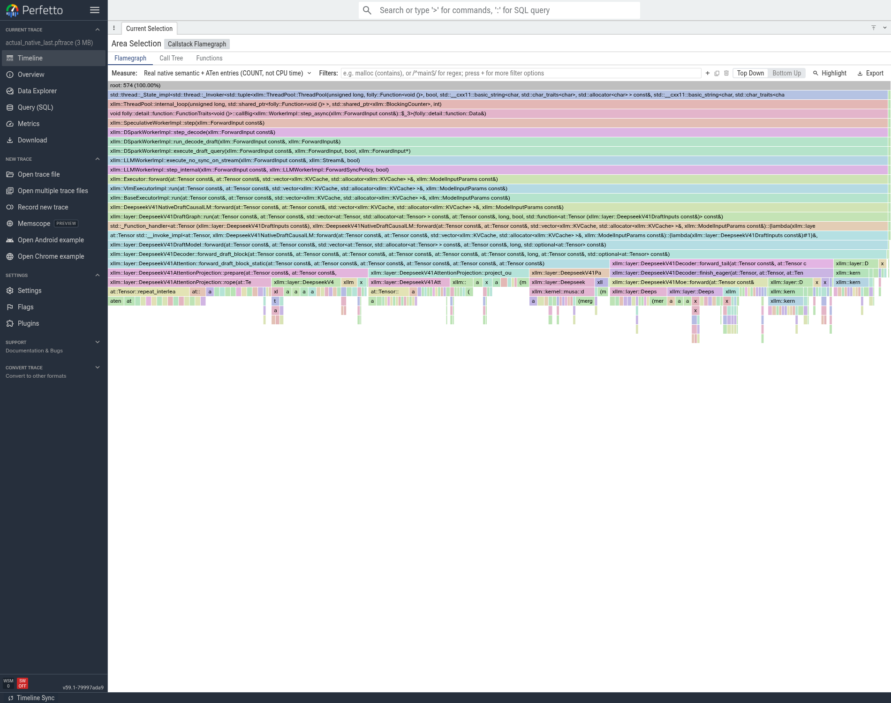

# 实验017：有效行SwiGLU，小幅阶段提速

本项完成了48组GPU字节级检查、9次变化输入Graph回放、OFF→ON→OFF反向的三组正式1暖5、两套独立16rank trace与Perfetto读图，以及全部服务正常退出。阶段配置采用ON，开关默认值仍关闭；它只减少SwiGLU空CTA，不改变GEMM布局或量化公式。**仅通过基础功能检查，未完成模型精度验收。**

## 同条件性能

同ELF `6ca28eb912c08ea4a5b272cedd5ed927dc57c0ca95c0c40071cc603c7aa5bfe2`，共同C++分支；SJ9/SJ10双机1P1D、各8卡、Attention TP8/专家EP8，W4AFP8-mt1017、实际256/256、C1。proposal3、target完整Graph、static draft、draft Graph关闭、动态group128激活保持不变，只切`XLLM_DSV41_W4A8_VALID_PREFIX_SWIGLU`。每组均独立1暖5，profiler关闭，期间无本任务编译负载。

|组别|TTFT ms|TPOT ms/token|E2E s|输出token/s|
|---|---:|---:|---:|---:|
|off|427.90886|39.26793|10.44123|24.51818|
|on|449.96025|38.71777|10.32299|24.79901|
|reverse|469.19769|39.24453|10.47655|24.43552|

ON相对首次OFF，TPOT降低1.401%、输出提升1.145%；相对反向OFF，TPOT降低1.342%、输出提升1.488%。三组TPOT样本标准差分别0.168/0.249/0.243ms，反向OFF恢复到39.24ms，支持小幅局部收益。先作为阶段晋级，不能视为最终稳定达标。此前E13不同时间的首轮输出24.946token/s仍保留；本项不宣称ON绝对超过所有历史单轮，晋级依据是同ELF、同窗口两个OFF控制均较慢。最终应在同一配置上做三轮新复验。

两道题都正确；15个正式请求全成功、实际256/256。已核对OFF/ON十个正式响应正文SHA一致，服务器accepted142/proposed339一致，约113次verify；没有靠输出变短、失败或改变投机工作量换取提升。这里只核对本性能输入，不扩展为模型精度验收。本次未改P/D通信、缓存提交或长输入算法，长输入正式验收仍留到最终阶段。

## 改动与参考

SG交付缓存镜像Git `7c97bb0e6d8b0f8fd41cd797a77b54f7162c79f6`中的`musa_w4a8_ll_prep.py`按GPU counts遍历有效专家行，本轮B日志确认启用。源码SHA与冻结包一致，详见00_参考依据。

我方此前每个expert按物理capacity128启动32组行CTA，多数decode专家只有0～4个有效token。新kernel保持FP32 SwiGLU、clamp、动态group128/静态scale、FP8舍入及GEMM缓冲布局；只让每个warp从自己的行起点以4行步长遍历有效行。counts留在GPU，不引入CPU读取。只在输入≤8行时启用，大prefill保持原路径。target和draft配置均接线；原kernel由template false保留，同ELF切换。

48检查覆盖capacity128/256、空专家、最大有效行0/1/4/6/17/full、动态/静态scale、默认/非默认流，FP8字节和scale完全相同。三个真实Graph桶各变化输入/counts回放三次通过。独立eager event OFF/ON/OFF为35.146/9.460/35.190微秒，局部约3.7倍；测试包含分配及kernel的流跨度，不能拿它直接推算全模型收益。

## 从图上看发生了什么

两组实际trace均验证16rank GPU事件、ATen和native record ID。可见draft的12次SwiGLU启动数量不变，kernel实例从`swiglu_quant_kernel<false>`换成`<true>`，每次grid由`[18,32,16]`（9216 CTA）变成`[18,1,16]`（288 CTA）。target每rank48专家时，代码网格由27648降至864，但target Graph内部GPU节点覆盖不完整，不能把它写成图中已全部逐节点看到。

主要ATen调用次数一致；选取同一draft layer0的实际C++入口都是574。因此火焰图不会凭空少一批ATen调用，这个改进发生在同一次底层kernel的线程块调度与空行处理。图中看到的是原生C++→MoE→同一SwiGLU调用链，需结合kernel详情里的grid读，不是“火焰图变窄所以提速”。ENTRY_COUNT是次数而非时间。

独立256/8 trace请求：OFF模型profile关闭0.705～0.718s、开启18.290s；ON模型关闭0.693～0.731s、开启18.003s。重型profiling严重扰动，kernel时间只用于线索，不计算其占正式全局百分比。未证明准确的全局局部占比，因此不虚构“完成理论上限多少%”。单算子大幅改善只换来约1.4%整模型改善，说明它不是当前全部差距所在。

## 证据、清理和下一步

正式/trace原始包OFF SHA `05407715a6cbd7af36875deb8a056e580c55b34df5dc4eb3aafd5b8512682058`，ON SHA `1cda5f916a61b319ec19f7aace5e4a62f36c35ae9641afbbe316bbb46af29cd5`；反向OFF SHA `2ffe9f20025164180ece6c653134fdde35fe8af269e1bae944f3da49218e5200`；算子检查包SHA `7082cc063748f7b65498c3ff5d3e7f88bd36c327ef20fe6625793c230252747a`。本地同名展开目录保留EvalScope数据库、逐请求、配置、实际ELF/SO、失败/诊断记录；NFS在`/data/nfs_shared/xiaopang/v41_xllm_match_sglang_20261116/{runs,builds,exports,profiling}`。run分别为`p17_prefix_off_v1`、`p17_prefix_on_v1`、`p17_prefix_off_reverse_v1`。

三组各16rank均正常exit0，最后22:07:21确认两台GPU释放；未使用SIGKILL、重启或驱动操作。源码与报告将提交共同现有个人分支，不提MR。

下一步优先核对投机q4中原先仅M1启用的Q/KV合并投影、共享专家合并、SWA读取和小矩阵实现；先按实际形状独立检查及计时，不能仅因“开关已开”就认为已使用快路径。完整draft Graph和静态activation仍为可组合的前置候选，尚未独立证明收益。更大差距仍需要target执行与并行/专家通信路径优化，不能把这次1.4%改进当作追平。目标21.57ms/token、39.45token/s、990.04ms，最终同配置三轮、2048/256及同窗口SG B仍未完成。
