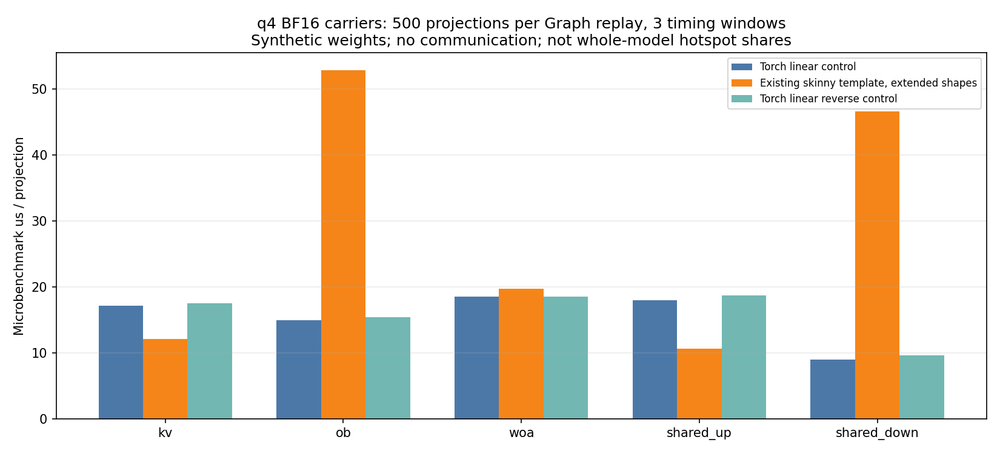
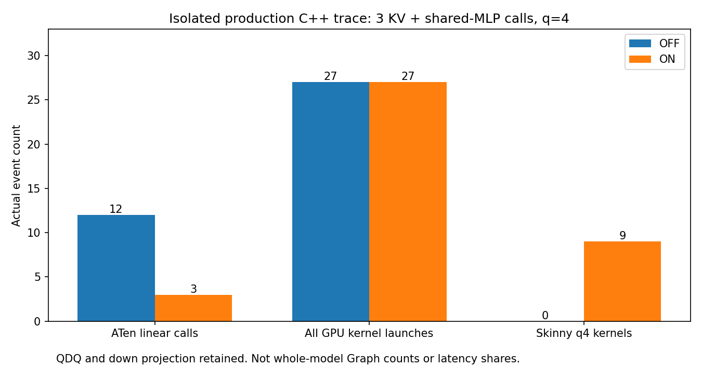
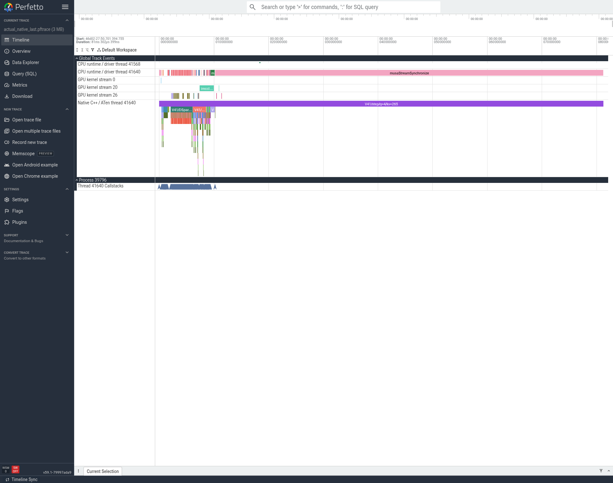
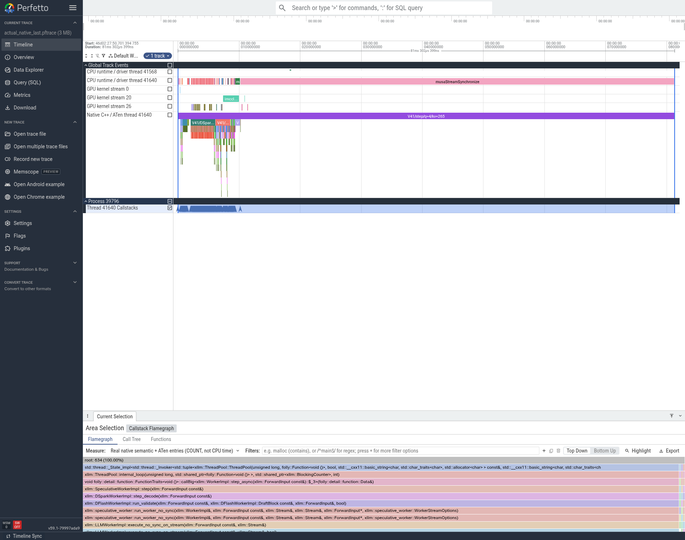

# 实验018：q4窄投影，小幅阶段收益与归因边界

本项把target verify四行输入的KV和共享专家gate/up接到已有原生C++ skinny kernel，保留原block32激活QDQ、SwiGLU、down、归约与投机提交逻辑。默认开关关闭，候选配置显式打开。OFF→ON→反向OFF正式对照支持小幅阶段收益，但**ON输出正文和投机接受数发生变化，不能将全部收益归因于投影kernel**。仅通过基础功能检查，未完成模型精度验收。

## 正式性能：每组独立1暖机+5请求

SJ9/SJ10双机1P1D、P/D各8卡、Attention TP8/专家EP8、同W4AFP8-mt1017、实际256/256、C1。继承E17有效行SwiGLU与E13 static draft，target完整Graph、proposal3，draft Graph和static activation关闭。相同ELF `a4f9ff81ef37d9daf3c14456f4c5ef1c0eaa06efc743bd451dcf173118147cab`，唯一正式变量为D端 `XLLM_DSV41_VERIFY_SKINNY_PROJECTION`。

|组别|TTFT ms|TPOT ms/token|E2E s|输出token/s|
|---|---:|---:|---:|---:|
|off|436.63234|38.63578|10.28876|24.88153|
|on|444.69080|37.58864|10.02980|25.52395|
|reverse|400.03605|38.49310|10.21578|25.05928|

ON相对首次OFF输出提升2.582%，相对反向OFF提升1.854%；TPOT分别降低2.710%、2.350%。小于3%的收益已补反向对照。三组均两道基础题通过、5次正式请求全部成功且实际256/256，没有只选择成功子集。作为阶段配置继续尝试后续组合，尚未完成最终同配置三轮，也远未达到21.57ms/39.45token/s的目标。

## 实际改动与数值边界

`skinny_gemm.cu`新增独立能力判断与接口，仅支持BF16连续且16字节对齐的M=4、K=5120、N=288/512。底层复用已有 `skinny_gemm_kernel<4>`，没有修改原通用skinny选路。`feed_forward.h`在执行前选择能力支持的路径，其他shape仍走定义好的torch::linear；`attention_projection.h`只给KV打开；attention/MoE配置和native模型构造传递开关。P端不开，draft不变。没有CPU模型计算，也没有删除任何专家、层或量化步骤。

实际生产对象的60项Dense/Shared检查覆盖M=0/1/4/6/9、QDQ开关、默认/非默认流，18次变化输入Graph回放全部通过，最大RMS相对误差0.00040617。BF16归约顺序不同不保证逐字节相同；这不是完整模型精度证明。

三个正式组内输出正文各自稳定；OFF与反向OFF正文SHA相同，ON不同。服务器记录OFF/反向均accepted142、proposed339（proposal3对应113次提案轮），ON均accepted147、proposed330（110次）。按TPOT×255/提案轮粗分摊，OFF约87.19ms/轮、ON约87.14ms/轮；这是整个decode成本的均摊，包含draft/verify/提交等，不是target kernel独占时间。较少提案轮可以解释很大部分全局变化。按本轮用户要求记录现象，不展开模型对分或逐题数值排查；也不能把接受率改善宣传为已证明的算法优化。

## 微基准如何筛选，以及修正了什么

短Graph的20/40节点结果混入Graph提交与启动成本。改用200/500节点并保留OFF/ON/OFF后，500节点纯投影中KV由17.187降到12.062微秒（反向17.508），共享gate/up由17.991降到10.651微秒（反向18.699）。宽输出明显负收益，例如O_B由14.94升到52.88微秒，因此没有全量替换Dense。这些是合成输入微基准，不能直接当成当前全模型比例。

初始微基准把q_lora_rank误写为1024，实际上text_config是1280；1024来自o_lora_rank。已保留错误假设的原始实验、明确撤回其QA/QB模型结论并从图中移除；本项实际接入的KV/shared形状不受影响。后续必须先从真实模型配置和TP布局导出形状。

## trace能证明什么

OFF和ON各有16rank有效GPU事件、ATen与native record关联，Perfetto图已真实渲染和目视检查。两者全模型trace可见GPU kernel均2417个；target完整Graph内部GPU节点未完整展开，因此看不到新增skinny kernel，不可把长musaStreamSynchronize下方的空白当成GPU空闲，也不可声称全模型launch数量减少。

另对实际生产C++ Dense+Shared对象抓了独立算子trace，三次KV+共享专家调用中：OFF `aten::linear`12次、ON3次；GPU总kernel均27次；ON新增9次skinny kernel并替换9次通用BF16 GEMM，QDQ9次、SwiGLU3次、cat3次和down3次保持。说明它改变的是同一次投影的底层实现，**不是减少GPU launch次数**。该独立trace只证明选路与调用结构，不能把其耗时比例套到正式全局Graph。

## 原始证据、清理、下一步

三个run为 `p18_projection_off_v1`、`p18_projection_on_v1`、`p18_projection_off_reverse_v1`；NFS根 `/data/nfs_shared/xiaopang/v41_xllm_match_sglang_20261116`，原始日志和EvalScope数据库在runs，各完整包在exports。本地同名中文原始证据目录已回传校验SHA。OFF包 `c9d09bae6b7b5251f88df2ae0962310612825f2a76b880b442ac75fdfa821ea9`；ON `2692f9e37da00ce7f4601eea7465fbcafc38e107b920524da376f95f885ca183`；反向 `d68f298150488f68095bff01c101dcaa76d65999dd1dc2d50ef8cebacc47632e`。独立算子trace包 `5483ded9df1813e0c75f166310d572d442b87a8d06fa8860823754106822da4a`。

每组16rank全部正常exit0；反向服务退出后显存释放。没有SIGKILL、GPU reset、重启或驱动变更。当前后续E19单卡微基准单独记录，不把它算成本轮服务泄漏。

下一项核对并微测SGLang真正保留block32 FP8权重的投影路径，以及target MoE和并行通信的主要差距。局部算子收益有限，不能只做低收益替换来代替完整追平。最终三轮同配置、2048/256和同窗口SG B复测仍待完成。
