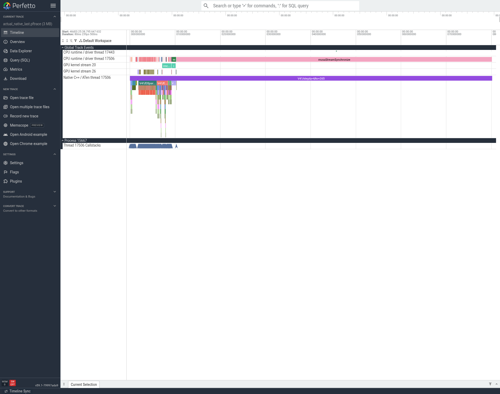
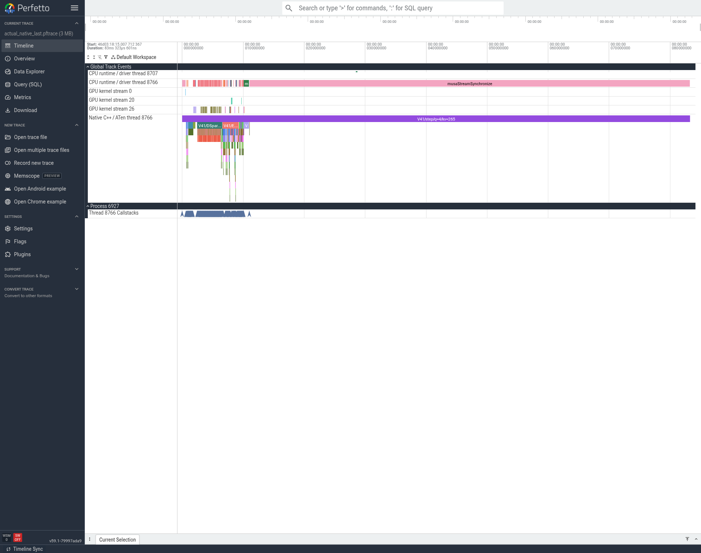

# 实验 21：q4 投机 Graph 加复制 Attention，没有提速

**结论：REJECTED，不替换实验18累计最佳。仅通过基础功能检查，未完成模型精度验收。**

## 1. 为什么做这个组合

SGLang B 使用 D 端 DP8 Attention/TP1、专家 EP8 和投机 Graph。实验4曾试普通单行复制 Attention，但没有验证当前 proposal3/q4 Graph 组合。实验20的 eager 诊断显示 Attention TP 归约流区间约0.803ms/层，包含等待和提交间隙，不能当成当前 Graph 的纯通信成本。于是本项检验：在累计最佳 q4 路径中，用每卡完整 H64 Attention 替代分片 H8，能否抵消每层一次 TP 归约。

这只是 C1 复制执行试验：8个rank都计算同一份Attention，不是SGLang的DP8请求调度或DeepEP low-latency。共享专家与LM-head仍TP8，路由专家EP8，Engram仍原分组。不能据本次负结果断言真正的DP8/DeepEP无价值。

## 2. 实际代码与边界

源码为共同分支 `xiaopangV41FlashCppFromSglangtoXllm` 的 `7594c04688cfe3ec548ea85bb1ce127bc733e8b5` 加本实验差异；文件 `xllm/models/llm/musa/deepseek_v41_native.h`。

- 新增默认不使用的 `XLLM_DSV41_TARGET_MATE_SPARSE_SO`：target读取H64库，draft继续H8，避免两者头数接口冲突。
- 允许复制Attention与native投机组合，但必须启用selective cache commit、verify custom归约且明确target稀疏库。保留C1、TP8/EP8限制。
- q4/q6的H64/H8同进程eager和Graph短检查，覆盖无效索引、NaN填充、全遮罩和更新输入。8个组合各4次比较，最大相对RMS约0.00223；全遮罩输出为零。
- 目标路径每rank增加约7.656GiB权重，D端加载后余量约6.01GiB；OFF约13.66GiB。ON/OFF都采用同一显存比例0.95与缓存预算，不用额外缩减模型计算换成绩。

两组实际ELF相同：`/expt/artifacts/replica_verify_q4_v2/bin/xllm`，SHA256 `f0d590211d759f41b5d7b76b0cb7ddb215e16d3aa492c38b9652a9042d64dfcf`。
H64库SHA `a1f754eeaeb312183cf0e754c923c9aa0b34e3dd95f5b9bbe5b0eee4b11576ce`；H8库SHA `212fbdd160e6cf63aa6ec1c229074e34793f1453f53fa88e1a9f86a4c52286fe`。已从实际进程maps核验加载路径，不仅查看配置文件。

## 3. 正式测速

SJ9/SJ10，双机1P1D各8卡，W4AFP8-mt1017、C1、实际256/256，EvalScope冻结请求。两道题分别返回4.2、56；独立快筛后，每组另做1暖机+5正式，profiler关闭。全部请求成功且长度有效。

|配置|TTFT ms|TPOT ms/token|E2E s|端到端输出token/s|TPOT样本标准差ms|
|---|---:|---:|---:|---:|---:|
|复制Attention ON|439.524376|42.315554|11.229991|22.796101|0.317397|
|原TP8同ELF OFF|435.349951|37.232451|9.929625|25.781437|0.194286|

ON的TPOT增加13.65%，输出速度下降11.58%。OFF是实验18累计配置的同窗口重采样，并不是又完成了一项优化。正式逐请求数据、文本指纹及数据库见 `03_性能/` 和两个 `Attention复制_*_正式与trace原始证据/formal_client/`。

ON每题accepted134/proposed363、121轮；OFF accepted147/proposed330、110轮。两组输出正文不同，各组内一致。将全部decode耗时除以轮数，约89.18ms/轮与86.31ms/轮；这不是直接测得的target GPU时间。更多轮次和每轮成本一起影响结果，不能把全部差距归因通信或某一算子。按本轮要求记录差异，不开展模型精度原因排查。

## 4. trace能说明什么

两组各抓独立256/8请求，P/D共16个rank均有GPU、ATen和真实C++ record-id关联。图内GPU节点覆盖不完整；截图的长 `musaStreamSynchronize` 与GPU空白不表示GPU闲置。

两组的真实C++调用链和ENTRY_COUNT火焰图保存在相邻目录，已检查渲染结果。ENTRY_COUNT是调用入口计数，不是采样CPU占比。最后一个q4/kv265步骤，OFF实际CPU区间约80.24ms，ON约83ms；正式五次测速才用于判定收益。

日志中custom-allreduce图buffer注册从80降至40，支持每层Attention归约被移除；这不是证明总通信次数减半，也不证明GPU关键路径必然减少。复制后单rank计算H64代替H8、权重副本增大，且投机接受序列改变。

开启profiler的短请求约18秒，关闭时约0.7–0.9秒，扰动明显。因此不把trace中的局部占比当成正式收益上限，不给虚假的Amdahl兑现百分比。

## 5. 踩坑与退出

第一次启动v1漏掉旧的“复制Attention与投机互斥”CHECK，D端8rank在加载前异常退出；P端rank0随后因D端etcd已退出而连接失败，其余7rank正常退出。修正为明确组合前置条件后才构建v2。首次失败独立归档，未覆盖。不是H64算子错误，也没有通过忽略CHECK继续运行。

ON、OFF正式和trace结束后，分别核验实际exe、rank和运行库并正常停止；两组16rank均exit0，GPU已释放，无SIGKILL、无重启或驱动操作。

## 6. 产物与下一步

NFS根目录：`/data/nfs_shared/xiaopang/v41_xllm_match_sglang_20261116`。
运行记录：`runs/p21_replica_on_v2`、`runs/p21_replica_off_v2`；完整16rank trace：`profiling/`对应同名目录。
已回传本地的证据包SHA256：

- ON：`442d2ac1b88e962d2b1bd8d9cfe729c708d2d0c49b4f6bda2e2324f080fe6f84`。
- OFF：`1958f0b4853138ff347d292559818e2cfb04f132cbd8c227ea88a8b6be8bb6f2`。
- 首次失败：`e8c301e3d7479749f020fcd40edf0a92cf008fc2cf8e2bec018a64dc70cab10b`。

后续从累计最佳继续。小行mHC在q4 Graph下另测；再优先分析短上下文Indexer冗余工作，以及真正DP/DeepEP和当前复制执行的差异。目标21.57ms/39.45token/s尚未达到，最终三轮、2048/256正式回归与同窗口SG复验尚未完成。
