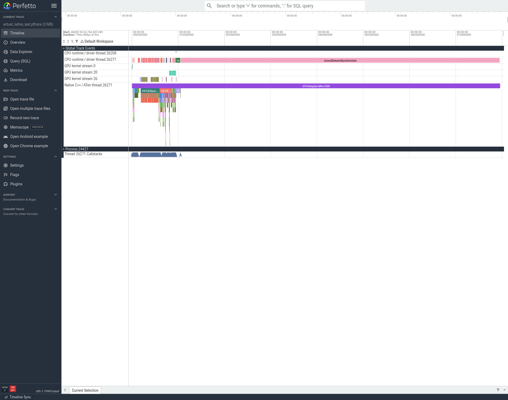

# 实验22：小行mHC融合与q4投机组合负收益

**REJECTED，不启用该组合。仅通过基础功能检查，未完成模型精度验收。**

## 改了什么、为什么试

只在D端将已有 `XLLM_DSV41_MHC_SMALL_BATCH_FUSION=1` 打开，累计配置的proposal3、q4跨层Graph、有效行SwiGLU、skinny投影等不变。没有启用复制Attention。旧T51曾在其他行数/请求场景验证此mHC小行路径，本次补查当前q4/q6组合，不能重复引用旧结果当成新路径已提速。

实际生产文件 `xllm/core/layers/musa/deepseek_v41/hyper_connection.h` SHA a11580239c31fc501a83a7a9bb14041201d6dfab6a0e2c7792eae6b6f2591b20，与已有被测算子相同。新增加 `tools/musa_deepseek_v41/validate_small_batch_mhc_graph.py`。ON与实验21 OFF控制使用相同ELF f0d590211d759f41b5d7b76b0cb7ddb215e16d3aa492c38b9652a9042d64dfcf。

## 基本检查和正式结果

已有14项短回归之外，新增attn/ffn、q4/q6/q9、每形状3次变更输入Graph，共18项通过。carried pre系数精确一致，metadata误差约1.19e-7，combined最大绝对误差0.001953125。该检查不等于整个模型精度验收。

两道题返回4.2、56。SJ9/SJ10双机1P1D各8卡，W4AFP8-mt1017、C1、实际256/256、冻结EvalScope协议；独立1暖5正式，profiler关闭，全部请求成功且长度有效。

|配置|TTFT ms|TPOT ms/token|E2E s|端到端输出token/s|
|---|---:|---:|---:|---:|
|同ELF控制，小行mHC关闭|435.349951|37.232451|9.929625|25.781437|
|小行mHC开启|405.323587|43.924003|11.605944|22.057662|

输出速度下降14.44%，不满足晋级条件。ON的五次TPOT标准差0.10243ms。控制来自紧邻的实验21 OFF同ELF正式五次；没有将这五次伪装成新做的反向控制，本次明显负收益无需为了晋级增加反向复测。

ON日志accepted128/proposed390，即130轮；OFF147/330，即110轮。decode总耗时除轮数约86.16ms与86.31ms，单轮摊销接近，但ON需要更多轮次。它提示输出与接受路径改变影响端到端效果，不证明某个mHC内核本身慢了，也不能把全部差异归因数值误差。按用户要求仅记录，不展开全模型精度原因排查。

## trace和可解释性边界

独立256/8请求，16rank的ATen/GPU事件和真实C++ record-id关联均通过验证；本地真实CPU区间、完整调用链与ENTRY_COUNT火焰图已渲染。992个实际区间、634个native入口。最后步骤是q4/kv266，约79.66ms；控制最后步骤q4/kv265，不是完全相同token前缀，不能直接用两段截图推算整模型百分比收益。

完整Graph内部节点覆盖有限，截图的长synchronize和GPU空白不能解释为GPU空闲。profiler请求18.16845秒，关闭时约0.80–0.84秒，存在明显扰动。正式五次成绩用于决策；不据此图声称融合减少了多少实际Graph kernel，亦不虚构Amdahl兑现比例。

## 生命周期、原始证据和下一步

两端各8rank正常exit0，无SIGKILL。完整数据在NFS `/data/nfs_shared/xiaopang/v41_xllm_match_sglang_20261116/runs/p22_mhc_q4_on_v1`，16rank trace在对应 `profiling/p22_mhc_q4_on_v1`。本地证据包 `小行mHC_on_正式与trace原始证据.tar.gz`，5500017字节，SHA256 `4ac6cbc6e296d950bcecaca63a31648b18e2905bde54e4d57c2cd6b8c40e1d33`，已核验并解包，内含正式数据库、日志、运行库指纹、算子检查和rank0 trace/符号。

经验：小算子融合通过数值短检查，不保证当前投机路径端到端提速。后续保留累计最佳，不打开此开关；实验23转向SG已有的短上下文Indexer全量选择省算逻辑，先验证缓存、候选遮罩和Graph输入更新，再正式测量。最终速度目标、三轮和长输入回归仍未完成。
