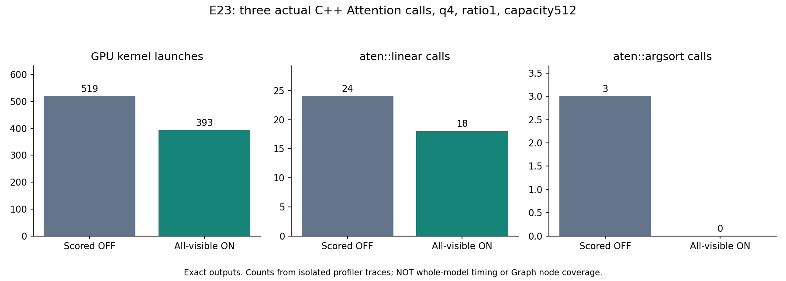

# 独立实际Attention trace

来自同一实际C++ Attention对象的两个配置，各3次q4/ratio1、静态容量512调用，输出逐元素一致。GPU kernel从519到393（每次173→131）；aten::linear从24到18（每次8→6），候选排序argsort从3到0。保留压缩/Index K发布、KV写入和Attention本身。

在原始off.pt.trace.json/on.pt.trace.json中，可以搜索 `E23/off/actual_Attention/q4/ratio1` 与对应on范围，再查看其子ATen和GPU流。消失的具体调用包括Indexer query的block32_qdq、FP4 query量化、两次投影，以及score和候选排序链。它来自实际被模型使用的C++ Attention，不是另写Python数学替代。

为显示Graph内部被隐藏的节点，这里用相同静态metadata执行Attention但不把整个模型包进Graph；只能证明省去了哪些调用，不能把24.3%的kernel数减少称为24.3%的端到端提速。全模型正式性能另在03_性能，16rank独立trace在相邻文件夹；Graph GPU空白不等于空闲。
