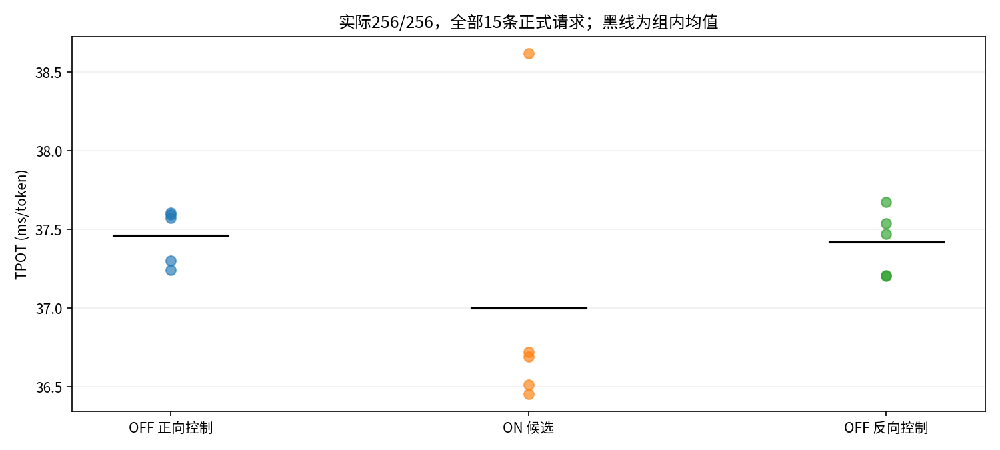
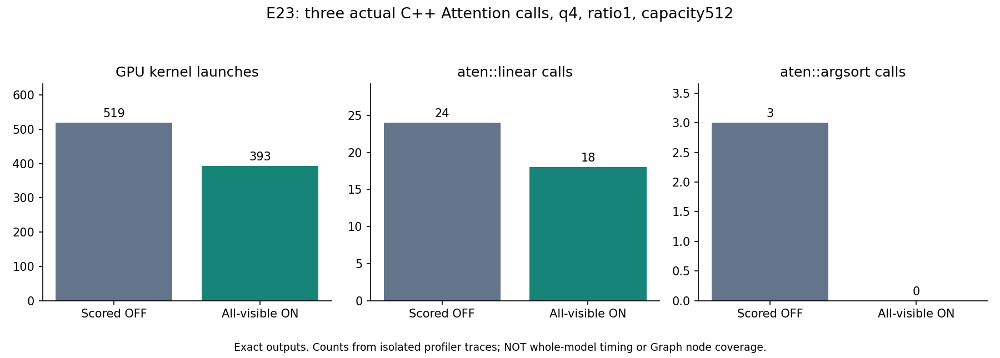

# 实验023：短上下文省去无意义Indexer排序，尚不替换累计最佳

**决定：INCONCLUSIVE / READY_DEPENDENCY。** 完成94项直接检查、OFF/ON/OFF反向三套正式请求、OFF/ON各16rank独立trace与真实算子trace；收益方向一致但较小，开启组波动足以影响结论，暂保留供组合验证，E18仍是累计最佳。未达到TPOT21.57ms、输出39.45token/s目标，最终三轮和2048/256回归仍待完成。

## 1. 依据与实际改动

冻结SGLang源码`7c97bb0e6d8b0f8fd41cd797a77b54f7162c79f6`的`sglang/srt/layers/attention/deepseek_v4_backend.py`包含`skip_low_ratio_indexer(ratio)`：当所有压缩KV都能放进选择预算时，无须计算每条得分再取TopK，同时仍写IndexK以保留后续长上下文状态。参考文件SHA为`d9350a9710da82ef4ea0da660c5e841875774326da747db02891669c13aea793`。**该代码是改动依据；尚未证明冻结的B正式请求实际开启了它，不能说这就是B快的原因。**

我方新增默认关闭的`XLLM_DSV41_SHORT_CONTEXT_INDEXER`。在`attention.h`判断静态Decode、压缩行数不超过index_topk、压缩块数不超过candidate_blocks后，通过`indexer.h::select_all_visible`直接构造全部可见索引；因果可见范围和此前层传下来的候选池继续限制索引。仍执行压缩/IndexK写入、缓存和topk/candidates跨层传递。超出短上下文预算或普通prefill，在执行前选择原有打分路径，不是出错后回退。`deepseek_v41_native.h`只负责从环境读取开关。

边界：适用于有效激活和得分有限的短上下文，不声称能覆盖有效激活本身含NaN/Inf的情况。索引顺序从按得分排列变成按行号排列，即使选择集合相同，也不能提前承诺浮点累加和最终生成逐位相同。本轮按已确认要求记录模型差异，不开展完整精度排查。

## 2. 直接检查和构建身份

- 30项selection检查：宽度0/1/7/8/9/127/256/511/512、外部候选池、q4/q6的变化输入Graph回放。
- 64项真实C++ Attention检查：ratio1/2、容量512/1024、页边界、变化物理页映射、后续token与缓存；输出relative RMS均为0，缓存检查通过。
- 实际模型两道题“1.3＋2.9”“7×8”在三套运行中均得到4.2/56。
- 正式三组同ELF `ca62940f3480d37f252dc2cefa70e97d8d74b21d9d05989182d7324727f189b4`，只改变D端上述开关；不启用E21复制Attention或E22小行mHC。测试模块SHA `b66c8bb448d5134c544fb3f0d79566403f181525fdf4cc62768b06c9f8686dca`。

## 3. 正式性能与是否晋级

SJ9/SJ10、1P1D各8卡，Attention TP8/专家EP8、target q4完整Graph、proposal3、W4AFP8-mt1017、并发1；各组单独1暖机+5正式、profiler关闭、实际256/256且请求全部成功。所有正式请求保留，没有剔除慢请求。前面的1暖2快筛不混入正式均值。

|组别|TTFT ms|TPOT ms/token|TPOT样本标准差 ms|E2E s|输出token/s|
|---|---:|---:|---:|---:|---:|
|OFF 正向控制|387.27525|37.46292|0.17617|9.940320|25.753697|
|ON 候选|399.63410|37.00085|0.91200|9.834851|26.029881|
|OFF 反向控制|389.99332|37.42015|0.20803|9.932132|25.774929|

ON相对两个控制组的输出提升分别为1.072%、0.989%。但ON的TPOT样本标准差0.912ms明显高于两个控制的0.176/0.208ms，5次样本不足以称稳定改善。后续有更大组合收益时再复验，暂不替换冠军，不以小收益牵制当前更大的Graph/通信/投影差距排查。

15条正式数据中，两个OFF各5条及ON中4条输出SHA都是`6609be7466db…`，ON第3条为`0486b667c568…`；该条TPOT38.61948ms，接受138/351（117轮proposal3），通常为147/330（110轮）。增加的target验证轮次与该条变慢相关；这只是观察，不把原因进一步归为某个未验证的数值错误，也不删除这条请求。逐请求和服务日志见[原始指标与输出指纹](03_性能/ON_OFF_REVERSE_逐请求与输出指纹.json)。

## 4. trace说明：能证实什么，不能证实什么

OFF/ON独立全模型各16rank均有真实GPU事件、ATen和原生栈，CPU时间线均已渲染并实际打开检查。同一末尾q4/kv265 step，OFF约83.27ms、ON约77.58ms，但这不是正式性能值，不能只拿一个step宣称收益。完整Graph内部GPU节点在此profiling栈覆盖不足，图中的长同步条不是“CPU算了这么久”，空白也不是GPU空闲。ENTRY_COUNT火焰图表示采集入口次数，不是独占耗时。

[OFF真实时间线](04_trace与图/短上下文Indexer_off/Perfetto图/真实CPU区间与GPU时间线.png) · [ON真实时间线](04_trace与图/短上下文Indexer_on/Perfetto图/真实CPU区间与GPU时间线.png)

采集256/8请求约18秒，而采集前后同类无profiler探针约0.70～0.90秒，扰动非常明显。因此另采真实C++ Attention单算子（q4、ratio1、容量512、prefix256）以观察具体删掉的工作：三次调用中GPU kernel从519降到393，每次173→131；aten::linear从24降到18，argsort从3降到0，indexer_score和indexer_radix_select均3→0，候选块radix sort 12→0。对照输出相同；IndexK更新保留。

这说明删掉了查询投影、查询量化和打分/排序的冗余工作；**不能把单算子kernel数减少24.3%等同于整模型提速24.3%**。全模型还包含其他40层计算、通信、draft、缓存维护和服务工作，而且生成过程可能改变每个有效输出token所需的验证轮数。详见[独立算子trace读图说明](04_trace与图/独立算子trace读图说明.md)。

## 5. 证据与资源

NFS根`/data/nfs_shared/xiaopang/v41_xllm_match_sglang_20261116`。运行分别在`runs/p23_short_indexer_off_v1`、`runs/p23_short_indexer_on_v1`、`runs/p23_short_indexer_off_reverse_v1`；正式EvalScope数据库、请求、响应与汇总均在各自`formal_client/formal`及`summary.json`，两套trace在`profiling`，归档在`exports`。本目录已保存无损小日志与原始包，并核对SHA：

- OFF：`25f0b71ec51bcbe2d9daa93821a46c9ed39baeedcd329fb74fb7c993ad4c7ab4`。
- ON：`aacd1f28c0fe309d342c3d1c566e54fe90ff56a38190f63c523abb64be73cf68`。
- reverse：`27c8ed75aed77b46ba3d3f69e44f071dee2be80f5c1cdb7c85e027922bdd3f91`。
- 独立算子：`70a63a4c751cd93d85c3b6ffa8e68b2532b81c82d16f8ab0097086a011a6af0c`。

三套模型每套16rank全部正常exit0，未SIGKILL。反向控制后2026-11-17 00:30两机显存释放预检通过，随后开展E24八卡独立归约诊断，不应误认为仍有旧模型运行。

下一步优先定位当前target Graph主要成本：E24独立8rank归约测实际载荷，避免把rank等待全归为通信；E25测E21复制Attention的全H64大矩阵FP8路径，不能沿用E19窄矩阵结果否定它。两者先诊断再决定生产改动，继续围绕同一速度目标。

**仅通过基础功能检查，未完成模型精度验收。**
