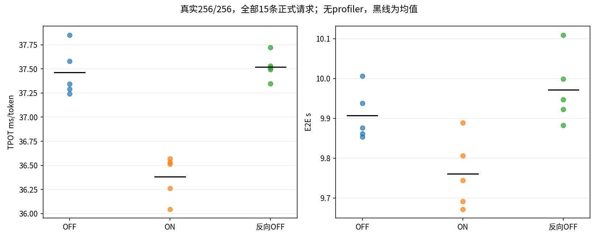
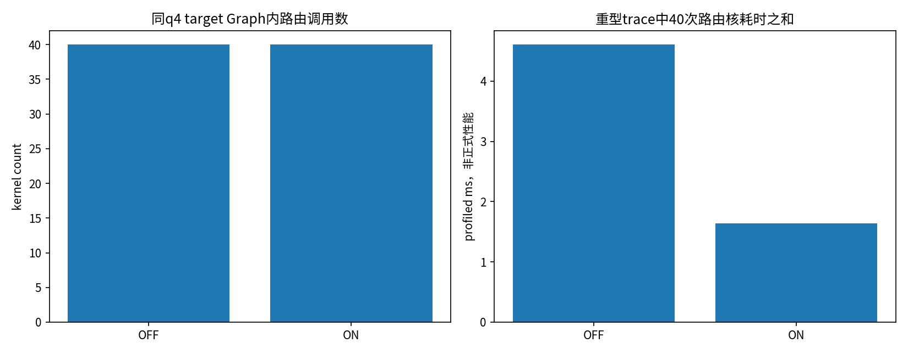

# E29：专家维度并行路由，完成同ELF OFF/ON/OFF对照

## 改动及来源

在E18累计最佳上只替换D端小行路由Top-K，默认开关`XLLM_DSV41_PARALLEL_GATE_TOPK=0`，开启时仅对最多6行、最多512专家使用新路径；其他形状显式沿用旧路径。原生MUSA文件为`xllm/core/kernels/musa/deepseek_v41_gate_topk.cu`。原来一个warp处理一个token，每lane串行处理12个专家；现在每个token一个512线程块，按专家并行算分，两级warp选择Top-K，缓存未加bias的原分数并按原选择顺序归一化。保持sqrt(softplus)、correction bias只影响选择、NaN优先/同分低ID、原权重scale与精度。

来源是冻结SGLang的MUSA fused gate组织：`routing_ops.py::_try_tilelang_moe_fused_gate_musa`（SHA79f34922cdfc…）和`moe_fused_gate.py`（SHAa8d5759ab4d0…），原文件和完整SHA存于微基准证据/reference。借鉴专家轴并行，不是直接照抄TileLang，不声称源文件存在就证明SG B正式请求一定调用它。v1每次重新计算选中分数；v2缓存原分数、每次Top-K使用两次CTA屏障。屏障保护跨warp发布与读取，不能为省同步删除必要依赖。

## 检查、配置及正式性能

v1/v2各640项精确数值检查、18次动态Graph检查通过；覆盖不同专家数/行数、Top-K、两种bias、NaN/Inf/极端值、默认及非默认流。真实两道题4.2/56均通过。独立40调用一图、每窗口50回放的q4微基准中，v2路由核中位耗时由约98.09us降至40.49us，反向约97.44us；这不是整模型提升。

三组用同一ELF `a4392541b8287268a3bd7fa888f06f89a943ae280ddc5bd54bfe8eb67a1bcc59`。SJ9/SJ10双机1P1D各8卡，Attention TP8、专家EP8，target q4完整Graph/proposal3，静态draft，E18窄投影开启；E21复制Attention/E22小行mHC/E23短Indexer关闭。只有D gate开关变化。每组独立1暖机+5正式，实际256/256、C1、profiler关闭、全部成功；快筛和trace不混入正式均值。

|组别|TTFT ms|TPOT ms/token|TPOT样本标准差 ms|E2E s|输出token/s|
|---|---:|---:|---:|---:|---:|
|OFF控制|354.30492|37.46262|0.25424|9.907274|25.839600|
|ON专家并行|483.06743|36.38347|0.22527|9.760852|26.227218|
|OFF反向|403.99225|37.52144|0.13424|9.971960|25.671984|

ON相对前后控制输出提升1.500%/2.163%；结果方向一致，小幅阶段晋级，不能称最终稳定达标。15条正式输出SHA种类为1、接受/提议组合为[(147, 330)]；详见逐请求JSON，保留全部慢请求。模型输出的一致仅用于这轮工作量核对，不是完整模型精度验收。

## trace能解释的改进

OFF/ON各16rank trace已通过GPU、ATen、native record ID、实际ELF/SO验证；两套Perfetto时间线和ENTRY_COUNT火焰图均已打开目视。每D rank四次target Graph均有5591个GPU节点，末尾同q4/kv265的40次`v41_gate_kernel<12>`替换为40次`v41_gate_block_kernel<512>`。采集下40次核耗时之和约4.608ms降至1.636ms，调用数没变；是核内并行和避免重复计算，不是launch次数减少。

[OFF实际时间线](04_trace与图/路由专家并行_off/Perfetto图/真实CPU区间与GPU时间线.png) · [ON实际时间线](04_trace与图/路由专家并行_on/Perfetto图/真实CPU区间与GPU时间线.png)

profile请求约18秒，而OFF前后约0.7～0.8秒。不能把上述kernel差约3ms直接当正式target收益，也不能以图中的占比算全局理论收益上限。原生火焰图COUNT是入口次数，不是CPU独占时长。独立无profiler算子计时与正式同条件结果共同支持路由变快，但仍有通信、专家GEMM、mHC、draft等成本。

## 决策与证据

保留E29为阶段累计最佳；目标TPOT≤21.57ms/token、输出≥39.45token/s尚未达到，最终同配置三轮/服务重启/2048/256和同窗口SG B仍待完成。下一项是mHC 4×4系数计算的warp通信，独立小算例已通过，必须接入生产路径再做同条件测量，不把微基准当全局成绩。

NFS根`/data/nfs_shared/xiaopang/v41_xllm_match_sglang_20261116`：三组在`runs/p29_parallel_gate_off_v2`、`runs/p29_parallel_gate_on_v2`、`runs/p29_parallel_gate_off_reverse_v2`；原始正式DB/日志在各`formal_client`；两套全rank trace在`profiling`。本地同目录保存三套原始小证据包、SHA校验和必要rank0原始trace，所有失败尝试也保留。三个模型运行的16rank均正常exit0，无SIGKILL。每项清理后的GPU释放凭据见恢复目录。

**仅通过基础功能检查，未完成模型精度验收。**
