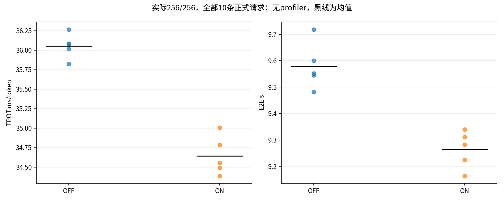
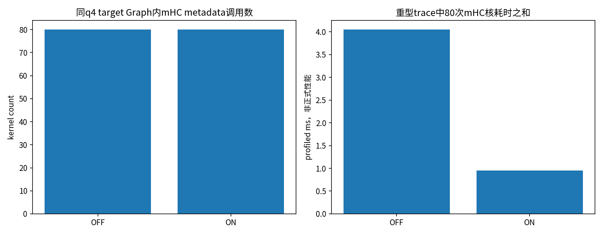

# E30：用warp内通信降低mHC 4×4系数计算开销

## 结论与改动

在E29累计最佳上，保留模型、路由、Graph、投机和通信配置，只替换D端mHC metadata的4×4 Sinkhorn小矩阵计算。默认关闭开关`XLLM_DSV41_HC_METADATA_WARP`；仅hc_mult=4、行数1～6进入新路径，零行直接返回，其他形状保留既有实现。

改动位于`xllm/core/kernels/musa/deepseek_v4_dsa_cache_ops.cu`。旧实现用共享内存与线程块屏障交换矩阵元素；新实现每token一个warp，前4个lane各持有一整行4个float，通过shuffle获取列归一化所需的值。保留原先的求和顺序、expf、倒数乘法、epsilon与20次迭代，消除这部分CTA屏障。没有改变mHC结构、合并层或减少调用次数；也没有使用E22被否决的小行prenorm归约改动。

参考了家明V4提交`f8dd0663279e9085365ade309d9823b7b438c4e6`的metadata实现，以及冻结SGLang的`mhc_sinkhorn.py`寄存器矩阵组织，原文件和SHA见`01_代码与构建/参考原文件`。SGLang源码采用的数学指令与我方旧路径并不完全相同，本次只借鉴通信组织，保留当前公式；源文件存在不能证明B正式请求执行了这个独立函数。

## 基本检查与正式性能

生产dispatcher检查342项精确一致、9次动态Graph更新一致，覆盖默认/非默认流、零行、形状边界、不同迭代数/epsilon/数值幅度，以及非4倍hc的回退形状。原型检查另有270项精确与9次Graph；生产测试直接链接实际xLLM产物，不能用原型代替。两道简单题分别得到4.2、56。

单独的无profiler算子微基准中，q4每次metadata约51.36us降至12.57us，反向关闭约51.36us。它证明局部核提速，不能直接当整模型性能。

正式配置：SJ9/SJ10双机1P1D、每台8卡、W4AFP8-mt1017、Attention TP8/专家EP8、target q4完整Graph、proposal3、静态draft；继承E29专家维度并行路由和E18窄投影。只有D端metadata开关0→1，P端保持0。两组同一实际ELF `d14f0cad2ce25da08a8cf096bfc8d851601e29bc6cbcbef44ee6e52e53fdd1f6`；各1次暖机+5次正式，实际256/256、C1、profiler关闭，全部成功。

|组别|TTFT ms|TPOT ms/token|TPOT样本标准差 ms|E2E s|输出token/s|
|---|---:|---:|---:|---:|---:|
|OFF控制|386.44154|36.05163|0.15900|9.579607|26.723435|
|ON warp通信|429.90342|34.64478|0.24970|9.264322|27.632890|

输出速度相对同ELF控制提升3.403%，TPOT下降3.902%。TTFT由386.44升至429.90ms，仍低于990.04ms门槛，端到端仍改善。10条输出文本SHA一致、接受/提议均147/330；没有依靠输出变短或接受轮数变化提速。两组逐请求TPOT范围不重叠，本轮未触发“收益不足3%或波动影响结论”的反向复测条件；这不等于统计显著性证明，也不代替最终三轮验收。

## trace解释与边界

两组各16rank均验证有真实GPU kernel、ATen、native record ID及实际ELF/SO。每个D rank均4次target Graph、每图5591个GPU节点。取相同q4、kv265的末尾Graph：80次旧`dsv4_hc_pre_metadata_kernel`变为80次`hc_metadata_warp_kernel`；重型采集中的核耗时之和由4.049ms变为0.955ms。调用数和图节点数都没减少，提升来自核内部共享内存/屏障通信变成warp内寄存器交换。

[OFF实际Perfetto时间线](04_trace与图/mHC元数据warp_off/Perfetto图/真实CPU区间与GPU时间线.png) · [ON实际Perfetto时间线](04_trace与图/mHC元数据warp_on/Perfetto图/真实CPU区间与GPU时间线.png)

采集请求约18秒，关闭profiler的同8输出token请求约0.67～0.95秒，扰动很大。因此不能将图中约3.09ms的差直接算作真实target step收益，不能以图中占比估算全局理论上限。正式结果、独立微基准和执行路径变化共同支持本次归因；火焰图ENTRY_COUNT只是原生入口次数，不是CPU独占时间。

## 决策、失败记录和下一步

本项可替换阶段累计最佳。最终TPOT≤21.57ms/token、输出≥39.45token/s尚未满足；最终同版本三轮、服务重启、2048/256及同窗口SGLang B仍待完成，不能宣布goal完成。下一项先验证SGLang使用的BF16输入/权重、FP32输出路由投影，核对接口和实际小行收益；更大方向仍包括真正DP8 token归属与DeepEP低延迟通信，不能把Attention副本等同于已实现DP8。

生产小测v1因SJ10没有SJ9本地checkout而未启动GPU，改用NFS冻结源文件后v2通过，失败已归档。本地ON渲染第一次早于证据下载完成，因文件不存在退出；未重新抓trace，等待下载SHA校验完成后再渲染。归档时addr2line提示DWARF部分格式不支持，仍核对了native record对应、实际ELF与可解析的模型符号；不能声称所有未知符号均已解析。

NFS根`/data/nfs_shared/xiaopang/v41_xllm_match_sglang_20261116`；控制与候选分别为`runs/p30_hc_metadata_off_v1`、`runs/p30_hc_metadata_on_v1`，正式原始DB/日志在各`formal_client`，全rank trace在`profiling`同名目录。两个模型运行各16rank均正常exit0，无SIGKILL，2026-11-17 01:56两机GMI确认GPU释放。本地已保存SHA核验后的原始小日志、DB和rank0必要trace。完整大证据与二进制保留NFS。

**仅通过基础功能检查，未完成模型精度验收。**
