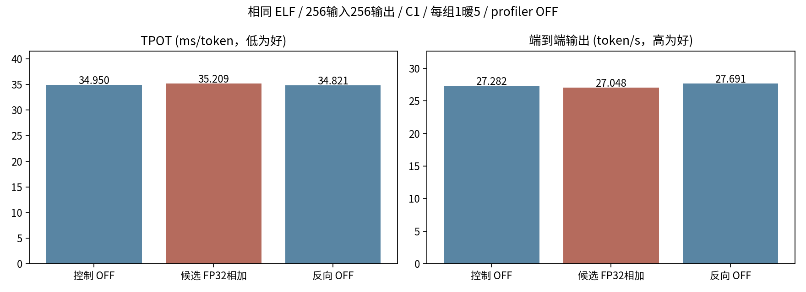
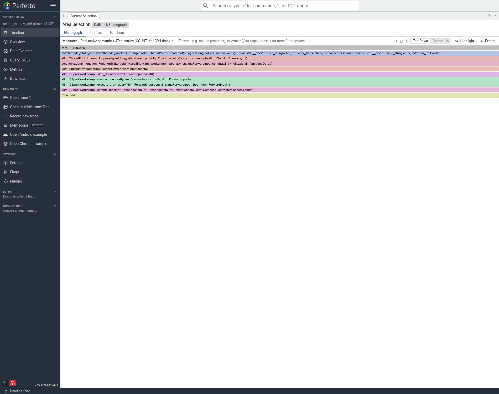
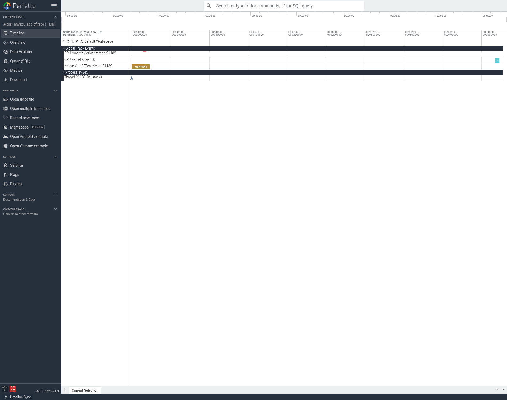

# 实验033：Markov相加对齐参考接口，但没有端到端收益

本项保留为默认关闭的实验能力，不替换E30累计最佳。OFF→ON→OFF反向三组各1暖5正式，15次请求全部成功且实际256/256。候选相对前控制与反向控制的输出变化分别为 **-0.855% / -2.321%**；两次对照都没有收益，不将小幅差异包装为优化成功，也不推断所有输入上都会更慢。

## 参考、改动与边界

冻结SGLang源码 `7c97bb0e6d8b0f8fd41cd797a77b54f7162c79f6`，`DSparkV4MarkovHead.project_bias`的BF16分支先做BF16 GEMM，再将bias转float；分片`BuildStepLocal`将base和bias按FP32相加。environ的MARKOV_W2_BF16/TP_SHARD默认均true，B启动脚本未见显式覆盖。这不等于SG使用FP32 GEMM，也不能把“源码支持该路径”扩大成所有运行分支都已核验。

我方此前BF16 base与BF16 bias相加仍得到BF16。新增 `XLLM_DSV41_MARKOV_FP32_LOGITS`（默认0），只在原生draft适配层使bias返回FP32，既有sample_block自然以FP32相加。Markov权重和GEMM保持BF16，target模型、proposal3、验证/回滚与缓存不变。本项只对齐相加接口，未移植SG词表分片、完整草稿采样Graph或DP8/DeepEP。

模型层：新增`core/layers/musa/deepseek_v41/markov_head.h`；适配层：`models/llm/musa/deepseek_v41_dspark_native.h`。不存在Python模型forward或CPU算术回退；生产采样对FP32使用已支持的Torch MUSA argmax。两组同ELF，逐rank环境校验只有D侧此开关不同（输出目录除外），反向环境还原。

## 检查与失败处理

24组原生Markov+实际采样选路链检查，覆盖1/3请求、1/3/5个proposal、1024/129280词表；18次Graph回放改变输入与anchor均通过。构造near-tie证明：BF16相加使两个候选舍入并列选择0，FP32相加保留差异选择1。该测试验证差异确实生效，不代表模型接受率必然提高。

首版检查包装器错误地强制使用只支持大BF16行的row_argmax，子进程自行SIGABRT；已按真实Sampler的执行前dtype/shape选路修正，未删除模型保护。v1失败与v2成功都保留。模型两道题4.2/56全部通过。

## 同条件正式结果

SJ9/SJ10双机1P1D各8卡；Attention TP8/专家EP8；W4AFP8-mt1017；target完整verify Graph、静态draft但draft Graph关闭、proposal3，E30元数据warp和E29Gate并行继承；E31投影关闭。EvalScope1.14.1，固定同请求、temperature0、prefix关闭、ignore_eos、C1。profiler OFF，快筛/暖机与正式分开，保留全部请求。

|配置|TTFT ms|TPOT ms/token|TPOT样本标准差 ms|E2E s|端到端输出 token/s|
|---|---:|---:|---:|---:|---:|
|控制 OFF|471.35751|34.94998|0.16926|9.38360|27.28163|
|候选 FP32相加|486.26196|35.20895|0.19969|9.46454|27.04832|
|反向 OFF|365.55611|34.82102|0.25938|9.24492|27.69089|

控制和反向为accepted147/proposed330，候选146/333；固定每轮3个proposal，对应110/111轮验证。最终输出文本SHA：15次相同，见逐请求JSON。计数是验证接受量，最后一轮可能包含未交付token；不能把accepted直接当最终输出的草稿token。最终吞吐分子只用实际交付256，详见[投机计数口径](03_性能/投机计数的口径.md)。接受数变化及新增采样开销是解释方向，没有逐环节低开销消融，不把0.8%～2.3%的总体差异完全分配给某一原因。

## 从真实图里确认的变化

两组各16rank的GPU kernel、原生RecordFunction ID及实际ELF核对通过。每个256/8独立trace包含4个q4 target回放、每图5591个GPU节点；此短请求的target工作量相同，不能拿它声称解释完整256输出中多出的一轮。

通过真实sample_block调用栈找到最后一次`aten::add`的RecordFunction ID，再按runtime correlation关联实际GPU kernel。工具新增`--record-id`选取方式，不伪造CPU范围、函数名或GPU耗时。该对照显示OFF的AddOp输出指针为BF16，ON为float；两者都是GPU计算。

|整个短trace的采样链|OFF|ON|
|---|---:|---:|
|Markov GEMM (`aten::mm`)|12|12|
|修正相加 (`aten::add`)|12|12|
|`aten::_to_copy`|0|12|
|`aten::argmax`|0|12|

OFF专用row_argmax也做实际采样，不能把`aten::argmax`为0误写成“不采样”。ON增加转换，使用Torch argmax；未减少Markov GEMM或target层计算。火焰图为原生入口COUNT，不是CPU采样时间。

完整target图另见`04_trace与图/Markov相加_off`和`Markov相加_on`。8张真实Perfetto截图已逐一打开核验。profile请求约18.07/18.10s，关闭profiler约0.67～0.73s；图中的排队空隙和总时长不能用于正式Amdahl占比。addr2line仍有既有部分DWARF格式警告，函数符号及实际ID关联已验证，不宣称全部源码行号完整。

## 产物与资源

ELF `/expt/artifacts/markov_fp32_logits_native_v1/bin/xllm`，SHA256 `2f9e4cd3fa9636d701382eb42882db6d7a9e81c80406ed801fb997118796dd8e`；构建成功且ninja无待编译项。检查模块v2 SHA `bae12928fff4607c90c700f2382b8217aa74d4602c49edcf890e1f20d04987df`。测试包装器v2单独编译，模型ELF不受测试文件修改影响。

NFS根 `/data/nfs_shared/xiaopang/v41_xllm_match_sglang_20261116`。三组原始性能为`runs/p33_markov_fp32_logits_{off,on,off_reverse}_v1/formal_client/`；独立trace为`profiling/p33_markov_fp32_logits_{off,on}_v1/`。本地本目录保留完整小日志、DB、usage、服务日志、源/运行身份、trace选取与图；大trace在NFS。归档SHA见各校验JSON。

三组两端各8rank均正常exit0，未用SIGKILL/重启/驱动操作；结束后两机GMI无我方GPU进程。首版诊断失败自行退出，恢复检查已存。

## 判断与下一步

本项无稳定收益，默认关闭；E30仍是已验收的阶段累计最佳，34.64478ms/token、27.63289token/s。不能把本次不同TTFT窗口的控制数值变动当作新代码加速。

下一步从E30继续：优先验证每轮缓存物理槽位构造的整数融合（保留负padding、环回、读写差异），并推进真正DP8/DeepEP的接口/布局。参考SG已运行路径逐项核对；复制Attention不等于DP，当前DeepEP只有CPU接口调查，未完成接入。无新证据不重跑proposal5旧负实验。

**仅通过基础功能检查，未完成模型精度验收。目标21.57ms/39.45token/s仍未达到；同最终配置三轮、正式2048/256与同窗口SG B复测尚未完成，goal保持进行中。**
