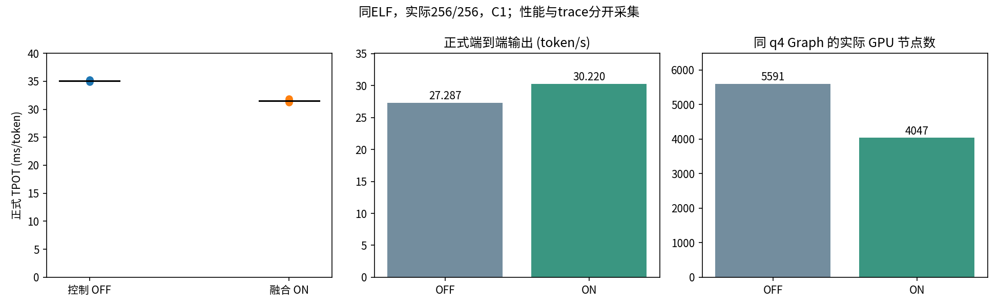
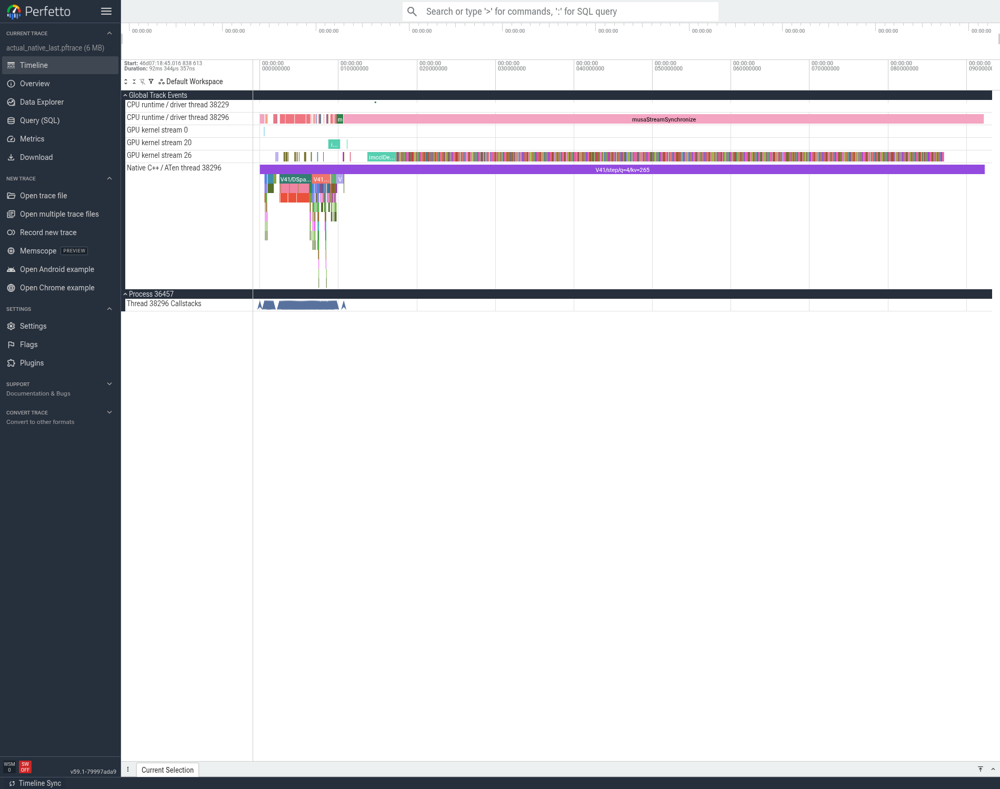
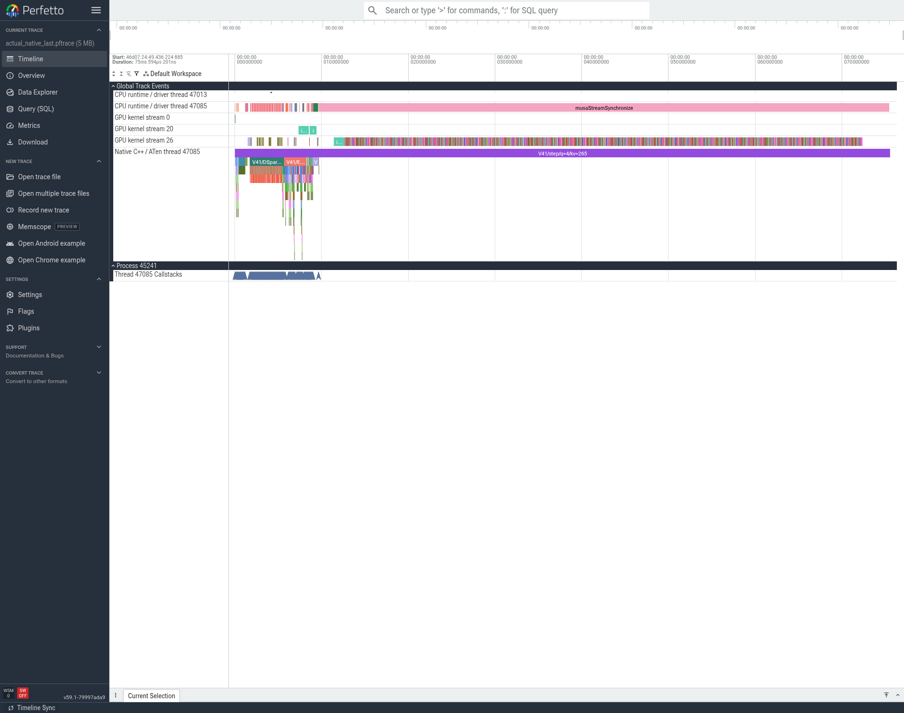
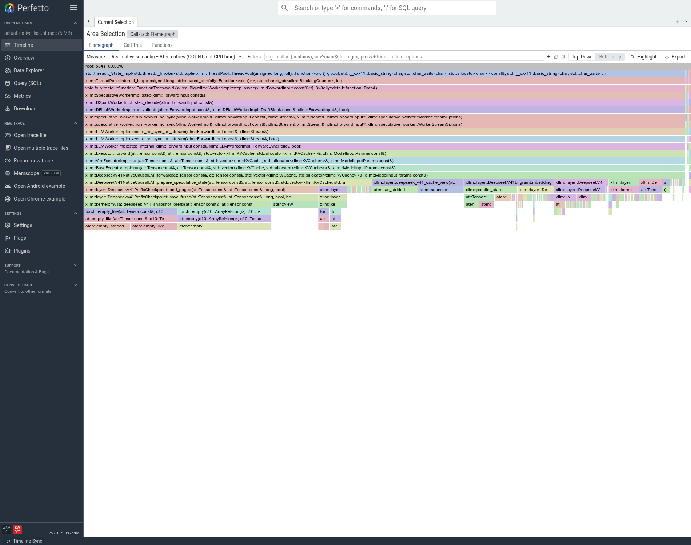

# E34：融合多token验证阶段的SWA读取，端到端输出提升10.748%

本项晋级为阶段累计最佳：**TPOT31.51346ms/token、端到端30.21984token/s、TTFT435.32497ms**。目标21.57ms/39.45token/s仍未达到；最终同配置三轮、正式2048/256与同窗口SGLang B复测仍未完成。

## 为什么做、实际改了什么

此前已有q1融合读取和草稿非因果块读取，但target一次验证4个token时仍走逐项Tensor操作：环形位置→页表映射→gather→padding mask→与当前KV拼接→每行因果窗口→压缩KV与Top-K映射→写槽位。完整Graph避免重复主机调度，却仍在图内执行这些小kernel。

最初只考虑融合物理槽位整数运算；读到已有q1和草稿融合实现后，将候选扩大到完整读取，以免只消除地址计算却保留多数中间搬运。复用了我方已验收的融合kernel组织和SG草稿读取的设计思路，**新的目标模型因果多行逻辑由我方实现**，不冒称直接移植SG现成的相同算子。

- 后端：`xllm/core/kernels/musa/deepseek_v41_swa_decode_read.cu/.h`新增多行入口；一次GPU kernel生成连续1～6行验证所需的rows、picks和物理写槽位。原q1接口保留，委托相同核心实现。
- 模型层：`paged_attention.h`仅在static_verify且开关开启时调用新入口，随后继续原Sparse Attention，再执行原scatter。`attention.h`传递配置。
- 原生模型适配：`models/llm/musa/deepseek_v41_native.h`读取默认关闭的`XLLM_DSV41_VERIFY_FUSED_SWA_READ`；本次仅D设1，P保持0。
- 未改权重、数学精度、attention范围、路由、proposal3、接受/拒绝或缓存回滚；仍为原生C++模型、MUSA GPU计算。不是Python forward，也没有CPU计算回退。

读padding时负block按原语义映射到安全页；写槽位保留负号，交给原scatter过滤。每行只看其因果窗口，不能把草稿的“全proposal相互可见”照搬给target。先读并计算attention，再写KV，防止环形覆盖破坏历史。静态verify之外仍走既有路径；不以捕获失败后继续执行来掩盖异常。

## 基本检查

生产链接模块直接调用实际C++入口：336组rows/picks/slots精确检查，覆盖q1～q6、int32/int64及strided输入、零/短/80行压缩KV、无效Top-K、未分配页、页边界、环回、位置0～2048。36次Graph回放改变位置、页表和KV仍精确一致。

72组实际Sparse Attention+缓存写入检查，覆盖默认/非默认流、q1/q4/q6、跨页与环回；6次实际Attention Graph变化输入回放通过。检查同时比较输出和整个缓存，不能只检查地址数组。两道模型基础题答案4.2/56。测试原始包SHA `cc382fb1eb44b4c88807d50f7fcc61997ae898f215c24d2ff468bd4019918e12`。

## 同条件正式结果

SJ9/SJ10双机1P1D、P/D各8卡；同W4AFP8-mt1017；Attention TP8/专家EP8；target完整verify Graph、proposal3、静态draft，完整draft Graph关闭。继承E30累计最佳的mHC metadata warp、E29并行路由和此前有效行SwiGLU/窄投影。E31路由投影、E33 Markov FP32相加均关闭。

两组同ELF、逐rank配置核验只有D的新开关不同（日志目录除外），各1次暖机+5次正式，固定实际256/256、C1、EvalScope1.14.1、temperature0、prefix关闭、ignore_eos；profiler OFF。所有请求、usage、DB、服务端计数均保留。

|配置|TTFT ms|TPOT ms/token|TPOT标准差 ms|E2E s|端到端输出 token/s|
|---|---:|---:|---:|---:|---:|
|控制 OFF|426.67434|35.11804|0.15402|9.381776|27.286945|
|融合 ON|435.32497|31.51346|0.24104|8.471257|30.219837|

输出提升10.748%，TPOT下降10.264%。10次正式输出正文SHA一致、验证接受/提议计数均147/330，即工作轮数没有变化。接受计数可含末轮未交付token，吞吐仍只用真实交付256个token。候选五次TPOT31.257～31.841ms，控制34.858～35.246ms，范围不重叠；本次收益超过3%、无需追加反向控制，不等于最终稳定性验收或统计显著性证明。

## 图里究竟改善了哪里

两组各16rank真实GPU/native trace通过，D各rank均4次q4 target Graph。比较同q4/kv265末尾Graph：**5591→4047个GPU节点，减少1544个（27.62%）**；新增40次`swa_verify_read_kernel`，对应40层每层一次。

实际节点变化包括：FloorMod176→16、整数Add212→54、整数Sub121→1、arange89→9、Clip96→16、整数Mul96→16、FloorDiv159→79；完整清单见`同q4_Graph节点变化.json`。这些正对应地址、mask、拼接及picks构造被融合，不是删除模型层或绕过attention。

CPU原生ENTRY_COUNT火焰图两组都为634个入口：完整Graph回放不会逐层重新执行ATen主机函数，因此不能说CPU火焰图调用数下降，也不能把GraphLaunch数量下降当作本次原因。GPU轨道中图内节点减少，与正式性能改善共同支持归因。

两组独立256/8 profile约18.05/18.00秒，关闭profiler约0.64～0.86秒，严重扰动。图中跨度不能当正式耗时、Amdahl占比或“理论上限兑现率”；27.62%是节点数量下降，不是时间下降。没有低开销局部占比，本项不报告虚构的理论收益百分比。

## 长输入与资源

同候选实现完成2048/256单次冒烟，实际长度/finish均正确，E2E16.67563秒、首个内容2.61826秒，含首次长图桶捕获，不能当正式长输入成绩。之后4.2、56与256/8短桶均成功；未发现跨长度缓存污染。正式长输入1暖5仍留到最终验收。

两组各16rank均正常exit0，03:44两机GPU空，无SIGKILL、重启、驱动变更。两台现有本轮容器名称不变：`xiaopang1116_v41_match_prefill_sj9` / `xiaopang1116_v41_match_decode_sj10`；本项结束时模型服务已退出。

首次本地ON解析/渲染在下载完成前启动，因文件不存在退出；保留失败，等待原下载完成后仅重做本地解析和渲染，没有重复GPU试验。addr2line有既有部分DWARF FORM警告，实际RecordFunction ID、函数符号与ELF关联通过，不宣称所有行号可解析。

## 可复现产物及下一步

ELF：`/expt/artifacts/verify_swa_read_native_v1/bin/xllm`，SHA256 `94fc34da932e72a6e4e8bbebb811b5e5652987f38d2a01ffd0ef1c4479b3401f`；生产检查模块SHA `19ac1ce187aac160f201b5c4ac5feb7f485c9ea9c904344cc8fdc259a0174bcd`。源快照及构建命令在`builds/verify_swa_read_native_v1`，基础commit与逐文件SHA都保留，不能只凭分支名复现。

NFS根`/data/nfs_shared/xiaopang/v41_xllm_match_sglang_20261116`；原始性能在`runs/p34_verify_swa_read_{off,on}_v1/formal_client`，trace在`profiling`同名目录，长输入与回短检查在ON的`long_smoke/post_long_checks`。本地本目录保留小日志、DB、摘要、必要trace和实际渲染图；大trace/ELF留NFS。

本项更新累计最佳，但尚差约9.94ms/token，端到端还需从30.22提升到39.45token/s。下一步基于此版本重新核对剩余target成本，优先考虑有明确调用证据的压缩缓存读取/metadata融合与真正DP8/DeepEP的隔离接口试验；不直接把旧q1计时或重型trace比例用于排序。此前full-draft Graph可作组合前置，旧proposal5无新依据不重跑。

同步修正了恢复入口不一致：`当前累计最佳.md`/`当前阶段最佳.json`此前停在E18，而`当前最佳.md`已到E30。本次保留旧入口快照，统一当前入口为E34，避免后续恢复退回旧配置。

**仅通过基础功能检查，未完成模型精度验收。本次是阶段晋级，不是goal完成。**
