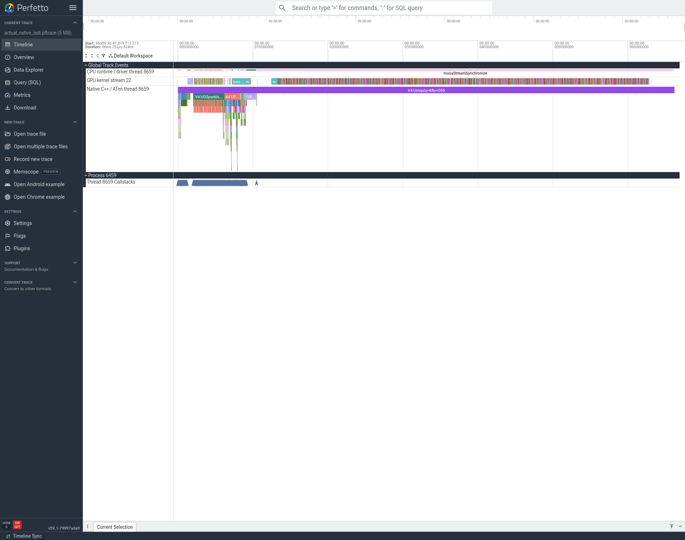
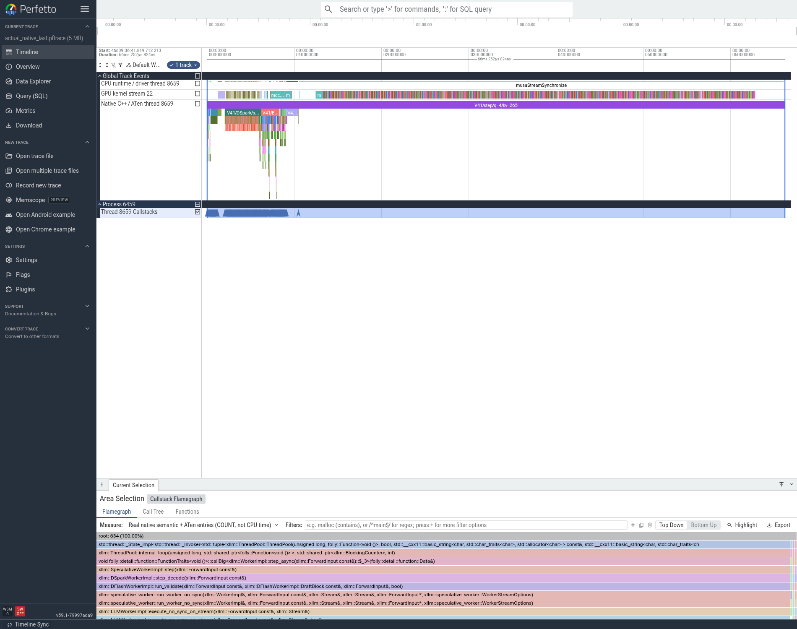

# E36—E37：原生 xLLM 在 SGLang 配套环境中跑通 Graph

## 结论

新环境控制组已经完成两道基础题、256/256 并发1的一暖五正式、16rank独立trace、单次2048/256和长后回短检查。它是后续真正DP8/DeepEP LL集成的可运行前置版本，**尚未接入整模型的DP8/DeepEP LL，尚未追平SGLang目标**。保留E34累计最佳快照；E37作为新环境控制和组合试验前置，不把一次跨环境对比冒充稳定单项收益。

**仅通过基础功能检查，未完成模型精度验收。**

|同口径实际256/256，C1|E34历史控制|E37新环境控制|目标|
|---|---:|---:|---:|
|平均TPOT ms/token|31.513459|30.614165|≤21.57|
|端到端输出token/s|30.219837|31.595040|≥39.45|
|平均TTFT ms|435.324973|295.925497|≤990.04|
|平均E2E s|8.471257|8.102538|同时报告|

新一轮TPOT样本标准差0.294408ms。相对历史控制，端到端输出速度约+4.551%，TPOT约-2.854%。这是依赖、重新编译与通信适配的组合对照，不能将全部变化归因于某一个算子或MCCL调用。正式EvalScope数据库已独立重算，5条success=1，实际prompt/completion均256，未删除失败行或缩短输出；工具窗口吞吐另保留在原始报告。

## 为什么先做这件事

E35已验证冻结SG的DeepEP库能进行八卡通信和Graph，但与原TorchMUSA2.9.1/MUSA5运行环境不兼容。为了在原生C++模型里使用该通信能力，需要先在SG实际TorchMUSA2.9.0/MUSA4.3.8环境建立可运行的控制组；这一步不等于切换为SGLang模型服务。

E36重新编译完整xLLM及W4A8、mHC、Sparse、Indexer、Engram等AOT产物。普通Graph生命周期85输出/23注册释放、W4A8五形状、mHC十组、Sparse十二形状和四动态Graph通过。但整模型首个D图捕获被ProcessGroupMCCL watchdog查询事件阻断。再关闭DESYNC_DEBUG/ENABLE_TIMING，八rank小复现仍全部失败，说明仅调调试开关不可行。

实际SG `parallel_state.py::graph_capture` 会启用PyNccl而禁用torch.distributed图内路径，`pynccl.py`直接向当前设备stream提交C API通信。我据此增加默认关闭的 `XLLM_MUSA_NATIVE_SYNC_COLLECTIVES`，由C++直接调用MCCL同步collectives；不关闭全局watchdog，不搬模型计算到CPU。

## 具体改动和边界

- `musa_native_collectives.h`：TCPStore交换唯一ID，图捕获外初始化/暖机communicator；同步allreduce/allgather/broadcast/reduce-scatter使用当前MUSA stream、显式dtype和形状检查。生命周期由RAII管理，所有已捕获Graph结束后才释放。异步API保留原实现。
- `musa_process_group.h`：按启动时的显式开关选择路径，原custom allreduce优先级不变。E37只在D开启，P保留原eager和host同步。图内不能混入host stream synchronize，构造时明确拒绝冲突配置。
- `parallel_state/CMakeLists.txt`：为该目标补充MCCL host API的MARCH_TYPE=310（与既有mp_31设备目标一致），显式链接MCCL；本次缓存Ninja应用等价的11个编译定义，原链接已包含MCCL。未改驱动或伪造so版本。
- E36五个Graph/allocator兼容文件：按实际API能力处理2.9.0/2.9.1接口差异。旧库普通Graph继续使用native pool；缺少引用计数检查时提前拒绝自有VMM pool，不伪造引用计数。
- `validate_w4a8_experts.py`：旧TorchMUSA不支持FP8高级索引，参考检查先在GPU将可精确表示的FP8值转换为FP32再索引。没有改变模型计算或放宽阈值。

原生MCCL八rank各187项，共1496项通过：五种dtype×q1/q4/q6，动态三次回放、SUM、rank顺序gather、root3 broadcast和reduce-scatter，另含非连续gather、空输入、仅一个rank非零及捕获中CPU等待2秒。全部正常exit0。此小测试覆盖生产helper，不声称已覆盖所有异步或多请求并发机制。

## 环境与实际身份

- 本地及共同仓库个人分支：`xiaopangV41FlashCppFromSglangtoXllm`，共同仓库 `https://github.com/fay85/xllm-musa`。本轮提交链接写入同目录的提交记录；不提MR。
- 冻结镜像：`1612b9c34896d7efb631975bf49542693c4c6d129554c63f32a31b13edc37337`；SG参考代码`7c97bb0e6d8b0f8fd41cd797a77b54f7162c79f6`；Torch2.9.0、torch_musa2.9.0+0680da1、MATE0.2.6，MUSA4.3.8。以两端runtime_identity中的真实SO SHA为准。
- 模型：`/data/nfs_shared/models/DeepSeek-V4.1-Flash-1017-W4AFP8-mt`，未更换资产。
- 原生ELF：`/data/nfs_shared/xiaopang/v41_xllm_match_sglang_20261116/artifacts/native_sg438_mccl_v1/bin/xllm`，SHA `6468707445ac26b74f6e8766dd20b13b5567e367a3d172d482aff777b0d09293`。
- 模型容器：SJ9 `xiaopang1117_v41_sg438_prefill_sj9`、SJ10 `xiaopang1117_v41_sg438_decode_sj10`。本轮16rank全部正常exit0，05:57:39两机GPU空；未使用本轮SIGKILL。
- 2411个本地源文件对照：编译源目录缺少E35四个未接入模型的DeepEP桥接/测试文件，另有一份参考测试脚本旧版；所有当前模型C++相关文件一致。检查实际使用的脚本已单独复制到NFS测试目录并固定SHA。不能只用容器旧Git HEAD声称源码全部相同。

## 测量有效性和数值现象

同一固定题目和token长度下，E34正式请求accepted/proposed为147/330，E37为119/408，正式5次均一致。输出文本和工作轮数可能受运行库/重编译的数值差异影响；本轮按用户要求仅记录，不展开全模型对分。两道基础题通过不代表精度验收，也不表示模型被删层或减少专家。

2048/256单次38.276807s、首内容1.780128s，包含新Graph桶捕获；长后4.2、56和256/8均正确成功。该数据不是长输入正式五次结果，不能用它宣称长输入更慢或更快；最终冠军仍须同配置正式长输入回归。

## trace读图与可确定的结论

16份trace都核验到了GPU kernel、CPU语义/ATen事件及native sidecar关联。D每rank四个q4 target回放，每图4047个kernel节点，仍保留E34的40层融合SWA路径；最后一步有634个真实C++/ATen入口，和E34的计数相同。因此这一轮没有通过减少模型层数或删掉forward工作取得成绩，也不能声称减少了主机入口数。

横轴是真实采集的CPU/GPU区间；火焰图权重是ENTRY_COUNT，**不是CPU耗时或GPU耗时占比**。848个原生地址都解析出函数名，797个没有可靠源码行号；addr2line有DWARF版本警告，保留原始地址和警告，不伪造行号。

最后q4图仍见80次MATE S4FP8 masked GEMM、40次FP32 custom归约、40次BF16 custom归约和40次融合SWA读取。原生MCCL的图内AllGather也存在。这证明当前仍是TP8/EP8本地专家求和路线，不是SG的owner-DP加DeepEP dispatch/combine。

独立256/8 profiler OFF前两次0.498905/0.478449s，ON18.599093s，关闭后0.522551s。重profiler扰动显著，图内局部毫秒不能直接套到正式31.595token/s计算Amdahl收益上限。新TorchMUSA还生成同名GPU annotation，验证器已按category区分CPU/GPU，未修改原始trace；转换工具原本支持该区分。

## 下一步

1. 在此兼容环境中，先把E35的DeepEP dispatch/combine与生产MATE masked S4FP8专家计算接成一个八rank小闭环；覆盖target384/top6、draft128/top3、空rank、动态Graph、路由权重和共享输出只加一次。不能只把身份通信成功当作完整专家算子接入。
2. 核算真实DP8/TP1 Attention、共享专家、头部、GPU Engram、Graph池、LL buffer的逐rank常驻/峰值内存，先查SG实际布局和E21超显存证据。当前“复制H64后仍各rank算相同token”不是真正DP8，不能换个名称就晋级。
3. 将token owner/空rank执行与target/draft状态、P/D缓存格式及LM-head TP8衔接，采用有证据的小步组合。环境和模型算法同时变化时保留E37这个控制组；累计最佳E34快照继续保留。
4. 每个候选仍通过基础题、必要短检查、真实256/256、独立trace。达到门槛后同一最终配置三轮、同窗口SG B及2048/256五正式仍未完成，不能提前结项。

## 证据位置

本地：本目录 `正式与trace原始证据/`（EvalScope数据库、日志、请求、两端配置/运行库身份、选定原始trace及symbols）、`正式与trace原始证据.tar.gz`（SHA089f2adc372f7f58a0c74cab9b7fceb2806a8d37f53abb1f41c2a2cf85f6ce82）、`03_性能/正式数据库独立复算.json`、`04_trace/`。

NFS：`/data/nfs_shared/xiaopang/v41_xllm_match_sglang_20261116/runs/p37_sg438_native_mccl_v2/`；全16rank原始trace在同根`profiling/p37_sg438_native_mccl_v2/`；编译与短检查在`builds/native_sg438_control/`和`diagnostics/e37_native_sync_mccl/`。E36失败包SHA168d9584…、关闭debug仍失败的复现、E37首版配置和验证器失败均保留。
