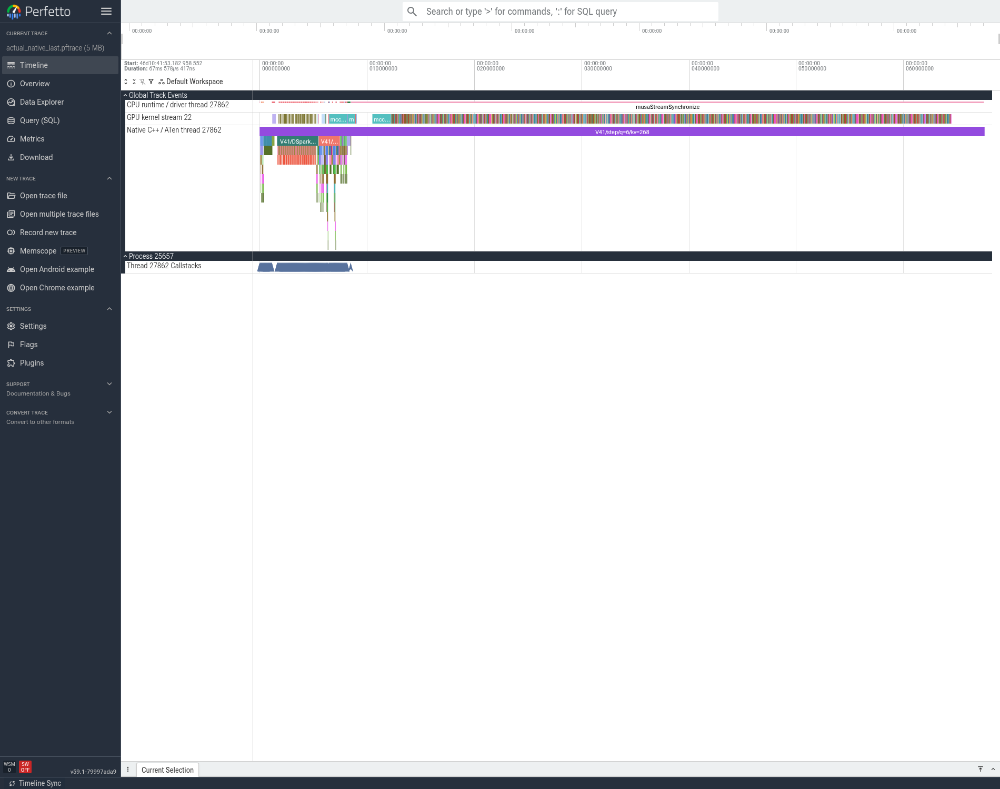
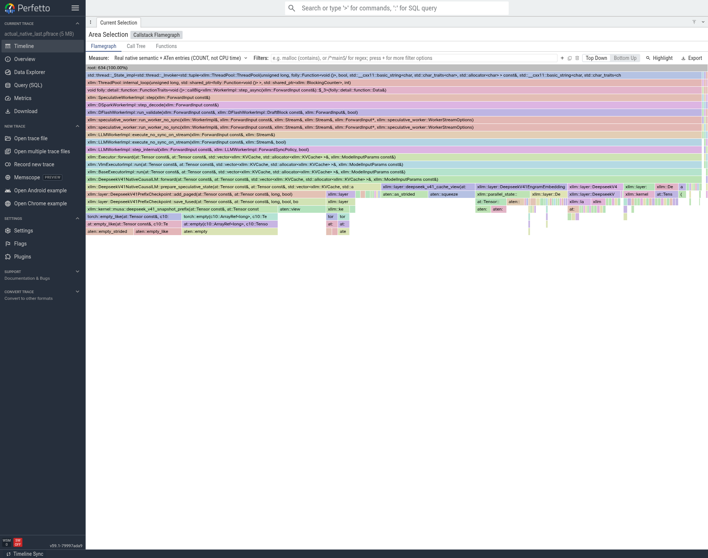

# E41：静态激活下proposal5没有提速，反向对照确认保留proposal3

本项已完成正式性能、独立16rank trace、2048/256有界冒烟、长短请求切换、反向控制与正常退出。结论REJECTED_REVERSE_CONFIRMED，累计最佳仍是E39的静态activation＋proposal3配置。本轮未改模型C++源码，没有把相同配置的重测浮动称为新的代码优化。

**仅通过基础功能检查，未完成模型精度验收。目标仍未达到。**

## 为什么重新检查proposal5

E11已经测过旧动态量化路径的proposal5负收益，保留该结论。这次E39静态激活使固定基准的accepted/proposed发生变化，才有依据再试与proposal5的组合；不是重复旧配置。仅改变P、D各8rank的num_speculative_tokens=3→5，target verify从q4变q6；E39 ON的镜像、ELF、静态MATE库、Graph、native MCCL、custom归约、P端动态量化及输入协议保持一致。

ELF SHA256：`6468707445ac26b74f6e8766dd20b13b5567e367a3d172d482aff777b0d09293`；静态专家AOT：`9a23ce3a6dfe2381e20573ae17643fba3d22760a79dd1e390bb5ab4531a36241`。实际各rank的exe/maps/库SHA在原始证据的runtime_identity.json内。源代码当前提交a4df2064；运行ELF沿用E37冻结构建，不能称本次重新编译。

## 五次正式请求与反向控制

SJ9/SJ10各8卡、1P1D，Attention TP8、专家EP8，同W4AFP8-mt1017，C1，固定tokenizer/模板/input IDs；EvalScope1.14.1、temperature0、top_p1、chat、ignore_eos。每组1暖机＋5正式，profiler OFF。三组共15个正式请求均成功且实际256/256，客户端DB逐题与服务端request_id/sequence_terminal交叉核验finish_reason=length，未按成功子集筛选。

|配置|TTFT ms|TPOT ms/token|E2E s|sum(tokens)/sum(latency) token/s|
|---|---:|---:|---:|---:|
|控制：E39静态activation、proposal3|331.764857|27.843298|7.431806|34.446540|
|候选：静态activation、proposal5|304.982227|28.795223|7.647764|33.473836|
|反向控制：恢复proposal3|336.505075|27.435171|7.332474|34.913183|

候选相对前向控制输出降低2.8238%，相对反向控制降低4.1226%。小于3%的首轮差距触发了反向复测；两个方向均不支持晋级。原始均值不先四舍五入判断门槛；当前仍未达到21.57ms/token、39.45token/s。

## 为什么增加提议数没有帮助

前后控制每题accepted/proposed=130/375，125轮；proposal5为131/625，仍125轮。日志接受数不等于最终交付token数，最后一轮受max_tokens截断，实际交付仍256。额外多提250个draft候选，却没有减少target验证轮数。首token后墙钟时间/轮从前向56.8003ms（反向55.9677ms）变成58.7423ms；它包含draft、verify、缓存维护及主机/流式工作，不是独立GEMM时间。各组内部五次正文相同，proposal3与5正文不同，现象已记录，不作精度合格结论。

## Trace里实际看到什么

16个rank的GPU events与C++原生sidecar按record ID、tid核验通过；D每步q6且有真正musaGraphLaunch，Graph profile刷新/恢复数量相同，关闭profile后短请求通过。rank0末步C++/ATen入口634，target Graph节点4047，与E39 q4相同。节点数相同不意味着工作量相同：q4变q6扩大节点内部计算的行数，多个长条宽度会改变。

q4末Graph GPU span52.9255ms，q6为56.2604ms；这里只是同类采集下的解释线索，不能当作无profiler场景的精确贡献。256/8不采集约0.485～0.526s，采集请求18.570s，明显包含捕获/追踪扰动。因此不能据图宣称某kernel占正式TPOT的固定百分比，也不能用COUNT火焰图宽度表示CPU耗时。

图片已实际打开核对，包含q6请求区间、GPU节点和C++调用链，不是加载页。符号化使用实际ELF；addr2line提示DWARF FORM0x23，函数名已解析，未声称所有源码行号均可用。

## 长输入与退出

2048/256单次冒烟耗时54.782502s，首内容1.793488s，含新Graph容量桶的首次捕获，不能作为正式长输入性能。随后4.2、56、256/8均通过。候选与反向控制32个rank全部正常exit0；无SIGKILL，未操作驱动、Docker daemon或服务器。候选显存07:01:29释放；反向控制07:08:09两台每卡0MiB核验。之后SJ10已用于E40单卡微基准，不能把这些时间点的空闲当作永久资源状态。

## 可复核产物与下一步

- 候选NFS：`/data/nfs_shared/xiaopang/v41_xllm_match_sglang_20261116/runs/p41_static_activation_proposal5_v1/`
- 反向NFS：同runs下`p41_static_activation_proposal3_reverse_v1/`
- 正式DB：各run的`formal_client/formal/deepseek-v4.1-flash-1017-w4afp8-mt/parallel_1_number_5/benchmark_data.db`；工具自带benchmark_summary也保留。
- 本地候选原始证据：`原始证据_candidate/`；反向：`原始证据_reverse/`；控制引用`../实验_039/原始证据_on/`，不重复拷贝旧大文件。
- 完整trace NFS：`profiling/p41_static_activation_proposal5_v1/sj9|sj10/`；全rankSHA manifest及事件核验在候选trace和trace_analysis下。
- 候选压缩包SHA：b1713b73069443d876f56d4a633e8d6484712ce7bd1fbd3b684425215c9123b3；反向SHA：4c9f399f764ff9243fccc0a482c152b4c064435adc7f9d5d6bb385dc03d0c671。

保留E39 proposal3。下一步优先推进E40：为真实DP/DeepEP减少参数存储并对齐SG先量化再GEMM路径；不是继续盲扫更长proposal。本轮只是候选试验，最终同配置三轮、正式2048/256、同窗口SG B仍未完成。
