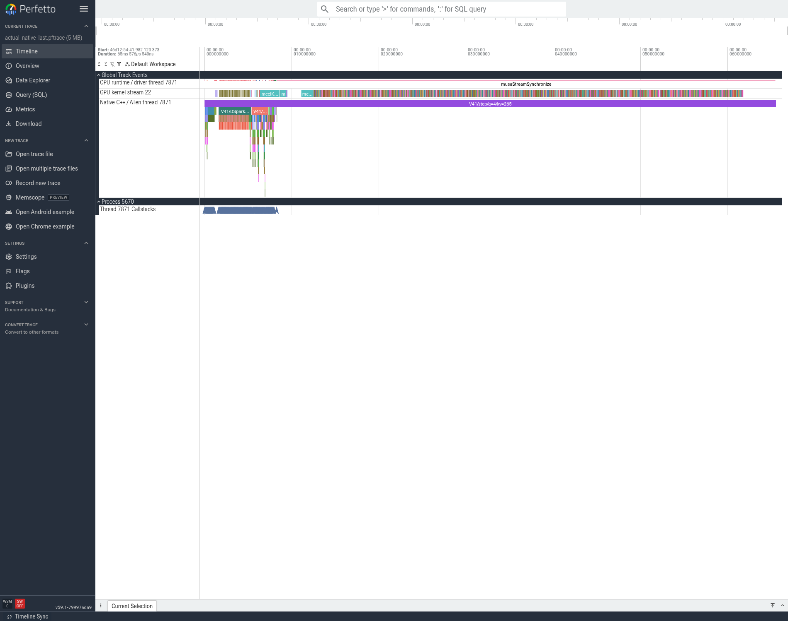
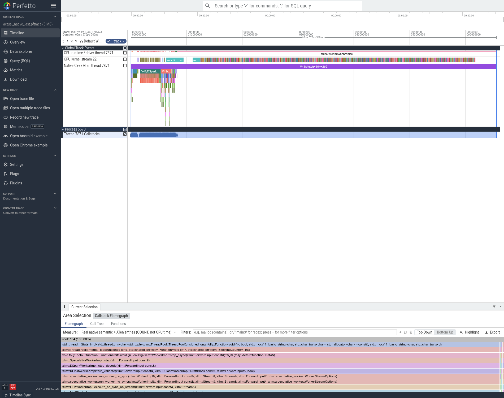

# E43 同产物控制组：排除构建与预加载环境本身失效

我保留 E43 新 ELF 和 DeepEP 所需的预加载库，只关闭 owner/DeepEP，恢复 E39 的 TP8 Attention、EP8 专家、target q4 Graph、proposal3 与静态专家激活量化。这个试验用于确认失败是否来自新增组合，不能作为独立加速成果。

|256/256，C1，1暖5正式|实测|
|---|---:|
|TTFT|330.893438 ms|
|TPOT|27.767124 ms/token|
|端到端|7.411510 s|
|输出 token / 请求延迟总和|34.540870 token/s|
|TPOT 样本标准差|0.197067 ms|

两道基础题得到 4.2、56；五次正式均成功，实际输入输出均256。profiler关闭。16个rank正常退出，2026-11-17 09:13双机显存释放。仅通过基础功能检查，未完成模型精度验收。结果接近当前累计最佳，不晋级，不替换累计最佳。

ELF SHA256：`8bfb199226c3712c56b8412ef42133638c3c9d1078ac0ee4a2b279a2899757a4`。原始正式结果见 `原始证据_control/formal_client/`，NFS run=`/data/nfs_shared/xiaopang/v41_xllm_match_sglang_20261116/runs/p43_owner_ll_off_control_v1`。归档6,449,637字节，SHA256=`729022e15580d0a0192dfa349446ddb5dbf1ca4c2a65d10666568c77a3def65f`。

## 独立 trace 和读图边界

16rank trace 均通过 GPU 事件、native stack 与关联检查；D端8个rank都有 q4 target Graph。独立请求是256/8，未采集时约0.469～0.491s，开启采集18.527s，不能据此把图中耗时比例当作正式27.77ms TPOT的组成比例。

本次转换得到4989个真实区间、634个native入口；图中能看到DSpark与Graph执行的前后关系，以及后半段GPU节点回放；CPU的长同步区间包含等待，不能直接判断主机计算占满。火焰图选择的COUNT是调用入口计数，不能当作CPU耗时。符号解析有DWARF FORM 0x23警告；函数符号和关联通过，但不声称所有源码行号均已解析。

同ELF关闭owner后可以运行，说明该ELF和新增预加载依赖并非必然导致所有Graph失败；它不能证明owner路径正确。下一步仍需区分真实专家连续图、MCCL与DeepEP混合图、以及模型其他计算与缓存的组合。
