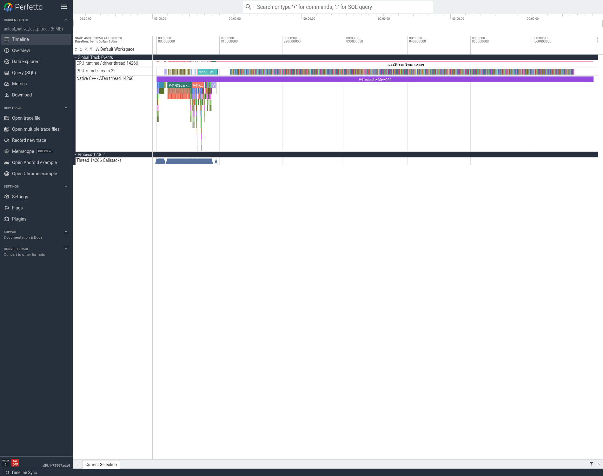
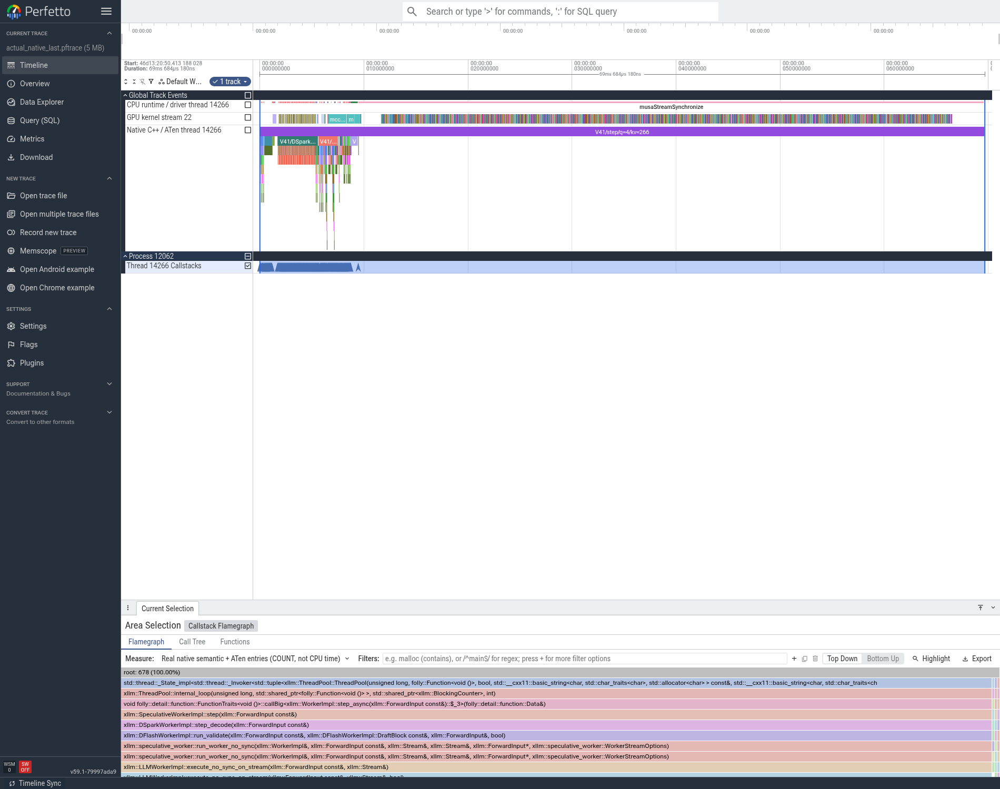

# E44：owner / EP8 完整 Graph 跑通，但尚未优于冠军

2026-11-17。仅通过基础功能检查，未完成模型精度验收。

## 结论与指标

将 TP8 embedding 的 MCCL gather 放到 target Graph 外，使用小型静态 embedding Tensor 传入图后，原生 C++ owner Attention / 共享专家 + EP8 DeepEP low-latency 路径完成两道题、正式短请求、独立 trace、长输入冒烟和长输入后的短请求。16 个 rank 全部正常退出；09:45 两机显存已释放，无 SIGKILL、GPU reset、改驱动或重启。

|实际 256/256，C1，独立 1 暖 5 测，profiler OFF|TTFT ms|TPOT ms/token|E2E s|输出 token/s|
|---|---:|---:|---:|---:|
|E39 累计最佳（历史参考）|331.764857|27.843298|7.431806|34.446540|
|E43 同其 ELF 的 owner OFF 控制|330.893438|27.767124|7.411510|34.540870|
|E42 FP8 Dense TP8 ON（历史前置）|340.297574|28.915808|7.713829|33.187152|
|E44 owner + LL + gather 图外|315.304544|30.462215|8.083169|31.670745|

E44 五次请求均成功，实际输入/输出各 256，finish reason=length。TPOT 样本标准差 0.103124ms。4.2、56 均正确。E43/E42 是不同 ELF 的既有对照，不能声称本表完成“仅一个开关不同”的因果消融。E44 明显没有超过累计最佳，因此 **READY_DEPENDENCY，不晋级**。

单次 2048/256 冒烟用时 34.773245s，首个有效内容约 1.780369s，含新容量 Graph 捕获，不能作为稳态正式性能。之后两道题和 256/8 请求均通过。最终三轮验收、正式长输入回归和同窗口 SGLang B 仍未完成。

## 为什么这样修改

E43 全 owner Graph 首次回放曾触发设备故障，身份通信的小算例不足以复现。E44 改为真实 W4A8 专家、rank0 有 4 行而其他 rank 真正 0 行、连续 40 次专家调用，并加入原生 MCCL gather / broadcast。

真实专家与 LL 组合能通过；加入图内 gather 的 40 连续专家图，在两次试验中分别停在 variant1/2 的 eager 参考阶段。正常 TERM 后释放。把 gather 移到图外的版本通过 3 种及扩展 12 种输入；全部成功组累计 192 项。它们重复的是 layer0 专家，不是完整 40 层模型；部分早期检查 reset 边界不同，不能把这些结果当作 vendor 根因的严格单变量证明。最终完整模型成功为这一规避路径提供了进一步证据。

默认关闭开关 `XLLM_DSV41_OWNER_GATHER_OUTSIDE_GRAPH` 只允许与 owner 模式一起使用。`text_model.h` 抽出 embedding 准备；`decode_graph.h` 固定其地址并原地复制；`deepseek_v41_native.h` 在 capture/replay 外 gather。每个 verify 输入仅 q×5120 BF16，没有复制整个 embedding 权重。该路径中 Attention/共享专家由 owner 执行，路由专家仍为 EP8；不是完整 DP8 服务调度。

## 从 trace 可以确认什么

16 个 rank 的 GPU 事件、原生调用 sidecar、实际 ELF 已关联核验。D 每个 rank 有 5 次 q4 target Graph：rank0 每图 4362 个 kernel，非 owner 每图 241 个。所有 rank 每图均有 40 次真实 LL dispatch、40 次 combine、80 次 MATE S4FP8 专家 GEMM。MCCL gather 在图外，target Graph 内没有 MCCL 节点。

图中左侧仍有 draft 和图外准备，后段为 target Graph 的真实 GPU 节点。火焰图按实际入口 COUNT 汇总，不是 CPU 时间占比；addr2line 对部分 DWARF 报警，函数符号可用，不承诺全部源码行可解析。profile 请求约 18.17s，关闭采集的同 256/8 请求约 0.61～0.76s，扰动明显；不可将图中时间直接当正式运行的瓶颈占比或 Amdahl 收益。

每图 owner 有 280 次 FP8 quant、280 次 prequant GEMM、280 次 reduce，说明七类投影/每层仍有三段执行。其他 rank 的 LL dispatch 较长可含等待 owner，不能解释为纯网卡传输耗时。正式 256 token 输出对应 126/390 接受/提议、130 次 verify，下一步需同时衡量投影成本与每个已提交 token 的有效工作量。

## 可复现产物与后续

- ELF SHA256：`db7d6d416da490e45f23602e076338496ae692d38cdb0b60da8ac5e3f3472f3a`，341738944 字节；父提交 `1bcf3e5c` 加本次三份生产 header 的 source_manifest。
- NFS：`/data/nfs_shared/xiaopang/v41_xllm_match_sglang_20261116/runs/p44_owner_gather_outside_graph_v1`；完整 trace 在同根 `profiling/p44_owner_gather_outside_graph_v1`。
- 本地原始小日志/数据库：`原始证据_model/formal_client`；trace 关联：`原始证据_model/trace_analysis/all_rank_validation.json`。
- 模型证据包 SHA256：`39fa3206acf3504793e93d636c41a5073d108b57e35071458faa7690c0769bf7`；检查/构建包：`d48b854071f308059b68a117099b896a58613a4e03b2c345b26256299dc25491`。
- 下一步核对冻结 SGLang 的实际 FP8 分块/融合调用，并在已通过基础检查的 owner Graph 上试 proposal5。E41 的 TP8 proposal5 负收益不证明新 owner 路径也无效，但若验证工作量仍不改善，应及时回到最优方案及其他方向。
