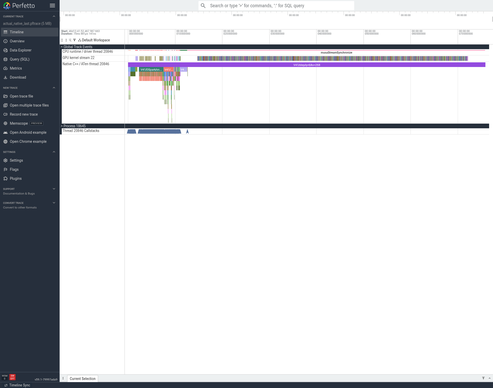
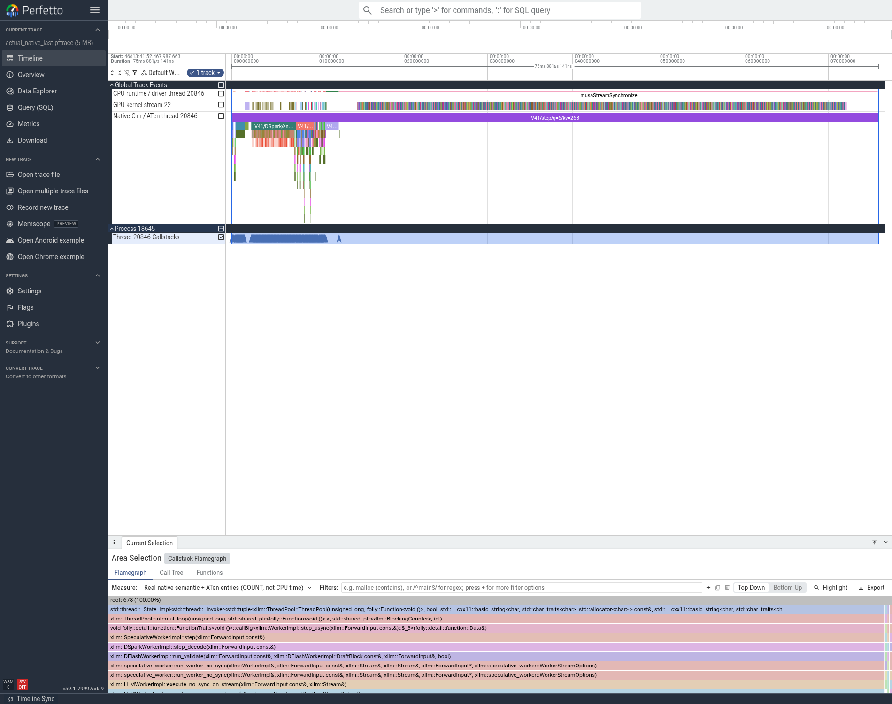

# E45 trace 与恢复点

候选16rank trace均验证成功，实际q6 target图保留40层的40 dispatch、40 combine、80 MATE专家GEMM；所有8rank都执行专家。profile前后256/8均成功且文本一致。采集请求18.105s，而无采集约0.503～0.713s，不能用采集时长充当性能。

图片已实际打开检查。原始证据包SHA：cabed2c844238c6d0aea1d86fa61d65e29ac4387a11405debd6b11dcf9d3c413。

候选P/D全16rank正常exit0，10:00:25显存空闲；随后开始反向proposal3控制，run p45_owner_ll_spec3_reverse_v1。10:03:24客户端57731/start524101818仍有效，两个模型存活，正在暖机/捕获。不能重复启动；正式终态以run/formal_client为准。
