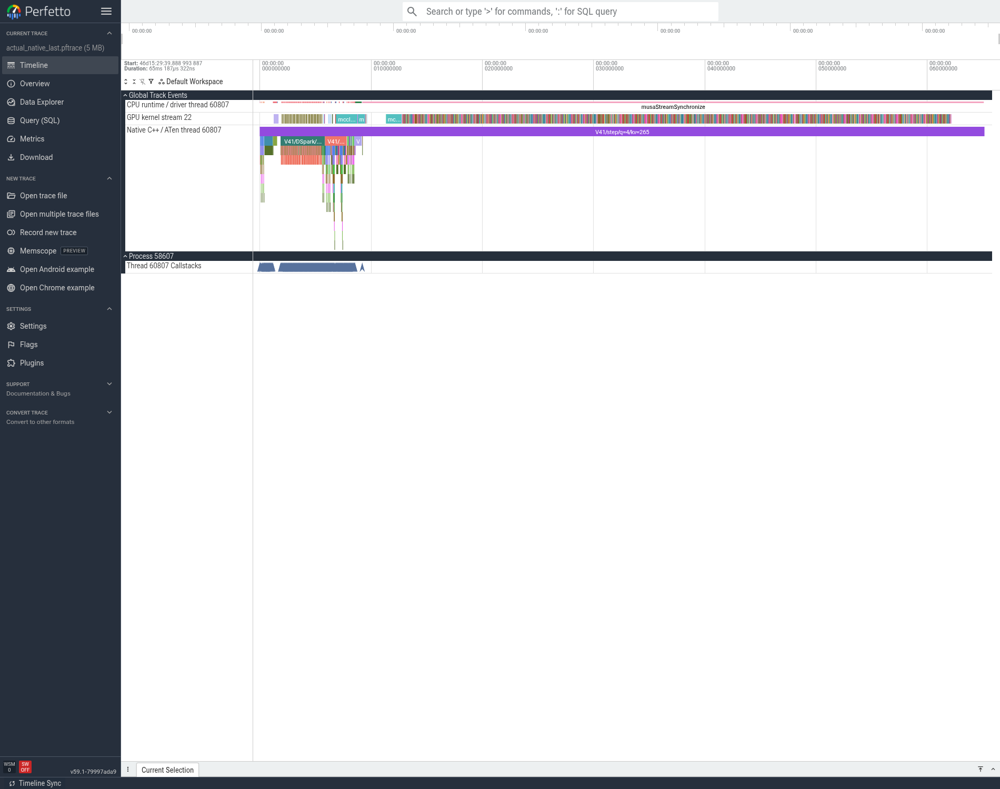
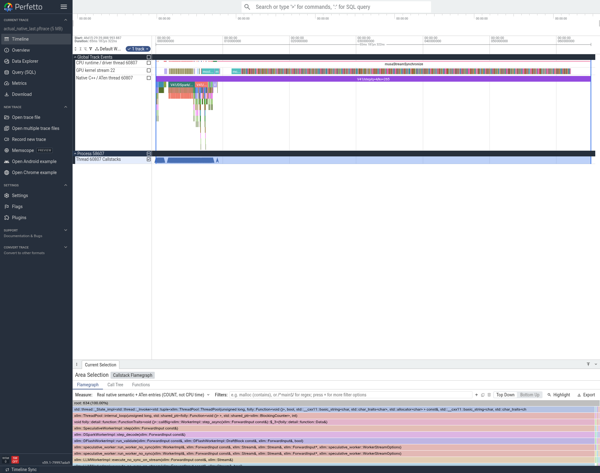

# E48：先测清一轮投机执行的时间，再选择优化位置

2026-11-17。**仅通过基础功能检查，未完成模型精度验收。** 本项是诊断，不是新的性能优化；累计最佳仍为 E39。

## 本次解决了什么问题

此前重型 profiler 中，CPU 调用、跨流同步、Graph 回放、GPU kernel 混在一起，不能把某段火焰图的面积当作正式推理耗时占比。此次在原生 C++ DSpark/DFlash 执行边界增加可关闭的 MUSA event 采样，分别观察 draft、target 验证、接受处理和 context 缓存维护。没有改变权重、数学公式、请求协议或 token 提交方式。

记录实际 runtime compute stream，在既有同步关系下测相邻边界之间的区间；每 8 轮采样一次，采样上限 128。先完成 Graph 捕获，再由独立 arm 文件开启；每条带实际 HTTP request ID。读取 event 只查询完成状态，没有为了计时新增 synchronize；待结果就绪才写 JSONL。未设置环境变量时默认关闭，正式控制组不创建计时 event。

实现涉及 `xllm/core/runtime/musa_spec_step_timing.h`、`dspark_worker_impl.cpp`、`dflash/dflash_worker_impl.cpp`。完整原生构建成功，ninja 无剩余任务，实际 ELF SHA256：`0c3def50fab14e750e61dede83c36c43eb6ecd590b6451153fbd2491b0db1bc1`。没有 Python 模型 forward。

## 同一服务、同一 ELF 的校准

SJ9/SJ10 双机 1P1D，每台 8 卡，W4AFP8-mt1017，Attention TP8/专家 EP8，target q4 完整 Graph、proposal3、静态 draft 输入、D 静态专家激活 scale、C1、prefix 关闭。EvalScope 1.14.1，实际输入和输出均为 256。每段独立暖机；以下仅列正式请求。

|阶段|正式请求数|平均 TTFT ms|平均 TPOT ms/token|TPOT 样本标准差 ms|平均 E2E s|总输出/总延迟 token/s|
|---|---:|---:|---:|---:|---:|---:|
|控制：计时关闭|5|340.431190|28.183333|0.197021|7.527181|34.010076|
|诊断：边界采样开启|2|364.093877|27.680844|0.090826|7.422709|34.488756|
|反向控制：计时关闭|5|256.243852|27.648372|0.363344|7.306579|35.036918|

三段及暖机共 15 个性能请求全部成功，服务端实际 256/256、finish_reason=length；所有文本 SHA 相同，服务端均记录 accepted130/proposed375，按 proposal3 为 125 轮。两道基础题分别回答 4.2 和 56。前后控制本身存在时间漂移，诊断 TPOT 处于其附近；未见比控制波动更大的明显计时开销，但仅 2 个诊断正式样本，**不能据此断言计时绝对零扰动，也不能把反向控制较快算作优化**。

原始 EvalScope 数据库、完整 SSE 序列、请求体与 token IDs、逐条原始日志都保留在 `原始证据_runtime_v1/formal_client/`。`03_性能/运行时分段与逐请求核对.json` 将计时记录关联到数据库中的响应 ID 和 server terminal 日志，排除了暖机样本。

## 一轮执行的主要时间在哪

D 的 8 个 rank 各得到 47 条采样：暖机 16 条、正式 31 条；全部 event record/elapsed 状态为 0，时间顺序合法，全部 request ID 能关联。下表为 rank0 的 31 条正式采样均值，**分母是这些采样的一轮 runtime 区间，不是完整 HTTP 请求，也不是 8 卡相加**。

|相邻边界所覆盖的工作|均值 ms/轮|占所采样 runtime 区间|
|---|---:|---:|
|draft 执行及其输出处理|5.681639|10.39%|
|target 输入准备|0.020409|0.04%|
|target forward 与 head|47.000716|85.92%|
|接受/拒绝计算|0.104391|0.19%|
|接受结果到主机可用|0.109203|0.20%|
|context 投影与缓存维护|1.703520|3.11%|
|其他已记录边界|0.084121|0.15%|
|合计|54.703999|100%|

实际 runtime stream 是默认流 0，模型内部仍切到独立池流，并通过 `MusaModelComputeStream` 的既有入口/出口同步维持依赖。因此上表包含计算及相应等待，**不能称为 kernel busy 时间**。`target forward 与 head` 也不是某一个 GEMM；还包含模型前后准备、状态处理、词表头及通信。不能把该 85.92% 直接代入全请求 Amdahl 公式，不能把 54.704ms 当作 TPOT：每轮提交的 token 数不同，还有未包含在该区间内的服务调度。

这项证据支持两个决定：主要精力放在 target 验证路径；draft 的约 5.68ms 也值得一次低成本、严格对照的完整 Graph 组合复查，但即使 draft 有收益，也不能预计它单独解决全部差距。当前目标仍为 TPOT≤21.57ms、输出≥39.45token/s、TTFT≤990.04ms。

## 独立 trace 说明了什么

另外采集 256/8 请求，与上述正式性能分开。16 个 rank 均有 GPU kernel、原生 C++ sidecar 和 ATen 事件，符号对应同一 ELF。D target 每次 q4 回放仍为 4047 个 GPU 节点；图注册刷新与恢复次数一致。`addr2line` 对部分 DWARF 格式报警，函数符号可解析，不承诺全部源码行号。

图上后半段长 CPU synchronize 与 GPU 工作重叠。它是主机等待 GPU 的表现，不能把两段相加，也不能只看到长同步就断定删同步能省下同样时间。默认流与模型池流之间的依赖仍需满足，不能盲目关闭现有流桥接。

火焰图度量为 ENTRY_COUNT，共 634 个已匹配原生入口，不是 CPU 时间占比。重型采集的 256/8 请求约 18.49s，普通同形状请求约 0.47～0.52s，扰动明显。该图用于确认调用链、节点和同步关系；正式运行的时间判断优先参考经过校准的边界采样和 profiler OFF 的 HTTP 数据。

## 后续与资源状态

E49 在相同 ELF 和累计最佳配置上，仅开启 D 的三层完整 draft Graph。E14 在旧运行库环境下收益不明确；当前 SG438、原生 MCCL 及测得的 draft 区间提供了重新检验的具体依据。若没有稳定收益就保持关闭。与此同时，target 的 TP8 归约、投影与量化、mHC/SWA 细粒度执行仍为后续重点；不能重复实施 E44 已完成的 owner-only Attention/共享专家计算，显存驻留副本不等于每个 rank 都在重复计算。

E48 的 16 个 rank 全部正常 exit0，2026-11-17 11:48:54 两机显存释放已核验；本项没有 SIGKILL、GPU reset、驱动改动或服务器重启。之后启动的 E49 是新的有效任务，身份见总控恢复记录。

NFS 根：`/data/nfs_shared/xiaopang/v41_xllm_match_sglang_20261116`。本项 `runs/p48_runtime_boundaries_v1`、`profiling/p48_runtime_boundaries_v1`、`builds/e48_native_timing_v1`。证据包 `exports/p48_runtime_boundaries_v1_evidence.tar.gz`，6,636,372 字节，SHA256 `de547b15a050fed4f6b9f1e3da3239324134eba11f724f42c20bf22626962b46`，已下载本地并校验。

本项没有新的晋级配置，最终同配置三轮、2048/256 正式回归及同窗口 SGLang B 复测仍未完成，不能宣布整个 goal 达标。
