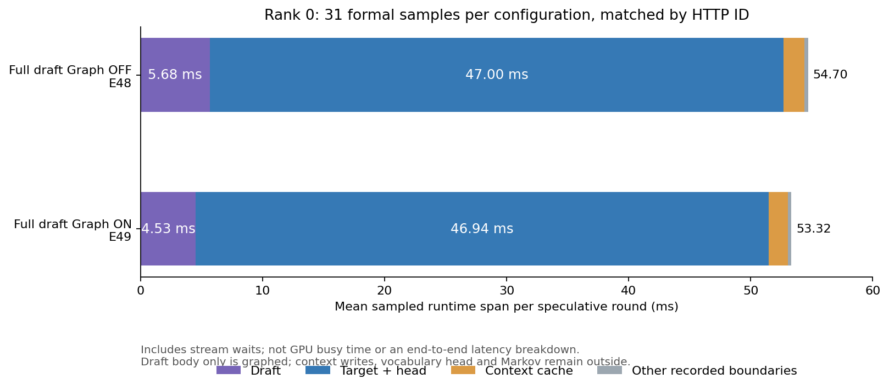
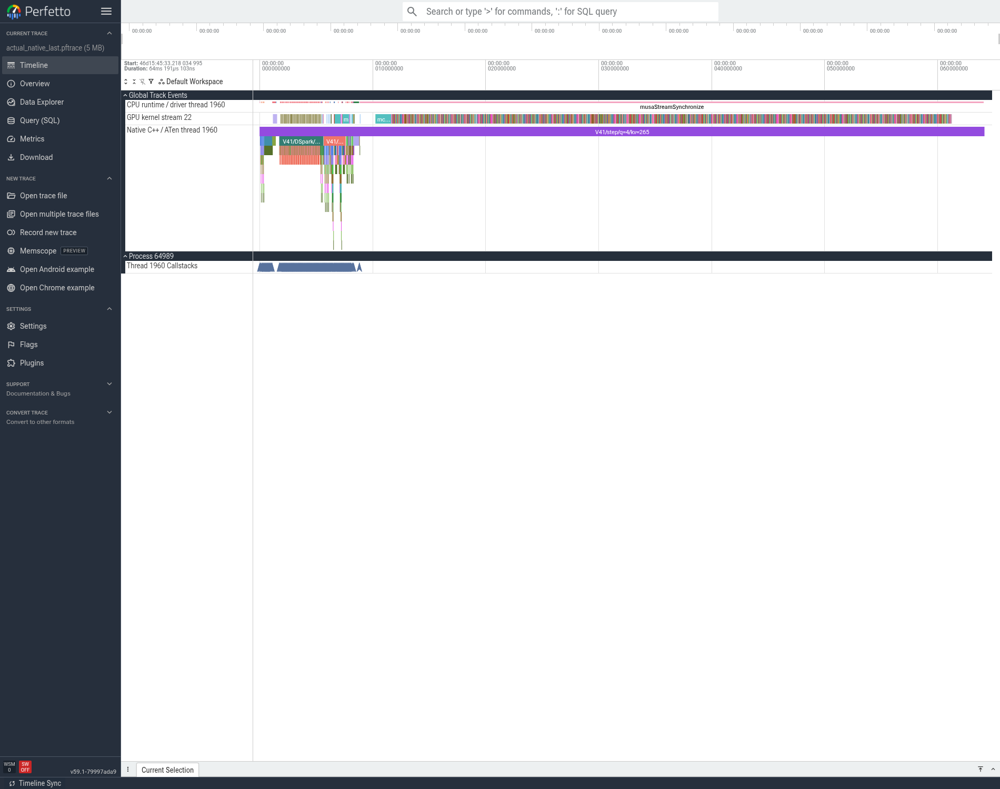
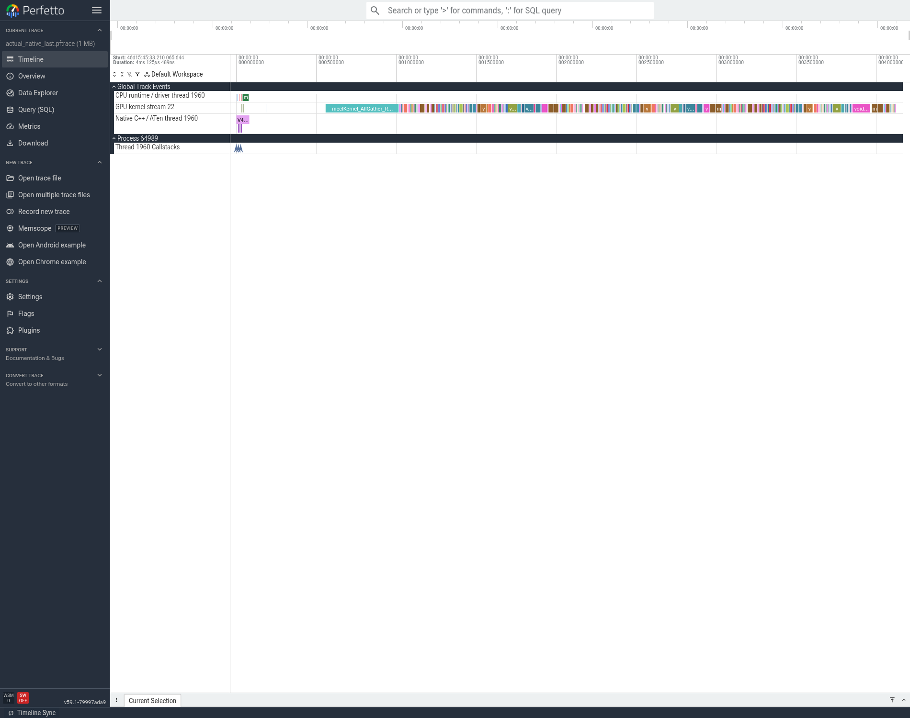

# E49 当前对照：有小收益，等待第二次 ON 与长输入确认

仅通过基础功能检查，未完成模型精度验收。尚未更新累计最佳。

相同ELF 0c3def50…，相同E39算法配置，D仅切换三层完整draft Graph。每组实际256/256、C1、1暖5正式，profiler关闭。

|顺序与配置|TTFT ms|TPOT ms/token|TPOT样本标准差 ms|E2E s|输出token/s|
|---|---:|---:|---:|---:|---:|
|E48控制 OFF|340.431190|28.183333|0.197021|7.527181|34.010076|
|E48反向 OFF，紧邻本候选前|256.243852|27.648372|0.363344|7.306579|35.036918|
|E49 ON|331.441278|26.942488|0.289108|7.201776|35.546788|
|E49反向 OFF|346.313876|28.102810|0.262977|7.512531|34.076401|

ON比紧邻的前OFF快约1.46%，比后OFF快约4.31%；不把最大差值作为唯一收益。控制组之间有时间漂移，所以追加第二次ON确认，并做2048/256单次冒烟和回短；结束后才决定是否晋级。不同阶段不是最终目标所需的同配置三轮复验。

## 从计时与trace解释目前现象

两配置独立诊断均使用正式2请求、每rank31条采样，已按HTTP响应ID排除暖机。rank0的draft区间5.681639→4.530147ms/轮，约下降20.27%；target+head47.000716→46.936303ms/轮，基本不变。一轮所采样总区间54.703999→53.322481ms。它包含跨流等待，不是kernel busy时间；31条采样不是31个独立HTTP请求。

16rank独立trace已验证；D各rank有4个target图和4个draft图，target仍4047个GPU节点，draft图277节点。证明三层draft body确实切成图回放，不能说缓存投影、词表头或Markov也全部入图。target图节点没有变化，与其边界时间基本不变相符。

首轮ON全部12个性能/诊断请求的server记录均实际256/256、accepted130/proposed375；不是通过减少token或更换投机工作量获得收益。原始trace及sidecar与同ELF对应，火焰图ENTRY_COUNT不是时间占比。

## 证据、已知小问题与恢复

首轮ON原始包6,007,565字节，SHA82965a9e510c8142ab2264f3fe8a3da59c73cd69a0ccb47daacc6630faa988a9；反向OFF原始包166,521字节，SHAdf3c54c8846a2a58ecb2be1ab0c75c707f2881690a741cbfa9e76b72671de2f6。NFS runs/profiling目录分别为p49_full_draft_graph_sg438_v1与p49_full_draft_reverse_control_v1，根为/data/nfs_shared/xiaopang/v41_xllm_match_sglang_20261116。

首版准备脚本误把trace输出路径改名当成算法配置差异，断言发生在CPU准备阶段，已修正并保留失败记录；没有启动错误GPU任务。formal identity中继承了旧manifest字符串，已用identity_correction.json明确更正为builds/e48_native_timing_v1/source_manifest.json，原始文件保留；实际ELF SHA、源码和运行配置核验不受影响。

ON与反向OFF各16rank正常exit0，12:04:33与12:12:20分别核验两台显存释放；无SIGKILL、设备reset或驱动修改。下一次ON确认run=p49_full_draft_confirm_on_v1，正在启动，不应重启或重复测试；实际PID/start ticks在总控任务状态中。

读图补充：draft的CPU回放入口很短，GPU异步完成在入口结束之后。初版按CPU区间裁剪的图片保留在E49_draft_body_graph，仅显示提交区间；正文改用E49_draft_body_correlated，通过实际GraphLaunch correlation关联完整GPU节点，不把异步节点裁掉，也不延长原始CPU事件冒充同步执行。
