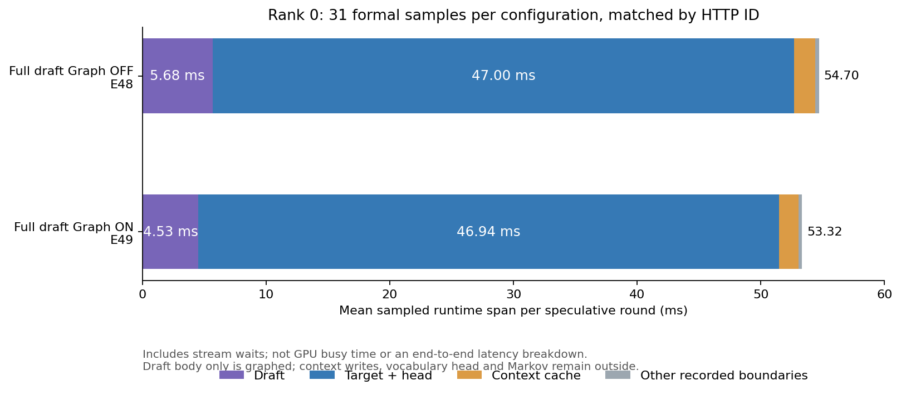
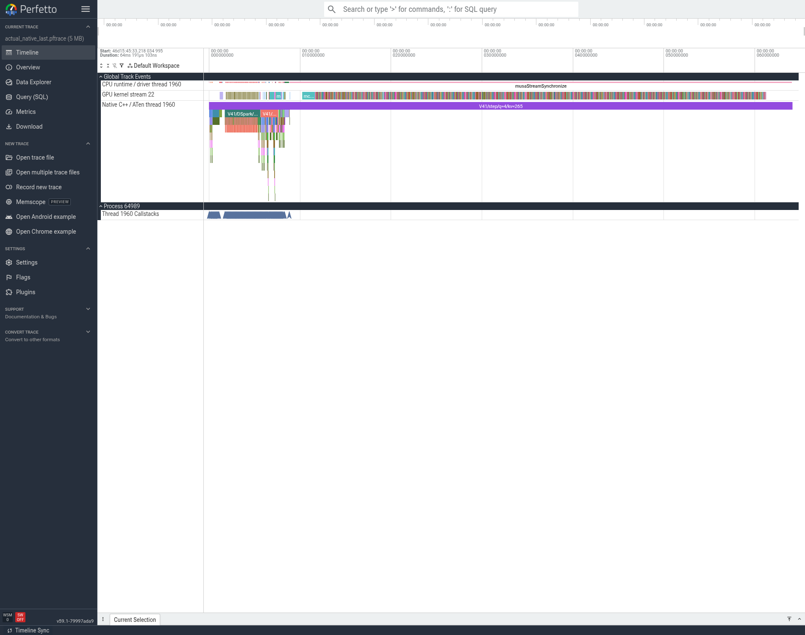
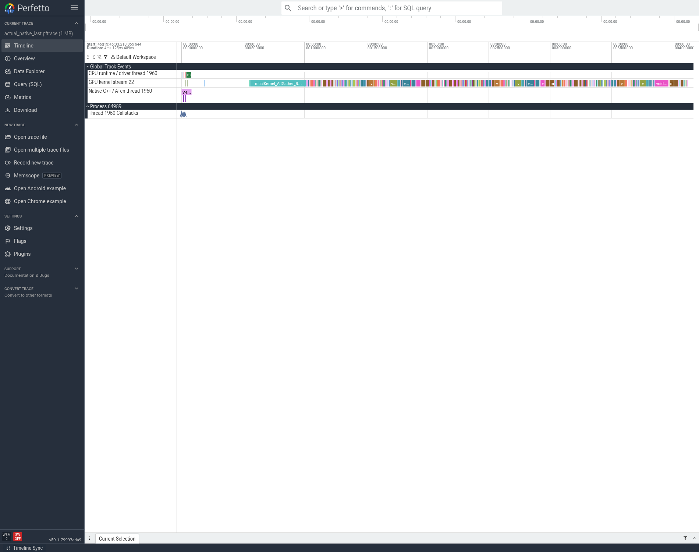

# E49 完整 draft Graph：小幅收益，作为后续累计起点

仅通过基础功能检查，未完成模型精度验收。**本项阶段晋级，最终 goal 未达成。** 当前保守引用第二次 ON：TPOT 27.20856 ms/token、输出 35.17582 token/s、TTFT 339.54254 ms。

## 为什么重试，以及实际改了什么

旧 E14 在旧环境中收益不明确。本次 E48 在当前 SG438 兼容环境、原生通信和 E39 静态激活下，测出 draft 边界约 5.68 ms/轮，提供了新的测试依据。本项仅把 D 的 `XLLM_DSV41_FULL_DRAFT_GRAPH` 从 0 改为 1，复用已实现的三层 draft body 捕获；没有另改模型方程、proposal 数或 target verify 行数。P 端保持原配置。

源码记录为 9046ef0292aa7bff88d2c5bcf248714e278d9ec9，三个配置用相同 ELF `0c3def50fab14e750e61dede83c36c43eb6ecd590b6451153fbd2491b0db1bc1`。构建清单为 NFS `builds/e48_native_timing_v1/source_manifest.json`，采样开关只用于独立诊断，正式测试没有 arm 文件。

## 正式数据和晋级理由

每组同 W4AFP8-mt1017、SJ9/SJ10 各8卡、Attention TP8/专家 EP8、实际256/256、C1；各自1暖机+5正式，profiler关闭。EvalScope1.14.1 原始 SQLite、HTML、工具吞吐和逐请求数据均保留。

|配置|TTFT ms|TPOT ms/token|TPOT 标准差 ms|E2E s|输出 token/s|
|---|---:|---:|---:|---:|---:|
|ON1|331.441278|26.942488|0.289108|7.201776|35.546788|
|OFF_reverse|346.313876|28.102810|0.262977|7.512531|34.076401|
|ON2|339.542536|27.208562|0.189609|7.277726|35.175824|

前置 E48 的紧邻反向 OFF 是27.648372 ms/token、35.036918 token/s；更早 OFF 是28.183333 ms/token、34.010076 token/s。ON1 相对紧邻前OFF输出提高 1.455%，相对后OFF提高 4.315%。ON2 相对后OFF提高 3.226%，相对前面最快OFF只有 0.396%。

两次独立启动的 ON 都优于前后 OFF，变化方向一致；结合 draft 区间下降和实际图回放证据，将其作为小收益累计起点。**不宣称稳定提升4.31%，也不宣称统计显著或已经追平。** 每组只有5次且控制有漂移，后续最终三轮仍须重新完成；本次两次ON不能冒充三轮最终验收。

已从 SQLite 重算15条正式请求的 TPOT 和总token/总latency，全部 success=1、256/256；与rank0服务记录交叉检查，短请求均 accepted130/proposed375，未靠缩短输出或改变工作量取得成绩。详见[逐请求核验](03_性能/三组逐请求与服务端交叉核验.json)。

## 从图和计时看优化发生在哪里

独立事件采样的 rank0 draft 区间5.681639→4.530147 ms/轮，约下降20.27%；target+head47.000716→46.936303 ms/轮，基本不变。采样总边界54.703999→53.322481 ms/轮。这些边界含跨流等待，不是kernel busy时间，也不是HTTP总时延占比；不能用20.27%预测整请求提速。

16rank trace和原生sidecar核验通过。D每rank的target图仍4047节点，完整draft图277节点；相同采集窗口各有4次target和draft回放。三层draft body已入图，但词表头、Markov及其外围缓存操作并非因此全部入图。图节点不等于Python/CPU调用数，不能把少见CPU事件自动解释为少执行模型。

最初按CPU提交区间截取draft图片只看到了很短的窗口，GPU异步节点被裁掉；原图保留并标注，正文采用GraphLaunch correlation关联的完整GPU窗口。没有延长CPU事件来伪造同步执行。正式性能与采集分开，重型trace不能直接用来排全局收益上限。

## 长输入、退出和证据

相同实现完成一次2048/256冒烟，usage核验通过，E2E 54.734742s、首有效内容1.871574s。该请求跨到新的图桶，含首次捕获，**不是暖机后的正式长输入性能**。随后两道题答出4.2/56，256/8回短也成功，未发现本次跨图桶缓存污染。正式2048/256的1暖5仍未做。

三次模型运行每次两台各8个rank均正常exit0；第二ON于12:24核验两台显存释放。无SIGKILL、GPU reset、驱动变更或他人任务操作。

NFS根：`/data/nfs_shared/xiaopang/v41_xllm_match_sglang_20261116`。三个run依次为 `p49_full_draft_graph_sg438_v1`、`p49_full_draft_reverse_control_v1`、`p49_full_draft_confirm_on_v1`；原始trace位于对应profiling目录，小日志和归档SHA在本地三个 `原始证据_*` 目录与 `归档回执_*.json`。ON2证据包SHA为a017caf298cec07c587fe6a318378dc9af14c1ed467c68ba178a8231f25c3158。

首ON formal identity误继承旧manifest路径，已以identity_correction.json保留原文件并明确更正；实际ELF核验正确。另发现累计最佳通用入口仍停留E34，而E39专页/状态已更新。本次把旧入口归档后统一至E49，防止后续从旧起点继续。所有历史结果保留。

## 下一步

先对来自V4的既有SIMT Gate GEMV做真实BF16权重、FP32累加/输出、动态Graph和小行微基准；它与E31负收益的MATE BF16→FP32 GEMM不是同一实现。只有实测支持才进入整模型，始终以E49为当前配置起点。owner/LL、FP8大投影等负收益/前置实现继续保留，不无新证据原样重做。

距离固定门槛，ON2的TPOT仍需降低 20.72%，输出仍需提高 12.15%。最终同实现三轮、正式长输入、同窗口SGLang和收口条件都未完成。
